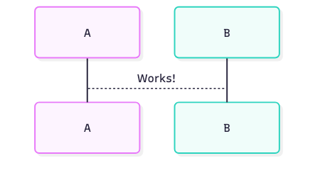

#+TITLE: Org mode demo
#+SUBTITLE: Demo to show how various Org mode blocks are rendered.
#+DATE: <2000-09-25>
#+TYPE: post
#+FILETAGS: :org:
#+DESCRIPTION: A sample post: folding sections, code, images, video, and tables.

This test post shows the blog and Org mode features.

* Code blocks
Source highlighting is done by Emacs at build time (with ~htmlize~). Move the mouse over a block to see the copy button.

#+BEGIN_SRC python :results output :exports both
from pathlib import Path

for post in sorted(Path("posts").glob("*.org")):
    print(post.stem)
#+END_SRC

#+RESULTS:
: 2026-09-25-hello

#+BEGIN_SRC emacs-lisp
(defun blog-hello (name)
  "Return a greeting for NAME."
  (format "Hello, %s!" name))
#+END_SRC

#+BEGIN_SRC shell
make serve
#+END_SRC

Inline code also works: ~make rebuild~.

* Images
Links to local image files are rendered as images on the page.

#+CAPTION: The build pipeline.
[[file:images/pipeline.svg]]

* Video
A =video:= link is rendered as an HTML5 video player. The path can be a local file or a URL.

[[video:https://interactive-examples.mdn.mozilla.net/media/cc0-videos/flower.mp4]]

* A section can be initially folded                                  :folded:
The =:folded:= tag on the heading makes the section folded on page load.
A link to a heading inside this section opens it: [[*Nested section][go to the nested section]].

** Nested section
Nested sections fold too.

* Tables and quotes
| Feature   | Where it is implemented |
|-----------+-------------------------|
| Folding   | =static/blog.js=        |
| Code      | htmlize                 |
| Video     | =publish.el=            |

#+BEGIN_QUOTE
Everything is text, and that is powerful.
#+END_QUOTE

* Config preview (custom)

#+HTML_HEAD_EXTRA: 

The custom popup is implemented in a separate JavaScript file that can be included like this:

#+begin_example
    #+HTML_HEAD_EXTRA: 

    [[file:files/cwl-setup.config][cwl-setup.config, click to preview in popup]]
#+end_example

Here is a live example:
[[file:files/cwl-setup.config][cwl-setup.config, click to preview in popup]]

The file can also be displayed in the HTML =
= tag:

#+begin_details
#+begin_summary
cwl-setup.config ([[file:files/cwl-setup.config][download]])
#+end_summary
#+include: "files/cwl-setup.config" src yaml
#+end_details

* ob-mermaid

Export the ~org-mode~ document or invoke ~org-babel-execute-src-block~
(e.g. with ~C-c C-c~ on a block) to generate the diagram.

#+begin_src mermaid :file test.png
sequenceDiagram
 A-->B: Works!
#+end_src

#+RESULTS:

* HTML Export

The =#+begin_export html= and =#+end_export= lines allow inserting HTML snippets that
will be added to the HTML after org export:

#+begin_example
#+begin_export html

    
close

    
<a href="">Download ()</a>

    

#+end_export
#+end_example
