#+TITLE: DIY Links
#+DATE: <2006-11-06>
#+TYPE: links
#+FILETAGS: :diy:kbd:
#+DESCRIPTION: Do-it-yourself, a collection of links.

Various links from reddit and across the web: DIY stuff, mostly electronics.

* Keyboards and Macropads DIY Links                                  :folded:
** [[https://makeakeyboard.com/][Make a Keyboard]]
Make a Keyboard: A walkthrough for creating a handwired keyboard with a custom layout : [[https://www.reddit.com/r/ErgoMechKeyboards/comments/l3efyc/make_a_keyboard_a_walkthrough_for_creating_a/][ErgoMechKeyboards]]
** Keyboards: Wireless builds                                       :folded:
- [[https://www.reddit.com/r/ErgoMechKeyboards/comments/n34wep/wireless_split_ergo_endgame/][Wireless split ergo endgame]]
- [[https://www.reddit.com/r/ErgoMechKeyboards/comments/mpp2g9/wireless_ferris_sweep_compact/][Wireless Ferris Sweep Compact]]
- [[https://www.reddit.com/r/ErgoMechKeyboards/comments/ml395k/wireless_skeletyl_with_15_degree_tenting/][Wireless Skeletyl with 15 degree tenting]]
- [[https://www.reddit.com/r/ErgoMechKeyboards/comments/mkicij/wireless_tbk_dactyl_manuform_mini/][Wireless TBK Dactyl Manuform Mini]]
- [[https://www.reddit.com/r/ErgoMechKeyboards/comments/m8liih/just_finished_my_first_ever_keyboard_build_a/][Just finished my first ever keyboard build; a wireless Dactyl CC]]
- [[https://www.reddit.com/r/ErgoMechKeyboards/comments/mciql5/wireless_dactyl_cc_build_log/][Wireless Dactyl CC Build Log]]
- Fully Wireless Lily58 Pro : [[https://www.reddit.com/r/MechanicalKeyboards/comments/fzlfy8/fully_wireless_lily58_pro/][MechanicalKeyboards]]
- Wireless Dactyl Manuform Build : [[https://www.reddit.com/r/ErgoMechKeyboards/comments/ktw1b7/wireless_dactyl_manuform_build/][ErgoMechKeyboards]]
- Convert Any USB Keyboard To Bluetooth | [[https://hackaday.com/2016/09/04/convert-any-usb-keyboard-to-bluetooth/][Hackaday]]
- Convert mechanical keyboard to wireless : [[https://www.reddit.com/r/MechanicalKeyboards/comments/7t6dix/convert_mechanical_keyboard_to_wireless/?sort=qa][MechanicalKeyboards]]
  - Adafruit Feather 32u4 Bluefruit LE ID: 2829 - $29.95 : [[https://www.adafruit.com/product/2829][Adafruit Industries, Unique & fun DIY electronics and kits]]
  - Adafruit Micro-Lipo Charger for LiPo/LiIon Batt w/MicroUSB Jack [v1] ID: 1904 - $6.95 : [[https://www.adafruit.com/product/1904][Adafruit Industries, Unique & fun DIY electronics and kits]]
  - [[http://handheldsci.com/kb/][Bluetooth Adapter for Keyboard & Mouse « Handheld Scientific, Inc.]]
- Converting a 30% Keyboard to Bluetooth: Gherkin + BlueMicro = GherkinBLE : [[https://www.reddit.com/r/MechanicalKeyboards/comments/8iwvvt/converting_a_30_keyboard_to_bluetooth_gherkin/][MechanicalKeyboards]]
  - [[https://imgur.com/a/WMYwcu2][Gherkin + BlueMicro = GherkinBLE - Imgur]]
  - Curves - my bluetooth split : [[https://www.reddit.com/r/MechanicalKeyboards/comments/86asf6/curves_my_bluetooth_split/][MechanicalKeyboards]]
  - [[https://gist.github.com/wez/b30683a4dfa329b86b9e0a2811a8c593][Split Bluetooth Keyboard]]
- Poor man's 40% "planck": two wireless keypads [Deltaco TB-125] : [[https://www.reddit.com/r/olkb/comments/kho4do/poor_mans_40_planck_two_wireless_keypads_deltaco/][olkb]]
- Just realised that r/ErgoMechKeyboards is more apropriate for this post!: [[https://www.reddit.com/r/ErgoMechKeyboards/comments/kjhom0/just_realised_that_rergomechkeyboards_is_more/][ErgoMechKeyboards]]
- [[https://www.youtube.com/watch?v=CpmQc1aTDpA][Bluetooth Corne Split Keyboard and BlueMicro840 Build Notes - YouTube]]
- Bluetooth mini corne : [[https://www.reddit.com/r/ErgoMechKeyboards/comments/f5r3ux/bluetooth_mini_corne/][ErgoMechKeyboards]]
  - Planck + Bluetooth: is it possible easily? : [[https://www.reddit.com/r/olkb/comments/bi500v/planck_bluetooth_is_it_possible_easily/][olkb]]
    - Little adapter from Handheld Scientific, inc. it's powered by the 6700 mah power bank.
- Minidox + BlueMicro = Smallest split wireless keyboard? : [[https://www.reddit.com/r/MechanicalKeyboards/comments/8rh2pc/minidox_bluemicro_smallest_split_wireless_keyboard/][MechanicalKeyboards]]
- Mini Corne with Bluetooth mobile kit : [[https://www.reddit.com/r/MechanicalKeyboards/comments/f9tit7/mini_corne_with_bluetooth_mobile_kit/][MechanicalKeyboards]]
- Kyria bluetooth : [[https://www.reddit.com/r/ErgoMechKeyboards/comments/j0tpnz/kyria_bluetooth/][ErgoMechKeyboards]]
- ErgoTravel + 2 BlueMicro = Wireless Split Keyboard : [[https://old.reddit.com/r/MechanicalKeyboards/comments/8i2twe/ergotravel_2_bluemicro_wireless_split_keyboard/][MechanicalKeyboards]]
- How come there are no fully-wireless split keyboards? : [[https://www.reddit.com/r/ErgoMechKeyboards/comments/gquhr0/how_come_there_are_no_fullywireless_split/?sort=qa][ErgoMechKeyboards]]
- When is "To Many BLE keyboards" too many? : [[https://www.reddit.com/r/MechanicalKeyboards/comments/hbovsi/when_is_to_many_ble_keyboards_too_many/][MechanicalKeyboards]]
- [[https://www.ivanyu.ca/blog/2014/2/2/wireless-das-keyboard-modification][Wireless Das Keyboard Modification - Build log — ivanyu]]
- Is it possible to design pcb for a wireless split keyboard like the Asterisk? Do they use touch sensor for the keys? : [[https://www.reddit.com/r/ErgoMechKeyboards/comments/1ng3mvw/is_it_possible_to_design_pcb_for_a_wireless_split/][r/ErgoMechKeyboards]]
  - The Asterisk: [[https://www.kickstarter.com/projects/stenokeyboards/the-asterisk-steno-keyboard-for-beginners][Steno Keyboard For Beginners by StenoKeyboards — Kickstarter]]
** Keyboards: Prototyping                                           :folded:
- Is it odd to make modern tools with old tools? Making a BFO-9000 with handtools.: [[https://www.reddit.com/r/olkb/comments/lvwznf/is_it_odd_to_make_modern_tools_with_old_tools/][olkb]]
- [[https://falstad.com/circuit/][Circuit Simulator Applet]]
  - [[https://falstad.com/circuit/circuitjs.html?ctz=CQAgjCAMB0l3BWcMBMcUHYMGZIA4UA2ATmIxAUgpABZsAoAJRAFowwVWxCuPXCaUITSo1onKpOgJ6AcxB4q3BVQFDITVpk7KW21tgnCqSSVGn0Azlow6ebYnaEQAZgEMANpYCm9AE5cjuD2YEGKzvAaYHgQLGrK4cpU2GAI0Nh4eDQceAjcGKTISmjmgjA09C6BnCyGXDSCtZzY2ODS5pAo9ADuvDW6YA1cPBoAJtXB-ILKnKPe7gCuHgAuchPhDjooeOo99Y00O2xDLOEavceNG2qnkntxV1QPk+cTTRNJ9EA][Example]]
- [[https://www.diykeyboards.com/parts/product/amoeba-single-switch-pcbs][Amoeba Single-Switch PCBs - DIY Keyboards]]
  - [[https://deskthority.net/viewtopic.php?f=7&t=11420&start=][Another single-switch circuit board - deskthority]]
  - mtl/keyboard-pcbs: [[https://github.com/mtl/keyboard-pcbs][Keyboard PCBs]]
- cardboard prototype of a simple oppositional keyboard : [[https://www.reddit.com/r/ErgoMechKeyboards/comments/kh88km/cardboard_prototype_of_a_simple_oppositional/][ErgoMechKeyboards]]
- Custom column stagger experimenting : [[https://www.reddit.com/r/ErgoMechKeyboards/comments/kgto7r/custom_column_stagger_experimenting/][ErgoMechKeyboards]]
** Keyboards: DIY Guides and articles                               :folded:
- [[https://www.reddit.com/r/ErgoMechKeyboards/s/ImhZbkMKvJ][Reddit]] where do I start if I want to build keyboards
- Designing Dactyl Manuforms (fusion 360 tutorial) : [[https://www.reddit.com/r/MechanicalKeyboards/comments/mytk54/designing_dactyl_manuforms_fusion_360_tutorial/][MechanicalKeyboards]]
- [[https://github.com/ruiqimao/keyboard-pcb-guide/blob/master/README.md][keyboard-pcb-guide/README.md]] at master · ruiqimao/keyboard-pcb-guide
- How to make a keyboard – the matrix | [[https://komar.blog/posts/how-to-make-a-keyboard-the-matrix/][komar's techblog]]
- [[https://www.dribin.org/dave/keyboard/one_html/][Keyboard Matrix Help]]
- Introducing Dactyl Chimera, a 3D keyboard test bench. : [[https://www.reddit.com/r/ErgoMechKeyboards/comments/q7jqlh/introducing_dactyl_chimera_a_3d_keyboard_test/][ErgoMechKeyboards]]
  - WolfIcefang/dactyl-chimera-keyboard: [[https://github.com/WolfIcefang/dactyl-chimera-keyboard/][A mechanical keyboard designed for 3D printing, tinkering, and experimentation.]]
- Posts | [[http://mark-story.com/posts/view/building-a-split-keyboard-part-1][Mark Story]]
- BYO (from kickstarter)
  - [[https://www.youtube.com/watch?v=c2Xr0iZCU7Y&feature=youtu.be][BYO Keyboard Setup Timelapse - YouTube]]
  - [[https://github.com/painlessprototyping][Painless Prototyping]]
  - [[https://www.youtube.com/watch?v=CsCY9unwY9w&feature=youtu.be][Button Board Arduino Hello World - YouTube]]
  - [[https://www.youtube.com/watch?v=B64QmeoK1-o&feature=youtu.be][Button Board V2.1 Setup - YouTube]]
  - [[https://www.instagram.com/travis_the_maker/][Travis Bumgarner (@travis_the_maker) • Instagram photos and videos]]
- 40% Keyboards: [[https://www.40percent.club/p/socketing-pro-micro.html][Socketing a Pro Micro]]
- [[https://imgur.com/a/P5g8rKu][Corne V3 Build Log - Imgur]]
- [[https://web.archive.org/web/20190722165039/https://github.com/foostan/crkbd/blob/master/corne-classic/doc/buildguide_en.md][crkbd/buildguide_en.md]] at master · foostan/crkbd
- [[https://web.archive.org/web/20210725091025/https://boardsource.xyz/help/5ee88cf909fed07af0b23c1d][3x4 Macro Build Guide - Boardsource]]
- [[https://github.com/jpconstantineau/ErgoTravel/blob/master/BuildInstructions.md][ErgoTravel/BuildInstructions.md]] at master · jpconstantineau/ErgoTravel
- [[https://github.com/MythosMann/tg4x/blob/master/buildguide.md][tg4x/buildguide.md]] at master · MythosMann/tg4x
- [[https://github.com/kata0510/Lily58/blob/master/Pro/Doc/buildguide_en.md][Lily58/buildguide_en.md]] at master · kata0510/Lily58
- [[https://imgur.com/gallery/fGa13nZ][Hand-wired mechanical keyboard build - 65% layout plus left keypad, walnut and aluminium case - Imgur]]
- [[https://mkbd.ru/post/make-own-custom-keyboard/][Создание собственной клавиатуры ⌨ DIY - Механические клавиатуры]]
- [[https://josef-adamcik.cz/electronics/squid-badge-my-first-pcb-design.html][Squid badge - my first PCB design – Josef Adamčík]]
  - ESP8266 based room-conditions monitor, part 2: [[https://josef-adamcik.cz/electronics/esp8266-based-room-conditions-monitor-part-2.html][PCB – Josef Adamčík]]
- [[https://awesomeopensource.com/project/diimdeep/awesome-split-keyboards][Awesome Split Keyboards (there is a "build your keyboard" section)]]
- First Ergo: Build or Buy? : [[https://www.reddit.com/r/MechanicalKeyboards/comments/csfvcq/first_ergo_build_or_buy/exehw9s/][MechanicalKeyboards]]
  - The ErgoDox was the first very successful open-source keyboard design back in 2012/2013 (EZ is a vendor that makes it in a factory), but the layout wasn't designed properly and suffers from several issues: the thumb clusters are too far out, and there isn't enough column offset to account for much shorter little fingers.
    - Now that 3D printing is easier and more common, it's possible to make your own contoured keyboard: Dactyl, Katy K80CS or Manuform.
    - adereth/dactyl-keyboard: [[https://github.com/adereth/dactyl-keyboard][Parameterized ergonomic keyboard]]
      - [[https://web.archive.org/web/20190723064626/https://ohkeycaps.com/products/built-to-order-dactyl-manuform-keyboard][Built-to-order Dactyl/Manuform Keyboard – Oh, Keycaps!]]
- [[https://deskthority.net/viewtopic.php?f=7&t=2534&start=][My DIY keyboard collection ( or how I became a KB-geek...) - deskthority]]
- [[https://docs.splitkb.com/frequently-asked-questions/about-split-keyboards/functionality/encoders][How can I use a rotary encoder? – splitkb.com]]
  - [[https://www.robotshop.com/community/forum/t/rotary-encoders-basics/64023][Rotary Encoders Basics - Let's Make Robots / Tutorials - RobotShop Community]]
- Corne 1.5u or 1u? : [[https://www.reddit.com/r/ErgoMechKeyboards/comments/jpqfqv/corne_15u_or_1u/][ErgoMechKeyboards]]
** Keyboards: hand-wiring                                           :folded:
- How to Build a Handwired Keyboard : [[https://www.reddit.com/r/arduino/comments/xm51zc/how_to_build_a_handwired_keyboard/][r/arduino]]
- Ribbon cable - only one MCU for two halves: Scorne - lets split corne with ribbon cable : [[https://www.reddit.com/r/ErgoMechKeyboards/comments/mxtki2/scorne_lets_split_corne_with_ribbon_cable/][ErgoMechKeyboards]]
- [[https://www.reddit.com/r/MechanicalKeyboards/comments/n37y31/diy_3d_printed_macropad_handwired_no_soldering/][DIY 3D printed macropad, handwired & no soldering because of 3D printed hotswap plates with video [guide], for faster custom keyboard prototyping (supports MX switches and choc switches)]]
- [[https://www.reddit.com/r/ErgoMechKeyboards/comments/mj23ar/question_about_split_keyboard_interconnect_ports/][Question about split keyboard interconnect ports]]
- RIP [[http://kbfirmware.com][kbfirmware.com]] (9 January 2017 - 13 March 2021): [[https://www.reddit.com/r/olkb/comments/m4rng6/rip_kbfirmwarecom_9_january_2017_13_march_2021/][olkb]]
- Progress on my dactyl, one half done, other half almost there. Turns out all my pro micros had headers and wont fit in the case :-O : [[https://www.reddit.com/r/ErgoMechKeyboards/comments/kydf7v/progress_on_my_dactyl_one_half_done_other_half/][ErgoMechKeyboards]]
- handwired reviung31 :) : [[https://www.reddit.com/r/olkb/comments/kvz3ru/handwired_reviung31/][olkb]]
- [[https://www.youtube.com/watch?v=zY2k75eWrLQ][Hand Wired Keyboard, Atreus DIY Build - YouTube]]
  - Learn more about the Atreus here:
  - https://web.archive.org/web/20160124085736/https://github.com/technomancy/atreus
  - https://atreus.technomancy.us/
  - Laser cutting done by: https://www.ponoko.com/
  - Case screws (20 mm): https://www.amazon.com/dp/B06XVSPWBW
  - Micro controller: https://www.amazon.com/dp/B01MTU9GOB
  - 18 awg Silicone Wire https://www.amazon.com/dp/B07G744V5Z
  - Diodes
  - Gateron Green Switches
  - Keycaps: https://www.amazon.com/dp/B07Q6ZC52C
- Seems easier than I thought, though my wire stripper decided to stop working :( : [[https://www.reddit.com/r/ErgoMechKeyboards/comments/ktkdoh/seems_easier_than_i_thought_though_my_wire/][ErgoMechKeyboards]]
- An attempt at neater wiring (yes I have new wire strippers now) : [[https://www.reddit.com/r/ErgoMechKeyboards/comments/kuvzl8/an_attempt_at_neater_wiring_yes_i_have_new_wire/][ErgoMechKeyboards]]
** Keyboards: Hardware and Parts                                    :folded:
- riskable/keycap_playground: [[https://github.com/riskable/keycap_playground][The Keycap Playground is a parametric OpenSCAD keycap generator made for generating keycaps of all shapes and sizes (and profiles)]]
- A modern handwiring guide - stronger, cleaner, easier
  - [[https://geekhack.org/index.php?topic=87689.0][https://geekhack.org/index.php?topic=87689.0]]
- Hand wiring a let's split | [[https://johannes-jansson.github.io/projects/2018/07/23/hand-wiring-lets-split.html][Janzon's projects]]
- [[https://www.reddit.com/r/ErgoMechKeyboards/comments/o8iqf7/mill_max_sockets_0305_vs_7305_vs_holtite/][Mill Max sockets 0305 vs 7305 vs Holtite]]
- Adafruit SHARP Memory Display Breakout - 1.3 168x144 Monochrome : ID 3502 : $24.95 : [[https://www.adafruit.com/product/3502][Adafruit Industries, Unique & fun DIY electronics and kits]]
- Proper Charging | Li-Ion & LiPoly Batteries | [[https://learn.adafruit.com/li-ion-and-lipoly-batteries/proper-charging][Adafruit Learning System]]
  - Voltages | Li-Ion & LiPoly Batteries | [[https://learn.adafruit.com/li-ion-and-lipoly-batteries/voltages][Adafruit Learning System]]
- [[https://web.archive.org/web/20190821144036/https://spacecat.design/products/pro-micro-dip-adapter-24pin][Pro Micro Hot-Swap Adapter – SpaceCat Design]]
- Amazon.com: 180 Pcs M2 Nylon Hex Nuts Screws Spacers Standoff Plastic Accessories Assortment Kit,Black: [[https://www.amazon.com/Spacers-Standoff-Plastic-Accessories-Assortment/dp/B073XYMQ9L][Home Improvement]]
- [[https://www.sprintek.com/en/products/pointing_stick/SK8702.aspx][SK8702 FlexPoint™ PS/2 Pointing Stick Mouse Module |Sprintek]]
- stingray127/handwirehotswap: [[https://github.com/stingray127/handwirehotswap][A 3D printed, Solderless Hot Swap Socket to build keyswitch matrixes]]
  - Handwire Hot Swap Socket update! : [[https://www.reddit.com/r/MechanicalKeyboards/comments/mdup21/handwire_hot_swap_socket_update/][MechanicalKeyboards]]
- Rubber bumpers 3M Bumpon pack (96)
  - SJ5302-BLISTERPACK 3M | Hardware, Fasteners, Accessories | [[https://www.digikey.com/en/products/detail/3m/SJ5302-BLISTERPACK/7243455][DigiKey]]
- Standoffs & screws - M2.5 Kit
  - 3299 Adafruit Industries LLC | Kits | [[https://www.digikey.com/en/products/detail/adafruit-industries-llc/3299/6596885][DigiKey]]
- Wire Wrap 30 AWG Solid Core
  - R30W-0100 Jonard Tools | Cables, Wires | DigiKey
      - [[https://www.digikey.com/en/products/detail/R30W-0100/K397-ND/221682][https://www.digikey.com/en/products/detail/R30W-0100/K397-ND/221682]]
*** RGB LEDs                                                       :folded:
  - Guide for WS2812B Addressable RGB LED Strip with Arduino | [[https://randomnerdtutorials.com/guide-for-ws2812b-addressable-rgb-led-strip-with-arduino/][Random Nerd Tutorials]]
  - Intro to LED Strips : [[https://www.instructables.com/Intro-to-LED-Strips/][9 Steps (with Pictures) - Instructables]]
  - [[https://www.aliexpress.com/item/32682015405.html?spm=a2g0s.9042311.0.0.8c534c4dk5TgYi][1m 2m 3m 4m 5m WS2812B WS2812 Led Strip,Individually Addressable Smart RGB Led Strip,Black/White PCB Waterproof IP30/65/67 DC5V|smart rgb led strip|ws2812 led stripled strip - AliExpress]]
  - [[https://www.diykeyboards.com/projects/add-underglow-to-qmk-boards][Add RGB Underglow to QMK Keyboards - DIY Keyboards]]
  - Light_WS2812 library V2.0 – Part I: [[https://cpldcpu.com/2014/01/14/light_ws2812-library-v2-0-part-i-understanding-the-ws2812/][Understanding the WS2812 – Tim's Blog]]
  - Only first 8 LEDs work? The LED strip is SK6812 individually addressable rgbw. I'm reading 5v throughout the strip and using an arc psu for power. Idk what the hell I'm doing : [[https://www.reddit.com/r/led/comments/flzyzm/only_first_8_leds_work_the_led_strip_is_sk6812/][led]]
  - Just two RGB on total. Why???? : [[https://www.reddit.com/r/crkbd/comments/kcz3yq/just_two_rgb_on_total_why/][crkbd]]
  - Arduino compatible coding 08: [[https://www.engineersgarage.com/microcontroller-projects/articles-arduino-rgb-led-driver-analogwrite-pwm/][Interfacing an RGB LED using Arduino]]
- Debugging RGB LEDs
  - Questions on per-key RGB lightning : olkb
    - [[https://www.reddit.com/r/olkb/comments/gqusjg/questions_on_perkey_rgb_lightning/][reddit]]
    - https://imgur.com/a/OivUo0O
    - How to debug and fix LEDs
  - How To Test Diodes With A Digital Multimeter | [[https://www.fluke.com/en-us/learn/blog/digital-multimeters/how-to-test-diodes][Fluke]]
*** Cables                                                         :folded:
  - Zap Cables | [[https://web.archive.org/web/20170625081559/https://zapcables.com/][Custom USB Cables for Work and Battle Stations]]
  - [[https://www.aliexpress.com/item/32459681560.html][1m 4 pole Stero audio cable Car AUX MP3/MP4 3.5mm male to male|mp3 extension cable|cable obdcable mp3 usb - AliExpress]]
  - DIY custom cable: [[https://golem.hu/guide/custom-cable][GOLEM (many more articles on different aspects of building a keyboard)]]
  - Amazon.com: Coiled Stereo Audio Cable, Haokiang 90 Degree 3.5mm 4 Pole TRRS Male to Female Spring Aux Extension Cable for Home/Car Stereo,Phone,Headset and More(M/F TRRS): [[https://www.amazon.com/Coiled-Stereo-Haokiang-Extension-Headset/dp/B07FGVXLJX][Industrial & Scientific]]
*** Switches                                                       :folded:
  - 3D Printed Maglev Switches Are So Hot Right Now | [[https://hackaday.com/2022/02/08/3d-printed-maglev-switches-are-so-hot-right-now/][Hackaday]]
    - DIY mechanical keyboard switch lets you set its actuation point | [[https://arstechnica.com/gadgets/2022/02/diy-mechanical-keyboard-switch-lets-you-set-its-actuation-point/][Ars Technica]]
    - [[https://github.com/famichu/MagLev_Switch_MX][famichu/MagLev_Switch_MX]]
  - Favorite Switch (Part 2) : [[https://www.reddit.com/r/ErgoMechKeyboards/comments/l8uu4c/favorite_switch_part_2/][ErgoMechKeyboards]]
    - [[https://github.com/keyboardio/keyswitch_documentation][Keyswitch Datasheets]]
  - Boba U4 switches. Aliexpress keycaps and almost all the other parts
    - [[https://web.archive.org/web/20210104204331/https://mkultra.click/products/gazzew-boba-silent-tactile-u4-switches?variant=37666892906693][Boba Silent Tactile U4 Switches – MKUltra Corporation]]
    - [[https://splitkb.com/products/gazzew-boba-u4-silent-tactile-switch?variant=33166237335629][Gazzew Boba U4 Silent Tactile Switch – splitkb.com]]
    - [[https://www.theremingoat.com/blog/boba-u4-switch-review][Gazzew's Boba U4 Switch Review — ThereminGoat's Switches]]
  - kailh choc v2
    - compatible with MX keycaps
    - the Kailh choc footprint is different from the MX switches footprint. And the V2 footprint is different from V1 — the center hole is bigger, and there are no side holes, plus there is a third leg for stability
    - [[https://www.kailhswitch.com/mechanical-keyboard-switches/key-switches/kailh-low-profile-switch-choc-v2.html][China Kailh Low Profile Switch Choc V2 Factory, Manufacturers and Suppliers - Kaihua Electronics]]
    - [[https://www.kailhswitch.com/mechanical-keyboard-switches/low-profile-key-switches/burnt-orange-switch.html][V1 - Choc Low Profile Switches]]
    - [[https://web.archive.org/web/20190125131722/https://www.cherrymx.de/en/mx-low-profile/mx-low-profile-red.html][Cherry - MX LOW PROFILE RED - MX LOW PROFILE - CherryMX]]
    - New Kailh Choc V2 Switches - Learning and discussion / Key switches - KeebTalk
        + [[https://www.keebtalk.com/t/new-kailh-choc-v2-switches/8349/15][https://www.keebtalk.com/t/new-kailh-choc-v2-switches/8349/15]]
    - New Kailh CHOC V2 : MechanicalKeyboards:[[https://www.reddit.com/r/MechanicalKeyboards/comments/fcprnu/new_kailh_choc_v2/][reddit]]
  - [[https://zealpc.net/products/zilent][Zilent™ V2 Switches (Silent Tactile) - Zeal Generation Inc.]]
  - (discussion, kailh choc with 12g springs)
    - [[https://www.reddit.com/r/ErgoMechKeyboards/comments/k8xuwu/microdox_with_gchoc_light_blues_20g_springs/gf2254f/][https://www.reddit.com/r/ErgoMechKeyboards/comments/k8xuwu/microdox_with_gchoc_light_blues_20g_springs/gf2254f/]]
  - [[https://www.nizkeyboard.com/products/2019-new-niz-ec-switch][2019 NEW NIZ EC switch – NIZ Store]]
    - [[https://www.google.com/search?q=Niz%20EC%20switchs&ie=utf-8&oe=utf-8&client=firefox-b-m][Niz EC switchs - Google Search]]
    - [[https://www.youtube.com/watch?v=-1vwM_PBqck][Niz Atom66 Electro-Capacitive Keyboard - Unboxing & Review - YouTube]]
  - [[http://www.kailh.com/en/Products/Ks/CS/][Home - Products - Keyboard switch - Choc Switch-Dongguan Kaihua Electronics Co., Ltd]]
*** Sockets                                                        :folded:
  - [[https://github.com/joric/nrfmicro/wiki/Sockets][Sockets · joric/nrfmicro Wiki]]
  - 40% Keyboards: [[https://www.40percent.club/2018/03/sockets.html][Sockets]]
  - 40% Keyboards: [[https://www.40percent.club/p/socketing-pro-micro.html][Socketing a Pro Micro]]
  - Digi-key hot-swap sockets, pins and controller sockets
    - Mill-max hot-swap sockets (125 pcs)
      - 7305-0-15-15-47-27-10-0 Mill-Max Manufacturing Corp. | Connectors, Interconnects | [[https://www.digikey.com/en/products/detail/mill-max-manufacturing-corp/7305-0-15-15-47-27-10-0/1765737][DigiKey]]
        - for Kyria hotswap
    - Pins (long, 50 pcs)
      - 3320-1-00-15-00-00-03-0 Mill-Max Manufacturing Corp. | Connectors, Interconnects | [[https://www.digikey.com/en/products/detail/mill-max-manufacturing-corp/3320-1-00-15-00-00-03-0/4147393][DigiKey]]
        - 0.020" (0.51mm) Dia
        - 0.500" (12.70mm) Length
    - Short pins, like in microdox (this is enough to socket a controller, no need to cut, long pins are useful to make two sided socketed controller)
      - 3320-0-00-15-00-00-03-0 Mill-Max Manufacturing Corp. | Connectors, Interconnects | [[https://www.digikey.com/en/products/detail/mill-max-manufacturing-corp/3320-0-00-15-00-00-03-0/4147392][DigiKey]]
        - 0.020" (0.51mm) Dia
        - 0.250" (6.35mm) Length
    - Controller & OLED Sockets - 315-43-164-41-003000 Mill-Max Manufacturing Corp. | Connectors, Interconnects | [[https://www.digikey.com/en/products/detail/mill-max-manufacturing-corp/315-43-164-41-003000/1212143][DigiKey]]
    - OLED Male-Male Sockets - 350-10-164-00-006000 Mill-Max Manufacturing Corp. | Connectors, Interconnects | [[https://www.digikey.com/en/products/detail/mill-max-manufacturing-corp/350-10-164-00-006000/357045][DigiKey]]
    - Controller sockets
      - 115-93-624-41-003000 Mill-Max Manufacturing Corp. | Connectors, Interconnects | [[https://www.digikey.com/en/products/detail/mill-max-manufacturing-corp/115-93-624-41-003000/81896][DigiKey]]
        - short and thick legs, can be used to install pins into pro-micro like boards, but not to solder the controller into this socket (it will not fit the sockets on the board)
      - 110-43-624-41-001000 Mill-Max Manufacturing Corp. | Connectors, Interconnects | [[https://www.digikey.com/en/products/detail/mill-max-manufacturing-corp/110-43-624-41-001000/947049][DigiKey]]
        - first thick, then thin legs - can be used to solder the controller into it and then insert it into the board
        - it has a middle section though, the controller board may not fit it
      - ED24DT On Shore Technology Inc. | Connectors, Interconnects | [[https://www.digikey.com/en/products/detail/on-shore-technology-inc/ED24DT/4147601][DigiKey]]
  - Mill-Max hotswap sockets
    - Mill-Max sockets
      - Mill-Max Socket Guide (pxlnght) : [[https://www.reddit.com/r/MechanicalKeyboards/comments/cbykxw/millmax_socket_guide_pxlnght/][MechanicalKeyboards]]
        - mill-max connectors
      - [[https://geekhack.org/index.php?topic=106330.0][Mill-Max sockets compatibility questions.]]
      - sellers
        - Mill-Max Distributor | [[https://www.mouser.co.uk/manufacturer/mill-max/][Mouser United Kingdom]]
        - Mill Max - Computer Board Connectors | DIP, IC Sockets | [[https://uk.farnell.com/b/mill-max][Farnell UK]]
        - [[https://www.arrow.com/en/manufacturers/mill-max/connectors/wire-and-pcb-connectors/connector-headers-and-pcb-receptacles][Mill-Max Connector Headers and PCB Receptacles | Arrow.com]]
        - [[https://www.futureelectronics.com/][Future Electronics]]
        - Amazon.com : [[https://www.amazon.com/s?k=%22mill-max%22&page=2&qid=1607237300&ref=is_pn_1]["mill-max"]]
          - [[https://www.amazon.com/310-47-120-41-001000-Component-Socket-Contacts-Beryllium/dp/B088YP1ZYB/ref=mp_s_a_1_29_sspa?dchild=1&keywords=%22mill-max%22&qid=1607237329&sr=8-29-spons&psc=1&spLa=ZW5jcnlwdGVkUXVhbGlmaWVyPUEzNEZZWTZHN0U3REgxJmVuY3J5cHRlZElkPUEwMzU2MzM1Q1c5R1lUOUM3SE04JmVuY3J5cHRlZEFkSWQ9QTAzNDU2MDkzQVJKS0FLT0NTMjZLJndpZGdldE5hbWU9c3BfcGhvbmVfc2VhcmNoX2F0Zl9uZXh0JmFjdGlvbj1jbGlja1JlZGlyZWN0JmRvTm90TG9nQ2xpY2s9dHJ1ZQ==][310-47-120-41-001000 - IC & Component Socket, 20 Contacts, SIP Socket, 2.54 mm, 310 Series, Beryllium Copper (310-47-120-41-001000) (Pack of 20) Amazon.com]]
          - Mill Max 0284-0-15-01-16-01-10-0 PCB Pin Receptacle for .022-.034 pins, tin/lead over nickel plating (package of 100): Amazon.com: [[https://www.amazon.com/0284-0-15-01-16-01-10-0-Receptacle-022-034-plating-package/dp/B00QMTHF4C/ref=mp_s_a_1_6?dchild=1&keywords=mill-max&qid=1607237230&sr=8-6][Industrial & Scientific]]
    - These Mill-Max hotswap sockets are so good : MechanicalKeyboards
      + [[https://www.reddit.com/r/MechanicalKeyboards/comments/8tuell/these_millmax_hotswap_sockets_are_so_good/][https://www.reddit.com/r/MechanicalKeyboards/comments/8tuell/these_millmax_hotswap_sockets_are_so_good/]]
    - 7305-0-15-15-47-27-10-0 Mill-Max | Mouser Germany
      + [[https://www.mouser.de/productdetail/mill-max/7305-0-15-15-47-27-10-0?qs=sGAEpiMZZMtzcnMBgC2bs4r8MywUouWab4lhjKyTlYM=][https://www.mouser.de/productdetail/mill-max/7305-0-15-15-47-27-10-0?qs=sGAEpiMZZMtzcnMBgC2bs4r8MywUouWab4lhjKyTlYM=]]
    - 7305-0-15-15-47-27-10-0 Mill-Max Manufacturing Corp. | Connectors, Interconnects | [[https://www.digikey.com/en/products/detail/mill-max-manufacturing-corp/7305-0-15-15-47-27-10-0/1765737?s=N4IgTCBcDaIAQHYDMAGArAWhRgjJvGALAhmCTtiiALoC%2BQA][DigiKey]]
    - [[https://www.rcscomponents.kiev.ua/product/7305-0-15-15-47-27-10-0.html][7305-0-15-15-47-27-10-0 - РАДИОМАГ РКС КОМПОНЕНТЫ]]
    - [[https://splitkb.com/products/mill-max-hot-swap-sockets][Mill-Max Hot Swap Sockets – splitkb.com]]
      - These sockets are Mill-Max' type 7305.
      - A single packet contains 110 sockets, enough to outfit all switch positions on a Kyria with two sockets left.
        - 2 per key, 50 keys - probably 110 is to cover additional places for 1u / 2u keys
    - They also mentioned 0305 sockets, but 7305 seem to be better
      - 0305-2-15-80-47-80-10-0 Mill-Max | Mouser Europe
          + [[https://eu.mouser.com/ProductDetail/mill-max/0305-2-15-80-47-80-10-0/?qs=QtQX4uD3c2Uys0ai6Tr8NQ%3D%3D&countrycode=US&currencycode=USD][https://eu.mouser.com/ProductDetail/mill-max/0305-2-15-80-47-80-10-0/]]
      - 0305-2-15-80-47-80-10-0 Mill-Max Manufacturing Corp. | Connectors, Interconnects | [[https://www.digikey.com/en/products/detail/mill-max-manufacturing-corp/0305-2-15-80-47-80-10-0/2639493?s=N4IgTCBcDaIAQAYDMCCsBaM6CMGAcC6ALAOzoE6EJwgC6AvkA][DigiKey]]
    - [[https://www.rcscomponents.kiev.ua/mill-max][Продукция производителя mill-max]]
    - PCB Sockets and Micro Plugs | [[https://web.archive.org/web/20230325054111/https://www.mill-max.com/products/new/pcb-sockets-and-micro-plugs][Mill-Max Mfg. Corp.]]
    - Mill-max hot swap connectors durability : [[https://www.reddit.com/r/MechanicalKeyboards/comments/9puu7n/millmax_hot_swap_connectors_durability/][MechanicalKeyboards]]
      - Along with cost, as mentioned by others, here are a few other considerations when choosing these sockets:
      - You will most likely want to buy more than what you need. The probability of messing up a couple during installation is high, unless you're quite skilled with your soldering techniques. I messed up about 8 sockets by getting solder in them (which is near impossible to get out) during installation.
      - As mentioned, since you have to solder these in place (unlike Holtites) the process can be a bit protracted due to having to re-flow solder to seat the sockets properly once initially soldered in. Not to mention having to install the sockets initially on switches in the first place. TL;DR- it's something of an ordeal to fully install these as there are quite a few steps.
      - One of the biggest drawbacks is that not all switch legs will fit/work with these. Kailh switches in particular use a wider leg and they don't always fit into the sockets. You can try to get around this by crimping/squishing the legs into a smaller diameter, but it's not the most pleasant of workarounds.
      - Note that these sockets do not sit flush with the PCB, they have a small lip, that, for the most part is not an issue, but just be aware of it. From my experience, I would recommend using PCB-mount (5 leg) switches with these sockets for the added stability.
    - Important thing is to fix-solder them while on the switch. And only then pull out the switch and finish the soldering. Otherwise when soldering them directly there is quite a big risk that they won't be positioned correctly.
      - Mill Max hot swap sockets : MechanicalKeyboards
        + [[https://www.reddit.com/r/MechanicalKeyboards/comments/dou8d1/mill_max_hot_swap_sockets/][https://www.reddit.com/r/MechanicalKeyboards/comments/dou8d1/mill_max_hot_swap_sockets/]]
  - Has anyone here used dupont connectors for your pro micro or elite-c controller? : [[https://www.reddit.com/r/ErgoMechKeyboards/comments/srpn31/has_anyone_here_used_dupont_connectors_for_your/][ErgoMechKeyboards]]
  - Pro micro mill max socket advantage : [[https://www.reddit.com/r/ErgoMechKeyboards/comments/qie292/pro_micro_mill_max_socket_advantage/][ErgoMechKeyboards]]
*** Keycaps                                                        :folded:
  - 3D printed keycaps: [[https://www.reddit.com/r/ErgoMechKeyboards/comments/nz4mkf/3d_printed_keycaps/][ErgoMechKeyboards]]
  - Made to Order Cold Casts | [[https://www.asymplex.xyz/category/made-to-order-cold-casts][Asymplex]]
    - On the DES keycap profile
      - [[https://kbd.news/On-the-DES-keycap-profile-2229.html][https://kbd.news/On-the-DES-keycap-profile-2229.html]]
  - pseudoku/PseudoMakeMeKeyCapProfiles: [[https://github.com/pseudoku/PseudoMakeMeKeyCapProfiles][Parametric Key Caps]]
    - [[https://github.com/grassfedreeve/PseudoMakeMeKeyCapProfiles/tree/master/STLS][PseudoMakeMeKeyCapProfiles/STLS at master · grassfedreeve/PseudoMakeMeKeyCapProfiles]]
  - [[https://github.com/AlaaSaadAbdo/DES-spru/tree/main][AlaaSaadAbdo/DES-spru]]
  - My own keycap profile: [[https://www.reddit.com/r/MechanicalKeyboards/comments/n5rrh8/my_own_keycap_profile_trifl_alpha/][TRIFL alpha]]
  - (pseudoku) CS (Chicago Stenographer) Profile Kit | [[https://www.asymplex.xyz/product/cs-chicago-stenographer-profile][Asymplex]]
  - [[https://github.com/imyownyear/Z-Butt/wiki][Home · imyownyear/Z-Butt Wiki · GitHub]]
  - [[https://spkeyboards.com/products/switch-blocker][(block unused keys) Switch Blocker (pack of 10) - Pimpmykeyboard.com]]
  - [[https://web.archive.org/web/20200527200852/https://ramaworks.store/products/grid-set-b][Grid Set B – RAMA WORKS®]]
  - Some keycaps for Kailh Choc switches
    - Shine-through
    - PC+ABS- ANSI-US legends-
    - black or white
    - odd 60% layout
    - but in case anybody is ever looking:
    - https://nuphy.com/collections/shop/products/nutype-f1-keycap-set?variant=33147055669357
  - geckopfote/keyrigami: Keycaps made from paper
      + [[https://github.com/geckopfote/keyrigami][https://github.com/geckopfote/keyrigami]]
    - Origamikeyboard : [[https://www.reddit.com/r/MechanicalKeyboards/comments/7fm4t6/origamikeyboard/][MechanicalKeyboards]]
  - keycaps cast
    - resin print - molding process
      - My current process is. Resin print-> post process/finish-> silicone molding (using Z-butt: https://github.com/imyownyear/Z-Butt)-> epoxy/polyurethane resin casting. I have not done FDM caps, but I've seem sanded printed caps with decent results. Acetone, I worry about warping stems. https://github.com/imyownyear/Z-Butt/wiki
      - [[https://www.youtube.com/watch?v=CrglNNw5A8Q&feature=youtu.be][Is resin 3D printing worth it? (Elegoo Mars Review) - YouTube]]
      - [[https://en.wikipedia.org/wiki/Resin_casting][Resin casting - Wikipedia]]
      - The Complete Guide to DIY Molding & Resin Casting | by Jaycon Systems | Jaycon Systems | [[https://medium.com/jaycon-systems/the-complete-guide-to-diy-molding-resin-casting-4921301873ad][Medium]]
      - SLA Resin & Silicone Molds : [[https://www.reddit.com/r/ResinCasting/comments/dtp4gy/sla_resin_silicone_molds/][ResinCasting]]
    - pseudoku
      - [[https://x.com/Pseudoku3/status/1336063870830583814][Pseudoku on Twitter: "New resin cast choc spaced sculpted caps for improving lateral chord presses. Thumbs and convex (first two pic) and R2/R3 (third photo). Sorry for all the dusts..." / Twitter]]
      - [[https://x.com/Pseudoku3/status/1195188779352391682][Pseudoku on Twitter: "🎉 First successful? resin shot of DES R3! 🎉 epoxy resin with porcelain powders. More incoming so stay tuned..." / Twitter]]
    - [[https://www.google.com/search?q=cast+keycaps&rlz=1C5CHFA_enUA871UA871&oq=cast+keycaps&aqs=chrome..69i57j0i22i30i457j0i22i30.5920j0j1&sourceid=chrome&ie=UTF-8][cast keycaps - Google Search]]
    - it's still technically shammy shake month right : [[https://www.reddit.com/r/MechanicalKeyboards/comments/fq5cxn/its_still_technically_shammy_shake_month_right/][MechanicalKeyboards]]
    - I made a Cuztomizable 3d printable Cherry MX Keycap in OpenSCAD : [[https://www.reddit.com/r/MechanicalKeyboards/comments/2gu236/i_made_a_cuztomizable_3d_printable_cherry_mx/][MechanicalKeyboards]]
    - What keycaps are these? Kailh Choc switches : [[https://www.reddit.com/r/MechanicalKeyboards/comments/be05p0/what_keycaps_are_these_kailh_choc_switches/][MechanicalKeyboards]]
    - [[https://www.google.com/search?client=ms-android-google&sxsrf=ALeKk01wEcUZisGl-RsG_F-IUceGtX-ZxA%3A1610574625054&ei=IWv_X5bjAsLG0PEPyrqX4AE&q=resin+cast+keycaps+openscad&oq=resin+cast+keycaps+openscad&gs_lcp=ChNtb2JpbGUtZ3dzLXdpei1zZXJwEAM6BAgAEEdQvJQBWNSfAWC-ogFoAHABeACAAd8CiAG-C5IBBTItNC4xmAEAoAEByAEIwAEB&sclient=mobile-gws-wiz-serp][resin cast keycaps openscad - Google Search]]
    - [[https://web.archive.org/web/20190824210129/https://www.zorbcaps.com/tutorials][Tutorials — ZorbCaps]]
    - GitHub - pseudoku/PseudoMakeMeKeyCapProfiles: [[https://github.com/pseudoku/PseudoMakeMeKeyCapProfiles][Parametric Key Caps]]
    - [[https://www.google.com/search?client=ms-android-google&sxsrf=ALeKk01Y8JUVatIGiD8R1PxYFM-eiHI4yQ%3A1610574869445&ei=FWz_X63mGvmt0PEPq7emoAY&q=how+to+make+resin+cast+keycaps+&oq=how+to+make+resin+cast+keycaps+&gs_lcp=ChNtb2JpbGUtZ3dzLXdpei1zZXJwEAMyBAgjECc6BAgAEEc6BQghEKABOggIIRAWEB0QHlCFI1ilKWCKLmgAcAF4AIABtAKIAbILkgEFMi0zLjKYAQCgAQHIAQjAAQE&sclient=mobile-gws-wiz-serp][how to make resin cast keycaps - Пошук Google]]
    - Added some DES caps to my kyria. They're so comfy. : [[https://www.reddit.com/r/MechanicalKeyboards/comments/d8baja/added_some_des_caps_to_my_kyria_theyre_so_comfy/][MechanicalKeyboards]]
  - low profile keycaps
    - Speciale Sleutel Cap Voor Chocolade Schakelaar Ultradunne Abs Materiaal|Muis & Toetsenbord Accessoires| [[https://nl.aliexpress.com/item/4000016751585.html][- AliExpress]]
    - [[https://web.archive.org/web/20200304164429/https://mkultra.click/products/mbk-choc-keycaps][MBK Choc keycaps - MKUltra]]
    - [[https://web.archive.org/web/20191022063733/https://kprepublic.com/products/kailh-low-profile-keycap-set-for-kailh-low-profile-swtich-abs-doubleshot-ultra-thin-keycap-for-low-profile-white-brown-red][kailh low profile keycap set for kailh low profile swtich abs doublesh – KPrepublic]]
  - Ladies, I present an updated Choc-MX Adapter : [[https://www.reddit.com/r/MechanicalKeyboards/comments/evx1x2/ladies_i_present_an_updated_chocmx_adapter/][MechanicalKeyboards]]
  - [[https://switchandclick.com/sa-vs-dsa-vs-oem-vs-cherry-vs-xda-keycap-profiles/][What's The Difference? SA vs DSA vs OEM vs Cherry vs XDA Keycap Profiles – Switch And Click]]
  - Keycap Profiles - I compiled a direct comparison, thought I'd share in case it's useful to anyone. : [[https://www.reddit.com/r/MechanicalKeyboards/comments/j484j5/keycap_profiles_i_compiled_a_direct_comparison/][MechanicalKeyboards]]
  - [[https://web.archive.org/web/20190718030754/https://mechlab.cc/a-guide-to-keycap-profiles/][A Guide to Keycap Profiles | MechLab.cc]]
  - [[https://web.archive.org/web/20190919190147/https://ohkeycaps.com/collections/sa-blanks/products/sa-blanks-kits][SA Blanks Kits – Oh, Keycaps!]]
  - Keycap Profiles v2, Web App Edition. [[https://www.keycaps.info/][www.keycaps.info]] - Stacked view coming soon! Feature/profile requests welcome! : [[https://www.reddit.com/r/MechanicalKeyboards/comments/j540nh/keycap_profiles_v2_web_app_edition_wwwkeycapsinfo/][MechanicalKeyboards]]
  - [[https://spkeyboards.com/products/sp-dcs-pbt-blank-individual-single-keycap][DCS PBT Blank Keysets - Pimpmykeyboard.com]]
  - XDA Blank PBT Keycaps – 142 Keys | [[https://flashquark.com/product/xda-blank-keycaps/][Flashquark]]
  - A set of keycaps | [[https://web.archive.org/web/20210904034337/https://ergodox-ez.com/collections/accessories/products/a-set-of-keycaps?variant=12940956270647][ErgoDox EZ]]
  - [[https://spkeyboards.com/products/dsa-unalice-keycaps][DSA "UnAlice" Keyset (Sublimated) - Pimpmykeyboard.com]]
- custom locator nubs (as on F / J)
  - Locator nubs for Colemak-DH layout : [[https://www.reddit.com/r/ergodox/comments/l1u9i7/locator_nubs_for_colemakdh_layout/][ergodox]]
*** Rotary Encoders                                                :folded:
  - [[https://docs.splitkb.com/frequently-asked-questions/about-split-keyboards/functionality/encoders][How can I use a rotary encoder? – splitkb.com]]
  - Do you know any really good rotary encoders for keyboards? : [[https://www.reddit.com/r/olkb/comments/kfjsg7/do_you_know_any_really_good_rotary_encoders_for/][olkb]]
  - [[https://www.aliexpress.com/item/32382989585.html][5pcs/lot EC11 Rotary Encoder Code Switch 30 Position With Switch 5pin Handle Length 13mm Half Shaft Type|switching power supply capacitors|switch vlanswitch double - AliExpress]]
  - [[https://www.aliexpress.com/item/32222859399.html][2pcs/lot 20*17MM Potentiometer Knobs Aluminum alloy Potentiometer Cap Half Shaft Type|shaft type|cap flatcap umbrella - AliExpress]]
*** PCBs                                                           :folded:
  - Ordering PCBs : [[https://www.reddit.com/r/ErgoMechKeyboards/comments/koutkv/ordering_pcbs/][ErgoMechKeyboards]]
  - Budget way to build a keyboard : [[https://www.reddit.com/r/ErgoMechKeyboards/comments/knu3hz/budget_way_to_build_a_keyboard/][ErgoMechKeyboards]]
*** LCD displays / e-ink displays                                  :folded:
- Better display for ZMK? e-ink, e-paper, etc
- see "visualizer" in QMK source
- infinity ergodox has them (for example)
  - [[https://github.com/kiibohd/pcb/tree/master/ICED%20-%20Left][pcb/ICED - Left at master · kiibohd/pcb]]
- display for ZMK? e-ink, e-paper, etc
  - adafruit/Adafruit-Sharp-Memory-Display-PCBs: [[https://github.com/adafruit/Adafruit-Sharp-Memory-Display-PCBs][EagleCAD files for our Sharp Memory display breakout]]
  - [[https://www.waveshare.com/1.02inch-e-paper.htm][128×80, 1.02inch E-Ink raw display, black/white dual-color, SPI interface, without PCB]]
  - Adafruit SHARP Memory Display Breakout - 1.3 168x144 Monochrome : ID 3502 : $24.95 : [[https://www.adafruit.com/product/3502][Adafruit Industries, Unique & fun DIY electronics and kits]]
    - Something in between e-ink and LED - low power usage and fast screen updates (from ZMK discord)
  - [[https://web.archive.org/web/20190220105943/https://www.smart-prototyping.com/%20Zio-Qwiic-E-ink-Display-I2C][Zio Qwiic E-ink Display (2.9inch, black and white, and Red Optional, 296x 128 pixel)]]
** [[file:keyboard-links.org][Keyboard Firmware]]
** 20/20 keyboard : [[https://www.reddit.com/r/ErgoMechKeyboards/comments/1s1kzhx/files_bom_and_instructions_are_uploaded_feel_free/][r/ErgoMechKeyboards]]
Files, BOM and instructions are uploaded! Feel free to build this 20/20 keyboard : [[https://www.reddit.com/r/ErgoMechKeyboards/comments/1s1kzhx/files_bom_and_instructions_are_uploaded_feel_free/][r/ErgoMechKeyboards]]

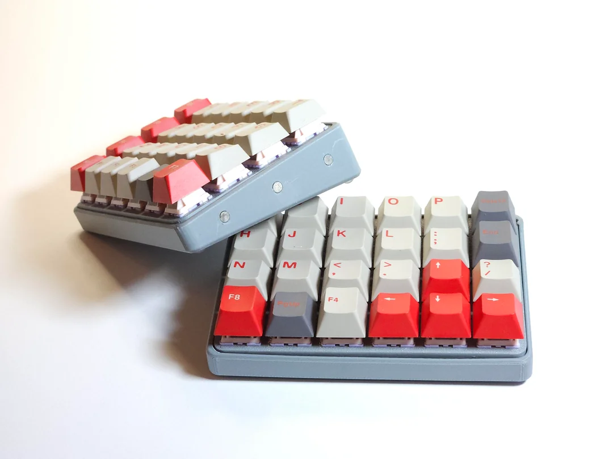
** [[https://kbd.news/Suutari20-2772.html][Suutari20 modular macropad]]
- [[https://github.com/Squalius-cephalus/suutari20/][https://github.com/Squalius-cephalus/suutari20/]]
- [[https://github.com/Squalius-cephalus/suutari20/wiki/Getting-started][https://github.com/Squalius-cephalus/suutari20/wiki/Getting-started]]
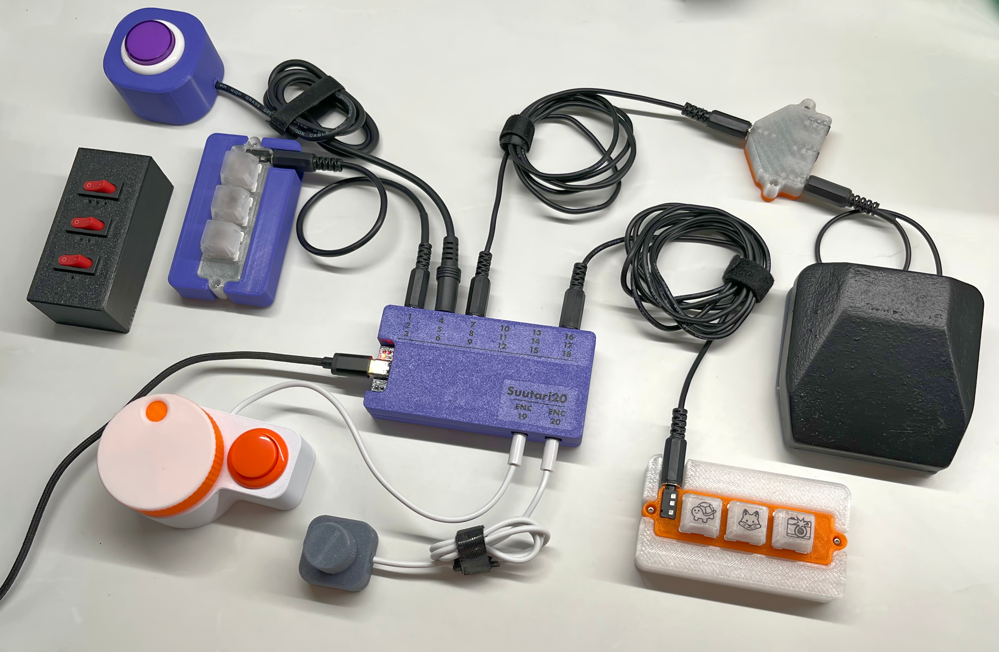
** Dactyl-like keyboard                                             :folded:
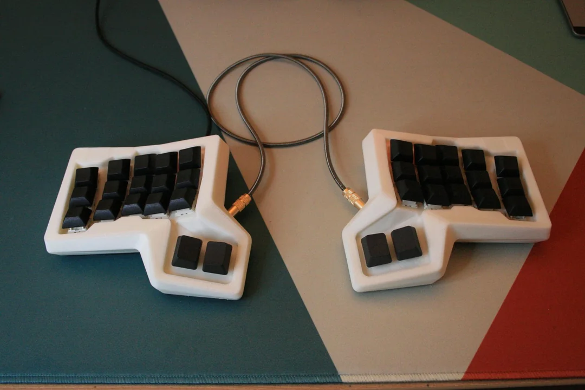
- New version of the Lil Chonky Bois, MX version added. : [[https://www.reddit.com/r/ErgoMechKeyboards/comments/ns6igi/new_version_of_the_lil_chonky_bois_mx_version/][r/ErgoMechKeyboards]]
- [[https://bastardkb.com/product/charybdis-nano-kit/][Charybdis Nano - Bastard Keyboards - Split ergonomic keyboards]]
  - Charybdis Nano is simply wonderful : [[https://www.reddit.com/r/ErgoMechKeyboards/comments/194qzty/charybdis_nano_is_simply_wonderful/][r/ErgoMechKeyboards]]
  - Charybdis - Dactyl trackball keyboard : [[https://www.reddit.com/r/ErgoMechKeyboards/comments/osqd86/charybdis_dactyl_trackball_keyboard/][ErgoMechKeyboards]]
  - [[https://github.com/bastardkb/charybdis][Bastardkb/Charybdis - An ergonomic keyboard with integrated trackball.]]
  - [[https://bastardkb.com/charybdis/][Charybdis - Bastard Keyboards - Split ergonomic keyboards]]
- Extra small trackball keyboard (5x3, miryoku, 34mm trackball, PMW3360 PCB) : [[https://www.reddit.com/r/ErgoMechKeyboards/comments/oxuo6p/extra_small_trackball_keyboard_5x3_miryoku_34mm/][ErgoMechKeyboards]]
- One-two split mini (dactyl manuform variant: Skeletyl) : [[https://www.reddit.com/r/ErgoMechKeyboards/comments/n8jzc1/onetwo_split_mini_dactyl_manuform_variant_skeletyl/][ErgoMechKeyboards]]
  - [[https://github.com/Bastardkb/Skeletyl][GitHub - Bastardkb/Skeletyl]]
  - [[https://bastardkb.com/product/skeletyl-prebuilt-preorder-2/][Skeletyl - Bastard Keyboards]]
  - New keyboard - new layout. Skeletyl with tents printed in resin. : [[https://www.reddit.com/r/ErgoMechKeyboards/comments/sg80yp/new_keyboard_new_layout_skeletyl_with_tents/][ErgoMechKeyboards]]
  - [[https://github.com/Bastardkb/][Bastardkb]]
- [[https://bastardkb.com/product/tbk-mini-prebuilt-preorder/][TBK Mini - Bastard Keyboards]]
  - Making the switch from an MS Sculpt to the TBKMini with tenting add-on has been a big leap, but I love the Gazzew Boba u4's and I've never worked this comfortably in 25 years : [[https://www.reddit.com/r/MechanicalKeyboards/comments/nm59ca/making_the_switch_from_an_ms_sculpt_to_the/][MechanicalKeyboards]]
** Modular mini 3D Keyboard (No support needed) : [[https://www.reddit.com/r/ErgoMechKeyboards/comments/qcqgb4/modular_mini_3d_keyboard_no_support_needed/][ErgoMechKeyboards]] :folded:
+ [[https://www.ikejima.org/projects/2021091-3mk.html][3mk (3D Mini Keyboard)]]
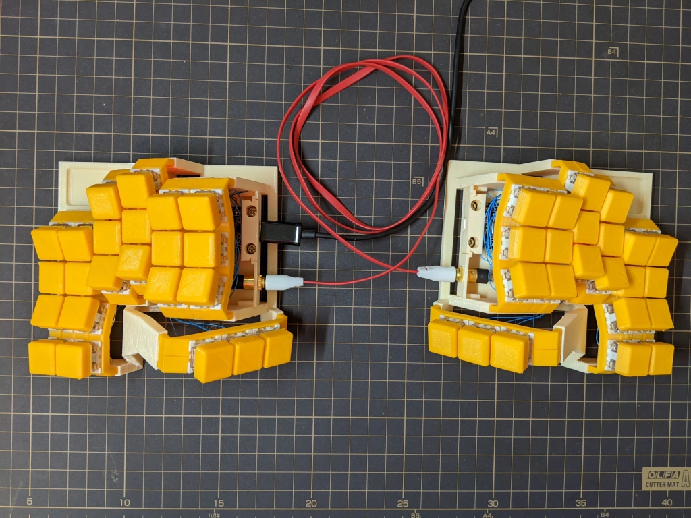
** kbjunky/MacroPact: [[https://github.com/kbjunky/MacroPact][rPico KMK powered macropad with IPS screen]]
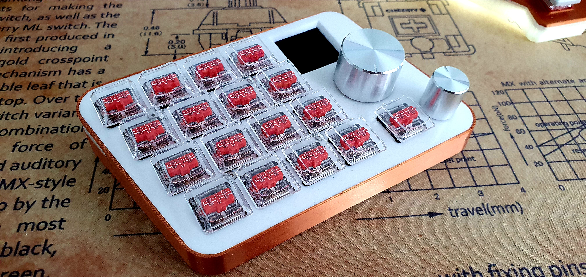
** Raspberry Pi Pico Powered Keypad Has All the Shortcuts You Need | [[https://www.tomshardware.com/news/raspberry-pi-pico-powered-keypad-has-all-the-shortcuts-you-need][Tom's Hardware]]
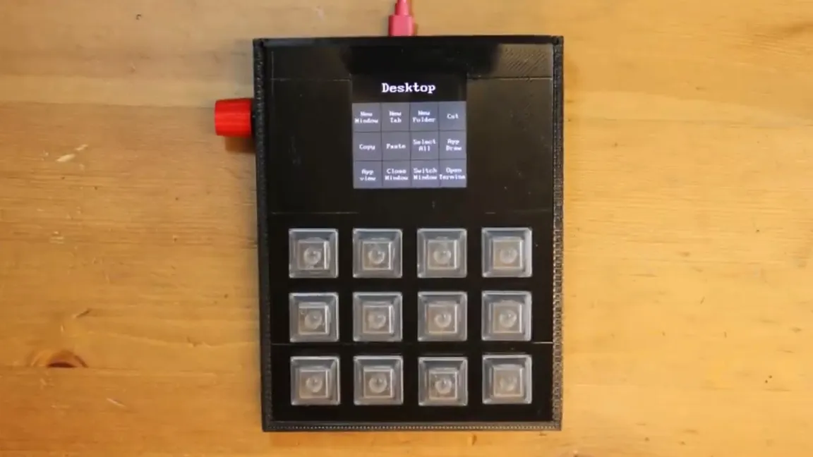
** Chordie - a chording keyboard you shouldn't be scared of : [[https://www.reddit.com/r/ErgoMechKeyboards/comments/pccxh4/chordie_a_chording_keyboard_you_shouldnt_be/][ErgoMechKeyboards]]
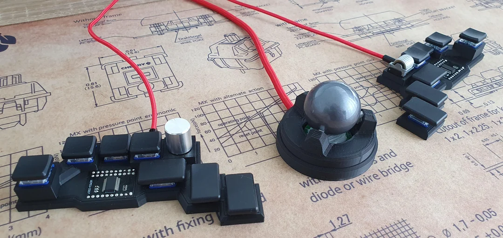
** ARTSEY | [[https://artsey.io/][An Easy, Fast, Open One-Handed Keyboard System]]
- software kb emulator
- Pi pico keyboard prototype, experiment with e-ink display
** Small keyboards                                                  :folded:
- 6 column splay. Split handwired cardboard : [[https://www.reddit.com/r/ErgoMechKeyboards/comments/shy8hz/6_column_splay_split_handwired_cardboard/][ErgoMechKeyboards]]
- [[https://www.youtube.com/watch?app=desktop&feature=youtu.be&v=fBPu7AyDtkM][How to make a FERRIS KEYBOARD [ beginner friendly! ] - YouTube]]
- iiiiiiiiiiiiiiiiiiiiiiiiiiiiii : [[https://www.reddit.com/r/ErgoMechKeyboards/comments/q6h8f2/iiiiiiiiiiiiiiiiiiiiiiiiiiiiii/][ErgoMechKeyboards]]
- I made my keyboard semi-wireless: [[https://www.reddit.com/r/ErgoMechKeyboards/comments/o09hdq/i_made_my_keyboard_semiwireless/][ErgoMechKeyboards]]
- Help implementing Adafruit Bluefruit SPI breakout with QMK : olkb
  - [[https://www.reddit.com/r/olkb/comments/n4hg5b/help_implementing_adafruit_bluefruit_spi_breakout/][link]]
  - [[https://www.amazon.com/Adafruit-Bluefruit-SPI-Friend-Bluetooth/dp/B01F3U8V0W/ref=sr_1_6?dchild=1&keywords=adafruit+bluefruit&qid=1620108320&sr=8-6][amazon]]
- [IC] Rollow: First Ever Split Keyboard with Dedicated Thumb Encoders : [[https://www.reddit.com/r/ErgoMechKeyboards/comments/na9nsv/ic_rollow_first_ever_split_keyboard_with/][ErgoMechKeyboards]]
- [[https://hackaday.io/project/179496-chocolad-keyboard-hacking][Chocolad Keyboard Hacking | Hackaday.io]]
  - [[https://github.com/jimmerricks/chocolad][jimmerricks/chocolad]]
- mitosis-like keyboard
  - mitosis is great, but first col is shifted up
  - ferris
  - 40%, split, wireless goodness: [[https://www.reddit.com/r/MechanicalKeyboards/comments/8hye1a/40_split_wireless_goodness/][MechanicalKeyboards]]
  - [[https://gist.github.com/wez/b30683a4dfa329b86b9e0a2811a8c593][Split Bluetooth Keyboard]]
  - davidphilipbarr/Sweep: [[https://github.com/davidphilipbarr/Sweep][Sweep - a small promicro based keyboard inspired by the Ferris.]]
    - davidphilipbarr/36keys: [[https://github.com/davidphilipbarr/36keys][Keyboard pcbs with 36key or less?]]
  - New build:Mitosis-plus,thank you @reverse_bias: [[https://www.reddit.com/r/MechanicalKeyboards/comments/6tcctx/new_buildmitosisplusthank_you_reverse_bias/][MechanicalKeyboards]]
  - [photos] interphase | finished my prototype: [[https://www.reddit.com/r/MechanicalKeyboards/comments/7ggeww/photos_interphase_finished_my_prototype/][MechanicalKeyboards]]
  - Wireless Let's Split Build Log - with both MX and Kailh Low Profile Support: [[https://www.reddit.com/r/MechanicalKeyboards/comments/7nox6q/wireless_lets_split_build_log_with_both_mx_and/][MechanicalKeyboards]]
- [[https://www.reddit.com/r/ErgoMechKeyboards/comments/m66std/super_slim_handwired_wireless/][Super slim, handwired, wireless]]
  - [[https://github.com/mattdibi/redox-keyboard/tree/master/redox-w][redox-keyboard/redox-w at master · mattdibi/redox-keyboard]]
- pseudoku/Apoptosis: [[https://github.com/pseudoku/Apoptosis][44 Keys Mitosis Clone with Staggering Stagger!]]
  - GlenPickle/Chimera: [[https://github.com/jawn-smith/Chimera][Chimera Keyboard software and hardware]]
  - wizarddata/Chimera-Battery-Mod: [[https://github.com/wizarddata/Chimera-Battery-Mod][This is a mod designed to add a convenient battery holder and power switch to the Chimera family of wireless keyboards.]]
- [[https://www.reddit.com/r/ErgoMechKeyboards/comments/nkz3yo/custom_layout_handwired/][Very nice keys layout]]
- KeySeeBee, TeXitoi/keyberon: [[https://github.com/TeXitoi/keyberon][A rust crate to create a pure rust keyboard firmware.]]
** e-matteson/pipit-keyboard: [[https://github.com/e-matteson/pipit-keyboard][Firmware and config tools for chording keyboards]]
** [[https://kbd.news/Ploopy-Mini-open-sourced-763.html][Ploopy Mini open-sourced]]
** [[https://kbd.news/Keeblab-773.html][Keeblab]]
** [[https://kbd.news/Atlantis-9e-772.html][Atlantis 9e]]
** [[https://web.archive.org/web/20210625234430/https://lowprokb.ca/products/corne-ish-zen-2?variant=37694330798244][Corne-ish Zen - Complete | Lowprokb.ca]]
** [[https://golem.hu/guide/first-macropad/][GOLEM - Building a 5$ macropad]]                                   :folded:
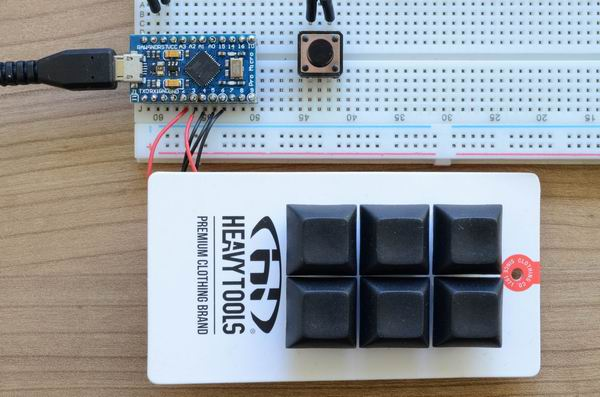

- [[https://www.reddit.com/user/dovenyi][golem project author - overview for dovenyi]]
- [[https://golem.hu/guide/custom-cable/][GOLEM - DIY Custom Cable]]
- [[https://golem.hu/guide/keyboard-build-logs/][GOLEM - build logs]]
- [[https://golem.hu/guide/cardboard-prototyping/][GOLEM - cardboard prototyping]]
** Complete idiot guide for building a dactyl manuform keyboard. | by Derek.L | The Startup | [[https://medium.com/swlh/complete-idiot-guide-for-building-a-dactyl-manuform-keyboard-53454845b065][Medium]]
** [[https://golem.hu/guide/build-the-storm/][Building the S.Torm46 aka Steel Tormentor]]
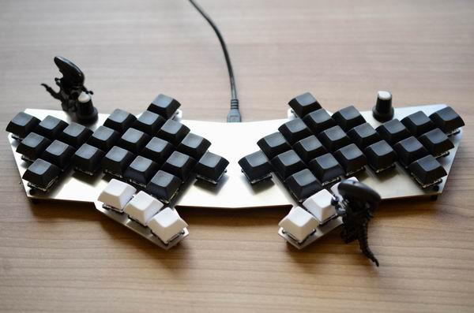
** [[https://keebfolio.netlify.app/][Keebfolio]]: A curated collection of 204 open-source mechanical keyboard projects. :folded:
- [[https://github.com/Keycapsss/awesome-mechanical-keyboard/blob/a21e41635e6cde1da052b8464ef93f759814c8e9/src/pages/en/tutorials.md][awesome-mechanical-keyboard/tutorials.md]]
- [[https://github.com/Keycapsss/awesome-mechanical-keyboard/blob/a21e41635e6cde1da052b8464ef93f759814c8e9/src/pages/en/miscellaneous.md][awesome-mechanical-keyboard/miscellaneous.md]]
** [[https://github.com/waffle87/microdox][Microdox Build Guide · toastedmangoes/waffledox Wiki]]
boardsource/microdox-goodies: [[https://github.com/boardsource/microdox-goodies][just a repo of some micro dox goodies feel free to make any prs you want to this repo and mostly I will just pull them in.]]
** [[https://docs.splitkb.com/product-guides][Build Guides – splitkb.com]]
** [[https://docs.keeb.io/iris-rev3-build-guide/][Nyquist Rev. 3 - Keebio Documentation]]
** duckyPad: Do-It-All Mechanical Macropad
- https://github.com/dekuNukem/duckyPad/blob/master/build_it_yourself.md
- [[https://github.com/dekuNukem/duckyPad/blob/master/duckyscript_info.md][duckyPad/duckyscript_info.md]]
** Building a WIRELESS Handwired Number Pad : [[https://www.reddit.com/r/MechanicalKeyboards/comments/zvolmw/building_a_wireless_handwired_number_pad/][r/MechanicalKeyboards]]
** Ergonomic Trackpoint keyboard (vol. 2) : [[https://www.reddit.com/r/ErgoMechKeyboards/comments/jlwvnn/ergonomic_trackpoint_keyboard_vol_2/][ErgoMechKeyboards]]
** [[https://github.com/triliu/JESK56][triliu/JESK56 - Graph-theory based matrix]]
** sammy-hughes/key-sweep: [[https://github.com/sammy-hughes/key-sweep?tab=readme-ov-file][A multi-axis, concave typing experience on your good ol' planar keyboard!]]
** 10$ Cardboard Planck - v.1.0 : [[https://www.reddit.com/r/MechanicalKeyboards/comments/bro6kk/10_cardboard_planck_v10/?sort=old][MechanicalKeyboards]]
Build log on Imgur: [[https://imgur.com/a/CadgXOP][build log]]
** Adjustable column stagger : [[https://www.reddit.com/r/ErgoMechKeyboards/comments/k53sig/adjustable_column_stagger/][ErgoMechKeyboards]]                    :folded:
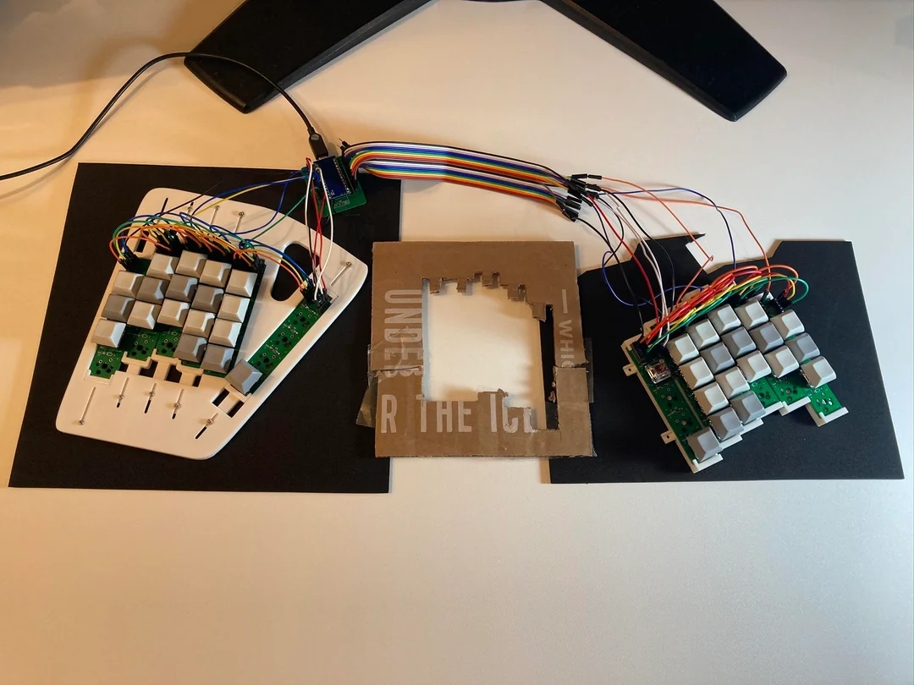
- https://github.com/nezumee/zebra
** first keyboard build, Tightyl Dactyl Manuform 5x6 : [[https://www.reddit.com/r/ErgoMechKeyboards/comments/k4tazn/first_keyboard_build_tightyl_dactyl_manuform_5x6/][ErgoMechKeyboards]]
** bluetooth adapter keyboard (nice!nano alternative)               :folded:
[[https://www.google.com/search?client=ms-android-google&sxsrf=ALeKk03fIuznGtrXj0I7ttAencis7mrBVQ%3A1603152320820&ei=wCmOX87FMcStytMPxNiUWA&q=bluetooth+adapter+keyboard&oq=bluetooth+adapter+ke&gs_lcp=ChNtb2JpbGUtZ3dzLXdpei1zZXJwEAEYADIKCAAQyQMQFBCHAjICCAAyAggAMgIIADICCAAyBggAEBYQHjIGCAAQFhAeMgYIABAWEB46BAgAEEc6BwgjEOoCECc6CQgjEOoCECcQEzoECCMQJzoHCAAQyQMQQzoECAAQQzoCCC46BQgAEMsBOgcIIxCxAhAnOgQIABAKOggIABDJAxCRAjoFCAAQkQI6BQgAEMkDOgcIABAUEIcCUJLkAVjV7gJgofsCaAVwAXgAgAHTAogBiyOSAQgwLjUuMTAuNJgBAKABAbABD8gBCMABAQ&sclient=mobile-gws-wiz-serp#scso=_8imOX9H7O7SwytMP0q6jgAg108:1465.4285888671875][bluetooth adapter keyboard - Google Search]]
- Bluetooth Keyboard Mouse Adapter : [[https://www.instructables.com/Bluetooth-Keyboard-Mouse-Adapter/][12 Steps (with Pictures) - Instructables]]
- Bluetooth Keyboard Adapter | Price & Reviews | [[https://web.archive.org/web/20190826065414/https://drop.com/buy/bluetooth-keyboard-adapter][Drop]]
- [[http://handheldsci.com/kb/][Bluetooth Adapter for Keyboard & Mouse « Handheld Scientific, Inc.]]
- Bluetooth mini corne : [[https://www.reddit.com/r/ErgoMechKeyboards/comments/f5r3ux/bluetooth_mini_corne/][ErgoMechKeyboards]]
** Cyberdesks                                                       :folded:
- WIP - functioning prototype : [[https://www.reddit.com/r/cyberDeck/comments/mvsz3w/wip_functioning_prototype/][cyberDeck]]
- drcode/lisperati-1000-diy: [[https://github.com/drcode/lisperati-1000-diy][DIY Instructions for Building a Lisperati1000 Computer]]
  - Instructions for the Lisperati1000
    + [[https://kbd.news/Instructions-for-the-Lisperati1000-566.html][https://kbd.news/Instructions-for-the-Lisperati1000-566.html]]
  - Open Source DIY Instructions for the Lisperati1000 Now Available : [[https://www.reddit.com/r/cyberDeck/comments/mx859y/open_source_diy_instructions_for_the/][cyberDeck]]
** A small micropad with rotary encoders and bluetooth instead of putting encoders into the keyboard?
- [[https://keeb.io/products/the-stick][The Stick – Keebio]]
- [[https://keeb.io/products/bdn9-3x3-9-key-macropad-rotary-encoder-support][BDN9 - 3x3 9-key Macropad - Rotary Encoder Support – Keebio]]
  - [[https://keeb.io/products/bdn9-rev-2-3x3-9-key-macropad-rotary-encoder-and-rgb][BDN9 Rev. 2 - 3x3 9-key Macropad - Rotary Encoder and RGB – Keebio]]
- Module Feather/Pro Micro Numpad : [[https://www.reddit.com/r/olkb/comments/kxxsyu/module_featherpro_micro_numpad/][olkb]]
- [[https://www.reddit.com/r/MechanicalKeyboards/comments/mkfq6e/my_first_macropad_i_designed_the_pcb_and_built_it/][My first macropad - I designed the PCB and built it. Ultra cheap "case" made with biscuits cardboard]]
- [[https://keeb.io/products/chocopad-16-key-macropad-for-kailh-choc-low-profile-switches][Chocopad - 16-key Macropad for Kailh Choc Low-Profile Switches – Keebio]]
- [[https://mechboards.co.uk/products/romac-macro-pad][RoMac Macro Pad — Mechboards]]
- Hotswappable Numpad! : [[https://www.reddit.com/r/MechanicalKeyboards/comments/mfdhyy/hotswappable_numpad/][MechanicalKeyboards]]
- macropad with rotary encoders
  - todbot/pico8enc: [[https://github.com/todbot/pico8enc][Lotsa Rotary Encoders on a Raspberry Pi Pico]]
  - The Sync Channel Blog: [[http://syncchannel.blogspot.com/2016/06/cherry-mx-keypad.html?m=1][Cherry MX Keypad]]
  - [[https://keeb.io/products/amoeba-single-switch-pcbs][Amoeba Single-Switch PCBs – Keebio]]
    - mtl/keyboard-pcbs: [[https://github.com/mtl/keyboard-pcbs][Keyboard PCBs]]
  - [[https://github.com/AnaviTechnology/anavi-macro-pad-8][AnaviTechnology/anavi-macro-pad-8]]
  - [[https://www.hackster.io/palsayantan/ardu-keyboard-ef4d46][Ardu Keyboard - Hackster.io]]
  - [[https://github.com/ogatatsu/Cherry-Mx-Bitboard-Re][ogatatsu/Cherry-Mx-Bitboard-Re]]
  - imchipwood/dumbpad: [[https://github.com/imchipwood/dumbpad][Simple 4x4 numpad with rotary encoder. Powered by QMK via ATmega32u4 Pro Micro]]
  - joshajohnson/Hub16: [[https://github.com/joshajohnson/Hub16][A macro pad with 16 keys, two rotary encoders, a four port USB hub, and plenty of LEDs!]]
  - dekuNukem/duckyPad: [[https://github.com/dekuNukem/duckyPad][Do-It-All Mechanical Macropad]]
  - [[https://kbd.news/Raspberry-Pi-Pico-macropad-583.html][Raspberry Pi Pico macropad]]
* General DIY Links                                                  :folded:
** How do I learn robotics in 2025? | [[https://news.ycombinator.com/item?id=44158353][Hacker News]]
Top reply: Do this course [[https://github.com/henki-robotics/robotics_essentials_ros2][henki-robotics/robotics_essentials_ros2]]

Totally free, don't need to buy anything just a computer.
** How To Build A Simple Raspberry Pi Pico Robot | [[https://www.tomshardware.com/how-to/raspberry-pi-pico-robot][Tom's Hardware]]
** Mini Pupper: Open-Source,ROS Robot Dog Kit | [[https://www.indiegogo.com/projects/mini-pupper-open-source-ros-robot-dog-kit#/][Indiegogo]]           :folded:
+ [[https://web.archive.org/web/20200503153025/https://stanfordstudentrobotics.org/pupper?utm_source=pocket_mylist][Pupper — Stanford Student Robotics]]
+ mangdangroboticsclub/QuadrupedRobot: [[https://github.com/mangdangroboticsclub/mini_pupper][Open-Source,ROS Robot Dog Kit]]
** chvmp/champ: [[https://github.com/chvmp/champ][𓃡 Quadruped Robot based on MIT Cheetah I]]
** ZX Spectrum Next on the Internet: [[https://retrogamecoders.com/zx-spectrum-next-on-the-internet-xberry-pi-esp01-and-pi-zero-upgrades/][Xberry Pi ESP01 and Pi Zero Upgrades - Retro Game Coders]]
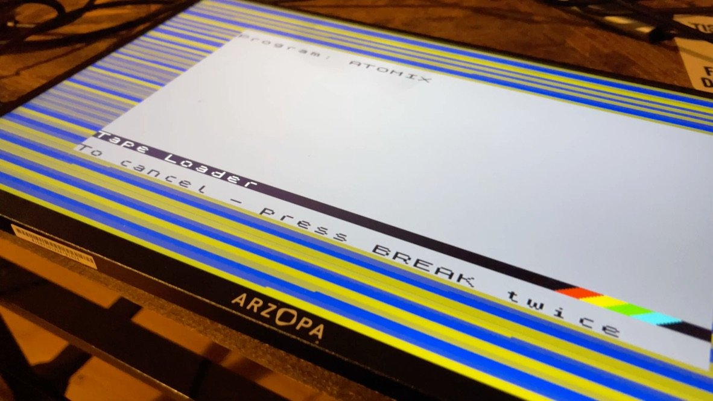
** tobetz/LegoMicroscope: [[https://github.com/tobetz/LegoMicroscope][To learn about optics and microscopy, we generated a simple to build lego microscope that does not need precision optics and 3D printed parts.]]
** TeamOpenSmartGlasses/OpenSourceSmartGlasses: [[https://github.com/Mentra-Community/OpenSourceSmartGlasses][Open Source smart glasses designed to be 1. All day wearable 2. Immediately useful 3. Extendable for makers, startups, and everyone else.]]
** Damaged Pocket Computer Becomes Portable Linux Machine | [[https://hackaday.com/2025/11/28/damaged-pocket-computer-becomes-portable-linux-machine/][Hackaday]]
- Using Raspberry Pi Zero 2W to run the show(Linux). It's a capable machine that runs Linux rather well and has wireless connectivity out of the box
** [[https://www.makeriot2020.com/index.php/2021/06/06/introducing-maker-pi-rp2040/][Introducing Maker Pi RP2040 - Maker and IOT Ideas]]
** The Arduino Uno Q is a weird hybrid SBC | [[https://www.jeffgeerling.com/blog/2025/arduino-uno-q-weird-hybrid-sbc/][Jeff Geerling]]
** Things you can do with a Software Defined Radio (2024) | [[https://news.ycombinator.com/item?id=45262835][Hacker News]]
[[https://blinry.org/50-things-with-sdr/][The original article]]
#+begin_quote
A Software Defined Radio is essentially a radio that relies on a computer to do most of its data processing. It doesn't rely on analog hardware too much – instead, most of what is does is "defined in software", hence the name.

Usually, SDRs can detect electromagnetic waves in a much wider range than a common FM radio, which makes it especially exciting! I got interested in SDRs after reading about [[https://community.frame.work/t/rtl-sdr-expansion-card/37098/15][Albert's project]] to build one as a module for the Framework laptop!
#+end_quote
** [[https://www.arvinpoddar.com/blog/3d-modeling-with-paper][3D Modeling with Paper]]

#+begin_quote
Over the past several years, I've enjoyed the hobby of [[https://en.wikipedia.org/wiki/Paper_model][*paper modeling*]] (or papercraft), the art of creating 3D models from cut and glued parts from paper sheets. This hobby is a superset of origami, in that it allows for cutting and gluing, as well as for multiple sheets of paper for a single model. The alleviation of these constraints means that papercraft allows for more complex models that are easier to assemble.
#+end_quote

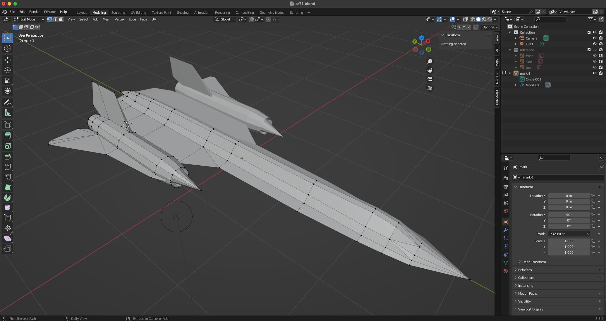

Related:
+ Tutorial: Blender MODELLING For Absolute Beginners | [[https://www.youtube.com/watch?v=sbCW0Cs7aI8][Low Poly Girl - YouTube]]
+ [[https://en.wikipedia.org/wiki/List_of_open-source_mobile_phones][List of open-source mobile phones - Wikipedia - en.wikipedia.org]]
** Since a lot of you liked it : [[https://www.reddit.com/r/ErgoMechKeyboards/comments/1mq7lfk/since_a_lot_of_you_liked_it/][r/ErgoMechKeyboards]]
https://makerworld.com/crowdfunding/53-bongo-cat-mini-monitor-2-0-new-features-upgrades
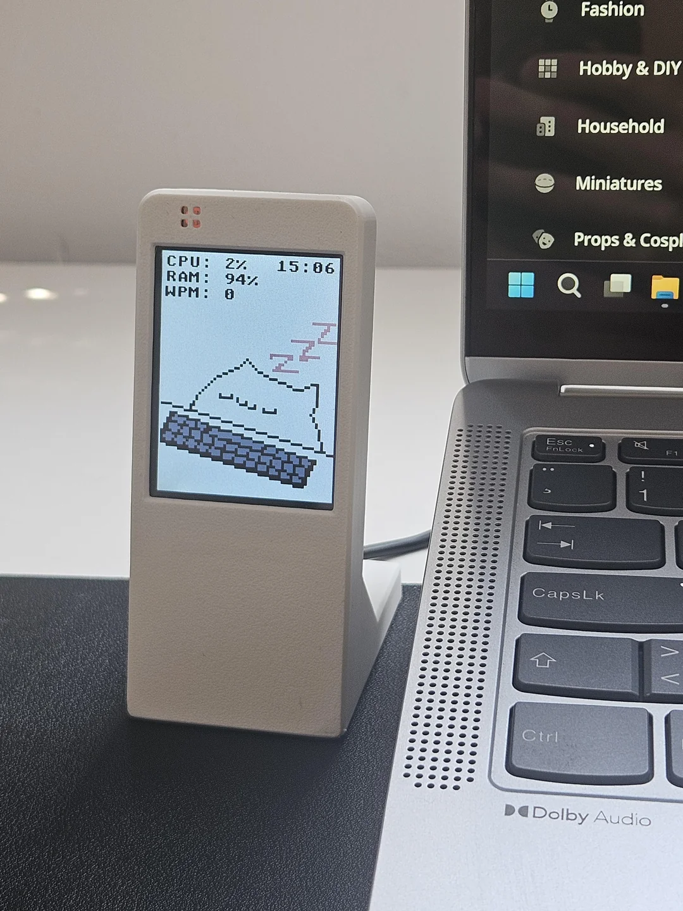
** [[https://kbd.news/Volume-mixer-782.html][Volume mixer]]
** MIDI keyboard
- [[https://www.hackster.io/news/build-your-own-arduino-controlled-velocity-sensitive-midi-keyboard-7ac0ed6f0665][Build Your Own Arduino-Controlled, Velocity-Sensitive MIDI Keyboard - Hackster.io]]
- [[https://www.makeuseof.com/tag/arduino-midi-controllers/][10 MIDI Controllers You Can Build With an Arduino]]
- ast/keyboard: [[https://github.com/ast/keyboard][Teensy (Arduino clone) 88 key velocity sensitive midi keyboard]]
** How to Create a Raspberry Pi 4 NAS Drive | [[https://all3dp.com/2/raspberry-pi-4-nas-openmediavault-tutorial/][All3DP]]
** Anduril Flashlight Firmware + FSM Flashlight UI Toolkit
[[https://github.com/ToyKeeper/anduril][ToyKeeper/anduril: Anduril 2 Flashlight Firmware and FSM UI Toolkit - github.com]]

#+begin_quote
Anduril is a user interface for flashlights. It is written with FSM, a UI toolkit for flashlights.

What is FSM? The "SM" means "Spaghetti Monster", and the "F" can be any F word you like, such as "Flashlight" or whatever suits your mood. FSM also means "Finite State Machine", which is the type of abstraction used for defining user interfaces. It is like a flowchart turned into executable code.
#+end_quote

UI diagrams: [[https://github.com/containerfan/anduril2-diagrams][containerfan/anduril2-diagrams: User Interface diagrams for Anduril 2 - github.com]]
** [[https://www.reddit.com/r/Xreal/s/1KO48dNYdW][Fixing glasses frame xreal air]]
#+begin_quote
- [[https://www.youtube.com/shorts/591j_depk6k][Binder Clip Hack: The $1 Fix for Cracked XREAL Air Arms]] (YouTube)
- [[https://www.reddit.com/r/Xreal/comments/1gop96s/my_effort_to_prevent_my_air_arm_from_breaking/][Heatshrink+Binder Clip XREAL Air Arm Repair]] (Reddit)
- [[https://www.reddit.com/r/Xreal/comments/1h2fraa/my_preemptive_reinforcements_to_get_ahead_of_any/][Heatshrink+Cable Ties XREAL Air Arm Repair]] (Reddit)
- [[https://www.reddit.com/r/Xreal/comments/1die26i/3dprinted_xreal_air_1_arm_support_clips/][3D-Printed XREAL Air 1 Arm Support Clips - Comfort & Durability Fix]] (Reddit)

I have this listed under the 'DIY Hardware Repairs...' section in the Table of Contents on the main page of my site: [[https://xrealguide.wixsite.com/unofficial][https://xrealguide.wixsite.com/unofficial]]
#+end_quote
** I made a chair | [[https://news.ycombinator.com/item?id=44142259][Hacker News #diy]]
Original article: https://milofultz.com/2025-05-27-i-made-a-chair.html

Simple! Just two pieces.
** Show HN: A subtly obvious e-paper room air monitor | [[https://news.ycombinator.com/item?id=45962266][Hacker News]]
[[https://www.nicolin-dora.ch/blog/en-epaper-room-air-monitor-part-1/][A subtly obvious e-paper room air monitor (Part 1: Why?) · Nicolin Dora]]

#+begin_quote
*TL;DR*  – In the cold season we tend to keep the windows closed. The air gets "stale": humidity often rises above 60 %, which can harm our wellbeing and promote mould. At the same time the CO₂ level in the air increases, which impacts our ability to concentrate. So I built a room air monitor that stays unobtrusive as long as everything is in the green zone, but becomes deliberately noticeable once thresholds are exceeded. For my personal love of statistics I also visualise the measurements in a clear dashboard.
#+end_quote

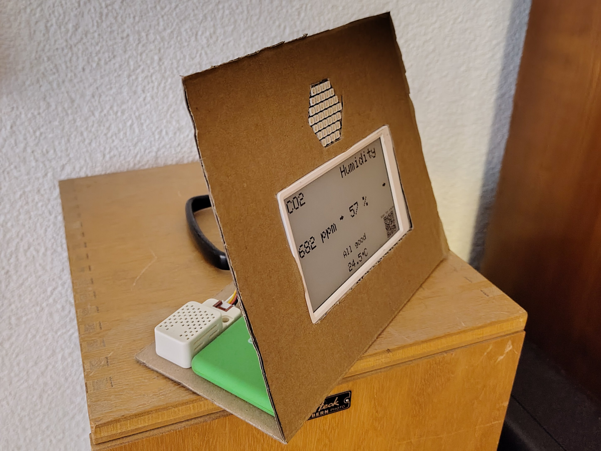
** [[https://bitsnpieces.dev/posts/a-synth-for-my-daughter/][I Built a Synth for My Daughter - bitsnpieces.dev]]
- Show HN: I built a synth for my daughter | [[https://news.ycombinator.com/item?id=45900425][Hacker News]]

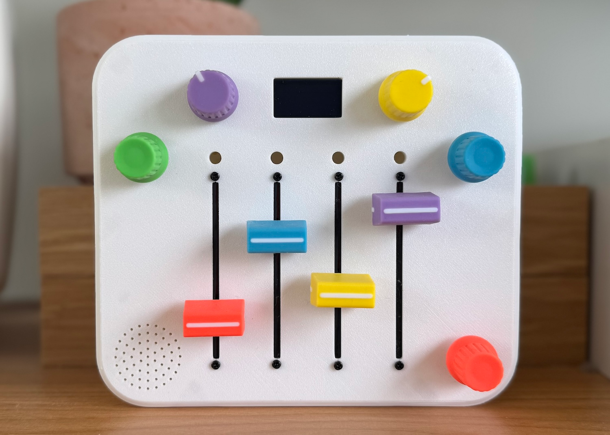
** [[https://www.raspberrypi.com/news/raspberry-pi-zero-makes-a-xylophone-play-itself/][Raspberry Pi Zero makes a xylophone play itself - Raspberry Pi]]
** DAP: Introducing Lyra : [[https://www.reddit.com/r/DigitalAudioPlayer/comments/1u23i3h/introducing_lyra/][r/DigitalAudioPlayer]]
** NiHaoMike/OpenDAC-HD: [[https://github.com/NiHaoMike/OpenDAC-HD][An open source HD audio DAC]]
** GitHub - Nicell/epaper-102: [[https://github.com/Nicell/epaper-102][Display module for the Good Display or Waveshare 1.02 inch e-ink display]]
** [[https://blog.toit.io/why-doesnt-v8-fit-on-my-microcontroller-71dc6e2d8f5c][(about Toit) Why doesn't V8 fit on my microcontroller?]]
** rsheldiii/rp2040-doom-LCD: [[https://github.com/rsheldiii/rp2040-doom-LCD/][Fully-featured Doom port for the Raspberry Pi RP2040 microcontroller]]
*** rsheldiii/doom-keycap-hardware: [[https://github.com/rsheldiii/doom-keycap-hardware][Kicad and Fusion360 files for the Doom Keycap]]
** colmi p8 - micropython
- wasp-os: [[https://www.youtube.com/watch?v=VJoDtMy-4pk][Installing MicroPython on a Colmi P8 smart watch using DaFlasher - YouTube]]
- colmi p8 bootloader bricked · Issue #10 · fanoush/ds-d6
  - [[https://github.com/fanoush/ds-d6/issues/10][https://github.com/fanoush/ds-d6/issues/10]]
** Overview | Build an ML Package Detector with Lobe | [[https://learn.adafruit.com/build-an-ml-package-detector][Adafruit Learning System]]
- Overview | Machine Learning 101 with Lobe and BrainCraft | [[https://learn.adafruit.com/machine-learning-101-lobe-braincraft][Adafruit Learning System]]
** RFID / NFC Smart Ring - Size 12 - NTAG213 : ID 2806 : $44.95 : [[https://www.adafruit.com/product/2806][Adafruit Industries, Unique & fun DIY electronics and kits]]
** [[https://hackaday.io/project/178093-make-your-own-custom-printed-circuit-board-ruler][Make your own custom printed circuit board ruler | Hackaday.io]]
** [[https://ben.akrin.com/?page_id=9650][PlottyBot – Ben's blog]]
- PlottyBot, the Pi based Pen Plotter I designed & built working with handwriting : [[https://www.reddit.com/r/raspberry_pi/comments/kxxtne/plottybot_the_pi_based_pen_plotter_i_designed/][raspberry_pi]]
* Open Source 3D printer                                             :folded:
+ Creality Ender 3 Pro Review: An Ideal First or Tenth 3D Printer | [[https://www.tomshardware.com/reviews/creality-ender-3-pro-3d-printer][Tom's Hardware]]
  - drivinfast247 19 March 2021 23:15
  - I have two of them, highly modified of course, and they're great machines!
  - They are great out of the box but a $40, 32bit silent board is a great upgrade.
+ Inspire Dev Kit Drops Price Of MSLA Printer To Just $30 | [[https://hackaday.com/2021/03/04/inspire-dev-kit-drops-price-of-msla-printer-to-just-30/][Hackaday]]
  - [[https://web.archive.org/web/20210307105536/https://accessible3d.com/inspire-3d-printer.html][Inspire 3D Printer]]
+ Stupid question but how does one go about learning how to make 3D printed stuff? I've always been curious but haven't pulled the trigger yet
  - [[https://www.reddit.com/r/ErgoMechKeyboards/comments/ltcf0g/i_made_a_dactyl_manuform_and_i_dont_like_it/gp3442l/][permalink]]
  - Well I basically bought my 3d printer for printing keyboard stuff considering that the price of a pre-built DM was the same (or more) as a 3d printer.
  - Then I never ended up making anything myself, just downloading stl files running them through the Cura software (which has pretty good guides for tuning settings and pretty good default setings) then printing them.
  - It's pretty easy these days, Creality is cheap & prints well (I bought a CR-10 3-4 years ago & they've gotten better since) but there were some issues with not adhering to open source licenses.
  - Prusa is the gold standard. I would say that if you don't have a use case it will sit around. Keyboards are a perfectly valid use case though. The real beauty is from printing a keyboard case & if you don't like it then tweaking and printing again. If you're sure that a standard DM will work for you then it's probably cheaper to buy from somewhere.
+ Top 10 Open-Source 3D Printers in 2020 | [[https://m.all3dp.com/2/open-source-3d-printer-designs/][All3DP]]
+ 7 Best Open Source 3D Printers 2021 (With Links To Designs) | [[https://www.3dsourced.com/3d-printers/open-source-3d-printer/][3DSourced]]
+ [[https://www.hackster.io/news/this-open-source-3d-printer-design-will-cost-you-less-than-200-to-build-59b03e33e918][This Open Source 3D Printer Design Will Cost You Less Than $200 to Build]]
* Arduino                                                            :folded:
** DIY Arduino projects (non-keyboards)                             :folded:
- [[https://www.hackster.io/danielbernalb/libreco2-easily-build-a-low-cost-co2-monitor-with-arduino-345ab9][LibreCO2: Easily Build a low cost CO2 monitor with Arduino - Hackster.io]]
- [[https://projecthub.arduino.cc/][Arduino Project Hub]]
- [[https://dev.to/studio_m_song/building-a-follow-light-with-arduino-4127][Building a "Follow Light" with Arduino - DEV]]
- [[https://web.archive.org/web/20160414011241/https://sudomod.com/][sudomod (some mini game consoles)]]
- [[https://oshpark.com/profiles/TheCurrentSource][OSH Park ~ Shared Projects by TheCurrentSource]]
    - [[https://web.archive.org/web/20141218091435/https://www.thecurrentsource.com/][The Current Source]]
- WatchX Learning Development Board | [[https://www.youtube.com/watch?v=4sl0IMTkBBM][PCB + Sensors & Actuators - YouTube]]
- Aplyard/Oled-Clicker: [[https://github.com/Aplyard/Oled-Clicker][Clicker Counter for Arduino Nano]]
- Walkie-Talkie
  - DIY Arduino Wristwatch Walkie-Talkie : [[https://www.instructables.com/Wristwatch-Walkie-Talkie/][6 Steps (with Pictures) - Instructables]]
  - [[https://www.youtube.com/watch?v=SZYwvvh6m-s][Make your own very crude Walkie-talkie with an Arduino - YouTube]]
  - [[https://circuitdigest.com/microcontroller-projects/arduino-walkie-talkie-using-nrf24l01][Long Range Arduino Based Walkie Talkie using nRF24L01]]
  - [[https://seniorelectron.com/][Senior Electron LLC]]
    - [[https://www.tindie.com/products/unitek/walkie-talkie-duino/][Walkie Talkie Duino from Senior Electron LLC on Tindie]]
- SmartScope - Reinventing the oscilloscope by LabNation — [[https://www.kickstarter.com/projects/751733865/smartscope-reinventing-the-oscilloscope?ref=android_project_share][Kickstarter]]
  - [[https://web.archive.org/web/20150803011722/http://wiki.lab-nation.com/index.php/Sources][Sources - LabNation]]
  - [[https://web.archive.org/web/20160826232553/https://www.lab-nation.com/store][LabNation - Store]]
- [[https://hackaday.io/project/1952-vectr-3d-gesture-controller-and-sequencer/details][Vectr - 3D Gesture Controller and Sequencer | Hackaday.io]]
- [[https://www.kickstarter.com/projects/1608192864/open-source-wireless-inventors-shield-for-arduino?ref=android_project_share][Open Source Wireless Inventors Shield for Arduino by Open Source RF — Kickstarter]]
- Daisy: [[https://www.kickstarter.com/projects/electro-smith/daisy-an-embedded-platform-for-music?ref=android_project_share][An Embedded Platform for Music by Electrosmith — Kickstarter]]
- [[https://www.kickstarter.com/projects/2081058999/lamobo-d1-develop-your-own-mini-camera?ref=android_project_share][Lamobo D1- Develop your own mini-camera by Lamobo — Kickstarter]]
- [[https://www.kickstarter.com/projects/marser/owl-programmable-effects-pedal?ref=android_project_share][OWL Programmable Effects Pedal by Martin Klang — Kickstarter]]
- [[https://www.kickstarter.com/projects/1245821645/the-vorpal-combat-hexapod?ref=android_project_share][The Vorpal Combat Hexapod by Steve Pendergrast — Kickstarter]]
** Arduino projects                                                 :folded:
- Watchy by SQFMI | [[https://watchy.sqfmi.com/][Watchy]]
- Keypad with 3d printed PCB: [[https://www.reddit.com/r/3Dprinting/comments/ls5gvv/keypad_with_3d_printed_pcb/][3Dprinting]]
- PiThermalCam | [[https://tomshaffner.github.io/PiThermalCam/][The PiThermalCam Project connects an MLX90640 Thermal IR Camera to a Raspberry Pi for viewing or web streaming.]]
  - [[https://www.raspberrypi.com/news/raspberry-pi-thermal-camera/][Raspberry Pi thermal camera - Raspberry Pi]]
- [[https://www.danyboard.com/][Danyboard – Open-source electronic prototyping platform]]
- Building a sonar sensor array with Arduino and Python | by Alberto Naranjo | Feb, 2021 | [[https://towardsdatascience.com/building-a-sonar-sensor-array-with-arduino-and-python-c5b4cf30b945?gi=6a3584e14948][Towards Data Science]]
- A Miniature Laptop You Can Build Yourself | [[https://hackaday.com/2020/01/27/a-miniature-laptop-you-can-build-yourself/][Hackaday]]
- [[https://hackaday.io/project/171994-arduino-tetris-clone-with-max7219-8x8-matrix][Arduino Tetris clone with MAX7219 8x8 Matrix | Hackaday.io]]
- Adaptive Macro-Pad Uses Tiny OLED Screens As Keycaps | [[https://hackaday.com/2020/12/17/adaptive-macro-pad-uses-tiny-oled-screens-as-keycaps/][Hackaday]]
- FM Radio From Scratch Using An Arduino | [[https://hackaday.com/2020/12/04/fm-radio-from-scratch-using-an-arduino/][Hackaday]]
- [[https://klever-doc.tech/en][Introduction · Clover - Clover is an educational kit of a programmable quadcopter that consists of popular open source components, and a set of necessary documentation and libraries for working with it.]]
- [[https://www.seeedstudio.com/blog/2020/01/16/20-awesome-arduino-projects-that-you-must-try-2020/][20 Awesome Arduino Projects That You Must Try 2020! - Latest open tech from seeed studio]]
- He's The Operator Of His Pocket Arduino | [[https://hackaday.com/2020/11/27/hes-the-operator-of-his-pocket-arduino/][Hackaday]]
- Update #3: My POCKIT project now does some cool things with an ESP32, check it out! : [[https://www.reddit.com/r/arduino/comments/k0v69h/update_3_my_pockit_project_now_does_some_cool/][arduino]]
** Arduino development                                              :folded:
+ What is like Arduino but more powerful?: [[https://www.reddit.com/r/embedded/comments/ly1pkl/what_is_like_arduino_but_more_powerful/][embedded]]
+ [[https://stackoverflow.com/questions/6590161/programming-languages-targeting-arduino-avr][target - Programming Languages Targeting Arduino/AVR - Stack Overflow]]
+ [[https://web.archive.org/web/20080212221006/http://www.piclist.com/techref/atmel/avr/languages.htm][Atmel AVR Microcontroller Languages]]
+ avr-rust :: [[https://web.archive.org/web/20200811212838/https://www.avr-rust.com/][Homepage]]
+ [[https://codius.ru/articles/%D0%9F%D0%BE%D0%B4%D1%82%D1%8F%D0%B3%D0%B8%D0%B2%D0%B0%D1%8E%D1%89%D0%B8%D0%B9_%D1%81%D1%82%D1%8F%D0%B3%D0%B8%D0%B2%D0%B0%D1%8E%D1%89%D0%B8%D0%B9_%D1%80%D0%B5%D0%B7%D0%B8%D1%81%D1%82%D0%BE%D1%80_%D1%87%D1%82%D0%BE_%D1%8D%D1%82%D0%BE_%D0%B8_%D0%B7%D0%B0%D1%87%D0%B5%D0%BC_%D0%BE%D0%BD_%D0%BD%D1%83%D0%B6%D0%B5%D0%BD][Подтягивающий (стягивающий) резистор - что это, и зачем он нужен]]
+ Arduino Parts
  + Parts | [[https://www.exploringarduino.com/parts/][Exploring Arduino]]
  + [[https://www.makeuseof.com/tag/whats-arduino-starter-kit-arduino-beginners/][What's in Your Arduino Starter Kit? (Arduino Beginners)]]
+ Radio Communication
  + Радио модуль NRF24L01: описание, подключение, схема, характеристики | [[https://3d-diy.ru/blog/radio-modul-nrf24l01/][ВИКИ]]
  + [[https://projecthub.arduino.cc/eEdizon/arduino-radio-communication-nrf24l01-0fec7a][Arduino Radio Communication (nRF24L01) - Arduino Project Hub]]
  + [[https://projecthub.arduino.cc/mayooghgirish/arduino-bluetooth-basic-tutorial-d8b737][Arduino Bluetooth Basic Tutorial - Arduino Project Hub]]
+ [[https://www.circuito.io/blog/arduino-debugging/][4 Simple Steps for Debugging Your Arduino Project]]
+ QMK can be flashed to arduino, but it requires writing a bootloader to the microcontroller, so either a separate processor is needed or two arduino boards or a separate ISP (In-circuit Serial Programmer)
   + Arduino as ISP and Arduino Bootloaders | [[https://docs.arduino.cc/built-in-examples/arduino-isp/ArduinoISP][Arduino]]
   + [[https://docs.qmk.fm/flashing][Flashing - QMK]]
   + Flashing QMK to ATmega328p with arduino? : [[https://www.reddit.com/r/olkb/comments/e5mriv/flashing_qmk_to_atmega328p_with_arduino/][olkb]]
     + hsgw/plaid: [[https://github.com/hsgw/plaid][12x4 ortholinear usb keyboard made by Through Hole components ONLY.]]
   + [[https://forum.arduino.cc/t/i-once-used-arduino-uno-as-a-hid-and-i-cant-turn-it-back-to-normal-arduino/449275][I once used Arduino Uno as a HID, and I can't turn it back to normal Arduino.]]
   + [[https://github.com/qmk/qmk_firmware/blob/master/docs/isp_flashing_guide.md][qmk_firmware/isp_flashing_guide.md]] at master · qmk/qmk_firmware
+ [[https://docs.arduino.cc/libraries/][Arduino - Libraries]]
  - USB Libraries (Leonardo, Micro, Due, Zero and Esplora)
  - [[https://docs.arduino.cc/language-reference/en/functions/usb/Keyboard/][Keyboard]] - Send keystrokes to an attached computer.
  - [[https://docs.arduino.cc/language-reference/en/functions/usb/Mouse/][Mouse]] - Control cursor movement on a connected computer.
- Arduino Micro | Arduino Official Store: [[https://store.arduino.cc/products/arduino-micro][The Micro comes with a built-in USB which makes the Micro recognizable as a mouse or keyboard. - ATmega32U4]]
- Arduino Leonardo with Headers | Arduino Official Store: [[https://store.arduino.cc/products/arduino-leonardo-with-headers][The classic Arduino board that can act as a mouse or keyboard.]]
- [3.3v] Arduino Zero | [[https://store.arduino.cc/products/arduino-zero][Arduino Official Store]]
- QMK - ATmega328P , best way to make it work (or work arounds...) : [[https://www.reddit.com/r/olkb/comments/a10aou/qmk_atmega328p_best_way_to_make_it_work_or_work/][olkb]]
  - Arduino Nano (with MCU ATmega328P) should also be fine
- [QMK] Burn DFU bootloader into keyboard with ATmega328p (Arduino Uno etc...) : [[https://www.reddit.com/r/olkb/comments/9ctx37/qmk_burn_dfu_bootloader_into_keyboard_with/][olkb]]
- Using arduino : [[https://www.reddit.com/r/MechanicalKeyboards/comments/6fgplz/using_arduino/?sort=qa][MechanicalKeyboards]]
  - It's possible using [[https://github.com/NicoHood/HID][https://github.com/NicoHood/HID]].
    - The arduino uno actually has 2 microcontrollers on it, the atmega16u2 (used to upload code over USB) and the atmega328p (the main microcontroller). What you do here is [[https://github.com/NicoHood/HoodLoader2/wiki/Installation-sketch-%28standalone-Arduino-Uno-Mega%29][change the code on the 16u2 chip]] so that when your Arduino sketch running on the atmega328p wants to talk over USB, it first talks to the atmega16u2 which then realays the command over USB to your computer. The most common one is the Pro Micro. An Arduino Uno would probably work, but it would be half the size of the Planck! You might have to write custom firmware for it though, because I'm not sure that QMK supports it.
- NicoHood/HID: [[https://github.com/NicoHood/HID][Bring enhanced HID functions to your Arduino!]]
  - This project went through a lot of phases and has now reached a new Arduino USB-Core Library with a lot of new functions like extended HID. It also supports HoodLoader2 (version 1 is no longer supported). The idea is to enable enhanced USB functions to almost all 'standard' Arduino boards.
- [[https://www.sparkfun.com/pro-micro-5v-16mhz.html][Pro Micro - 5V/16MHz - DEV-12640 - SparkFun Electronics]]
- [[https://www.pjrc.com/teensy/][Teensy USB Development Board]]
- [[https://www.pjrc.com/teensy/teensyduino.html][Teensyduino - Add-on for Arduino IDE to use Teensy USB development board]]
- [[https://geekhack.org/index.php?topic=90259.0][Advice - QMK, Arduino + FastLED]]
- [[https://austintoombs.com/keyboard-gloves-an-arduino-prototype/][keyboard gloves: an arduino prototype]]
** [[https://store.arduino.cc/products/arduino-starter-kit-multi-language][Arduino - ArduinoStarterKit]]
** [[https://projecthub.arduino.cc/ErniW/easy-interaction-prototyping-with-html-arduino-and-involt-bdf25c][Easy Interaction Prototyping with HTML, Arduino and Involt - Arduino Project Hub]]
** [[https://web.archive.org/web/20151009043755/https://store.arduino.cc/product/GKX00007][Arduino Store - community and electronics - Genuino Starter Kit]]
** arduino - транзистор BC337 NPN
- [[https://iarduino.ru/shop/radioparts/tranzistory/][Транзисторы для Ардуино]]
- [[http://www.kosmodrom.com.ua/el.php?name=BC337-40][Купить BC337-40 на складе КОСМОДРОМ, Харьков, Украина]]
- [[https://iarduino.ru/shop/radioparts/bipolyarnyy-tranzistor-bc337-npn.html][Купить Биполярный транзистор BC337 NPN, 10 Шт. для Arduino]]
- Транзистор | [[https://uscr.ru/tranzistor/][Электронные печеньки]]
- [[https://wiki.amperka.ru/%D1%81%D1%85%D0%B5%D0%BC%D0%BE%D1%82%D0%B5%D1%85%D0%BD%D0%B8%D0%BA%D0%B0:%D1%82%D1%80%D0%B0%D0%BD%D0%B7%D0%B8%D1%81%D1%82%D0%BE%D1%80%D1%8B][Транзисторы (Амперка / Вики)]]
** [[https://pikabu.ru/story/seriya_videourokov_po_yelektronike_2_4332077][Серия видеоуроков по электронике #2]]
* Electronics                                                        :folded:
** CircuitPython                                                    :folded:
- Overview | CircuitPython Media Dial | [[https://learn.adafruit.com/media-dial/][Adafruit Learning System]]
- Raspberry Pico: The Complete SDK Overview (Native C/C++, Arduino, MicroPython, CircuitPython) | by Sebastian | Geek Culture | Jun, 2021 | [[https://medium.com/geekculture/raspberry-pico-the-complete-sdk-overview-native-c-c-arduino-micropython-circuitpython-1ce3a70c2527][Medium]]
- How to Use an I2C LCD Display With Raspberry Pi Pico | [[https://www.tomshardware.com/how-to/lcd-display-raspberry-pi-pico][Tom's Hardware]]
- [[https://shop.pimoroni.com/products/pico-explorer-base][Pico Explorer Base – Pimoroni]]
- GitHub - Rybec/pyRTOS: [[https://github.com/Rybec/pyRTOS][RTOS written in pure Python, designed for use with CircuitPython]]
- [[https://web.archive.org/web/20210410104146/https://andywarburton.co.uk/python-script-to-make-connecting-to-the-circuit-python-repl-quick-and-easy/][Python script to make connecting to the Circuit Python REPL quick and easy!]]
- adafruit/Adafruit_CircuitPython_OV7670: [[https://github.com/adafruit/Adafruit_CircuitPython_OV7670][CircuitPython driver for OV7670 cameras]]
- Circuit Playground Express : ID 3333 : $24.95 : [[https://www.adafruit.com/product/3333][Adafruit Industries, Unique & fun DIY electronics and kits]]
  - [[https://makecode.adafruit.com/][Adafruit Circuit Playground Express - Blocks / Javascript editor]]
** PCB Design                                                       :folded:
- Going low profile: adjustable keyboard with magnets: [[https://www.reddit.com/r/ErgoMechKeyboards/comments/phhtet/going_low_profile_adjustable_keyboard_with_magnets/][ErgoMechKeyboards]]
- [[https://www.youtube.com/watch?v=8u4izLA-SCo][You can now PRINT PCBs! Creating a homemade PCB with the Voltera V-One PCB Printer! - YouTube]]
- [[https://www.robot-electronics.co.uk/i2c-tutorial][I2C tutorial]]
  - [[https://docs.qmk.fm/drivers/i2c][I2C Driver - QMK]]
- [[https://hackaday.io/page/9687-electronics-microcontrollers-for-absolute-beginners-part-13][Electronics & Microcontrollers for Absolute Beginners (Part 13) | Hackaday.io]]
- [[https://www.dribin.org/dave/keyboard/html/][Keyboard Matrix Help]]
- PCB design notes
  - microdox
    - key footprint is nice, allows both mx and kailh hot swap sockets
    - having controller upside down on the left half is not good (not compatible, power diode is at the top)
    - sk6813 mini are too small (better either bigger as on Kyria or mini-e with legs)
  - Kyria
    - nice hints on the pcb, additional mount points
    - no hot swap is not good (mill max is more of a hack)
- circuit prototyping (is there a simpler alternative to PCB?)
  - The World's Great Prototyping Product | [[https://schmartboard.com/][Schmartboard, Inc.]]
  - Review: [[https://www.robotshop.com/community/forum/t/review-schmartboard-ez/12953][Schmartboard EZ - Let's Make Robots / Tutorials - RobotShop Community]]
  - Breadboarding and Prototyping Circuits | [[https://www.analog.com/en/analog-dialogue/studentzone/studentzone-november-2016.html#][Analog Devices]]
  - [[https://controls.ame.nd.edu/microcontroller/main/node6.html][Circuit Prototyping]]
  - [[https://www.jaredwolff.com/how-to-self-assemble-circuit-boards/][How to Self-Assemble Circuit Boards]]
  - [[https://www.freecodecamp.org/news/whats-the-best-way-to-prototype-circuits/][What's The Best Way To Prototype Circuits?]]
  - Why Are You Still Making PCBs? | [[https://hackaday.com/2015/09/21/why-are-you-still-making-pcbs/][Hackaday]]
- ruiqimao/keyboard-pcb-guide: [[https://github.com/ruiqimao/keyboard-pcb-guide][Guide on how to design keyboard PCBs with KiCad]]
- Prototyping, Fabrication Products | Prototype Boards Perforated | [[https://www.digikey.com/en/products/filter/prototyping-fabrication-products/636][DigiKey]]
  - Prototyping, Fabrication Products | Solderless Breadboards | [[https://www.digikey.com/en/products/filter/prototyping-fabrication-products/638][DigiKey]]
  - Prototyping, Fabrication Products | Prototype Boards Unperforated | [[https://www.digikey.com/en/products/filter/prototyping-fabrication-products/637][DigiKey]]
- help-14/mechanical-keyboard: [[https://github.com/help-14/mechanical-keyboard#tutorials][DIY mechanical keyboard and where to find them]]
  - [[https://wiki.ai03.com/books/pcb-design/chapter/pcb-designer-guide][PCB Designer Guide by ai03]]
  - [[https://github.com/ruiqimao/keyboard-pcb-guide/blob/master/README.md][Keyboard PCB Guide by ruiqimao]]
  - [[https://geekhack.org/index.php?topic=87689.0][A modern handwiring guide]]
  - [[https://johannes-jansson.github.io/projects/2018/07/23/hand-wiring-lets-split.html][Hand wiring a let's split]] (pro micro)
  - [[https://github.com/alonswartz/trackpoint][How to integrate a trackpoint in a mechanical keyboard (TMK, Teensy)]]
  - [[https://github.com/nicinabox/lets-split-guide][lets-split-guide]] - This guide covers building a Let's Split v2.
  - [[http://blog.flipwork.nl/?x=entry:entry081009-142605;comments:1][the 1-Key-Keyboard project]] - One key keyboard using Attiny85.
  - [[http://blog.flipwork.nl/?x=entry:entry100224-003937][4-key-keyboard]] - Four key keyboard using Attiny85.
- [[https://github.com/Keycapsss/awesome-mechanical-keyboard/blob/master/src/pages/en/tutorials.md][awesome-mechanical-keyboard/tutorials.md]] at master · BenRoe/awesome-mechanical-keyboard
  - [[https://geekhack.org/index.php?topic=87689.0][A modern handwiring guide]]
  - [[https://wiki.ai03.com/books/pcb-design][ai03 PCB Designer Guide]] - Learn how to make mech keyboard PCBs.
  - Blog post about [[https://josef-adamcik.cz/electronics/in-search-of-the-best-custom-keyboard-layout.html]["search of the best custom keyboard layout"]].
  - [[https://johannes-jansson.github.io/projects/2018/07/23/hand-wiring-lets-split.html][Hand wiring a let's split]] (pro micro)
  - [[https://github.com/alonswartz/trackpoint][How to integrate a trackpoint in a mechanical keyboard (TMK, Teensy)]]
  - [[https://github.com/ruiqimao/keyboard-pcb-guide/blob/master/README.md][Keyboard PCB Guide]]
  - [[https://github.com/nicinabox/lets-split-guide][lets-split-guide]] - This guide covers building a Let's Split v2.
  - [[https://josef-adamcik.cz/electronics/need-a-usb-cable-build-on.html][Need a USB cable? Build one!]] - How to build a custom USB cable with aviation connectors and coils.
  - [[https://komar.blog/posts/how-to-make-a-keyboard-the-matrix/][The Keyboard Matrix]] - How a keyboard matrix work, explained in depth.
  - [[https://www.dribin.org/dave/keyboard/one_html/][The Keyboard Matrix 2]] - Another explanation how a keyboard matrix work and why it needs diodes.
- [[https://github.com/Keycapsss/awesome-mechanical-keyboard/blob/master/src/pages/en/miscellaneous.md][awesome-mechanical-keyboard/miscellaneous.md]] at master · BenRoe/awesome-mechanical-keyboard
  - [[https://github.com/ai03-2725/MX_Alps_Hybrid][KiCad Parts by Ai03]] - KiCad Library of custom MX-Alps footprints.
  - [[https://github.com/daprice/keyswitches.pretty][KiCad Parts by Daprice]] - KiCAD footprint library for kailh choc and MX-style mechanical switches.
  - [[https://github.com/keebio/Keebio-Parts.pretty][KiCad Parts by Keebio]] - Various KiCAD footprints for mechanical keyboard parts.
  - [[https://github.com/tmk/keyboard_parts.pretty][KiCAD Parts by TMK]] - KiCad modules for keyboard design.
** [[https://atomic14.substack.com/p/vibe-coding-a-pcb-surprisingly-good][Vibe-Coding a PCB - surprisingly good - by Chris Greening]]
#+begin_quote
For this experiment, I used *[[https://atopile.io/atopile/introduction][Atopile]]* — a tool that lets you define a hardware project using code and turns it into a KiCad PCB. I also enlisted *Claude* , an AI coding assistant that seemed to outperform Cursor for this task.
#+end_quote

** Micro-controllers, dev boards                                    :folded:
- Promicro, Elite C - AVR ATMega based
- [[https://github.com/joric/nrfmicro/wiki/Alternatives][Alternatives · joric/nrfmicro Wiki]]
- pinouts
  - [[https://deskthority.net/viewtopic.php?f=7&t=8448&start=][How to use a Pro Micro as a cheap controller/converter - deskthority]]
  - [[https://deskthority.net/wiki/Arduino_Pro_Micro#Pinout][Arduino Pro Micro - Deskthority wiki]]
- nice!nano, blue micro - nrf52 based (with Bluetooth)
  - BlueMicro V2.1 | [[http://nrf52.jpconstantineau.com/docs/bluemicro_v2_1/][nRF52 Hardware Documentation]]
    - It is based on Adafruit nRF52 board (Adafruit Feather nRF52 Bluefruit LE [nRF52832] ID: 3406 - $24.95 : [[https://www.adafruit.com/product/3406][Adafruit Industries, Unique & fun DIY electronics and kits]])
      - The BlueMicro boards are designed to be used with the Adafruit nRF52 Arduino Core but with the footprint of other Arduino boards such as the Arduino Pro Micro and the Arduino Micro.
      - nice!nano - also based on nrf - nRF52840 chip on board with 1MB of Flash and 256KB of RAM
- [[https://micropython.org/][MicroPython - Python for microcontrollers]]
  - [[https://circuitpython.org/][CircuitPython]]
    - main difference: interpreter is running on the microprocessor, so no need to re-flash it to update the program (just modify the source)
  - [[https://pumbaa.readthedocs.io/en/latest/][Welcome to Pumbaa's documentation! — Pumbaa 3.0.2 documentation]]
  - Arduino With Python: [[https://realpython.com/arduino-python/][How to Get Started – Real Python]]
  - Meet the BluePhage Express, a Bluetooth keyboard controller for use with CircuitPython/KMK, QMK, and ZMK. : [[https://www.reddit.com/r/olkb/comments/kh5g9n/meet_the_bluephage_express_a_bluetooth_keyboard/][olkb]]
- Raspberry Pi Pico
  - Pimoroni Pico Explorer Base Review: Expanding Your Raspberry Pi Pico | [[https://www.tomshardware.com/reviews/pimoroni-pico-explorer-base-raspberry-pi][Tom's Hardware]]
  - Raspberry Pi Pico Gains Unix-like Operating System | [[https://www.tomshardware.com/news/raspberry-pi-pico-fuzix][Tom's Hardware]]
  - How to Use an OLED Display With Raspberry Pi Pico | [[https://www.tomshardware.com/how-to/oled-display-raspberry-pi-pico][Tom's Hardware]]
  - [[https://www.raspberrypi.org/products/raspberry-pi-pico/][Buy a Raspberry Pi Pico – Raspberry Pi]]
  - [[https://www.raspberrypi.org/documentation/pico/getting-started/][Getting Started with Raspberry Pi Pico – Raspberry Pi]]
  - Meet Raspberry Silicon: [[https://www.raspberrypi.com/news/raspberry-pi-silicon-pico-now-on-sale/][Raspberry Pi Pico now on sale at $4 - Raspberry Pi]]
    - Adafruit Feather RP 2040
      - RP2040 joins the hundreds of boards in the Feather ecosystem with the fully featured [[https://www.adafruit.com/feather2040][Feather RP 2040]] board. The 2″ × 0.9″ dev board has USB C, Lipoly battery charging, 4MB of QSPI flash memory, a STEMMA QT I2C connector, and an optional SWD debug port. With plenty of GPIO for use with any FeatherWing, and hundreds of Qwiic/QT/Grove sensors that can plug and play, it's the fast way to get started.
    - Adafruit ItsyBitsy RP 2040
      - Need a petite dev board for RP2040? The [[https://www.adafruit.com/itsybitsy2040][Itsy Bitsy RP 2040]] is positively tiny, but it still has lots of GPIO, 4MB of QSPI flash, boot and reset buttons, a built-in RGB NeoPixel, and even a 5V output logic pin, so it's perfect for NeoPixel projects!
    - Arduino Nano RP2040 Connect
      - Arduino joins the RP2040 family with one of its most popular formats: the Arduino Nano. The [[https://blog.arduino.cc/2021/01/20/welcome-raspberry-pi-to-the-world-of-microcontrollers/][Arduino Nano RP2040 Connect]] combines the power of RP2040 with high-quality MEMS sensors (a 9-axis IMU and microphone), a highly efficient power section, a powerful WiFi/Bluetooth module, and the ECC608 crypto chip, enabling anybody to create secure IoT applications with this new microcontroller. The Arduino Nano RP2040 Connect will be available for pre-order in the next few weeks.
    - Pimoroni PicoSystem
      - [[https://shop.pimoroni.com/products/picosystem][PicoSystem]] is a tiny and delightful handheld game-making experience based on RP2040. It comes with a simple and fast software library, plus examples to make your mini-gaming dreams happen. Or just plug it into USB and drop the best creations from the Raspberry Pi-verse straight onto the flash drive.
    - Pimoroni Pico Explorer Base
      - [[https://shop.pimoroni.com/products/pico-explorer-base][Pico Explorer]] offers an embedded electronics environment for educators, engineers, and software people who want to learn hardware with less of the "hard" bit. It offers easy expansion and breakout along with a whole bunch of useful bits.
    - SparkFun Thing Plus – RP2040
      - The [[https://www.sparkfun.com/sparkfun-thing-plus-rp2040.html][Thing Plus – RP2040]] is a low-cost, high-performance board with flexible digital interfaces featuring Raspberry Pi's RP2040 microcontroller. Within the Feather-compatible Thing Plus form factor with 18 GPIO pins, the board offers an SD card slot, 16MB (128Mbit) flash memory, a JST single-cell battery connector (with a charging circuit and fuel gauge sensor), an addressable WS2812 RGB LED, JTAG PTH pins, mounting holes, and a Qwiic connector to add devices from SparkFun's quick-connect I2C ecosystem.
    - SparkFun MicroMod RP2040 Processor
      - The MicroMod RP2040 Processor Board is part of SparkFun's MicroMod modular interface system. The MicroMod M.2 connector makes it easy to connect your RP2040 Processor Board with the MicroMod carrier board that gives you the inputs and outputs you need for your project.
    - SparkFun Pro Micro – RP2040
      - The [[https://www.sparkfun.com/sparkfun-pro-micro-rp2040.html][Pro Micro RP2040]] harnesses the capability of RP2040 on a compact development board with the USB functionality that is the hallmark of all SparkFun's Pro Micro boards. It has a WS2812B addressable LED, boot button, reset button, Qwiic connector, USB-C, and castellated pads.
  - How To Solder Pins to Your Raspberry Pi Pico | [[https://www.tomshardware.com/how-to/solder-pins-raspberry-pi-pico][Tom's Hardware]]
  - [[https://www.raspberrypi.org/products/raspberry-pi-pico/][Buy a Raspberry Pi Pico – Raspberry Pi]]
  - RPi Pico... potential new controller? : [[https://www.reddit.com/r/ErgoMechKeyboards/comments/l1utfb/rpi_pico_potential_new_controller/][ErgoMechKeyboards]]
- Adafruit ItsyBitsy
  - Adafruit ItsyBitsy M0 Express - for CircuitPython & Arduino IDE ID: 3727 - $11.95 : [[https://www.adafruit.com/product/3727][Adafruit Industries, Unique & fun DIY electronics and kits]]
- Downloads | Introducing the Adafruit nRF52840 Feather | [[https://learn.adafruit.com/introducing-the-adafruit-nrf52840-feather/downloads][Adafruit Learning System]]
- [[https://predictabledesigns.com/review-of-bluetooth-low-energy-ble-solutions/][Review of Bluetooth Low Energy (BLE) Solutions]]
- [[https://www.waveshare.com/core51822-b.htm][BLE4.0 Bluetooth 2.4G Wireless Module, nRF51822 Onboard]]
  - 1 шт. Bluetooth 4,0 NRF51822 основная плата, маленький фактор BLE4.0 Bluetooth 2,4G беспроводной модуль|bluetooth 4.0|bluetooth bluetoothboard board | [[https://aliexpress.ru/item/32827273115.html?spm=a2g0o.productlist.0.0.19f86aa86SjTNK&algo_pvid=5e5192b8-826d-4cbd-a972-b85c308028c1&algo_expid=5e5192b8-826d-4cbd-a972-b85c308028c1-0&btsid=0b8b035a16036510428782856e5be5&ws_ab_test=searchweb0_0,searchweb201602_,searchweb201603_][АлиЭкспресс]]
  - 5 шт. Bluetooth 4,0 NRF51822 основная плата, маленький фактор BLE4.0 Bluetooth 2,4G беспроводной модуль|Детали и аксессуары для 3D-принтеров| | [[https://aliexpress.ru/item/32829947149.html?spm=a2g0o.productlist.0.0.19f86aa86SjTNK&algo_pvid=5e5192b8-826d-4cbd-a972-b85c308028c1&algo_expid=5e5192b8-826d-4cbd-a972-b85c308028c1-15&btsid=0b8b035a16036510428782856e5be5&ws_ab_test=searchweb0_0,searchweb201602_,searchweb201603_][АлиЭкспресс]]
- [[https://www.nordicsemi.com/Software-and-tools/3rd-Party/3rd-party-modules][3rd party modules/modems - nordicsemi.com]]
- nice!nano - ProMicro replacements with bluetooth support
  - [[https://docs.nicekeyboards.com/#/nice!nano/][nice!nano Overview (bluetooth)]]
  - From nice!nano FAQ
    - [[https://docs.nicekeyboards.com/#/nice!nano/faq?id=how-is-this-different-from-the-nrfmicro-or-bluemicro][How is this different from the nRFMicro or BlueMicro?]]
    - The nRFmicro is extremely similar to the nice!nano. The main difference is depending on the version of the nRFMicro, the power system would be slightly different from the nice!nano. From a usability standpoint, very little is different. The nice!nano exposes more pins and is thinner than older versions of the nRFMicro.
    - The biggest difference is that the nice!nano is assembly ready, so they can be mass produced more easily than the nRFMicro (hence the GB).
    - The BlueMicro is basically the same story except for the nRF52832 versions don't support USB.
  - [[https://docs.nicekeyboards.com/#/nice!nano/?id=nicenano][nice!nano Overview]]
  - [[https://web.archive.org/web/20210126120301/https://keyhive.xyz/shop/nicenano][nice!nano — KeyHive]]
    - [[https://web.archive.org/web/20201029125129/https://boardsource.xyz/store/5f4a1733bbaa5c635b83ed67][Boardsource - nice!nano v1.0]]
    - nice!nano: the wireless Pro Micro replacement board is now available at vendors internationally! : [[https://www.reddit.com/r/MechanicalKeyboards/comments/iivz1i/nicenano_the_wireless_pro_micro_replacement_board/?sort=qa][MechanicalKeyboards]]
    - [IC] nice!nano: the super thin, wireless Bluetooth drop-in replacement for the Pro Micro : [[https://www.reddit.com/r/MechanicalKeyboards/comments/gsszq7/ic_nicenano_the_super_thin_wireless_bluetooth/?sort=qa][MechanicalKeyboards]]
- BlueMicro - ProMicro with bluetooth (can be soldered manually)
  - BlueMicro V2.1 | [[http://nrf52.jpconstantineau.com/docs/bluemicro_v2_1/][nRF52 Hardware Documentation]]
  - BlueMacro840 V1.x | [[http://nrf52.jpconstantineau.com/docs/bluemacro840_v1/][nRF52 Hardware Documentation]]
  - Getting Started | [[http://bluemicro.jpconstantineau.com/docs/][BlueMicro nRF52 Keyboard Firmware]]
  - [[https://web.archive.org/web/20190528012123/https://store.jpconstantineau.com/#/][BlueMicro Store]]
    - Introducing the BlueMicro: A drop-in Bluetooth replacement for the Pro Micro : [[https://old.reddit.com/r/MechanicalKeyboards/comments/8h8jf4/introducing_the_bluemicro_a_dropin_bluetooth/][MechanicalKeyboards]]
    - BlueMicro_BLE: [[https://bluemicro.jpconstantineau.com/][A BLE Keyboard firmware for the NRF52 chips]]
    - jpconstantineau/BlueMicro_BLE: [[https://github.com/jpconstantineau/BlueMicro_BLE][Keyboard Firmware for the Nordic nRF52 Series of Bluetooth SoC based on the Adafruit NRF52 Feather]]
- [[https://github.com/joric/nrfmicro/wiki][Home · joric/nrfmicro Wiki]]
  - [[https://web.archive.org/web/20210214110044/https://github.com/joric/nrfmicro/wiki/nRFMicro-1.4][nRFMicro 1.4 · joric/nrfmicro Wiki]]
  - joric/nrfmicro: [[https://github.com/joric/nrfmicro][Pro Micro-compatible Bluetooth 5.2 board with Li-Po charger and USB-C]]
  - [[https://golem.hu/blog/nrfmicro/][nrfmicro - a Pro Micro alternative for wireless keyboards (bluetooth)]]
- [[https://github.com/joric/nrfmicro/wiki/Alternatives][Alternatives · joric/nrfmicro Wiki]]
- GitHub - ryan-ma/PD_Micro: [[https://github.com/ryan-ma/PD_Micro][USB-C PD3.0 PPS on ATMega32U4 Arduino board]]
- ProMicro
  - [[https://arduino.ua/prod661-arduino-pro-micro-s-konnektorami][Arduino Pro Micro с коннекторами в Киеве и Украине]]
  - Amazon.com: HiLetgo 3pcs Pro Micro Atmega32U4 5V 16MHz Bootloadered IDE Micro USB Pro Micro Development Board Microcontroller Compatible to Arduino Pro Micro Serial Connection with Pin Header: [[https://www.amazon.com/gp/product/B01MTU9GOB/ref=ppx_od_dt_b_asin_title_s00?ie=UTF8&psc=1][Home Improvement]]
  - QMK Pro Micro Pinouts? : [[https://www.reddit.com/r/olkb/comments/73auvh/qmk_pro_micro_pinouts/][olkb]]
- [[https://deskthority.net/wiki/Elite-C][Elite-C - Deskthority wiki]]
  - [[https://docs.splitkb.com/frequently-asked-questions/about-split-keyboards/microcontrollers/about][Why would I want to use an Elite C? – splitkb.com]]
  - [Vendor] Announcing The Elite-C: A better Pro Micro replacement with USB-C Port! Available Now! : [[https://www.reddit.com/r/mechmarket/comments/9qgxgx/vendor_announcing_the_elitec_a_better_pro_micro/][mechmarket]]
- Adafruit Feather nRF52 Bluefruit LE [nRF52832] ID: 3406 - $24.95 : [[https://www.adafruit.com/product/3406][Adafruit Industries, Unique & fun DIY electronics and kits]]
  - Коротко о nRF51822: [[https://habr.com/ru/articles/343166/][Быстрый старт / Хабр]]
  - [[https://devzone.nordicsemi.com/f/nordic-q-a/18902/redistributing-the-sdk-as-personal-github-repo][Redistributing the SDK as personal github repo - Nordic Q&A - Nordic DevZone - Nordic DevZone]]
- help-14/mechanical-keyboard: DIY mechanical keyboard and where to find them
    - [[https://github.com/help-14/mechanical-keyboard#controller][https://github.com/help-14/mechanical-keyboard#controller]]
  - controller section
  - adafruit/Adafruit-Feather-32u4-Bluefruit-LE-PCB: [[https://github.com/adafruit/Adafruit-Feather-32u4-Bluefruit-LE-PCB][PCB files for the Adafruit Feather 32u4 Bluefruit LE]]
  - adafruit/Adafruit-nRF52-Bluefruit-Feather-PCB: [[https://github.com/adafruit/Adafruit-nRF52-Bluefruit-Feather-PCB][PCB files for the Adafruit nRF52 Bluefruit Feather]]
  - [[https://geekhack.org/index.php?topic=69169.0][USB to USB keyboard converter (convert regular keyboard to QMK)]]
- [[https://www.waveshare.com/core51822-b.htm][BLE4.0 Bluetooth 2.4G Wireless Module, nRF51822 Onboard]]
- [[https://golem.hu/pro-micro-vs-teensy][Pro Micro vs. Teensy 2.0 review (2020)]]
* Soldering                                                          :folded:
** Soldering How Tos
+ [[https://www.youtube.com/watch?v=NZtwD_F7lTA][Never Solder Again - How to Connect Wires the EASY Way - YouTube]]
+ [[https://www.reddit.com/r/ErgoMechKeyboards/comments/mrxc7l/soldering_a_circuit_board/][Soldering a circuit board]]
+ Soldering a circuit board : [[https://www.reddit.com/r/ErgoMechKeyboards/comments/mrxc7l/soldering_a_circuit_board/][ErgoMechKeyboards]]
+ [[https://www.allaboutcircuits.com/projects/reflow-soldering-its-so-much-easier-with-a-solder-paste-stencil/][Reflow Soldering? It's So Much Easier with a Solder Paste Stencil - Projects]]
  + Who Says Solder Paste Stencils Have To Be CNC Cut? | [[https://hackaday.com/2020/12/09/who-says-solder-paste-stencils-have-to-be-cnc-cut/][Hackaday]]
+ A Beginner's Guide to Soldering | [[https://www.artofmanliness.com/skills/craftsmanship/how-to-solder/][The Art of Manliness]]
+ How to test LEDs with Digital Multimeters (DMMs) | [[https://www.circuitbread.com/ee-faq/how-to-test-leds-with-digital-multimeters-dmms][CircuitBread]]
+ [[https://www.ledsupply.com/blog/guide-to-soldering-high-power-leds/][Guide to Soldering LEDs - LEDSupply BLOG]]
+ [[https://www.build-electronic-circuits.com/right-soldering-temperature/][What is the RIGHT Soldering Temperature?]]
+ [[https://electronics.stackexchange.com/questions/1980/what-s-the-proper-soldering-iron-temperature-for-standard-031-60-40-solder][What's the proper soldering iron temperature for standard .031" 60/40 solder? - Electrical Engineering Stack Exchange]]
+ How to solder (x-post from r/coolguides : [[https://www.reddit.com/r/MechanicalKeyboards/comments/9h4z6x/how_to_solder_xpost_from_rcoolguides/][MechanicalKeyboards]]
+ [[https://www.makerspaces.com/how-to-solder/][How To Solder: A Complete Beginners Guide - Makerspaces.com]]
+ [[https://docs.qmk.fm/hand_wire][Hand Wiring Guide - QMK]]
+ Hand soldering SMT resistor arrays. Is it possible? : [[https://www.reddit.com/r/ECE/comments/17u7kf/hand_soldering_smt_resistor_arrays_is_it_possible/][ECE]]
  + http://www.digikey.com/product-detail/en/YC164-JR-0710KL/YC164J-10KCT-ND/1005702
  + mitosis has these resistor arrays and other small components like that
+ [[https://www.youtube.com/watch?v=_DsCdOaRUPM][Soldering 1206 SMD resistor - YouTube]]
+ [[https://www.youtube.com/watch?v=f9fbqks3BS8][How to Solder Surface Mount parts (it's easy!) - YouTube]]
+ Soldering 101: [[https://thekeeblog.com/soldering-101-mechanical-keyboard-soldering-basics-and-useful-tips/][Mechanical Keyboard Soldering Basics and Useful Tips! – The Keeblog]]
** Soldering Tools
*** [[https://www.google.com/search?q=smd+soldering+tweezers&tbm=isch&client=ms-android-asus-tpin&sa=X&ved=2ahUKEwim29CXipP0AhWImIsKHVBdC2IQtI8BKAB6BAgBEEI&biw=412&bih=852&dpr=2.63][smd soldering tweezers - Google Search]]
+ [[https://www.google.com/search?q=two-tipped+desoldering+iron&oq=two-tipped+desoldering+iron&aqs=chrome..69i57j33i160.17260j1j4&client=ms-android-asus-tpin&sourceid=chrome-mobile&ie=UTF-8#imgrc=Hfv7D3kqpR47wM][two-tipped desoldering iron - Google Search]]
+ [[https://www.google.com/search?q=two+tip+desoldering+iron&oq=two+tip+desoldering+iron&aqs=chrome..69i57j33i22i29i30.10706j0j4&client=ms-android-google&sourceid=chrome-mobile&ie=UTF-8#scso=_q8K8YImXBu-SrgSYg7igCQ4:81.42857360839844][two tip desoldering iron - Google Search]]
+ [[https://www.amazon.com/Rhfemd-Tweezer-Soldering-Heating-Accessories/dp/B07TBZZFC8][Rhfemd 902 ESD SMD Tweezer Style Soldering Iron Double Soldering Iron Tweezer Handle Clip Heating Plier Soldering Station Accessories]]
*** Professional Silicone-Tip Solder Sucker : ID 1597 : $17.50 : [[https://www.adafruit.com/product/1597][Adafruit Industries, Unique & fun DIY electronics and kits]]
+ Professional Silicone-Tip Solder Sucker
+ Product ID: 1597
+ $17.50
*** Hot air is so satisfying after struggling to solder those damned RGB LEDs with an iron.: [[https://www.reddit.com/r/ErgoMechKeyboards/comments/o2ptg8/hot_air_is_so_satisfying_after_struggling_to/][ErgoMechKeyboards]]
*** Review: Pine64 Pinecil Soldering Iron | [[https://hackaday.com/2021/01/05/review-pine64-pinecil-soldering-iron/][Hackaday]]
+ Soldering Tools Order
*** helping hand
+ Amazon.com: Neiko 01902 Adjustable Helping Hand With Magnifying Glass | Dual Alligator Clips: [[https://www.amazon.com/Neiko-01902-Adjustable-Magnifying-Alligator/dp/B000P42O3C/ref=sr_1_16?dchild=1&keywords=soldering+ventilator&qid=1603486989&sr=8-16][Home Improvement]]
+ [[https://www.amazon.com/Toolour-Helping-Hands-Third-Soldering/dp/B07Q21XVMG/ref=sr_1_47?dchild=1&keywords=soldering+ventilator&qid=1603487156&sr=8-47][Toolour Helping Hands Third Hand Soldering Tool - 6 Arms with 360 Degree Alligator Clips USB Powered LED Flashlight Magnifying Glass Metal Base for Electronic Repair Soldering Jewelry Art Crafts Hobby]]
+ [[https://www.amazon.com/KOTTO-Soldering-Magnetic-Flexible-Workshop/dp/B07W42SR65/ref=sr_1_50?dchild=1&keywords=soldering+ventilator&qid=1603487156&sr=8-50][KOTTO Third Hand Soldering Tool PCB Holder Four Magnetic Based Flexible Metal Arms Helping Hands Crafts Jewelry Hobby Workshop Helping Station Non-Slip Steel Weighted Base]]
+ [[https://www.amazon.com/Fstop-Labs-Soldering-Workshop-Non-Slip/dp/B07C577S21/ref=sr_1_54?dchild=1&keywords=soldering+ventilator&qid=1603487156&sr=8-54][KOTTO Third Hand Soldering Tool PCB Holder Five Arms Helping Hands Crafts Jewelry Hobby Workshop Helping Station Non-Slip Steel Weighted Base]]
+ [[https://www.amazon.com/Helping-Magnetic-Adjustable-Hot-gun-Desoldering/dp/B07ZCVZV1X/ref=sr_1_24?dchild=1&keywords=soldering+ventilator&qid=1603487156&sr=8-24][Helping Hands with Heavy Duty Magnetic PCB Holder, Solder Arms, Adjustable Hot-gun Holder, for DIY Desoldering Work]]
+ [[https://www.amazon.com/Gooseneck-Alligator-Automobile-Electronics-Soldering/dp/B07XNXH3JT/ref=sr_1_39?dchild=1&keywords=soldering+ventilator&qid=1603487156&sr=8-39][2 Pack Set Flexible Gooseneck Metal Arms with Alligator Clips for Helping Hands Third Hand Tool Automobile Electronics Soldering Jewelry Painting Art Crafts Hobby]]
+ Amazon.com: Lisle 55000 Wire Holder Assembly: [[https://www.amazon.com/Lisle-55000-Wire-Holder-Assembly/dp/B001C6NJOA/ref=sr_1_40?dchild=1&keywords=soldering+ventilator&qid=1603487156&sr=8-40][Automotive]]
+ [[https://www.amazon.com/Ram-Pro-Magnifier-Flexible-Flashlight-Alligator/dp/B071NDZRPZ/ref=sr_1_43?dchild=1&keywords=soldering+ventilator&qid=1603487156&sr=8-43][Ram-Pro Helping Hand Magnifier Glass Stand with Flexible Neck LED Flashlight & Alligator Clips – 3x Magnifying Lens, Perfect for Soldering, Crafting & Inspecting Micro Objects - - Amazon.com]]
+ LED Light Helping Hands Magnifier Station - FEITA 2.5X/4X Lighted Heavy Base Magnifying Glass Stand with Auxiliary Clamp Alligator Clips - for Soldering, Assembly, Repair, Workshop, Hobby and Crafts: Amazon.com: [[https://www.amazon.com/Light-Helping-Hands-Magnifier-Station/dp/B07JD935J6/ref=sr_1_44?dchild=1&keywords=soldering+ventilator&qid=1603487156&sr=8-44][Industrial & Scientific]]
+ [[https://www.amazon.com/Soldering-Flexible-Aluminum-Assembly-Modeling/dp/B07TZ5C746/ref=sr_1_55?dchild=1&keywords=soldering+ventilator&qid=1603487156&sr=8-55][Soldering Station With Six Flexible Soldering Helping Hand Arms, Soldering Vise Metal Aluminum Base Soldering Tool For Soldering, Assembly, Repair, Modeling, Hobby, Crafts, Jewelry - - Amazon.com]]
+ Amazon.com: Fancii LED Light Helping Hands Magnifier Station - 2X 4X USB Lighted Hands Free Magnifying Glass Stand with Clamp and Alligator Clips - For Soldering, Assembly, Repair, Modeling, Hobby and Crafts: [[https://www.amazon.com/Fancii-Light-Helping-Magnifier-Station/dp/B01882K0OC/ref=sr_1_59?dchild=1&keywords=soldering+ventilator&qid=1603487156&sr=8-59][Office Products]]
*** soldering smoke absorber / fan / ventilator
+ [[https://www.amazon.com/Absorber-Remover-Extractor-Prevention-Soldering/dp/B07VWDN29F/ref=sr_1_2?dchild=1&keywords=soldering+ventilator&qid=1603486989&sr=8-2][KOTTO Solder Smoke Absorber Remover Fume Extractor Smoke Prevention Absorber DIY Working Fan for Soldering Station]]
+ [[https://www.amazon.com/VALTCAN-Absorber-Extractor-Remover-Portable/dp/B07HPZ3FF6/ref=sr_1_15?dchild=1&keywords=soldering+ventilator&qid=1603486989&sr=8-15][Valtcan Solder Smoke Absorber Fume Extractor Fan]]
+ Hakko FA400-04 Bench Top ESD-Safe Smoke Absorber: Fume And Smoke Extractor Filters: Amazon.com: [[https://www.amazon.com/Hakko-FA400-04-Bench-ESD-Safe-Absorber/dp/B08155XS95][Industrial & Scientific]]
+ [[https://www.amazon.com/Weller-WSA350-Bench-Smoke-Absorber/dp/B000EM74SK/ref=sr_1_33?dchild=1&keywords=soldering+ventilator&qid=1603487156&sr=8-33][Weller WSA350 120v Bench Top Smoke Absorber - Power Soldering Accessories]]
+ [[https://www.amazon.com/Kulannder-Absorber-Remover-Extrator-Prevention/dp/B0711LFYJ1/ref=sr_1_48?dchild=1&keywords=soldering+ventilator&qid=1603487156&sr=8-48][Kulannder Handy Carry Solder Smoker Absorber Remover Fume Extrator Smoke Prevention Absorber DIY Working Fan]]
+ [[https://www.amazon.com/Adjustable-Absorber-Extractor-Soldering-Eliminate/dp/B077Q99PPV/ref=sr_1_57?dchild=1&keywords=soldering+ventilator&qid=1603487156&sr=8-57][Adjustable Solder Smoke/Fume Absorber, Remove Fume Extractor Absorber Fan Quiet Working Fan with Adjustable Table Clamp for ESD Soldering Station Work, Eliminate Toxic Fumes helpful for Health]]
+ Soldering Smoke / Fume Extractor Absorber, ESD, Articulated Arm, 110 V, with spare filter: Amazon.com: [[https://www.amazon.com/Soldering-Extractor-Absorber-Articulated-filter/dp/B00VX8RZO2/ref=sr_1_86?dchild=1&keywords=soldering+ventilator&qid=1603487156&sr=8-86][Industrial & Scientific]]
+ Xytronic 426DLX Fume Extractor: Fume And Smoke Extractors: Amazon.com: [[https://www.amazon.com/Xytronic-0608426DLX-426DLX-Fume-Extractor/dp/B0007ZLH4Q/ref=sr_1_90?dchild=1&keywords=soldering+ventilator&qid=1603487156&sr=8-90][Industrial & Scientific]]
*** tools
+ Micro Cutter: Side Cutting Pliers: Amazon.com: [[https://www.amazon.com/Hakko-CHP-170-Micro-Cutter/dp/B00FZPDG1K/ref=sr_1_16?dchild=1&keywords=soldering+tools&qid=1603487643&sr=8-16][Industrial & Scientific]]
+ [[https://www.amazon.com/Kaisiking-Soldering-Precision-Tweezers-Electronics/dp/B07PLWDH6W/ref=sr_1_7?dchild=1&keywords=soldering+tools&qid=1603487643&sr=8-7][Kaisiking 6 Pcs Double Sided Soldering Assist Aid Repair Tool with 2 Precision Tweezers for Electronics Repair and Soldering]]
+ [[https://www.amazon.com/Kaisiking-Soldering-Resistant-Electronics-Anti-Static/dp/B07FSGVCDN/ref=sr_1_9?dchild=1&keywords=soldering+tools&qid=1603487643&sr=8-9][Kaisiking Magnetic Silicone Soldering Mat Heat Resistant Soldering Repair Work Mat Electronics Soldering Mat with 6 Soldering Aid Tool, Anti-Static Wrist and 2 Tweezers Repair Work Mat, 13.8 x 9.8 inch]]
+ [[https://www.amazon.com/Kingsdun-Precision-Professional-Anti-Static-Electronic/dp/B01K9VQRQU/ref=sr_1_10?dchild=1&keywords=soldering+tools&qid=1603487643&sr=8-10][Kingsdun 8pcs Pointed Precision Tweezers Set Professional Anti-Static Long Tweezer Kit for Electronic Repairing, Soldering & Crafting]]
+ [[https://www.amazon.com/Sainwora-Soldering-Accessories-Desoldering-Tweezers/dp/B08FH6Y98Y/ref=sr_1_12?dchild=1&keywords=soldering+tools&qid=1603487643&sr=8-12][Sainwora 10 Pcs Soldering Accessories Kit Includes 6 Pcs Soldering Assist Aid Repair Tool, Desoldering Pump, Solder Wick & Pocket Pack Solder, Tweezers]]
+ [[https://www.amazon.com/Engineer-SS-02-Solder-Sucker/dp/B002MJMXD4/ref=sr_1_44?dchild=1&keywords=soldering+tools&qid=1603487643&sr=8-44][Engineer SS-02 Solder Sucker - Power Soldering Accessories]]
+ [[https://www.amazon.com/Weller-7874B-ESD-Safe-Desoldering-Aluminum/dp/B00DKYNKPK/ref=sr_1_53?dchild=1&keywords=soldering+tools&qid=1603487643&sr=8-53][Weller 7874B Manual ESD-Safe Desoldering Pump with Aluminum Body - Power Soldering Accessories]]
+ American HAKKO Products FR301-03/P Desoldering Tool: Amazon.com: [[https://www.amazon.com/dp/B07BFVFMS9?tag=thekeeblog-20&linkCode=ogi&th=1&psc=1&keywords=desoldering%20tool][Industrial & Scientific]]
*** soldering wire
+ AUSTOR 6 Pack 60-40 Rosin Core Solder, Solder Wire Tin Lead Electrical Soldering Tools Diameter 0.8mm, 20g: Amazon.com: [[https://www.amazon.com/gp/product/B074CFBQS7/ref=ox_sc_act_title_2?smid=ASCJ5KR72MQDG&psc=1][Industrial & Scientific]]
+ [[https://www.amazon.com/dp/B00J41PX5S/ref=cm_sw_r_cp_ep_dp_SstVzbX7RCMT7][Kester Pocket Pack Solder 60/40 0.031 0.50 oz. Tube, 2 Pack]]
*** soldering mat
+ Amazon.com: Bertech ESD Soldering Mat Kit, 18 Inches Wide x 24 Inches Long x 0.06 Inches Thick, Blue, Includes a Wrist Strap and Grounding Cord, RoHS and REACH Compliant (Assembled in USA): [[https://www.amazon.com/Bertech-Rubber-Soldering-Wrist-Grounding/dp/B01MAYSXQ3/ref=as_li_ss_tl?dchild=1&keywords=grounding+mat+solder&qid=1587663039&sr=8-7&linkCode=sl1&tag=thekeeblog-20&linkId=3686df7597bf4880b1ec6ddc969a4b33&language=en_US][Industrial & Scientific]]
*** hookup wire
+ I have 18awg (thick), here ([[https://docs.keeb.io/soldering-tools/][https://docs.keeb.io/soldering-tools/]]) it is recommended to use 22 or 24 AWG (thinner)
+ [[https://en.wikipedia.org/wiki/American_wire_gauge][American wire gauge - Wikipedia]]
+ American wire gauge (AWG), also known as the Brown & Sharpe wire gauge, is a logarithmic stepped standardized wire gauge system
+ Increasing gauge numbers denote decreasing wire diameters
+ 22AWG Silicone Hook Up Wire - 22 Gauge Stranded Tinned Copper Wire with Silicone Insulation, 6 Colors (Black, Red, Yellow, Green, Blue, White) 23ft / 7m Each, Hook Up Wire Kit from Plusivo: Amazon.com: [[https://www.amazon.com/22GA-Hook-Wire-Kit-Electrical/dp/B07T4SYVYG/ref=sr_1_5?dchild=1&keywords=hookup+wire&qid=1603489811&sr=8-5][Industrial & Scientific]]
*** soldering station
+ For beginners: Amazon.com: Anbes Soldering Iron Kit Electronics, 60W Adjustable Temperature Welding Tool, 5pcs Soldering Tips, Desoldering Pump, Soldering Iron Stand, Tweezers: [[https://www.amazon.com/ANBES-Soldering-Iron-Kit-Electronics/dp/B06XZ31W3M/ref=as_li_ss_tl?ac_md=0-0-c29sZGVyaW5nIGtpdA==-ac_d_rm&cv_ct_cx=soldering+kit&keywords=soldering+kit&pd_rd_i=B06XZ31W3M&pd_rd_r=ca673317-eecf-4f5f-9f4e-76cbd8303a93&pd_rd_w=SIxZn&pd_rd_wg=NCRq9&pf_rd_p=de19e82a-2d83-4ae8-9f5c-212586b8b9a0&pf_rd_r=J8AG8YYGQHPQA39SXR9B&psc=1&qid=1584586515&sr=1-1-12d4272d-8adb-4121-8624-135149aa9081&linkCode=sl1&tag=thekeeblog-20&linkId=f7e9fb6f11f2e043547986ffbc09d697&language=en_US][Home Improvement]]
+ [[https://www.amazon.com/dp/B00ANZRT4M][Hakko FX888D]]
*** [[https://www.sparkfun.com/resistor-lead-bending-tool.html][Resistor Lead Bending Tool - TOL-13114 - SparkFun Electronics]]
*** PCB prototyping
+ 4PCS Breadboards Kit Include 2PCS 830 Point 2PCS 400 Point Solderless Breadboards for Arduino Proto Shield Distribution Connecting Blocks: Amazon.com: [[https://www.amazon.com/Breadboards-Solderless-Breadboard-Distribution-Connecting/dp/B07DL13RZH/ref=pd_sim_nf_328_2/141-4290329-9670861?_encoding=UTF8&pd_rd_i=B07DL13RZH&pd_rd_r=00604f47-ace5-4677-830e-fe4bea2bde35&pd_rd_w=Dp9bu&pd_rd_wg=72a62&pf_rd_p=cb3486e5-b7ae-445b-a528-26b35ac6293b&pf_rd_r=XX6W2SDQ8M27QGN3BNCS&psc=1&refRID=XX6W2SDQ8M27QGN3BNCS][Industrial & Scientific]]
+ ELEGOO 32 Pcs Double Sided PCB Board Prototype Kit for DIY Soldering with 5 Sizes Compatible with Arduino Kits: Amazon.com: [[https://www.amazon.com/ELEGOO-Prototype-Soldering-Compatible-Arduino/dp/B072Z7Y19F/ref=pd_sbs_328_1/141-4290329-9670861?_encoding=UTF8&pd_rd_i=B072Z7Y19F&pd_rd_r=00604f47-ace5-4677-830e-fe4bea2bde35&pd_rd_w=0NBsu&pd_rd_wg=72a62&pf_rd_p=b65ee94e-1282-43fc-a8b1-8bf931f6dfab&pf_rd_r=XX6W2SDQ8M27QGN3BNCS&psc=1&refRID=XX6W2SDQ8M27QGN3BNCS][Industrial & Scientific]]
+ [[https://www.amazon.com/AUSTOR-Lengths-Assorted-Preformed-Breadboard/dp/B07CJYSL2T/ref=sr_1_2?dchild=1&m=ASCJ5KR72MQDG&marketplaceID=ATVPDKIKX0DER&qid=1603655176&s=merchant-items&sr=1-2][AUSTOR 560 Pieces Jumper Wire Kit 14 Lengths Assorted Preformed Breadboard Jumper Wire with Free Box: Amazon.com]]
*** [[https://docs.keeb.io/docs/soldering-tools][Soldering Tools - Keebio Documentation]]
+ soldering station
  + [[https://www.amazon.com/KSGER-Temperature-Controller-Electronic-Equipments/dp/B07PYFSCJ9/ref=as_li_ss_tl?ie=UTF8&linkCode=ll1&tag=keebio-20&linkId=822712355244e8e266aa9f3a0e9cc199&language=en_US][KSGER T12 Soldering Iron Station OLED DIY Kits STM32 V2.0 Temperature Controller Electronic Welding Iron Tips Handle Aluminum Alloy Case Power Equipments 110V T12-K D16 JL02 Sting]]
  + [[https://www.amazon.com/Professional-Digital-Soldering-Station-Switch/dp/B07YSCBZ4F/ref=as_li_ss_tl?crid=3N1M0SIYEM586&dchild=1&keywords=937d+soldering+station&qid=1587486069&s=hi&sprefix=937d+,tools,166&sr=1-5&linkCode=ll1&tag=keebio-20&linkId=ab6d36bdb26b24471f952743473b2e02&language=en_US][Yihua 939D+ Professional 75 Watt Equivalent Digital Soldering Iron Station ESD SAFE °F /°C Switch with Extras - 3 Solder Tips, Lead-Free Solder Wire and Goot Wick]]
  + Hakko FX888D-23BY Digital Soldering Station FX-888D FX-888 (blue & yellow): Power Soldering Accessories: Amazon.com: [[https://www.amazon.com/gp/product/B00ANZRT4M/ref=as_li_ss_tl?ie=UTF8&linkCode=ll1&tag=keebio-20&linkId=29b2b3842b2687b17e8cc6cc98e3ef11&language=en_US][Industrial & Scientific]]
  + [[https://www.amazon.com/PACE-ADS200-Professional-Soldering-Station/dp/B07KY58984/ref=as_li_ss_tl?keywords=ads200&qid=1582429726&sr=8-1&linkCode=ll1&tag=keebio-20&linkId=92236c548c2db681739944b0d3656f7f&language=en_US][PACE ADS200 Professional Soldering Station with 3 Tip Bundle - AccuDrive-Compatible High Powered, 120VAC]]
+ If you plan on doing some work with SMD components in the future, having a hot air station is great to have and sometimes doesn't cost that much more than a regular iron.
  + 2in1 SMD Soldering Station 862D+ Hot Air Rework
+ Avoid lead-free solder unless you are more experienced. Lead-free solder requires high temperatures, and for someone starting out with soldering, using it often leads to cold joints and/or overheating of pads. Leaded solder is fine, and that's what most people use anyway. Don't cheap out on solder!
  + Diameter: 0.031" solder is good for general usage. For SMD components which are smaller, 0.020" is recommended.
  + Tin/Lead Ratio: 63/37 or 60/40 are good ratios to go with. 63/37 stands for 63% tin, 37% lead.
  + Kester 24-6337-0027 Solder Roll, Core Size 66, 63/37 Alloy, 0.031" Diameter: Amazon.com: [[https://www.amazon.com/Kester-24-6337-0027-Solder-Alloy-Diameter/dp/B0149K4JTY/ref=as_li_ss_tl?s=hi&linkCode=ll1&tag=keebio-20&linkId=5b11a1cceea42951c2929d842cfb7b14&language=en_US][Home Improvement]]
+ [[https://www.amazon.com/Pliers-Electrical-Cutters-Cutting-Diagonal/dp/B0188DHO40/ref=as_li_ss_tl?pf_rd_m=ATVPDKIKX0DER&linkCode=ll1&tag=keebio-20&linkId=36bb31bebc9d51e3f1fbc8f701c87638&language=en_US][Pliers Electrical Wire Cable Cutters Cutting Side Flush Cutting Pliers Diagonal Cutting Pliers]]
+ Extras
  + Soldering Iron Tip Cleaner
  + Solder Sucker and Wick
  + Tweezers
  + Hookup Wire
  + Helping hands/PCB holder
  + Multimeter
  + Solder Spool Holder
  + Flux
*** Solder shopping list check? : [[https://www.reddit.com/r/MechanicalKeyboards/comments/cbbj2j/solder_shopping_list_check/][MechanicalKeyboards]]
*** [[https://en.wikibooks.org/wiki/Practical_Electronics/Soldering][Practical Electronics/Soldering - Wikibooks, open books for an open world]]
*** [[https://web.archive.org/web/20200815095258/https://sudomod.com/soldering-crash-course/][Soldering Crash Course - sudomod (list of tools)]]
*** Soldering 101: [[https://thekeeblog.com/soldering-101-mechanical-keyboard-soldering-basics-and-useful-tips/][Mechanical Keyboard Soldering Basics and Useful Tips! – The Keeblog]]
+ Amazon.com: Hakko 633-01 Iron Holder w/599B Tip Cleaner: [[https://www.amazon.com/Hakko-633-01-Iron-Holder-Cleaner/dp/B000TGNWCS/ref=as_li_ss_tl?dchild=1&keywords=soldering+iron+holder&qid=1585838703&sr=8-3&linkCode=sl1&tag=thekeeblog-20&linkId=cdc9daf46f74fae1125aa4ed2788444f&language=en_US][Home Improvement]]
  + Amazon.com: Hakko 599B-02 Wire-type soldering iron tip cleaner: [[https://www.amazon.com/Hakko-599B-02-Wire-type-soldering-cleaner/dp/B00FZPGDLA/ref=sr_1_54?dchild=1&keywords=soldering+ventilator&qid=1603487156&sr=8-54][Industrial & Scientific]]
+ Amazon.com: Bertech ESD Soldering Mat Kit, 18 Inches Wide x 24 Inches Long x 0.06 Inches Thick, Blue, Includes a Wrist Strap and Grounding Cord, RoHS and REACH Compliant (Assembled in USA): [[https://www.amazon.com/Bertech-Rubber-Soldering-Wrist-Grounding/dp/B01MAYSXQ3/ref=as_li_ss_tl?dchild=1&keywords=grounding+mat+solder&qid=1587663039&sr=8-7&linkCode=sl1&tag=thekeeblog-20&linkId=3686df7597bf4880b1ec6ddc969a4b33&language=en_US][Industrial & Scientific]]
+ American HAKKO Products FR301-03/P Desoldering Tool: Amazon.com: [[https://www.amazon.com/dp/B07BFVFMS9?tag=thekeeblog-20&linkCode=ogi&th=1&psc=1&keywords=desoldering%20tool][Industrial & Scientific]]
+ Micro Cutter: Side Cutting Pliers: Amazon.com: [[https://www.amazon.com/dp/B00FZPDG1K?tag=thekeeblog-20&linkCode=ogi&th=1&psc=1][Industrial & Scientific]]
+ NTE Electronics SW02-10 No-Clean Solder Wick, 4 Blue.098" Width, 10' Length: Amazon.com: [[https://www.amazon.com/dp/B0195UVWJ8?tag=thekeeblog-20&linkCode=ogi&th=1&psc=1][Industrial & Scientific]]
  + [[https://www.youtube.com/watch?v=htrcZuK_ZsY][Removal of Solder Using Solder Wick - YouTube]]
*** [[https://thekeeblog.com/best-soldering-equipment-for-building-your-mechanical-keyboard/][Best Soldering Equipment for Building Your Mechanical Keyboard – The Keeblog]]
+ For beginners: Amazon.com: Anbes Soldering Iron Kit Electronics, 60W Adjustable Temperature Welding Tool, 5pcs Soldering Tips, Desoldering Pump, Soldering Iron Stand, Tweezers: [[https://www.amazon.com/ANBES-Soldering-Iron-Kit-Electronics/dp/B06XZ31W3M/ref=as_li_ss_tl?ac_md=0-0-c29sZGVyaW5nIGtpdA==-ac_d_rm&cv_ct_cx=soldering+kit&keywords=soldering+kit&pd_rd_i=B06XZ31W3M&pd_rd_r=ca673317-eecf-4f5f-9f4e-76cbd8303a93&pd_rd_w=SIxZn&pd_rd_wg=NCRq9&pf_rd_p=de19e82a-2d83-4ae8-9f5c-212586b8b9a0&pf_rd_r=J8AG8YYGQHPQA39SXR9B&psc=1&qid=1584586515&sr=1-1-12d4272d-8adb-4121-8624-135149aa9081&linkCode=sl1&tag=thekeeblog-20&linkId=f7e9fb6f11f2e043547986ffbc09d697&language=en_US][Home Improvement]]
  + [[https://www.amazon.com/dp/B00ANZRT4M][Hakko FX888D]]
+ NTE Electronics SW02-10 No-Clean Solder Wick, 4 Blue.098" Width, 10' Length: Amazon.com: [[https://www.amazon.com/NTE-Electronics-SW02-10-No-Clean-Blue-098/dp/B0195UVWJ8/ref=as_li_ss_tl?crid=1CKSOPE3VKC0R&keywords=solder+wick&qid=1580245440&sprefix=solder+,aps,196&sr=8-4&linkCode=sl1&tag=thekeeblog-20&linkId=635d2d45c5f6fcf264963f2848d5d2e0&language=en_US][Industrial & Scientific]]
+ AUSTOR 6 Pack 60-40 Rosin Core Solder, Solder Wire Tin Lead Electrical Soldering Tools Diameter 0.8mm, 20g: Amazon.com: [[https://www.amazon.com/AUSTOR-Solder-Electrical-Soldering-Diameter/dp/B074CFBQS7/ref=as_li_ss_tl?dchild=1&keywords=SOLDER+WIRE&qid=1587070040&sr=8-7&linkCode=sl1&tag=thekeeblog-20&linkId=c58fef755441e29083e14729d70297ee&language=en_US][Industrial & Scientific]]
+ WYCTIN 60-40 (Tin-60% Lead-40%) Activity Solder Wire for Electrical DIY Work Dia 0.8mm(0.0315 Inches) 0.11lbs: Amazon.com: [[https://www.amazon.com/WYCTIN-Solder-Electrical-Soldering-0-11lbs/dp/B072QDLPCK/ref=as_li_ss_tl?dchild=1&keywords=SOLDER+WIRE&qid=1587070040&sr=8-6&th=1&linkCode=sl1&tag=thekeeblog-20&linkId=2839f9faeebfc32e693bf8db773332a7&language=en_US][Home Improvement]]
*** [keyboard science] Why are 1N4148 Diodes recommended for builds instead of other diodes? : [[https://www.reddit.com/r/MechanicalKeyboards/comments/8g3utt/keyboard_science_why_are_1n4148_diodes/][MechanicalKeyboards]]
*** Soldering iron recommendations? : [[https://www.reddit.com/r/MechanicalKeyboards/comments/4cqq1p/soldering_iron_recommendations/][MechanicalKeyboards]]
+ Hakko FX888D-23BY Digital Soldering Station FX-888D FX-888 (blue & yellow): Power Soldering Accessories: Amazon.com: [[https://www.amazon.com/Hakko-FX888D-23BY-Digital-Soldering-Station/dp/B00ANZRT4M/ref=redir_mobile_desktop?ie=UTF8&dpID=41sQ1GwOT8L&dpPl=1&keywords=hakko%20soldering%20station&pi=SX200_QL40&qid=1459442355&ref=plSrch&ref_=mp_s_a_1_1&sr=8-1][Industrial & Scientific]]
- $35 Weller on Amazon (cheap and good for one time work)
- Solder: 60/40 or 63/37 is good
*** Just ordered a Planck! What soldering guns does everyone use :) : [[https://www.reddit.com/r/MechanicalKeyboards/comments/4cn9na/just_ordered_a_planck_what_soldering_guns_does/?sort=qa][MechanicalKeyboards]]
+ FX-888D
+ [[https://www.amazon.com/Weller-WE1010NA-Digital-Soldering-Station-dp-B077JDGY1J/dp/B077JDGY1J/ref=dp_ob_title_hi][Weller WE1010NA Digital Soldering Station - - Amazon.com]]
** De-soldering
+ Looking for some attachment for the iron to heat several pads at the same time.
+ [[https://res.cloudinary.com/iwh/image/upload/q_auto,g_center/assets/1/26/JBC_AM120-A_-_Manual.pdf][JBC_AM120-A_-_Manual.pdf]]
+ [[https://www.jbctools.com/tools-category-5.html][JBC Tools]]
  + [[https://www.jbctools.com/an115-a-adjustable-nano-tweezer-product-1488.html][AN115-A - Adjustable Nano Tweezer]]
  + [[https://www.youtube.com/watch?v=POkYsb0mdcw][New Adjustable Nano Tweezers AN115-A - YouTube]]
+ T0051317299N Apex Tool Group | Soldering, Desoldering, Rework Products | [[https://www.digikey.com/en/products/detail/apex-tool-group/T0051317299N/1030298][DigiKey]]
+ FM2023-05 American Hakko Products, Inc. | Soldering, Desoldering, Rework Products | [[https://www.digikey.com/en/products/detail/american-hakko-products-inc/FM2023-05/6228803][DigiKey]]
+ FX8804-02 American Hakko Products, Inc. | Soldering, Desoldering, Rework Products | [[https://www.digikey.com/en/products/detail/american-hakko-products-inc/FX8804-02/6228838][DigiKey]]
+ Soldering, Desoldering, Rework Products | Soldering Irons, Tweezers, Handles | [[https://www.digikey.com/en/products/filter/soldering-irons-tweezers-handles/268][DigiKey]]
* Bags                                                               :folded:
** [[https://www.reddit.com/r/EVERGOODS/s/1Ar7IcwQjS][Handmade CAP1]]
** Tech Pouch! : [[https://www.reddit.com/r/myog/comments/1qyi953/tech_pouch/][r/myog]]
* IEM                                                                :folded:
** My DIY Clear Thieaudio Hype 4!! : [[https://www.reddit.com/r/iems/comments/1w6oqfa/my_diy_clear_thieaudio_hype_4/][r/iems]]
** Made these, gave it to a friend. : [[https://www.reddit.com/r/iems/comments/1tz1ejk/made_these_gave_it_to_a_friend/][r/iems]]
- [[https://www.reddit.com/r/DIEMs/][https://www.reddit.com/r/DIEMs/]]
- [[https://www.reddit.com/r/iems/comments/1t8vs1d/spent_the_last_3_months_diving_into_diy_iems_here/][https://www.reddit.com/r/iems/comments/1t8vs1d/spent_the_last_3_months_diving_into_diy_iems_here/]]
** Hello i made my first iem yesterday. 2Ba1Dd : [[https://www.reddit.com/r/iems/comments/1r0vsfj/hello_i_made_my_first_iem_yesterday_2ba1dd/][r/iems]]
* Related:
- [[file:keyboard-my-layout.org][My Keyboard Layouts]]
- [[file:keyboard-layouts.org][Keyboard Layouts (Links, Articles)]]
- [[file:keyboard-layouts-examples.org][Keyboard Layouts (Examples)]]
- [[file:keyboard-links.org][Keyboards Links]]
- [[file:2020-01-21-touch-typing.org][Touch Typing Tutors and Games]]
- [[file:diy-links.org][DIY Links]]
