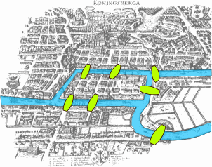

#+Title: Emacs: Org Mode Features
#+DATE: <2006-11-06>
#+TYPE: post
#+FILETAGS: :emacs:
#+DESCRIPTION: Overview of the org mode features

* About

Overview of the Org mode features, based on [[https://orgmode.org/manual/][Org Manual]] and other sources.

* Headings and sections

Headings start with ~*~ and the number of stars defines the heading level.
A couple of ~**~ create the second level. And so on...

Instead of typing many ~*~s, you can use TAB at the beginning of the line to indent and Shift-TAB to de-indent.

The text under the heading becomes the section text and is indented according to the parent heading.

Note: The confusion: coming from markdown, I thought that ~*~ starts a list.
But this is not a list, this is a heading (similar to markdown's ~#~, ~##~, etc.).
It is displayed in org mode as a hierarchical (and collapsible) structure, so it kind of looks and works like a list too.

* Controlling and navigating the document structure

Use ~TAB~ when the cursor is on the document node (in insert mode in evil) to collapse/expand the current node (cycles through states)
+ The cycle is: Folded -> Children -> Subtree

Use ~Shift-TAB~ to collapse/expand all nodes
+ The cycle is: Overview -> Contents -> Show all

~TAB~ / ~Shift-TAB~ are multi-functional, the effect depends on the context:
+ After the heading marker (~*~) it shifts / unshifts the marker.
+ On the table, it formats the table
+ On the list item (heading) it cycles through folding states.
+ More commands to control the visibility: [[info:org#Global and local cycling][org#Global and local cycling]]

Note: The ~M-x toggle-truncate-lines~ is useful to toggle truncation on and off.

Motion commands:
+ Next heading: C-c C-n (org-next-visible-heading).
+ Previous heading: C-c C-p (org-previous-visible-heading).
+ Next heading same level: C-c C-f (org-forward-heading-same-level).
+ Previous heading same level: C-c C-b (outline-backward-same-level).
+ Backward to higher level heading: C-c C-u (outline-up-heading).

Structure editing commands:
+ Insert new heading on the same level: M-RET (org-meta-return)
+ Insert new TODO heading on the same level: M-S-RET (org-insert-todo-heading)
+ Cycle through levels in a new empty entry: TAB (org-cycle)
+ Promote/demote heading or list item: M-LEFT (org-metaleft), M-RIGHT (org-metaright)
+ Move subtree up or down: M-UP (org-move-subtree-up), M-DOWN (org-move-subtree-down)
+ [[info:org#Refile and Copy][Refile]] entry or region to a different location: C-c C-w (org-refile)
+ Narrow/widen buffer to current subtree:
  + Narrow: ~C-x n s~ (~M-x org-narrow-to-subtree~)
  + Widen: ~C-x n w~ (~M-x widen~)

Filtering the document ("sparse tree"): we can filter the document (collapse unrelated headings) based on several properties (such as TODO items, tags, dates). The simplest mode is "Regex" where we can enter the search term and only keep sections that contain it expanded.

Sparse tree commands:
+ Prompt for the filter type: C-c / (org-sparse-tree)
+ Occur: prompts for a regexp: C-c / r (org-occur)
  + Highlights occurrences, highlight can be removed with C-c C-c.

* Lists

Lists can be started with ~+~, ~-~ or ~*~ (the ~*~ should not be at the start of the line or it will be a heading), the list with ~+~ markers:
+ Item 1
  + Item 1.1
    + Item 1.1.1 (use TAB to indent sub-items)
+ Item 2
  + Item 2.2 (items can also be indented by adding more spaces before the marker)

Structure editing commands (see above) that can be used for headings are also useful for lists.
So, for example, ~M-Up~ / ~M-Down~ move list items up and down.

List with ~-~ marker and check-boxes (added with ~[ ]~, ~[x]~, ~[-]~)
- [ ] not started
- [-] in progress
- [X] complete

** TODO Use ~TODO~ to mark the heading as a task and add tags      :tag-one:tag-two:

The ~[/]~ and ~[%]~ add "cookies" that display task progress as "N/M" and "X%".

To toggle the todo state (unmarked -> TODO -> DONE): ~M-x org-todo~ (C-c C-t).
Or just edit it ("TODO" -> "DONE").

It is [[info:org#Workflow states][possible]] to have more states than TODO and DONE.

And more features: add note/timestamp when changing states, set priorities, subtasks, checkboxes.

Search tags with ~M-x org-agenda~ then ~m~, select tag name.

** TODO Organize party [75%] [3/4]
- [-] call people [1/3]
  - [ ] Peter
  - [X] Sarah
  - [ ] Sam
- [X] order food
- [X] think about what music to play
- [X] talk to the neighbors

Scheduling:
+ SCHEDULED: <2021-01-01> - Schedule an item for a specific date.

Use ~M-x org-toggle-checkbox~ to toggle the current checkbox and recalculate cookies.
Use ~M-x org-toggle-radio-button~ to toggle the current checkbox as radio-button (untoggle the rest on the same level).

More commands: [[info:org#Checkboxes][org#Checkboxes]]

Note that direct text editing does not trigger the cookies recalculation. This only happens after using one of the commands like ~M-x org-toggle-checkbox~ or ~M-x org-update-statistics-cookies~ (specifically to do the recalculation).

* Links
Links:
+ ~[[link]]~
+ ~[[link][description]]~
+ ~[[file:file.org]]~
+ ~[[file:file.org::heading]]~

The link format is similar to HTML: ~<a href="target">desc</a>~ (first link, then description).

Once the link is inserted, it is rendered as a hyperlink.
To update it, use ~M-x org-insert-link~ or switch to the fundamental
mode with ~M-x fundamental-mode~ for a plain text view.

Links to images without description are rendered automatically:
+ Web image:
  + https://upload.wikimedia.org/wikipedia/commons/5/5d/Konigsberg_bridges.png
+ Local image:
 + 

To display the image in Emacs, put the cursor on the link and do ~M-x org-link-preview~.

To automatically display all images in Emacs:
#+BEGIN_QUOTE
Org mode can display link previews automatically when opening
buffers.  Either customize 'org-startup-with-link-previews' or use
the '#+STARTUP: linkpreviews' keyword to enable previews for that
specific buffer when opening it.  '#+STARTUP: nolinkpreviews' will
disable previews on startup in the buffer.
#+END_QUOTE

** Info manual links

It is useful to have links to the Info manual. For example, in this document, to have links to the Org mode Info manual for more details.

Example: [[info:org#Global and local cycling][org#Global and local cycling]]

To copy a link in Info mode, use ~M-x org-store-link~ then insert into the org document with ~M-x org-insert-link~.

* Links: cross-linking

The ~M-x org-store-link~ and ~M-x org-insert-link~ are useful to get
links to org documents or nodes and paste in another document.

The link can be edited by using ~M-x org-insert-link~ again.

For more reliable cross-links in org documents, use ~M-x org-set-property~
and insert the ~CUSTOM_ID~ property.

Links can point to a place inside other files:

- ~file:~/code/main.c::255~ - find line 255
- ~file:~/xx.org::My Target~ - find ~<<My Target>>~
- ~[[file:~/xx.org::#my-custom-id]]~ - find the entry with a custom ID

* Tables

Table is added with ~|~, like this:

| Table Heading    | Table Heading  |
|------------------+----------------|
| Table cell       | Table cell     |
| Table cell two   | Table cell two |
| Aligned with TAB |                |
|                  |                |

Table is reformatted with ~TAB~ when cursor is inside the table.

* Markup

Markup is different from Markdown, but similar by nature:
- *Bold* (~*Bold*~)
- /italic/ (~/italic/~)
- _underline_ (~_underline_~)
- =verbatim= (~=verbatim=~)
- ~code~ (~~code~~)
- +strike-through+ (~+strike-through+~)

Markup can be combined: _*/combination/*_ (~_*/combination/*_~).

~code~ (~~code~~) and =verbatim= (~=verbatim=~) need to be the inner-most markup.

More information: [[https://orgmode.org/worg/org-syntax.html#Emphasis_Markers][Emphasis Markers]]

* Editing raw markup

Org mode renders the markup, so, for example, after you add a link, it is hard to edit the URL.

Switching to ~M-x fundamental-mode~ shows everything as plain text.
+ Is there a better way to do this?

* Blocks and Code Blocks

Example block:

#+begin_example
block example
#+end_example

Source block:

#+BEGIN_SRC emacs-lisp
(message "Hello World")
#+END_SRC

To wrap text into the block, use =M-x org-insert-block-template=.

Code blocks can be executed. Emacs Lisp works by default and more languages can be added like this (a snippet from the emacs config):

#+BEGIN_SRC emacs-lisp
;; use python3
(setq org-babel-python-command "python3")
;; Enable python and bash support in org-babel,
;; so that we can run code blocks in org-mode.
(org-babel-do-load-languages
 'org-babel-load-languages
 '((python . t)
   (shell . t)))
#+END_SRC

Execute the code block with ~M-x org-babel-execute-src-block~, the output goes into the following ~#+RESULTS~ block:

#+BEGIN_SRC bash
echo "Hello World (bash)"
#+END_SRC

#+RESULTS:
: Hello World (bash)

#+BEGIN_SRC python
return "Hello World (python)"
#+END_SRC

#+RESULTS:
: Hello World (python)

We have access to the outside world too, for example, get the list of =*.el= files in the current folder, calculate file sizes and print as a table:

#+BEGIN_SRC python
    from pathlib import Path
    elFiles = []
    for el_file in Path("./").glob("*.el"):
        elFiles.append([
            el_file.name,
            "{:4.1f} KiB".format(el_file.stat().st_size / 1000)])
    return elFiles
#+END_SRC

#+RESULTS:
| custom-vars.el | 0.8 KiB  |
| init.el        | 43.4 KiB |

* Clocking
:LOGBOOK:
CLOCK: [2026-09-20 Sun 17:00]--[2026-09-20 Sun 17:08] =>  0:08
CLOCK: [2026-09-20 Sun 16:56]--[2026-09-20 Sun 16:56] =>  0:00
:END:
+ ~C-c C-x C-i~ - Start the clock
+ ~C-c C-x C-o~ - Stop the clock
+ ~C-c C-x C-e~ - Change the effort estimate

* Capturing
+ ~M-x org-capture~

* Agenda
+ C-c a a - Open the agenda (day / week view)
+ C-c a t - List all TODO entries
+ C-c a m - Match tags and properties

* Org mode + Embedded Calc Demo

https://www.reddit.com/r/emacs/comments/1upaqm5/underappreciated_emacs_builtins_emacs_calc/

Press =C-x *=, then =?= to see the calculator help.

Calculator can work in its own window, but it can also be used in
the org document to calculate embedded expressions.

Press =C-x * u= on the formula to evaluate it.

#+begin_example
$(80 km/h) * 2h$
#+end_example

The formula like above will be replaced with the result.

To keep the formula and add the result, use the ~=>~ at the end of the formula:

#+begin_example
$(80 km/h) * 2h => $
#+end_example

=C-x * a= detects and activates every "assignment-formula", so we can have some
assignments and then evaluate the formula that uses them:

#+begin_example
$mass := 2 kg$
$v := 3 m/s$
$E_c := (1/2) mass * v^2 => $
#+end_example

Out comes =9 kg m^2 / s^2=

The calculator understands units:

#+begin_example
$side1 := 3 m$
$side2 := 40 cm$
$hyp := usimplify(sqrt(side1^2 + side2^2)) => 3.02654919008 m $
#+end_example

It can solve equations! Press =C-x * u= on the next formula:

#+begin_example
$solve(22 x + 33 = 65, x) => x = 1.45454545455 $
#+end_example

* [[https://github.com/unhammer/org-rich-yank][org-rich-yank]] to copy/paste rich text

Copy code, then insert with ~M-x org-rich-yank~ to get it formatted as org mode
block.

* org-download to download images

Put the cursor on a link, copy it (can do =vi[y= if on an org link)
then run ~M-x org-download-yank~ to download the image and insert a
local link into the org file.

https://getreuer.info/posts/keyboards/symbol-layer/my-layer-v2.png

Use ~M-x org-link-preview~ to display images inline.
Use ~M-x org-link-preview-refresh~ to make sure all images are displayed.

org-download also allows dragging and dropping images to Emacs.

* pandoc to convert from Google Docs to org-mode

Google Docs document can be converted to org mode by downloading it as =docx= and then
converting with pandoc:

#+BEGIN_SRC bash
    # The --extract-media=images will put extracted images in the images/media folder.
    pandoc -f docx -t org --extract-media=images -o Document.org ~/Downloads/Document.docx
#+END_SRC

* [[https://cmdln.org/2023/03/25/how-i-org-in-2023/][How I org in 2023 (web)]]

My notes based on the "How I org in 2023" article:
- https://github.com/nickanderson/how-i-org
- https://github.com/nickanderson/org-config

** Structure
  + ~/org
    + ~/org/roam
      + subfolders, lots of files
    + lots of files
** Write
  + org-roam [primary capture interface, with lots of templates]
  + org-roam-ui - interactive 2D or 3D graph of nodes
  + org-babel to execute code inside documents
  + [[https://github.com/nobiot/org-transclusion][org-transclusion]] to extract content into separate notes and link to it
  + presentations using ~org-reveal~ and ~org-re-reveal~ with nice features like speaker notes
  + ~abbrev-mode~ for auto-correcting common typos
  + ~writegood-mode~ and [[https://github.com/rnkn/olivetti][olivetti]] are nice for writing.
  + diagrams with [[https://orgmode.org/worg/org-contrib/babel/languages/ob-doc-plantuml.html][PlantUML]] or [[https://github.com/arnm/ob-mermaid][Mermaid]]
** Capture
  + org-web-tools to pull web pages into org
  + [[https://github.com/abo-abo/org-download][org-download]] to insert images into a document, provides functions for taking and inserting screenshots, downloading images, renaming images as well as dragging and dropping images into your document
  + [[https://github.com/unhammer/org-rich-yank][org-rich-yank]] to copy/paste rich text
  + capture notes for yesterday, tomorrow or an arbitrary date: ~org-roam-dailies-capture-yesterday~, ~org-roam-dailies-capture-tomorrow~, and ~org-roam-dailies-capture-date~
  + ~org-roam-capture~ to capture non-date related note.
** Navigate
  + See today note: ~org-roam-dailies-goto-today~ (or create it), ~org-roam-dailies-goto-yesterday~, ~org-roam-dailies-goto-tomorrow~, and ~org-roam-dailies-goto-date~ take you to the note for yesterday, tomorrow, or the specified date, creating the file if necessary
  + ~org-roam-dailies-goto-previous~ and ~org-roam-dailies-goto-next~ go to the previous and next note in the series
  + org-roam-random-note can display random node (for example, on startup)
  + [[https://github.com/alphapapa/org-sticky-header][org-sticky-header]]: show in the header-line the Org heading for the node that's at the top of the window.
    + can be customized to show just the heading, the full outline path, or the full outline path in reverse.
** Export
  + there are many export backends: ~org-mime~ for mail, Markdown flavours (~ox-hugo~ for blog, ~ox-gfm~, ~ox-slack~)
  + export using ~ox-jira~ and use ~org-jira~ to manage issues in Jira.
  + write reports, export to ODT for copying and pasting into Google Drive and PDF for emailing
  + write blog posts exporting with ~ox-hugo~ to multiple websites using different hugo configurations
  + author emails in org-mode exported with ~org-mime~ as a multi-part ASCII & HTML message
** Search
  + Search node by name: org-roam-node-find
  + Search content: ripgrep + consult-ripgrep
  + See other notes that link to this one: org-roam-buffer
  + org-agenda can be fed by org-roam-db-query
** Mobile
  + Syncthing to sync the ~Orgzly~ folder and the [[https://www.orgzly.com/][Orgzly, android app]]
** LLMs:
  + org-ai, chatgpt-shell, [[https://llm.datasette.io/en/stable/][llm]], [[https://github.com/karthink/gptel][gptel]]
  + [[https://khoj.dev/][Khoj]] is a desktop application to search and chat with your notes, documents and images.
    + It is an offline-first, open source AI personal assistant accessible from your Emacs, Obsidian or Web browser.
    + It works with jpeg, markdown, Notion, org-mode, pdf files and github repositories.
** Other
+ [[https://github.com/krisajenkins/ob-translate][ob-translate]]: translate text
+ [[https://github.com/ahungry/md4rd][md4rd]]: Reddit client
+ [[https://github.com/emacs-elfeed/elfeed][elfeed]]: feed reader
+ [[https://github.com/natask/org-roam-search][org-roam-search]]: org-ql like search for org-roam
+ [[https://github.com/alphapapa/org-ql][org-ql]]: query language for Org files
+ [[https://www.nongnu.org/org-edna-el/][org-edna]]: dependencies and actions for Org tasks
+ [[https://github.com/unhammer/org-mru-clock][org-mru-clock]]: automatically track time for the most recent task
+ [[https://github.com/weirdNox/org-noter][org-noter]]: create Org notes for other documents
+ [[https://titan-c.gitlab.io/org-cv/][org-cv]]: make a CV in org-mode (-> LaTeX -> PDF)
+ [[https://github.com/zzamboni/ox-leanpub][ox-leanpub]]: publish books and courses
+ [[https://github.com/alphapapa/org-super-agenda][org-super-agenda]]: "supercharge" the agenda by grouping it into sections
+ [[https://github.com/alphapapa/org-recent-headings][org-recent-headings]]
+ [[https://github.com/alphapapa/org-protocol-capture-html][org-protocol-capture-html]]: capture web pages to Emacs with a bookmarklet
+ [[https://github.com/emacs-slack/emacs-slack][emacs-slack]]: Slack client
+ [[https://github.com/sulami/literate-calc-mode.el][literate-calc-mode]]: literate programming for M-x calc
+ [[https://github.com/brunoarine/org-similarity][org-similarity]]: cosine similarity search for Org files
+ [[https://github.com/jkitchin/org-ref][org-ref]]: insert citations, cross-references, indexes and glossaries
+ org-cite: citations (https://orgmode.org/manual/Citations.html)
+ [[https://gewhere.github.io/org-bibtex][org-bibtex]]: bibtex citations
+ [[https://github.com/isamert/orgmdb.el][orgmdb]]: watchlist, OMDb API
+ [[https://github.com/chrisbarrett/nursery/blob/main/lisp/org-roam-review.el][org-roam-review]]: spaced repetition for notes.
+ [[https://github.com/Fuco1/org-pretty-table][org-pretty-table]]: unicode tables
+ [[https://github.com/tefkah/org-roam-timestamps][org-roam-timestamps]]: track modification and creation time for nodes.
+ [[https://github.com/Malabarba/camcorder.el][camcorder.el]]: record screencasts from emacs
+ [[https://github.com/jeremy-compostella/org-msg][org-msg]]: authoring emails
+ [[https://github.com/rtrppl/orgrr][orgrr]]: a replica of org-roam v1 implemented using ripgrep
+ [[https://github.com/Kinneyzhang/gkroam][gkroam]]
+ [[https://github.com/protesilaos/denote][denote]]: simple note taking tool using predictable and descriptive file-naming scheme.
+ [[https://github.com/localauthor/zk][zk]]: simple Zettelkasten implementation for Emacs.
** Example: email flow, documentation update, Git flow
+ Email
  + Read emails in ~mu4e~, open the message you want to reply to.
  + Run ~org-roam-dailies-capture~ -> press e (email) r (response).
  + This creates a new node in today's work log with the headline "Responded to name@some.org Re: Some Email" and a link back to the message in mu4e (that information is automatically pulled from the email I was reading when I initiated the capture).
  + The "e" -> "r" points to the email response template.
  + Standard template fields are pre-populated.
  + Find relevant information in another note, ~org-roam-node-find~
  + Run ~org-mime-org-subtree-htmlize~ to export the org-mode text to a multipart plain text (ascii) and html message
  + Then ~C-c C-c~ to send it, and ~C-c C-c~ again to complete my capture
+ Documentation update
  + run ~org-jira-create-issue~ to create the ticket
  + run ~org-jira-progress-issue~ to set it in progress
  + initiate a new work log capture
  + run ~projectile-switch-project~ and switch to the documentation repository
  + find the documentation I want to update and yank it
  + go back to the work log, run ~org-rich-yank~ to paste the copied text with a link back to the source
  + update the documentation, while at it visit other repositories yanking other snippets of code for reference
    + ~ol-git-link~ provides nice capabilities for linking to git forges
  + export the notes to Jira wiki syntax with ~ox-jira~
  + copy exported text, add it to the Jira ticket using ~org-jira-add-comment~
+ Git flow
  + continuing from above...
  + create a new branch with ~magit-branch-create~, commit and push.
  + use [[https://github.com/magit/forge][forge]] to open a pull request, request reviewers, make comments and grab the URL of the Pull Request
  + add the PR URL to the work log which ultimately becomes a well styled comment in the associated Jira issue
  + once the PR is approved, merge it with ~forge-merge~ and close the issue with ~org-jira-progress-issue~
** Example, configuration ([[https://fosstodon.org/@nickanderson/109979927683467557][source]]): Setting ~org-agenda-files~ dynamically to a custom dir (to collect todos scattered across the files)

   #+BEGIN_SRC emacs-lisp
   (defun my/search-TODO-created-2023()
     (seq-uniq
       (seq-map
         #'car
         (org-roam-db-query
          [:select [file]
                   :from nodes
                   :where (like properties '"%CREATED%2023%")
                   ]
                   ))))

   (setq org-agenda-custom-commands
        '(("z" todo "TODO" ;; (1) (3) (4)
          ((org-agenda-files (my/search-TODO-created-2023)))
          )))
   #+END_SRC

** Links
+ [[https://cmdln.org/2023/03/13/reflecting-on-my-history-with-org-mode-in-2023/][Reflecting on my history with org-mode in 2023]]
+ [[https://doc.norang.ca/org-mode.html][Org Mode - Organize Your Life In Plain Text!]]
+ [[https://www.youtube.com/watch?v=PE4eGkIQycc][Org-mode all the thingz!]]
  + [[https://github.com/nickanderson/Org-mode-all-the-thingz/blob/master/presentation.org][org source]], [[https://github.com/nickanderson/Org-mode-all-the-thingz/blob/master/presentation.html][html source]]
+ [[https://daryl.wakatara.com/emacs-gtd-flow-evolved/][Emacs GTD Flow Evolved]]
+ [[https://willvaughn.org/articles/vp-of-emacs-a-personal-wiki-in-plain-text/][VP of Emacs: A Personal Wiki In Plain Text]]
+ [[https://github.com/hasu/notdeft][NotDeft]]: Emacs package for searching and managing collections of plain text note files.
  + It features efficient, local, Xapian engine based search over potentially very large numbers of note files

* Reference

- [[https://orgmode.org/quickstart.html][Org mode quick start (web)]]
- [[https://orgmode.org/guide/][Org mode guide (web)]]
- [[https://orgmode.org/tools.html][Org mode tools (web)]]
- [[info:org#Top][The Org Manual (Info)]]
- [[https://orgmode.org/worg/][Org mode community wiki (web)]]
- [[https://orgmode.org/worg/org-tutorials/index.html][Org mode tutorials (web)]]
- [[https://orgmode.org/orgcard.pdf][Org mode Reference Card (web, pdf)]]
