#+TITLE: Keyboard Layouts: Examples
#+DATE: <2006-11-06>
#+TYPE: post
#+FILETAGS: :kbd:
#+DESCRIPTION: A collection of keyboard layouts.

Various examples of keyboard layouts.

* Layouts                                                            :folded:
** [[https://stevep99.github.io/seniply/][_Colemak-DH Seniply_]]
:PROPERTIES:
:CUSTOM_ID: colemak-dh-seniply
:END:
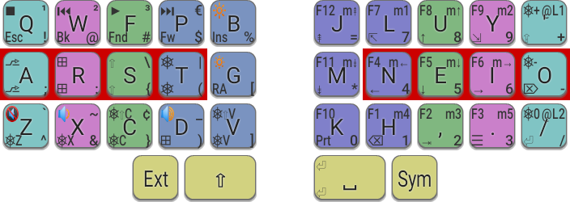

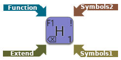

#+CAPTION: Base
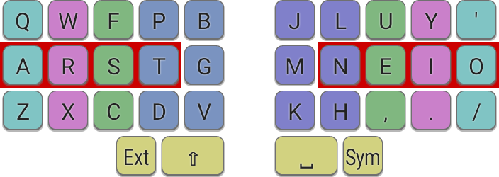

#+CAPTION: Ext
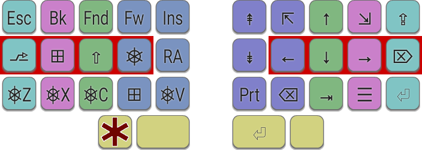

Navigation and other non-printable functions are provided by the Extend
layer, which is heavily based on [[https://dreymar.colemak.org/layers-extend.html][DreymaR's original]].

The Extend layer is selected via the left-most thumb key. This layer
provides navigation, page up/down, home/end on the right-hand side.
Backspace ⌫ is assigned to a comfortable spot on a strong index finger
(Ext-H), with Delete ⌦ also well positioned on the home-row (Ext-O).

On the left-hand side are home-row modifiers for Alt, Super, Shift,
Control and AltGr on A,R,S,T,G respectively. As with DreymaR's Extend,
these modifiers can be held down and combined with other Extend
functions such as arrows etc, to comfortably produce combinations like
Ctrl ⌫, Alt ←. Importantly though, these home-row modifiers are also
implemented as one-shot (sticky) keys, which makes it easy to do Control
and Alt shortcuts without needing dedicated modifier keys. An additional
non-sticky Super key is provided on Ext-D as some desktop environments
require this key to be tapped on its own. Commonly used operations like
Cut, Copy, Paste and Undo have dedicated shortcuts in this layer too.

Examples:

(i) Output Ctrl-A using Ext-t a

(ii) Output Ctrl-W using Ext-t w

(iii) Output Alt-Tab using Ext-a-,

#+CAPTION: Functiun
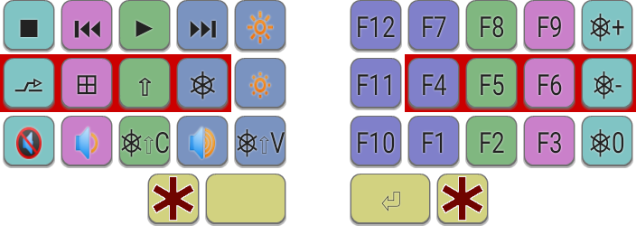

#+CAPTION: Sym
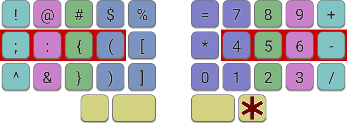

#+CAPTION: Symbols2 Layer
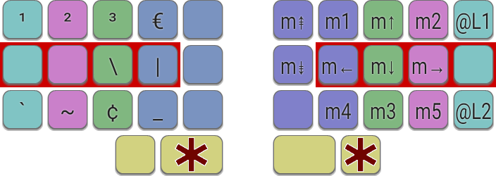

** [[http://xahlee.info/kbd/eucalyptus_keyboard.html][_Eucalyptus Keyboard_]]
:PROPERTIES:
:CUSTOM_ID: eucalyptus-keyboard
:END:
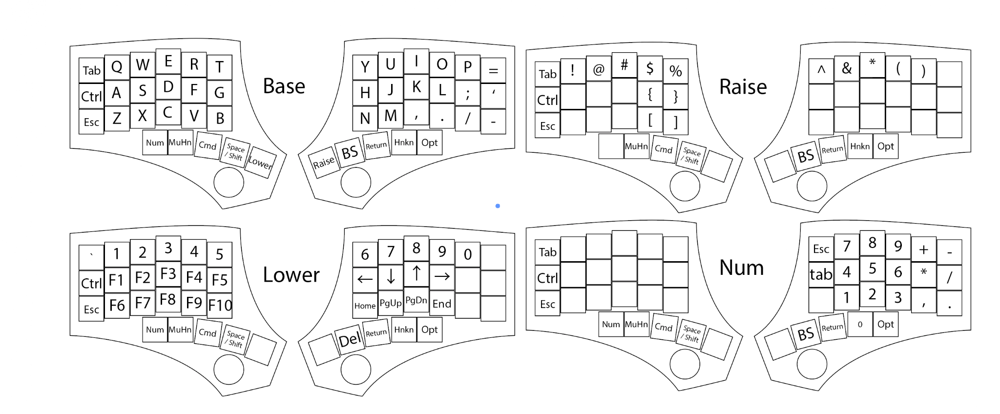

** [[http://xahlee.info/kbd/darknight_keyboard.html][_Darknight Keyboard_]]
:PROPERTIES:
:CUSTOM_ID: darknight-keyboard
:END:
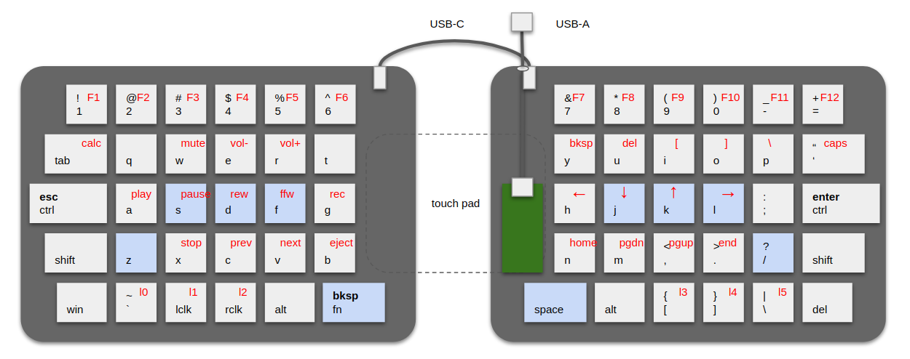

** [[http://xahlee.info/kbd/gergoplex.html][_gergoplex_]]
:PROPERTIES:
:CUSTOM_ID: gergoplex
:END:
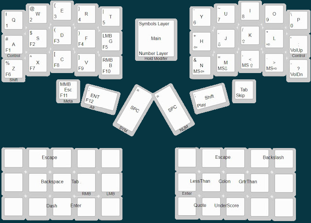

** [[http://xahlee.info/kbd/gergo_keyboard.html][_Gergo Keyboard_]]
:PROPERTIES:
:CUSTOM_ID: gergo-keyboard
:END:
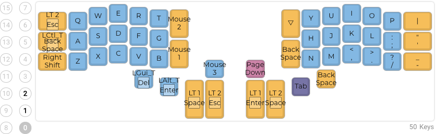

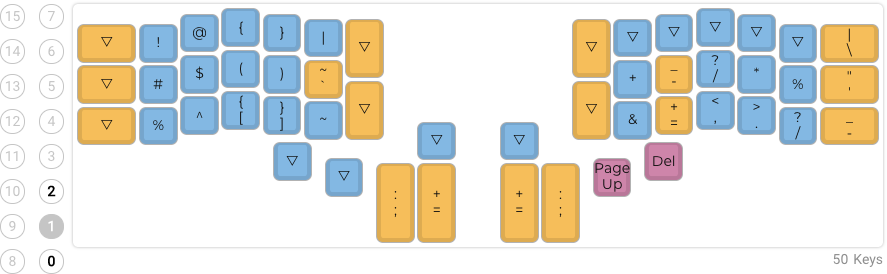

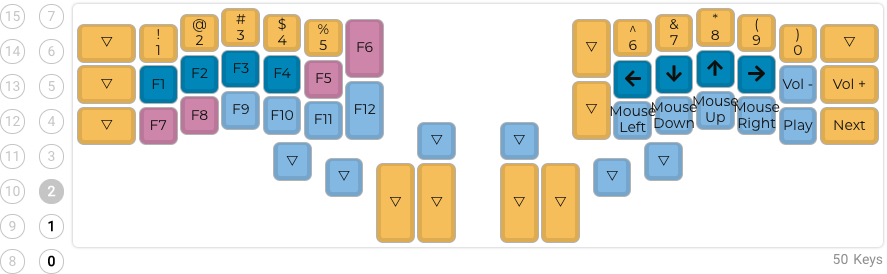

** Xah Gergo Layout
:PROPERTIES:
:CUSTOM_ID: xah-gergo-layout
:END:
[[http://xahlee.info/kbd/xah_gergo_layout.html][_Xah Gergo Layout_]]

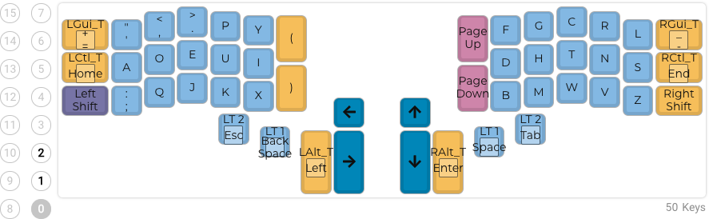

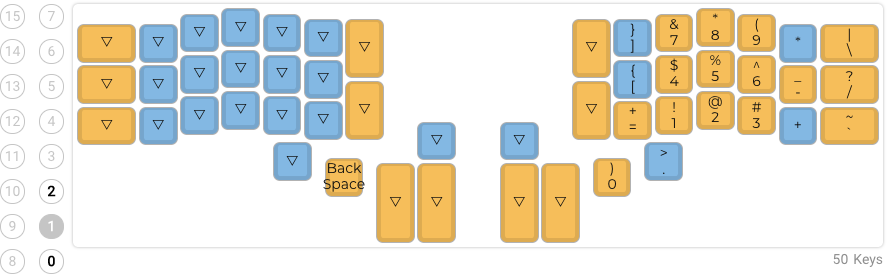

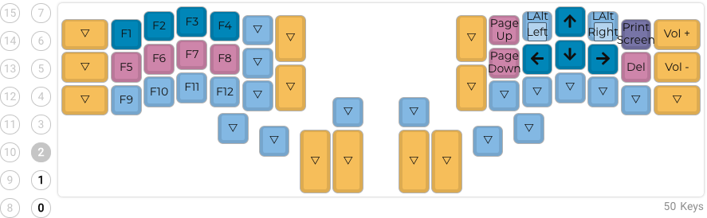

** [[http://xahlee.info/kbd/gergoplex.html][_gergoplex_]]
:PROPERTIES:
:CUSTOM_ID: gergoplex-1
:END:

** [[http://xahlee.info/kbd/atreus_keyboard.html][_Atreus Keyboard_]]
:PROPERTIES:
:CUSTOM_ID: atreus-keyboard
:END:

#+CAPTION: Fn

** Mitosis
:PROPERTIES:
:CUSTOM_ID: mitosis
:END:
[[http://www.keyboard-layout-editor.com/#/gists/f89d2ff79b72e920939b][_http://www.keyboard-layout-editor.com/#/gists/f89d2ff79b72e920939b_]]

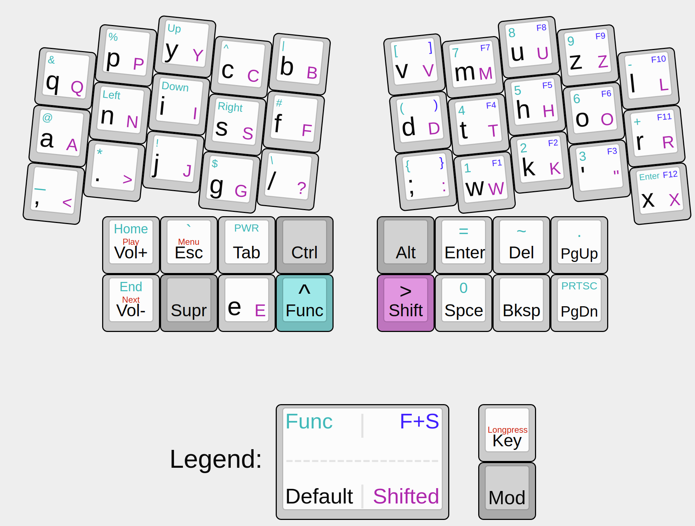

[[http://www.keyboard-layout-editor.com/#/gists/e213fec721cb035614cef401cd6750d6][_http://www.keyboard-layout-editor.com/#/gists/e213fec721cb035614cef401cd6750d6_]]

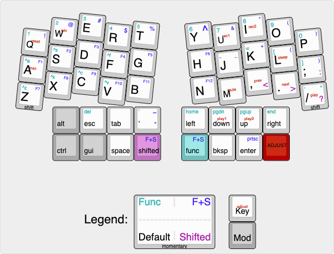

** Mitosis qwerty
:PROPERTIES:
:CUSTOM_ID: mitosis-query
:END:
[[https://www.reddit.com/r/MechanicalKeyboards/comments/66588f/wireless_split_qmk_mitosis/di5yf8z/][from the Reddit comment]]

[[http://www.keyboard-layout-editor.com/#/gists/acec41432b5ce0eb341d88245a20d9da][http://www.keyboard-layout-editor.com/#/gists/acec41432b5ce0eb341d88245a20d9da_]]

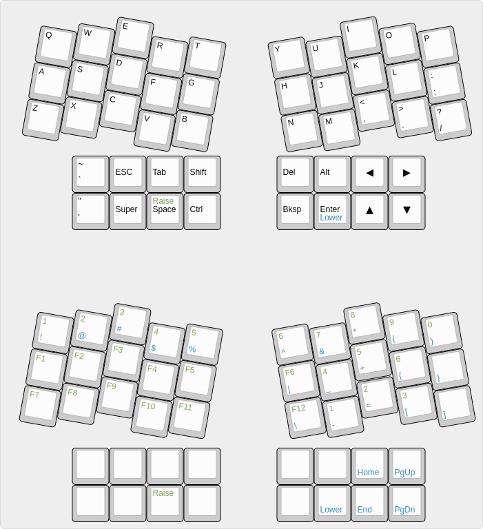

** [[https://josef-adamcik.cz/electronics/in-search-of-the-best-custom-keyboard-layout.html][_In search of the best custom keyboard layout_]]
:PROPERTIES:
:CUSTOM_ID: in-search-of-the-best-custom-keyboard-layout
:END:
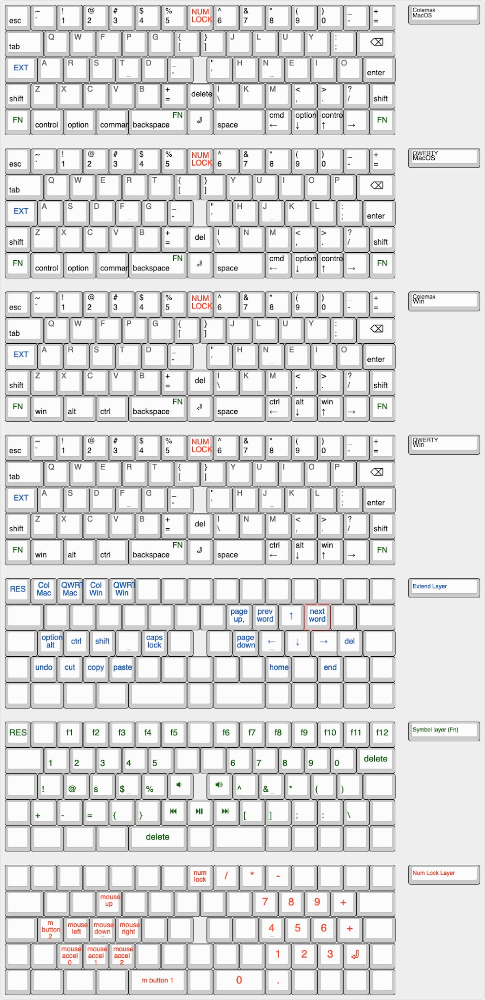

** [[https://josef-adamcik.cz/electronics/in-search-of-the-best-custom-keyboard-layout.html][_In search of the best custom keyboard layout_]]
:PROPERTIES:
:CUSTOM_ID: in-search-of-the-best-custom-keyboard-layout-1
:END:
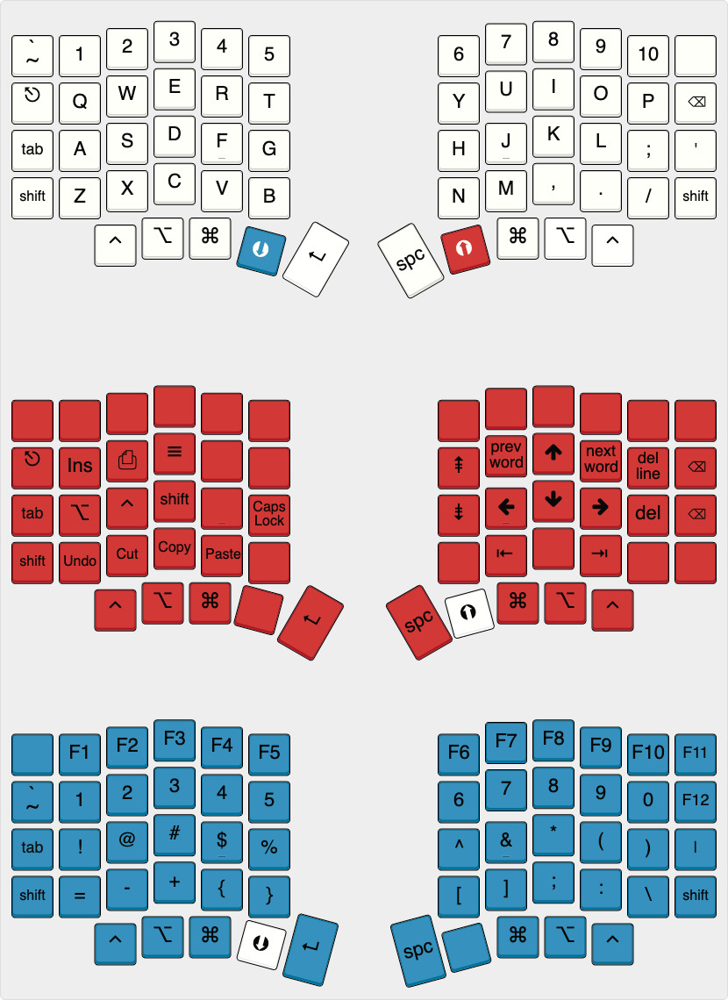

** [[https://www.reddit.com/r/MechanicalKeyboards/comments/igf0xw/check_out_my_new_small_keyboard_and_read_all/][_Check out my new small keyboard and read all about my layers (details in comments) : MechanicalKeyboards_]]
:PROPERTIES:
:CUSTOM_ID: check-out-my-new-small-keyboard-and-read-all-about-my-layers-details-in-comments-mechanicalkeyboards
:END:
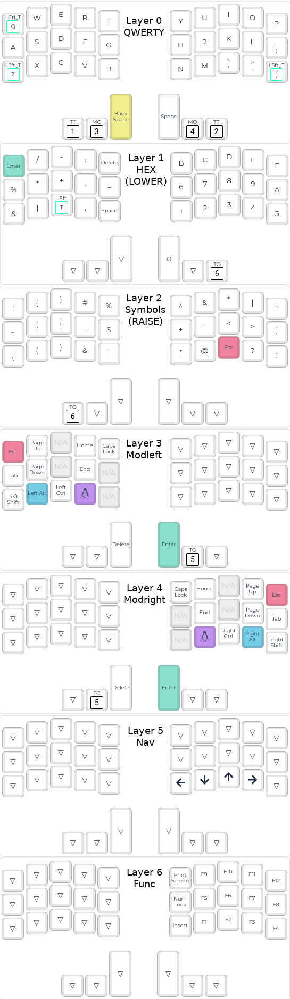

QWERTY layer

Not much to see here, pretty essential default layer provides a standard
QWERTY; layout, however if the 'z' or '/' key is held it acts as a
shift, likewise the 'q' key acts like control when held; having these
basic modifiers easily accessible is entirely essential. Backspace and
space are available on the innermost thumb cluster keys on the left and
right, respectively. The outermost thumb cluster keys give access to the
hex and symbols layers (left and right, respectively), while the middle
thumb cluster keys access the left and right modifier layers. The left
and right thumb buttons become delete and enter whenever the modifiers
layer is active. The QWERTY layer is indicated by a blue underglow.

Hex layer (lower)

The hex layer is accessed by the left thumb holding or double-tapping
the "Lower" key. The hex layer glows pink.

A numpad layer is fairly common on the layouts I've seen and used, but I
cannot recall seeing a hexpad layer anywhere. Since I actually do find
myself typing hex fairly often it seemed reasonable to forgo a
traditional numpad. Instead I used the fifteen keys on the right hand to
provide the numbers 1-F with 0 on the thumbcluster. I type numbers in a
variety of contexts and they each use distinct punctuation to separate
the digits. For instance, typing a datetime requires up to 4 symbols
(e.g. 2020-08-16T06:03:56.69420) while typing any maths requires having
operators close at hand. To address this I used the left hand for a
variety of symbols which find regular use alongside numbers. For
convenience I provided delete, space, and enter as well. While on the
hex layer pressing the "Raise" key will change layers to the function
layer.

Symbols layer (raise)

Access the symbols layer by holding or double-tapping the "Raise" key.
Symbols are active when the board glows cyan.

The symbols layer gives access to all the symbols, importantly I wanted
to have underscore and all the brackets really prominently on the hand
opposite the "Raise" key. Pressing the "Lower" key while on the symbol
layer also makes the function layer active. This symmetric arrangement
permits the function layer to be accessed by touching the raise and
lower keys simultaneously.

modifiers layer (left and right)

Using a text editor /essentially requires/ having ready access to all
modifier keys in conjunction with /any/ normal key, so a layer which
features a modifier key covering any normal key presents a problem. My
solution to this is to provide two separate modifier layers which each
only consume one hand of the split layout, the other hand is completely
transparent to allow access to whichever key from any of the QWERTY,
hex, or symbols layer might be needed.

The left modifier layer is accessed by holding the "Mod" under your left
thumb and will be signified with a red glow under your left hand (and
right with right).

The placement of the modifiers is mirror imaged on either side. Caps
lock is accessible on both sides, which when active one LED on each side
will glow white.

navigation layer

The navigation layer places arrow keys on the left side of the board.
Find it by tapping both of the "Mod" keys, and recognize it by the three
top LEDs of the right half glowing green.

function layer

The function layer provides access to the F-keys, print screen, num
lock, and insert. It underglows white and can be accessed by hitting
both the "Raise" and "Lower" keys.

** [[https://sgotti.dev/post/the-quest-for-the-perfect-keyboard-and-layout/][_The (infinite) quest for the perfect keyboard and layout_]]
:PROPERTIES:
:CUSTOM_ID: the-infinite-quest-for-the-perfect-keyboard-and-layout
:END:

#+CAPTION: base
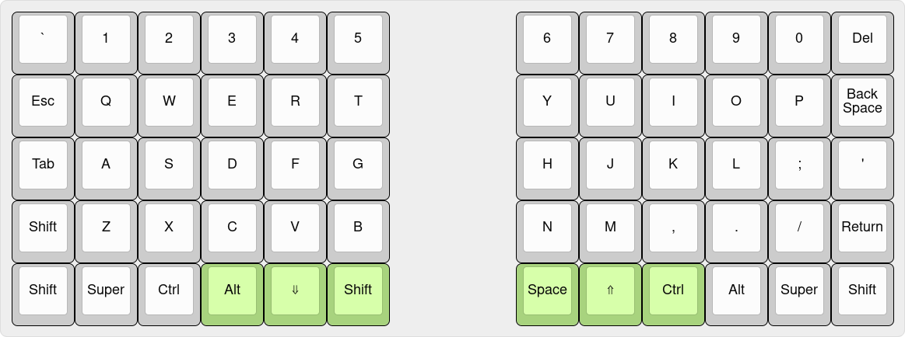

#+CAPTION: raise
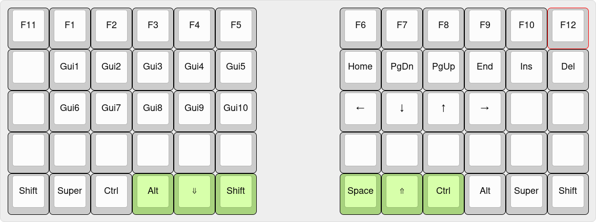

#+CAPTION: lower
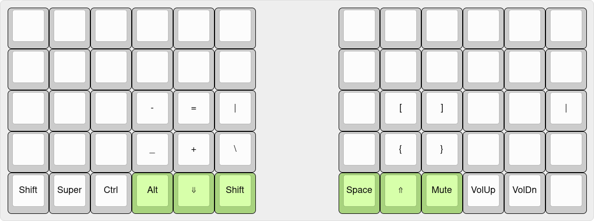

** [[https://www.smittey.co.uk/the-planck-key-theory][_The Planck - Key Theory_]]
:PROPERTIES:
:CUSTOM_ID: the-planck---key-theory
:END:

#+CAPTION: Base
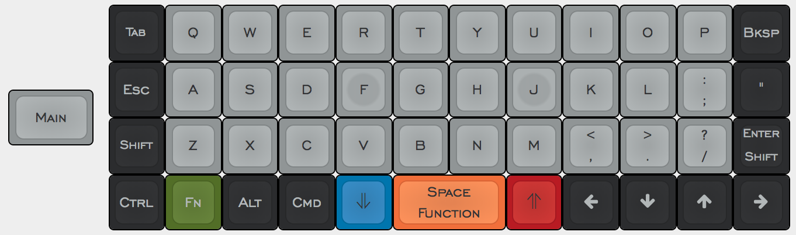

#+CAPTION: Lower
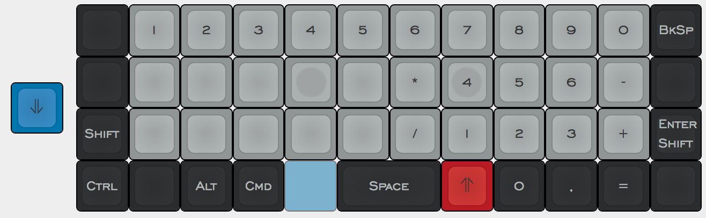

#+CAPTION: Raise
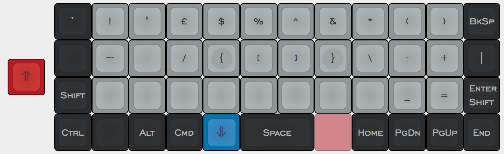

#+CAPTION: Space FN
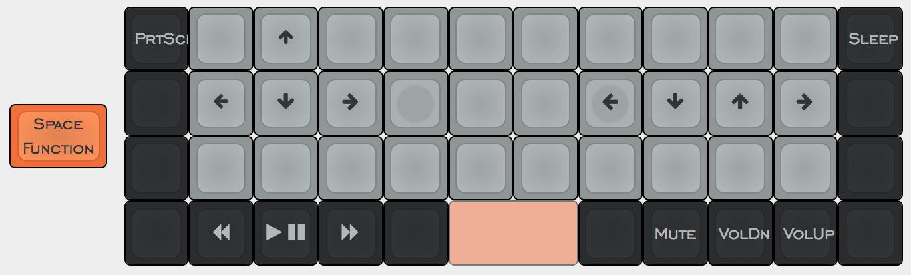

** The art of making 40% layouts
:PROPERTIES:
:CUSTOM_ID: the-art-of-making-40-layouts
:END:
[[http://www.keyboard-layout-editor.com/#/gists/d06425aaccaef71cf3d0ffbc0e2042ba][http://www.keyboard-layout-editor.com/#/gists/d06425aaccaef71cf3d0ffbc0e2042ba_]]

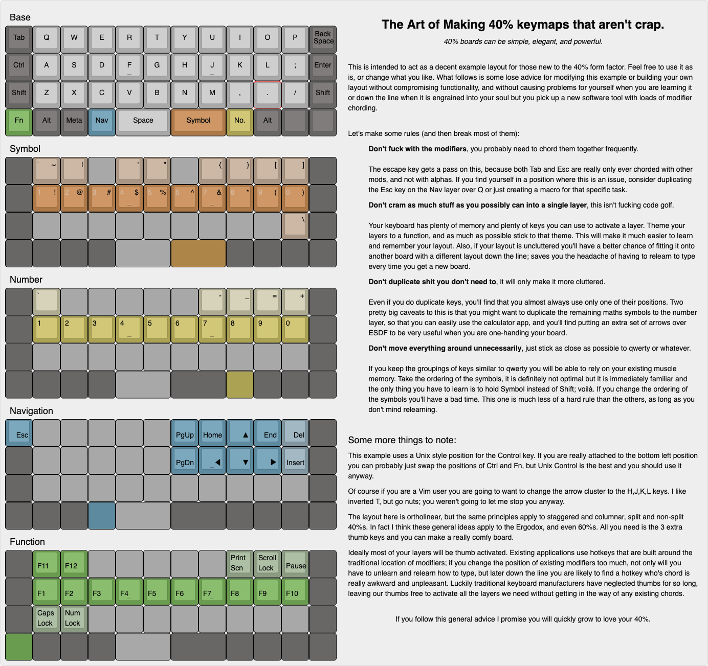

** [[http://evantravers.com/articles/2020/02/22/customizing-a-keyboard-layout/][_Customizing a Keyboard Layout_]]
:PROPERTIES:
:CUSTOM_ID: customizing-a-keyboard-layout
:END:

#+CAPTION: Plank Version
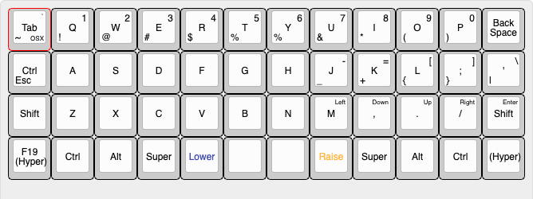

#+CAPTION: Kyria Version
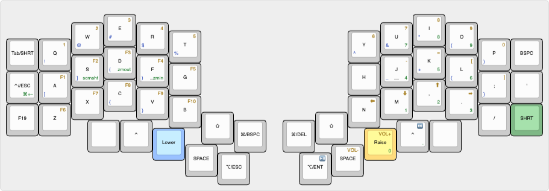

** Planck: [[https://github.com/olkb/olkb_parts/blob/master/planck/planck-keymap-MD3.pdf][_The PDF of the default keymap_]]
:PROPERTIES:
:CUSTOM_ID: planck-the-pdf-of-the-default-keymap
:END:
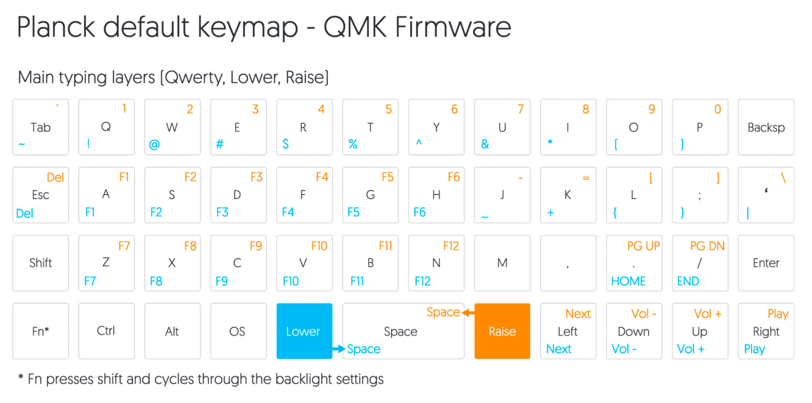

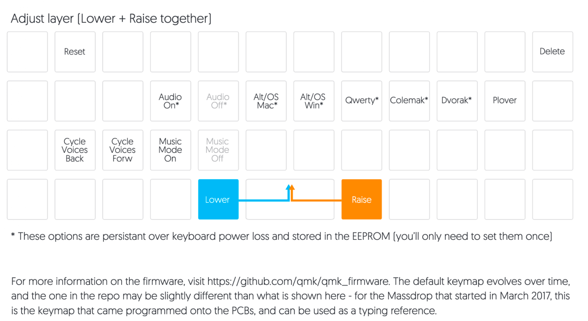

** Moonlander, Planck, and new layout that minimizes pinkies and stretching
:PROPERTIES:
:CUSTOM_ID: moonlander-planck-and-new-layout-that-minimizes-pinkies-and-stretching
:END:

[[https://www.reddit.com/r/ergodox/comments/jjk0rf/moonlander_planck_and_new_layout_that_minimizes/gafhjvp][from the Reddit comment]]

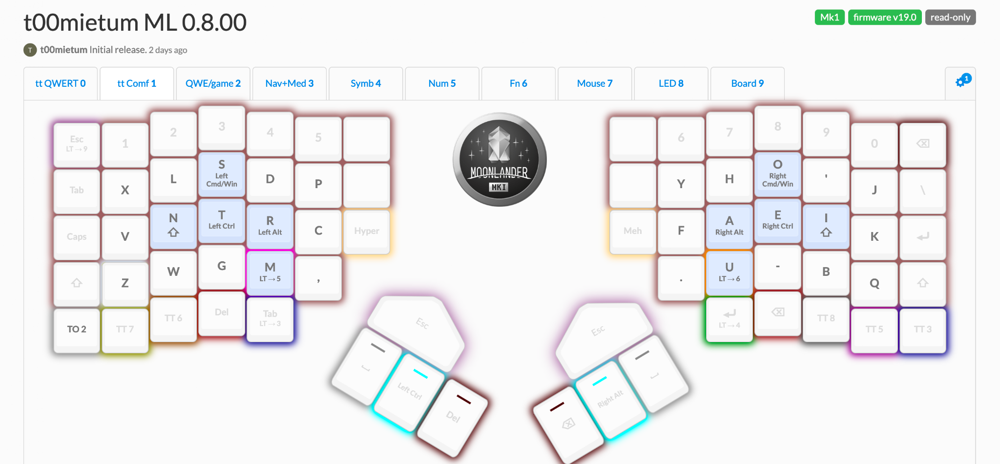

I went a long way down those rabbit holes! I'd say definitely don't
bother with 4grams. You can and probably would go mad. The only way I'm
typing on an infinitely better layout now, is because:

- I remembered that my peak Dvorak speed, after a few years of
  all-day/every-day use and frequent speed test practice, was only
  marginally better than qwerty; and typical use was slower. Which
  suggests to me at least, that the strength of brain wiring is more
  important to speed and accuracy, than any specific layout, even as
  grossly suboptimal as qwerty is. (And like most, I had developed
  organic, mostly subconscious workarounds for qwerty's worst flaws.)

- There are SO many tradeoffs and compromises that have to be weighted
  and considered, it's literally not possible to accomplish all
  objectives. Optimize top 3grams? Sacrifice top 2grams. Optimize top
  2grams? Sacrifice pinkie curling. It's endless (even with tools like
  [[http://mkweb.bcgsc.ca/carpalx/][_this_]]), and maddening. I
  eventually realized that, while I could still weight other concerns, I
  had to really focus on two main things: minimal pinkie use, and
  minimal index finger stretching. That greatly simplified things, and
  was the only thing that allowed me to make progress. Basically the
  only other priorities that had significant influence after that, was
  alternating fingers!

- I gave all the major modern layouts really good runs. Colmak[/dh],
  Workman, Carpalx [[http://mkweb.bcgsc.ca/carpalx/?full_optimization][_QGMLWY_]], and
  several ortholinear/thumb-cluster derivatives. I desperately wanted
  one - any one - to work. They all made too many tradeoffs. (And had
  too many "quality-of-life" issues such as dumb navigation or Fn-key
  layering.) For example, many layouts make the inexplicable choice to
  maintain ZXCV, and/or symbols locations. But that immediately and
  /severely/ constrains your options! Such wholly unnecessary artificial
  hamstringing must be the first thing to go if you want to have any
  hope of optimizing much else.

- Even the few layouts that avoid those mistakes, still seem to optimize
  for a five-finger home row, that involves too much pinkie, and index
  stretching. That's bad for me personally, and I'm now realizing
  possibly in general too.

My work has all been local, but I've recently begun open-sourcing it.
More to come.

[[https://github.com/t00mietum/keyboard][https://github.com/t00mietum/keyboard_]]

[[https://docs.google.com/spreadsheets/d/1i8QfbnC41kJ8Fhe2n4VAXiONWaPQjeGDeqqHqsaXD2Y/edit?usp=sharing][https://docs.google.com/spreadsheets/d/1i8QfbnC41kJ8Fhe2n4VAXiONWaPQjeGDeqqHqsaXD2Y/edit?usp=sharing]]

[[https://configure.ergodox-ez.com/moonlander/layouts/7Qqby/][https://configure.ergodox-ez.com/moonlander/layouts/7Qqby/]]

[[https://configure.ergodox-ez.com/planck-ez/layouts/En5W5/][https://configure.ergodox-ez.com/planck-ez/layouts/En5W5/]]

By another user:

Incase you're interested my 61 are:
- 26 Letters
- 10 numbers
- 11 symbols: ,.;'`/[]-= (and their shifted options)
- 4 modifiers: shift, ctl, alt, win
- 3 whitespace: space, tab, enter
- backspace and delete,
- arrow keys
- esc

I gave serious consideration to autoshift, but opted not to because:
- I knew I'd be layering modifier keys on top of letters,
- I reasoned that I'd be already struggling mightily with new (to me)
  ortho config, all modifier keys moved around; numbers, Fn, nav, and
  symbols moved, and a new alpha layout. (And I am struggling! But by
  now it's a sound layout. Just need muscle memory. I struggled through
  dvorak successfully, I'll get this too.) Adding autoshift to the mix
  might break my brain. Esp as I type painfully slow now, but eventually
  80 to 100 wpm.

I've been thinking about OSM. I think it would work well for things like
Fn layer, which as afaicr, are only ever single presses. But not, I
think, for things like ctrl or shift, where you might (and I often do)
hold it down while doing a number of things in succession, e.g.
"advanced" text navigation, selection, etc. Similarly with Alt, for
things like text multiselect, Linux window management, file manager
navigation, etc.

I love the Microdox, thanks for that link! I might have to order one.
Like yours, my layouts are specifically designed with that form factor
in mind as a lowest common denominator. I ordered [[https://www.gboards.ca/product/gergoplex-heavy][_this_]] months ago,
but have given up on it shipping.

So, my layouts are fully functional if all the extra keys go away.

** Miryoku
:PROPERTIES:
:CUSTOM_ID: miryoku
:END:
[[https://github.com/manna-harbour/miryoku/tree/master/docs/reference][https://github.com/manna-harbour/miryoku/tree/master/docs/reference]]

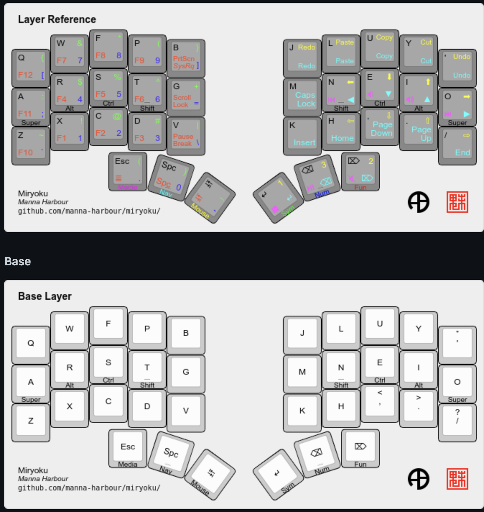

** Alternative Numpad Layout
:PROPERTIES:
:CUSTOM_ID: alternative-numpad-layout
:END:
[[https://kbd.news/Numbers-in-Pnohty-1230.html][_https://kbd.news/Numbers-in-Pnohty-1230.html_]]

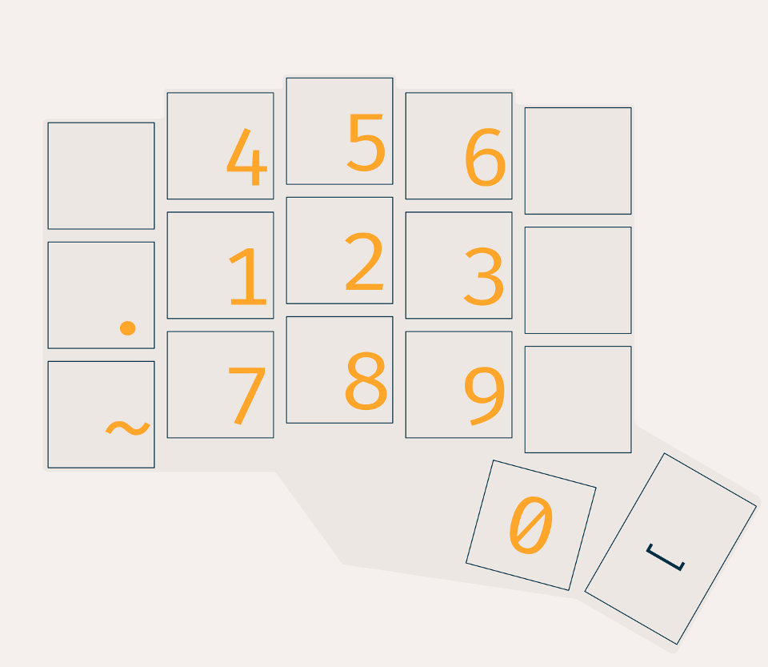

The gist of the trick is that the frequency of numbers is different but
sort of descending: 0123 are the most frequently used ones and 789 are
much rarer.

So with numbers on a logical layer, instead of putting 456 on the home
row (as it's done on the classic numpad) you can put 123 (Pnohty) or
0123 (my approach) in the best positions:

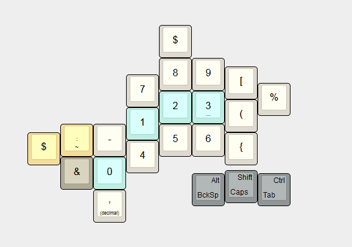

[[http://www.keyboard-layout-editor.com/#/gists/9b6379d4940a356bf904ea5452bf3956][_http://www.keyboard-layout-editor.com/#/gists/9b6379d4940a356bf904ea5452bf3956_]]

** Layout with combos

[[https://www.reddit.com/r/ErgoMechKeyboards/comments/1nvdlfa/i_finally_found_peace_with_my_keymap_hopping/][Reddit comment]]

[[https://github.com/phaberest/qmk_firmware][https://github.com/phaberest/qmk_firmware]]

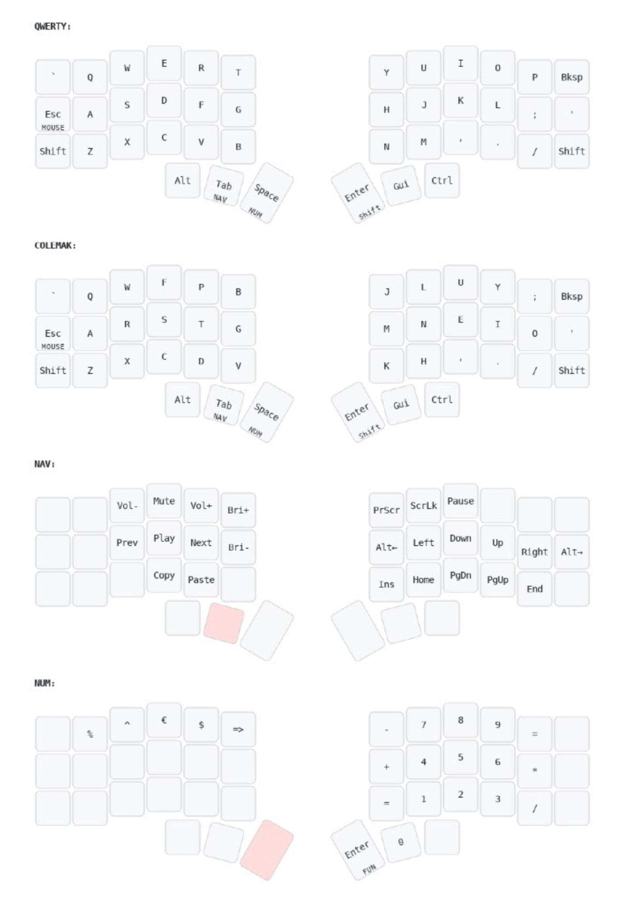

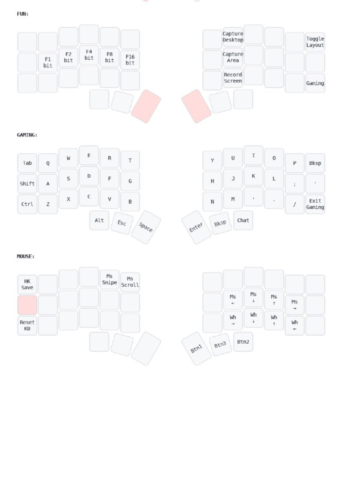

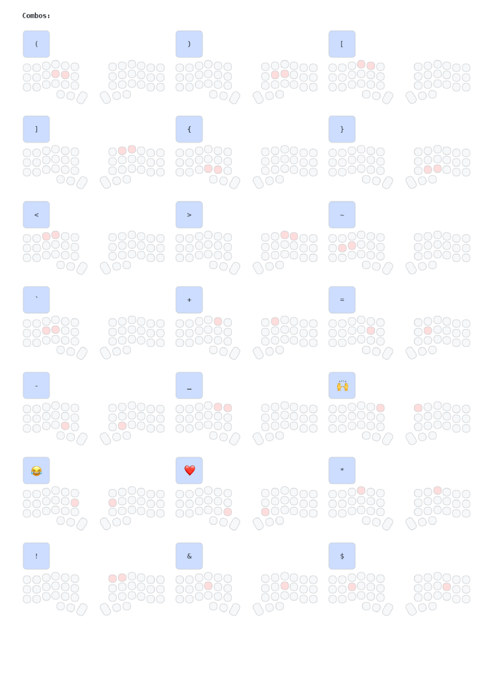

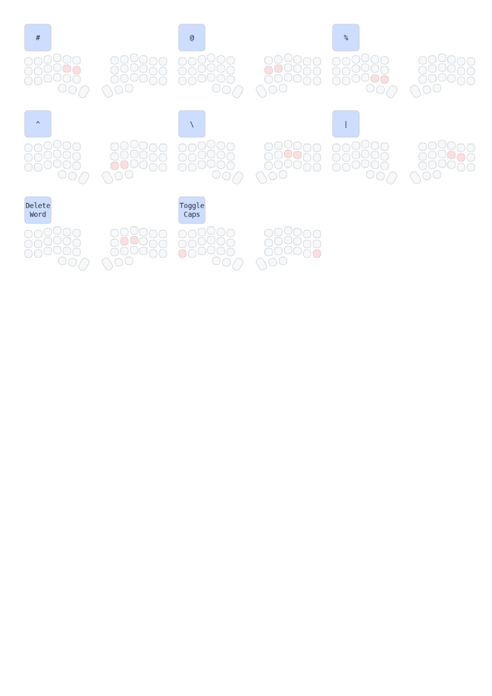

- Layer Overview*
  - *Layer 0: QWERTY Base*
    #+begin_example
    ┌─────┬─────┬─────┬─────┬─────┬─────┐     ┌─────┬─────┬─────┬─────┬─────┬─────┐
    │ GRV │  Q  │  W  │  E  │  R  │  T  │     │  Y  │  U  │  I  │  O  │  P  │BSPC │
    ├─────┼─────┼─────┼─────┼─────┼─────┤     ├─────┼─────┼─────┼─────┼─────┼─────┤
    │ESC/6│  A  │  S  │  D  │  F  │  G  │     │  H  │  J  │  K  │  L  │ ; : │ ' " │
    ├─────┼─────┼─────┼─────┼─────┼─────┤     ├─────┼─────┼─────┼─────┼─────┼─────┤
    │LSFT │  Z  │  X  │  C  │  V  │  B  │     │  N  │  M  │ , < │ . > │ / ? │RSFT │
    └─────┴─────┴─────┼─────┼─────┼─────┤     ├─────┼─────┼─────┼─────┴─────┴─────┘
                      │LALT │TAB/2│SPC/3│     │ENT/⇧│LGUI │RCTL │
                      └─────┴─────┴─────┘     └─────┴─────┴─────┘
    #+end_example

  - *Layer 1: Colemak-DH Base*
    #+begin_example
    ┌─────┬─────┬─────┬─────┬─────┬─────┐     ┌─────┬─────┬─────┬─────┬─────┬─────┐
    │ GRV │  Q  │  W  │  F  │  P  │  B  │     │  J  │  L  │  U  │  Y  │ ; : │BSPC │
    ├─────┼─────┼─────┼─────┼─────┼─────┤     ├─────┼─────┼─────┼─────┼─────┼─────┤
    │ESC/6│  A  │  R  │  S  │  T  │  G  │     │  M  │  N  │  E  │  I  │  O  │ ' " │
    ├─────┼─────┼─────┼─────┼─────┼─────┤     ├─────┼─────┼─────┼─────┼─────┼─────┤
    │LSFT │  Z  │  X  │  C  │  D  │  V  │     │  K  │  H  │ , < │ . > │ / ? │RSFT │
    └─────┴─────┴─────┼─────┼─────┼─────┤     ├─────┼─────┼─────┼─────┴─────┴─────┘
                      │LALT │TAB/2│SPC/3│     │ENT/⇧│LGUI │RCTL │
                      └─────┴─────┴─────┘     └─────┴─────┴─────┘
    #+end_example

  - *Layer 2: Navigation/Media*
    - Arrow keys, page navigation, word navigation
    - Media controls (play/pause, volume, brightness)
    - Copy/paste shortcuts

  - *Layer 3: Numbers/Symbols*
    - Number pad on right side
    - Symbol keys on left side
    - Mathematical operators

  - *Layer 4: Function Keys (Bitwise Input)*
    - Innovative bitwise input system
    - Left home row keys act as binary bits: A(1) + S(2) + D(4) + F(8) + G(16)
    - Examples: A+D = 1+4 = 5 = F5, S+F = 2+8 = 10 = F10
    - Access to all F1-F24 function keys

  - *Layer 5: Gaming /(Work in Progress)/*
    - Standard WASD layout
    - Optimized for gaming with direct access to common keys
    - Chat mode for quick typing during games

  - *Layer 6: Mouse/Utilities*
    - Mouse movement and scroll wheel
    - Mouse buttons
    - Keyboard reset and utilities

- Combo System*
  The keyboard features comprehensive combos that adapt to your current
  layout (QWERTY/Colemak-DH). Each combo is mapped to equivalent key
  positions on both layouts, so you learn one set of finger movements that
  work regardless of your active layout:

  - *Brackets & Parentheses*
    | *Combo* | *QWERTY Keys* | *Colemak Keys* | *Output* |
    |---------+---------------+----------------+----------|
    | ()      | D+F           | S+T            | ( )      |
    | []      | E+R           | F+P            | [ ]      |
    | {}      | C+V           | C+D            | { }      |
    | <>      | W+E, I+O      | W+F, U+Y       | < >      |

  - *Mathematical Operators*
    | *Combo*    | *QWERTY Keys* | *Colemak Keys* | *Output* |
    |------------+---------------+----------------+----------|
    | Plus       | R+U           | P+L            | +        |
    | Minus      | V+M           | D+H            | -        |
    | Equal      | F+J           | T+N            | =        |
    | Asterisk   | E+I           | F+U            | ​*        |
    | Underscore | R+T           | P+B            | _        |

  - *Special Characters*
    | *Combo*     | *QWERTY Keys* | *Colemak Keys* | *Output* |
    |-------------+---------------+----------------+----------|
    | Tilde       | A+S           | A+R            | ~        |
    | Grave       | S+D           | R+S            | `        |
    | Exclamation | Y+U           | J+L            | !        |
    | At symbol   | H+J           | M+N            | @        |
    | Hash        | F+G           | T+G            | ​#        |
    | Dollar      | S+L           | R+I            | $        |
    | Percent     | V+B           | D+V            | %        |
    | Caret       | N+M           | K+H            | ^        |
    | Ampersand   | D+K           | S+E            | &        |

  - *Utility Combos*
    | *Combo*     | *Keys* | *Action*      |
    |-------------+--------+---------------|
    | Word Delete | 4+5    | Alt+Backspace |

- Special Features
  - *Layout Switching*
    - Toggle Layout: Access via Function layer to switch between QWERTY and
      Colemak-DH
    - Persistent Storage: Your layout preference is saved to EEPROM
    - Smart Combos: Combos automatically map to equivalent key positions on
      your active layout
  - *Bitwise Function Keys*
    The most unique feature - use binary combinations on the left home row:
    - A = 1, S = 2, D = 4, F = 8, G = 16
    - Hold combinations to generate F-keys: A+D = F5, S+F = F10, etc.
    - Access all F1-F24 keys with simple finger combinations
    /Idea brutally copied from [[https://leanrada.com/notes/developing-bitwise-input-method/][_this excellent article_]] - full credit to the original author!/
  - *Auto Mouse Layer*
    - Automatically activates when trackpoint movement is detected
    - 1-second timeout returns to previous layer
    - Full mouse control with buttons and scroll wheel
  - *Caps Lock Toggle*
    - Press both shift keys simultaneously to toggle Caps Lock
    - Visual feedback on OLED display

* ZSA configurator layouts                                           :folded:
- Modifiers on the home row, symbols on the top row (instead of numbers): [[https://configure.zsa.io/ergodox-ez/layouts/W4aV3/latest/0][https://configure.zsa.io/ergodox-ez/layouts/W4aV3/latest/0]]
- Default Ergodox Layout
  - https://cdn.shopify.com/s/files/1/1152/3264/files/ergodox_ez_keymap_highres_1c358ca7-d57e-4242-bdc5-4efc2e901f56.png?2712369424111058957
- [[https://configure.zsa.io/ergodox-ez/layouts/Malb/latest/0][34 key Ergodox EZ Configurator]]
  - similar to mine, with mods on the home row
- [[https://configure.zsa.io/moonlander/layouts/GLra3/latest/3][Oryx: The ZSA Keyboard Configurator]] - Corne
- Planck: workman dead (by Ben Vallack)
  - [[https://configure.zsa.io/planck-ez/layouts/EeJOQ/latest/0][Ergodox EZ Configurator]]
- [[https://configure.zsa.io/ergodox-ez/layouts/K0al9/latest/2][Ergodox EZ Configurator - Eio 2.0 (coding macros)]]
  - coding layer with things like "->" and "()->"
  - also there are macro recording keys on this layer in thumb cluster
- [[https://configure.zsa.io/ergodox-ez/layouts/ABaJR/latest/0][Singularity - Ergodox EZ Configurator]]
  - heavy double-function keys
  - all modifiers (alt, ctrl, shift) are on the home row
    - dual ctrl/esc is where the caps lock is
    - A - shift, D - alt (and similarly on the right side)
    - "space cadet" - square brackets [ ] (instead of parenthesis) on shift keys
  - tmux layer with move (vim-like) keys, vertical and horizontal split and detach
    - Switch to layer: dual-function B key (memo: tmux'es Ctrl-B)
  - FKey pad - numpad-like F keys + extra F16 - F21 keys at the top
    - F is a toggle for this layer (easy to remember)
    - it is also easy to perform alt-FX combinations - alt is on D, so we hold D+F and press the right cluster key to get the F we need
- [[https://configure.zsa.io/ergodox-ez/layouts/MZRAK/latest/1][Glowing Siegler Symmetric]]
  - mouse and mouse wheel buttons hjkl-style
- [[https://configure.zsa.io/moonlander/layouts/mlLZP/latest/0][miryoku - Ergodox EZ Configurator (moonlander)]]
  - Miryoku layout for Moonlander, Planck EZ, and Ergodox EZ : [[https://www.reddit.com/r/ErgoDoxEZ/comments/ijtcq1/miryoku_layout_for_moonlander_planck_ez_and/][ErgoDoxEZ]]
    - settings for home mods in miryoku layout
- (Halmak, Vim layer) Oryx: [[https://configure.zsa.io/ergodox-ez/layouts/9Qq9W/latest/5][The ZSA Keyboard Configurator]]
  - Vim layer - Vim-like commands over regular keys
    - w = fwd word (Ctrl + ->)
    - b = back word (Ctrl + <-)
    - u = undo (Ctrl-Z)
    - 4 ($) = end line (End)
    - =-= layer - same as base, but with "-" in place of space - to type long-hyphen-separated-words
    - =_= layer - same as base, but with "_" in place of space - to type long_underscore_sep_words
- [[https://configure.zsa.io/moonlander/layouts/aWyOG/latest/0][Ergodox EZ Configurator - Flying to the Moon (Florian Didron, Ergodox QMK Developer)]]
  - Minimalistic layout with AutoShift
  - AutoShift timeout = 110
  - Tapping term = 121
    - This sets the delay interval (in milliseconds) that the firmware uses to determine if a press is considered a tap or a hold. This is used for dual-action keys like Layer Tap (LT), and Mod Tap (MT). If the "hold time" to trigger the "hold" action feels too long, decrease this value. If it is too short for you (you trigger the hold action when you meant to tap), increase this value. This also determines the length of time for certain other features. For Instance, the TT and One Shot keys use this as the timeout for a "toggle", (aka, you have to hit the key within this window to be considered for the "tap toggle" functionality).
  - Retro tap = On
- algernon/ergodox-layout: [[https://web.archive.org/web/20180612223408/https://github.com/algernon/ergodox-layout][algernon's ErgoDox EZ layout]]
  - advanced layout, using tap dancing (for example, all brackets are on the same key, there is leader key with some mappings) and other features that are not available in configurator (and I am not at that point yet to switch to code)
  - there is also a steno layer to use with plover
    - Lesson 1: [[https://web.archive.org/web/20200427231043/https://sites.google.com/site/learnplover/lesson-1-fingers-and-keys][Fingers And Keys - Learn Plover!]]
  - Asylum: [[https://asylum.madhouse-project.org/blog/tags/ergodox/][Diaries of a Madman]]
  - ErgoDox: [[https://asylum.madhouse-project.org/blog/2016/05/26/ergodox-day-34/][Day 34 - Asylum]]
    - The Shift, Alt, and Control modifiers are one-shot. When tapped, they are considered active for the next key press only. When double tapped, they toggle on, until a third, single tap sometime later. When held, they act as expected. My usual pattern is that I use these for the next keypress only, so this behaviour is perfect. If I need them held, I'll just double-tap.
- [[https://configure.zsa.io/moonlander/layouts/bgLRp/latest/0][Ergodox EZ Configurator (Mac, Vim, IDEA IDE)]]
  - Layer 0 - Vim Leader on the red button (macro = , ,)
  - Layer 0 - Copy and paste mac buttons on the inner side column, at the bottom
  - Layer 1 - brackets are symmetrical on the left and right hands; looks like this is a special layer for OSL 1 switch (there is also Layer 2 where there are more punctuation chars put similar to the default layout)
  - Layer 4 - Nav, enabled by left big red button - arrows, left ctrl, cmd on the left and pg up, home, pg down and shift tab and tab on the right
    - Having shift tab and tab near looks convenient
    - Separate layer for lights (I have it on the media layer)
  - Separate layer for IDE/vim
    - mostly macros and key combos
- [[https://configure.zsa.io/ergodox-ez/layouts/BNpaO/latest/0][Ergodox EZ Configurator - BEAKL 15 (+query, + dvorak), pc and mac]]
  - osx vs pc - there is a separate osx layer with some overrides (like CMD instead of Ctrl) and most of keys transparent
  - separate layers for arrows and mouse
  - main layout - BEAKL with fallback layers - qwerty and dvorak
- [[http://thedarnedestthing.com/wide%20planck%20form][wide planck form (letters outside, mods inside)]]
  - [[http://thedarnedestthing.com/ergo%20planck][ergo planck]]
- [[https://xeiaso.net/blog/zsa-moonlander-first-impressions-2020-10-27/][ZSA Moonlander First Impressions - Christine Dodrill]]
  - [[https://configure.zsa.io/moonlander/layouts/xbJXx/latest/0][Ergodox EZ Configurator]]
    - Four different layouts - colemak, qwerty, dvorak, steno
    - Layout for window manager (dwm)
    - symnum with symbols, numpad, F keys
- Moonlander, Planck, and new layout that minimizes pinkies and stretching : [[https://www.reddit.com/r/ergodox/comments/jjk0rf/moonlander_planck_and_new_layout_that_minimizes/][ergodox]]
  - [[https://configure.zsa.io/moonlander/layouts/7Qqby/latest/0][Ergodox EZ Configurator]]
  - [[https://configure.zsa.io/planck-ez/layouts/En5W5/latest/1][Ergodox EZ Configurator]]
  - t00mietum/keyboard: [[https://github.com/t00mietum/keyboard][Ground-up redesign of ergonomic keyboard layout for QMK programmable keyboards.]]
- naps62/ergodox-layout: [[https://github.com/naps62/ergodox-layout][A heavily customized layout for my Ergodox EZ keyboard]]
  - very "classic" layout, close to the standard keyboard
  - brackets at the right bottom
  - coder layer with num pad (I tried similar setup, then moved the numpad to a separate layer to have arrows on the right side)
- [[https://www.massdrop.com/talk/70/the-ergodox-layouts-repository][The Ergodox Layouts Repository - Massdrop]]
- [[https://geekhack.org/index.php?topic=62848][fixing the ergodox thumb section]]
* Layouts: Links                                                     :folded:
- [[https://github.com/callum-oakley/qmk_firmware/tree/master/users/callum][qmk_firmware/users/callum at master · callum-oakley/qmk_firmware]]
- Jonas Hietala: [[https://www.jonashietala.se/blog/2021/06/03/the-t-34-keyboard-layout/?utm_source=pocket_mylist][The T-34 keyboard layout]]
  - [[https://www.jonashietala.se/blog/2021/09/05/t-34-0/?utm_source=pocket_mylist][The T-34/0 keyboard layout]]
- Share your keyboard layouts, here is my iris layout: [[https://www.reddit.com/r/ErgoMechKeyboards/comments/pdvp40/share_your_keyboard_layouts_here_is_my_iris_layout/?utm_source=pocket-app&utm_medium=share][ErgoMechKeyboards]]
- Yet, another keyboard layout (RSHT / IENA) : [[https://www.reddit.com/r/KeyboardLayouts/comments/n1ngck/yet_another_keyboard_layout_rsht_iena/?utm_medium=android_app&utm_source=share][KeyboardLayouts]]
- [[https://blog.friz64.de/ergodox-rawhid/][[with custom RGB control - qmk + host app!] my ergonomic keyboard adventure - ergodox ez · Friz64]]
- Symbols via combos on the base layer: The Kombol Layout : ErgoMechKeyboards
  https://www.reddit.com/r/ErgoMechKeyboards/comments/mi7tyi/the_kombol_layout/
  - GitHub - skychil/kombol: [[https://github.com/skychil/kombol][A combo-based layout for Ergonomic Keyboards, implemented in QMK]]
  - The Kombol Layout : KeyboardLayouts
    - https://www.reddit.com/r/KeyboardLayouts/comments/mib12s/the_kombol_layout/
    - Vertical combos and inner combos (! ?) use 1 finger, the rest use 2 fingers.
- Arno's Engram keyboard layout | [[https://web.archive.org/web/20210306170723/https://engram.dev/][engram]]
  - alternative letter / symbol layout
- 30-40% split keyboard users: how do your punctuation/symbol/number layer(s) look like? : [[https://www.reddit.com/r/ErgoMechKeyboards/comments/mbf7w6/3040_split_keyboard_users_how_do_your/][ErgoMechKeyboards]]
- Made a video explaining how I made a 34 key keymap. Might be useful for those wondering how so few keys are usable!: [[https://www.reddit.com/r/ErgoMechKeyboards/comments/lvp7bz/made_a_video_explaining_how_i_made_a_34_key/?utm_medium=android_app&utm_source=share][ErgoMechKeyboards]]
- Share your keyboard layouts, here is my iris layout : [[https://www.reddit.com/r/ErgoMechKeyboards/comments/pdvp40/share_your_keyboard_layouts_here_is_my_iris_layout/?utm_medium=android_app&utm_source=share][ErgoMechKeyboards]]
- [[https://artsey.io/][ARTSEY.io - 8 key layout]]
- LT-37 Keyboard mod for regular keyboards : [[https://www.reddit.com/r/Keyboard/comments/lkjqpc/lt37_keyboard_mod_for_regular_keyboards/][Keyboard]]
- ZenTron
  - [[https://github.com/zenaan/quick-fixes-ftfw/blob/master/keyboard/README-ZenTron.md][quick-fixes-ftfw/README-ZenTron.md at master · zenaan/quick-fixes-ftfw]]
  - [[https://configure.zsa.io/ergodox-ez/layouts/l7eRq/latest/0][Ergodox EZ Configurator (ZenTron.00-US.en)]]
  - [[https://configure.zsa.io/ergodox-ez/layouts/QayrK/latest/0][Ergodox EZ Configurator (ZTron.00-US.en_+_RSTHP_custom)]]
- [[https://xsznix.wordpress.com/2016/05/16/introducing-the-rsthd-layout/][Introducing the RSTHD layout – meus recogitare et excogitare]]
- [[https://deskthority.net/wiki/Ergonomic_keyboard_layouts#Ergolinear_Split-case_designs][Ergonomic keyboard layouts - Deskthority wiki]]
- What are some of the most popular ergonomic keyboard layouts with layers? : [[https://www.reddit.com/r/ErgoMechKeyboards/comments/kq6902/what_are_some_of_the_most_popular_ergonomic/][ErgoMechKeyboards]]
  - [[https://www.reddit.com/r/olkb/comments/hz2zux/making_a_crkbdmini_any_pointers_on_qmk_for_non/fzhub49/][modtap comments on Making a crkbd-mini, any pointers on QMK for non default column layouts]]
    - [[https://github.com/qmk/qmk_firmware/tree/0.19.0/keyboards/maple_computing/minidox/keymaps/dustypomerleau][qmk_firmware/keyboards/minidox/keymaps/dustypomerleau at master · qmk/qmk_firmware]]
    - [[https://github.com/qmk/qmk_firmware/tree/0.19.0/keyboards/maple_computing/minidox/keymaps/bepo][qmk_firmware/keyboards/minidox/keymaps/bepo at master · qmk/qmk_firmware]]
    - [[https://github.com/qmk/qmk_firmware/tree/0.19.0/keyboards/maple_computing/minidox/keymaps/norman][qmk_firmware/keyboards/minidox/keymaps/norman at master · qmk/qmk_firmware]]
    - [[https://github.com/germ/qmk_firmware/blob/ginny-improv/keyboards/gergoplex/keymaps/default/keymap.c][qmk_firmware/keymap.c at ginny-improv · germ/qmk_firmware]]
    - [[https://github.com/qmk/qmk_firmware/blob/054021e8757a72de4d3fae1f58944e9c922d22d1/keyboards/squiggle/keymaps/rick/keymap.c][qmk_firmware/keymap.c at 054021e8757a72de4d3fae1f58944e9c922d22d1 · qmk/qmk_firmware]]
  - [[https://www.reddit.com/r/MechanicalKeyboards/comments/ik7foh/just_finished_my_levinson/g3is4wc/][lifow comments on Just finished my Levinson]]
- t00mietum/keyboard: [[https://github.com/t00mietum/keyboard][Ground-up redesign of ergonomic keyboard layout for QMK programmable keyboards.]]
- [[https://imgur.com/a/hm4bbdM][QMK Layout Mitosis:Datagrok - Imgur]]
  - See the readme [[https://github.com/qmk/qmk_firmware/blob/0.19.0/keyboards/mitosis/keymaps/datagrok/readme.md][https://github.com/qmk/qmk_firmware/blob/0.19.0/keyboards/mitosis/keymaps/datagrok/readme.md]]
- [[https://web.archive.org/web/20171113052853/https://www.allthingsergo.com/case-study-one-approach-optimizing-ergonomic-keyboard-layouts/][Case Study: One Approach to Optimizing Ergonomic Keyboard Layouts - All Things Ergonomic]]
  - plate-based Let's Split
- [[https://josef-adamcik.cz/electronics/in-search-of-the-best-custom-keyboard-layout.html][In search of the best custom keyboard layout – Josef Adamčík]]
- Community Post: [[https://evantravers.com/articles/2019/04/20/community-post-40-keyboard-layouts/][40% Keyboard Layouts]]
- [[https://mulldotin.wordpress.com/2019/02/03/layers-36keys/][layers on 36 keys – mullin']]
- [[https://deskthority.net/viewtopic.php?t=24536][Thoughts on the Seelpy Layout - deskthority]]
- [[https://github.com/wafflekeebs/waffle_microdox/tree/master/firmware/waffle][waffle_microdox/firmware/waffle at master · wafflekeebs/waffle_microdox]]
- [[https://blog.scottlogic.com/2020/10/09/ergo-rabbit-hole.html][Down the ergonomic keyboard rabbit hole]]
  - custom letters layout (no inner layer)
  - [[https://configure.zsa.io/ergodox-ez/layouts/5BvvY/ZKx5z/3][Ergodox EZ Configurator]]
- [[https://keebs.fehmer.info/post/2020-04-05-planck/][OLKB Planck rev6 | keebs.fehmer.info]]
- [[http://brettterpstra.com/2012/12/08/a-useful-caps-lock-key/][A useful Caps Lock key - BrettTerpstra.com]]
- Show off your layouts! : [[https://www.reddit.com/r/ergodox/comments/6s68v1/show_off_your_layouts/][ergodox]]
- [[https://www.keebtalk.com/t/some-ideas-about-sub-30-layouts-involving-the-enigma-pain27-alpha-and-30wer/7765][Some ideas about sub-30% layouts involving the Enigma, pain27, Alpha and 30wer - Learning and discussion / Key layouts - KeebTalk]]
- 48 keys are plenty | [[https://callumoakley.net/posts/48-keys-are-plenty.html][Callum Oakley]]
- Transitioning to a new keyboard layout | [[https://wildlyinaccurate.com/transitioning-to-a-new-keyboard-layout/][Wildly Inaccurate]]
- [[https://my.moergo.com/glove80/][MoErgo Glove80 Layout Editor]]
- Keyboardio: [[https://shop.keyboard.io/][keyboards for serious typists]]
  - see the Atreus layout
  - top part - letters, bottom row - modifiers
* Related:
- [[file:keyboard-my-layout.org][My Keyboard Layouts]]
- [[file:keyboard-layouts.org][Keyboard Layouts (Links, Articles)]]
- [[file:keyboard-layouts-examples.org][Keyboard Layouts (Examples)]]
- [[file:keyboard-links.org][Keyboards Links]]
- [[file:2020-01-21-touch-typing.org][Touch Typing Tutors and Games]]
- [[file:diy-links.org][DIY Links]]
