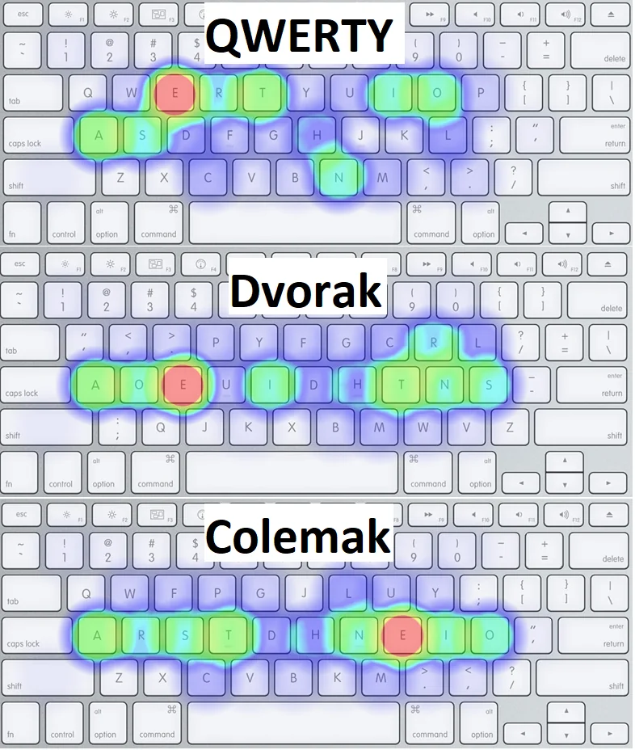
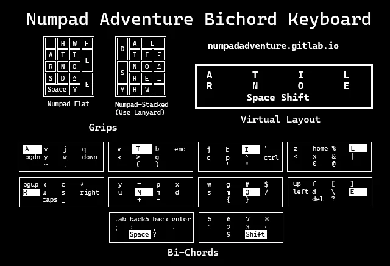

#+TITLE: Keyboard Layouts: Links, Articles
#+DATE: <2006-11-06>
#+TYPE: post
#+FILETAGS: :kbd:
#+DESCRIPTION: A collection of keyboard layouts.

Various examples of keyboard layouts.

* Qwerty, Dvorak, Colemak                                            :folded:
Alternative layouts try to make typing more pleasant by placing more often accessed
keys in the home row:

- [[https://www.dvorak-keyboard.com/][The Dvorak Keyboard]]
- Colemak
  - Colemak keyboard layout: [[https://colemak.com/][ergonomic, fast and easy to learn QWERTY/Dvorak alternative]]
  - Switching to Colemak | [[https://lobste.rs/s/3izfup/switching_colemak][Lobsters]]
  - Colemak worth it? : [[https://www.reddit.com/r/ErgoMechKeyboards/comments/1tnl9a5/colemak_worth_it/][r/ErgoMechKeyboards]]
    - Colemak-Dh vs Colemak-Dhm : [[https://www.reddit.com/r/Colemak/comments/lbwqfd/colemakdh_vs_colemakdhm/][r/Colemak]]
      - You couldn't find any information on the differences... because [[https://colemakmods.github.io/mod-dh/#revision-history][they are the same]]! [Dh == Dhm]
      - Previously, DH had the K key in the home row with the M key below it. This layout is now called DHk. For ANSI keyboards, DH also had (and still has) the Z key in the center of the bottom row.
      - The DHm variant has M in the home row, and keeps Z in its current position. The m refers to the fact that it's recommended for matrix keyboards (although I think it used to refer to the fact that the M and K keys were swapped from the original DH layout).
      - You can compare all of the different layouts [[https://colemakmods.github.io/mod-dh/keyboards.html][here]].
    - [[https://stevep99.github.io/seniply/][Colemak-DH Seniply]]
      - [[https://blog.zsa.io/zsa-loves-colemak/?mc_cid=f9404429af&mc_eid=c2a3cf3895][ZSA Loves: Colemak | ZSA: The Blog]]
      - [[https://configure.zsa.io/moonlander/layouts/Aw7ae/latest/0/intro][Oryx: The ZSA Keyboard Configurator]]
  - [[https://stevep99.github.io/seniply/][colemak-dh seniply]]
  - Seniply - an ergonomic, minimal keyboard layout for a keyboard with at least 34 keys : [[https://www.reddit.com/r/KeyboardLayouts/comments/mpimmr/seniply_an_ergonomic_minimal_keyboard_layout_for/][KeyboardLayouts]]
  - Colemak-DH in 10 weeks (Since then, I've been working on achieving 100 WPM & afterward further tweaking of layout) : [[https://www.reddit.com/r/MechanicalKeyboards/comments/ojsbl7/colemakdh_in_10_weeks_since_then_ive_been_working/][MechanicalKeyboards]]
  - Colemak vs. Workman? : [[https://www.reddit.com/r/Colemak/comments/6b09xm/colemak_vs_workman/][Colemak]]
    - [[https://forum.colemak.com/topic/2152-is-workman-off-its-rocker/][Some reading regarding Workman vs Colemak]] [[https://www.workmanlayout.com/][Workman blog is down]] [[https://forum.colemak.com/][Colemak forum is up and running]] Not happy with Colemak and looking toward Workman? [[https://colemakmods.github.io/mod-dh/][Look no further than Colemak Mod-DH]] [[https://forum.colemak.com/topic/1942-moddh-for-colemak/][Also a lot of reading about Mod-DH here]] My opinion, Workman tried to improve Colemak, but "the baby was poured out with bath water".
  - [[https://colemakmods.github.io/mod-dh/][Colemak Mod-DH]]
    - A lot of reddit posts recommend it over Colemak and Workman
  - The Colemak keyboard layout | [[https://callumoakley.net/posts/colemak][Callum Oakley]]
    - [[http://mkweb.bcgsc.ca/carpalx/?colemak][Carpalx - keyboard layout optimizer]]
    - [[https://colemak.com/Fun][Fun - Colemak]]
  - Colemak or Workman for a Planck? : [[https://www.reddit.com/r/olkb/comments/79wazb/colemak_or_workman_for_a_planck/][olkb]]
  - Colemak DH vs Workman : [[https://www.reddit.com/r/Colemak/comments/j9pxcb/colemak_dh_vs_workman/][Colemak]]
  - Layouts review: [[http://pinouchon.github.io/keyboard/layouts/2016/03/07/layouts-review-dvorak-vs-colemak-vs-carpalx-vs-workman.html][Dvorak vs Colemak vs Carpalx vs Workman]]
  - [[http://patorjk.com/keyboard-layout-analyzer/#/main][Keyboard Layout Analyzer - QWERTY vs Dvorak vs Colemak]]
  - [[http://mkweb.bcgsc.ca/carpalx/?popular_alternatives][Carpalx - keyboard layout optimizer]]
- [[https://sites.google.com/alanreiser.com/handsdown/][HandsDown - alanreiser.com/handsdown/]]
  - Oryx: [[https://configure.zsa.io/ergodox-ez/layouts/l9Jyz/latest/0/intro][The ZSA Keyboard Configurator - inspired by the HandsDown-Neu layout by Alan Reiser]]
- More layouts
  - Uno layout : [[https://www.reddit.com/r/KeyboardLayouts/comments/phmdbh/uno_layout/?utm_source=pocket_mylist][KeyboardLayouts]]
  - [[https://www.keyboard-design.com/index.html][Keyboard-Design.com - A feast for the fingers]]
  - Suggestions for layout to learn after Colemak DH : [[https://www.reddit.com/r/KeyboardLayouts/comments/oxj1cd/suggestions_for_layout_to_learn_after_colemak_dh/?utm_source=pocket_mylist][KeyboardLayouts]]
  - [[https://lykt.xyz/jnsf/ortho/][Orthocarpus layout]]
  - Has anyone here heard of (or used) the Halmak layout? : [[https://www.reddit.com/r/MechanicalKeyboards/comments/8o0xrm/has_anyone_here_heard_of_or_used_the_halmak_layout/][MechanicalKeyboards]]
    - GitHub - MadRabbit/halmak: [[https://github.com/kaievns/halmak][The final version of the AI designed keyboard layout]]
  - GitHub - bclnr/kb-layout-evaluation: [[https://github.com/bclnr/kb-layout-evaluation][Evaluate ergonomic keyboard layouts over multiple languages]]
  - The Development of the ThinQu Keyboard Layout: [[https://microexploitation.com/2018/06/26/the-development-of-the-thinqu-keyboard-layout-factors-that-influence-typing-effort/][Factors that Influence Typing Effort – MicroExploitation, MacroExploration]]
  - [[http://thedarnedestthing.com/beakl%20ti%20revisited][beakl ti revisited]]
- Qwerty, Dvorak, or Colemak? : [[https://www.reddit.com/r/ergodox/comments/g4pwmz/qwerty_dvorak_or_colemak/][ergodox]]
  - Using vim feels natural with both Colemak and Dvorak after some training. However, if you use any vim bindings for your browser, like vimium or surfing key, jk will be a nightmare for you.
  - it's not just the bottom row (zxcvb) that is unchanged, Colemak manages to leave a number of other keys in the same place as qwerty (q, w, a, h, m) whilst retaining one of the most efficient keyboard layouts you can switch to.
  - I typed with Dvorak for 10 years and then eventually switched to Colemak which I have been using for the last 5 years and I'm a software engineer as well. I think either layout is better than Qwerty in my opinion. Dvorak will have you switching hands more often and Colemak has more "finger rolls" across the keyboard which I personally like more, but that is a preference thing.
  - Well as a software developer (Javascript among others) I asked myself the same question, I ended up with this :
    - [[https://configure.zsa.io/ergodox-ez/layouts/W4aV3/latest/0][https://configure.zsa.io/ergodox-ez/layouts/W4aV3/latest/0]]
      - Note: all modifiers are on the home row
      - A modified Norman layout to suit software development.
  - I have tried both Dvorak and Colemak when I got my Ergodox EZ. Unlike popular belief, neither have problems with using vim or the function keys. These just come naturally once you get used to. Also, both feels comfy when it gets to typing. Those minor wins does not matter at all.
    - However, I do find Dvorak has an edge on two aspect. First is the jk position. Since the Ergodox is so good and using so much space on your table, chances are you might want to use vim bindings for your browser too. The jk position is a total nightmare when I used Colemak. It simply makes my index finger on my right hand painful. For using vim it does not matter as j k are not used often but if you use vim binding for browsers, it will be a pain.
    - The other is that the idea of alternating hands are more universal among languages while Colemak is only optimised for English. When I type other languages like Japanese in Romaji, or Chinese in pinyin, or other languages, Dvorak still feels great as you still alternate hands a lot. Whereas Colemak is giving no edge on that.
    - I'm personally a huge fan of Colemak DH on all my keebs at this point because of how comfy it is when learned. Dvorak focuses on hand alternation (left, right, left) while Colemak focuses on inward rolls (pinky, ring, middle index). So specific layout is up to you. But you may be less frustrated with Colemak for that and because of the decreased key change.
    - Here's my Ergodox Dvorak layout, if you want to see some ideas: [[https://configure.zsa.io/ergodox-ez/layouts/aWM5b/latest/0][https://configure.zsa.io/ergodox-ez/layouts/aWM5b/latest/0]]
    - I started using Colemak-DH (with switched m/k) when I built my split ortho keyboard and I'm entirely pleased with it. I feel like I'm almost always on the home row and the common rolling actions are both super fast and very satisfying. The m/k switch is a specific adaptation with respect to matrix style keyboards and it shows. Having used qwerty extensively and Workman a little and regular Colemak a little I can say that this particular variant is entirely superior. Vim keybindings are fine for me, with the caveat that I use arrow keys for navigation and those arrow keys are mapped to where wasd are on a qwerty keyboard, on a layer I access with my left thumb. I have escape under a thumb and : where left shift usually is and consequently I can escape to normal mode and type ':wq' at the speed of light.
  - Been using Dvorak for 15+ years, but 2 months ago decided to give BEAKL15 a try. It is extremely comfortable especially for English typing, and the symbol layer is fantastic for Software Developers (I program in Java).
    - Still not sure about the number row though. I have been using an Ergodox for 3 years and prefer F-keys on the base layer (where numbers would traditionally be) and numbers as a numpad layout on a different layer. This has served me very well.
    - Anyway, here is my layout for more inspiration. [[https://configure.zsa.io/ergodox-ez/layouts/BNpaO/latest/1][https://configure.zsa.io/ergodox-ez/layouts/BNpaO/latest/1]]
      - Several layouts on layers: qwerty, dvorak, beakl15
      - Symbols layer - check how parenthesis are placed
      - Strange: instead of Shift, there is a shifted layer + momentary toggle (press and hold) to switch to it - so it looks like it works the same way as shift
        - Is this because of a custom layout?
  - ErgoDox: [[https://asylum.madhouse-project.org/blog/2016/06/09/ergodox-day-48/][Day 48 - Asylum - mentions some practical dvorak problems]]
* QMK Features: Layers, Home Row Mods, Combos, etc                   :folded:
** [[https://web.archive.org/web/20190818211315/https://thomasbaart.nl/category/mechanical-keyboards/firmware/qmk/qmk-basics/][QMK Basics – Thomas Baart]] and info
- QMK Basics: Tap and hold actions: [[https://web.archive.org/web/20190818213750/https://thomasbaart.nl/2018/12/09/qmk-basics-tap-and-hold-actions/][Tap into your modifiers – Thomas Baart]]
- Help me start a collection of QMK Macro and features for sharing : [[https://www.reddit.com/r/olkb/comments/coz5wa/help_me_start_a_collection_of_qmk_macro_and/][olkb]]
- What clever keystroke shortcuts have you set up with QMK? : [[https://www.reddit.com/r/olkb/comments/5ilzi9/what_clever_keystroke_shortcuts_have_you_set_up/][olkb]]
- Porting QMK To A Cheap Mechanical Keyboard | [[https://hackaday.com/2020/10/04/porting-qmk-to-a-cheap-mechanical-keyboard/][Hackaday]]
- Automatic conversion of OLED images : [[https://www.reddit.com/r/ErgoMechKeyboards/comments/i3dlz3/automatic_conversion_of_oled_images/][ErgoMechKeyboards]]
** [[https://ergodox-ez.com/getting-started][Layer toggle types]] :folded:
- Momentary (MO):
  - This is like a Shift key. Hold down a momentary toggle, and you're taken to another layer. Let go, and you drop back to layer 0.
  - As soon as you let go of the key, the layer is deactivated and you pop back out to the previous layer.
  - When you apply this to a key, that same key must be set as KC_TRNS on the destination layer. Otherwise, you won't make it back to the original layer when you release the key (and you'll get a keycode sent).
  - You can only switch to layers above your current layer. If you're on layer 0 and you use MO(1), that will switch to layer 1 just fine. But if you include MO(3) on layer 5, that won't do anything for you -- because layer 3 is lower than layer 5 on the stack.
- Toggle (TG):
  - This is similar to a Caps Lock. Tap once, and you're moved to that layer. You'll stay on that layer until you tap the layer toggle key again. Depending on the type, you'll momentarily/permanently have access to the key bindings of that specific layer.
- One-shot (OSL):
  - Tap this key, and you're moved to the layer. Tap a single key on the layer, and you will then be sent back to layer 0. Like Shift, but without having to hold down two keys at once.
  - This type of layer switch allows you to either tap it and get the next layer for one key press or hold it and continue to get that next layer until you release it. It's wonderful for the types of keys we'll be looking at on Layer 1.
- OSM(mod) - this is a "one shot" modifier. - sticky shift
  - So let's say you have your left Shift key defined as OSM(MOD_LSFT). Tap it, let go, and Shift is "on" -- but only for the next character you'll type. So to write "The", you don't need to hold down Shift -- you tap it, tap t, and move on with life. And if you hold down the left Shift key, it just works as a left Shift key, as you would expect (so you could type THE). There's also a magical, secret way to "lock" a modifier by tapping it multiple times. If you want to learn more about that, open an issue. :)
- Tap-Toggle (TT):
  - A combination of Momentary and Toggle. Hold this key, and the layer is active only as long as you hold it. Tap it briefly, and you're moved to the destination layer until you tap it again.
- Direct switch (TO):
  - All other layer switches go /up/ (allow you to switch from layer 0 to layer 1, for example). TO is the only one which also allows you to switch /down/ (from layer 3 to layer 2, for example).
- Meh / Hyper keys
  - System-level shortcuts to switch to apps
- order matters: [[https://github.com/qmk/qmk_firmware/issues/6943][OSL + OSM ignores OSL; OSM + OSL works as expected Issue #6943]]
** [[https://precondition.github.io/home-row-mods][A guide to home row mods]] (notes)                                 :folded:
- Notes
  - Why not GACS (shift is used more often than Ctrl)
    - The points are not very convincing in my case
    - On a 40% layout another important key(s) is the layer switch (Sym like I have or lower/raise like in Planck)
    - Auto-shift makes shift not needed
    - I almost never use Alt (might be due to other flows I use)
- Summary
  - Mods that are placed on the home row
  - It is more convenient and ergonomic
  - How to use home row mods?
    - Home row mods order
      - SCGA (Shift-Ctrl-Gui-Alt) - order like on the regular keyboard
      - GASC (Gui-Alt-Shift-Ctrl) - often used keys are on stronger fingers
        - Why not GACS (shift is used more often than Ctrl)?
          - 1. The index finger is the finger that is responsible for the biggest amount of alpha keys so if you use the index finger to hold Shift, you'll have to swap hands if you want to type any of the six keys
            - I did not understand this point, what is "swap hands" in this context?
            - Is this about the possibility to hold the shift with right hand and type the upper-case letter with the same hand? So "swap hands" is holding shift on the left and typing on the right and vice versa
            - In that case, I always only consider the "swap hands" variant
            - 2. With GASC it is easier to do both Alt-Shift and Ctrl-Shift (adjacent keys in both cases)
            - 3. (weak point) We can have "main" thumb shift, so GASC shift in the home row is just to use in combinations with Alt and Ctrl
            - 4. The position of GUI next to Alt allows for easy GUI+Alt+Arrows, a keyboard shortcut used in some DEs for switching between virtual desktops/workspaces.
            - 5. Do not load the index finger too much
          - Additional note: This works out great on ortholinear and vertically staggered keyboards but if you use a row-staggered keyboard, you may find that you're suddenly unable to copy and paste one-handedly.
            - Not sure why
            - GACS - order following the keys frequency (Miryoku uses it)
            - CAGS - good for Mac OS where GUI is used in place of Ctrl
    - Using home row mods with QMK
      - Use MT (mod tap) keys: MT(mod_code, key_code)
      - On code level, there are shortcut macros: MT(MOD_LGUI, KC_A) = LGUI_T(KC_A)
  - Tap Hold configuration settings
    - IGNORE_MOD_TAP_INTERRUPT is the most important tap hold configuration settings that's absolutely necessary for a good home row mods experience
      - Because it allows using rolls with modifiers (mod down - key down - mod up - key up)
      - Although, it may work this way by default (from PR 9404)
    - [[https://docs.qmk.fm/tap_hold][Tap-Hold Configuration]]
    - Proposed changes in PR 9404
      - [[https://github.com/qmk/qmk_firmware/blob/155cc17359711a6dd7b67119ec994800588ebaaa/docs/tap_hold.md][qmk_firmware/tap_hold.md at 155cc17359711a6dd7b67119ec994800588ebaaa · qmk/qmk_firmware]]
      - [[https://github.com/qmk/qmk_firmware/pull/9404][Add HOLD_ON_OTHER_KEY_PRESS option for dual-role keys by sigprof · Pull Request #9404 · qmk/qmk_firmware]]
        - Cheatsheet on LT and MT: [[https://web.archive.org/web/20211211132011/https://cdn.discordapp.com/attachments/663573863480950808/757162393209012304/modtap.pdf][modtap.pdf]]
** Retro [[https://precondition.github.io/home-row-mods#using-home-row-mods-with-qmk][tapping]] :folded:
- ~MT(Mod, X)~ will send X if the key is held longer than tapping term. Retro Tap thus gives another way to trigger the tapping function of mod-taps. With this option, you can get away with a very short tapping term.
- Tapping term is short, so it is easier to do Hold
- What if we set tapping term to zero? (so any keypress is "Hold")
  - When used in combination with other keys, mod will always be Hold
- What if we set tapping term to infinity? (so any keypress is "Tap")
  - We can get "nested hold, rolling tap" behavior with
  - MT = Nested=Hold, Rolling=Tap -> PERMISSIVE_HOLD + IGNORE_MOD_TAP_INTERRUPT
  - LT = Nested=Hold, Rolling=Tap -> PERMISSIVE_HOLD
  - This is also a behavior that looks natural to me, so it might be possible to go without tapping term
    - When should keys be processed in this case? Should we wait until all are released?
    - What if we are on a layer or holding Shift?
** [[https://docs.qmk.fm/tap_hold][Tap-Hold Configuration]]       :folded:
- ~TAPPING_TERM 200~
  Tapping Term - determines what is a tap and what is a hold
  - ~TAPPING_TERM_PER_KEY~ + get_tapping_term() function to define term per key
- ~#define PERMISSIVE_HOLD~
  Permissive Hold - do not take tapping term into account for mod taps (hold mod, press and release another key will always work, even if done faster than tapping term)
  - Makes tap and hold keys (like Mod Tap) work better for fast typists, or for high ~TAPPING_TERM~ settings
  - Note: always enabled for ~TAPPING_TERM~ >= 500
  - For Instance:
    - ~SFT_T(KC_A) Down~
    - ~KC_X Down~
    - ~KC_X Up~
    - ~SFT_T(KC_A) Up~
    - Normally, if you do all this within the ~TAPPING_TERM~, by default 200ms, this will be registered as ax by the firmware and host system.
    - With permissive hold enabled, this modifies how this is handled by considering the Mod Tap keys as a Mod if another key is tapped, and would be registered as X (SHIFT+x).
  - [[https://github.com/qmk/qmk_firmware/pull/1359/][Permissive Hold, and two keymaps by agbell · Pull Request #1359 · qmk/qmk_firmware]]
  - Note: it looks like permissive hold only works for MT (mod tap), but not for LT
    - Maybe not, this is mentioned in PR comments, but it may have changed since then
    - PERMISSIVE_HOLD_PER_KEY + get_permissive_hold() to define permissive hold per key
- ~#define IGNORE_MOD_TAP_INTERRUPT~
  Ignore Mod Tap Interrupt - allow to release modifier before the other key (rolling through mod and key), need to hold both down during the tapping term (or is this the opposite, where enabling ignore mod tap interrupt makes rolling input produce regular keys and enables mod ONLY AFTER waiting for the tapping term)
  - Setting Ignore Mod Tap Interrupt requires holding both keys for the ~TAPPING_TERM~ to trigger the hold function (the mod)
  - For Instance:
    - ~SFT_T(KC_A) Down~
    - ~KC_X Down~
    - ~SFT_T(KC_A) Up~
    - ~KC_X Up~

    Normally, this would send X (SHIFT+x). With Ignore Mod Tap Interrupt enabled, holding both keys are required for the ~TAPPING_TERM~ to register the hold action.
    - Bad example, as "normally" here does not say if that is done before or after the tapping term
    - A quick tap will output ax in this case, while a hold on both will still output X (SHIFT+x).
  - Note: This only concerns modifiers and not layer switching keys.
    - Not sure why, logically layers should work exactly the same as regular modifiers
    - ~IGNORE_MOD_TAP_INTERRUPT_PER_KEY~ + get_ignore_mod_tap_interrupt to set per key
- Ignore Mod Tap Interrupt + Permissive Hold
  Modifier added when rolling (modifier released first) instead of waiting for other key release (like in permissive hold) or when both keys are held for tapping term
  - If you have Permissive Hold enabled, as well, this will modify how both work.
  - The regular key has the modifier added if the first key is released first or if both keys are held longer than the ~TAPPING_TERM~.

  Not sure, but probably this means that:
  - SFT_T(KC_A) Down - KC_X Down - SFT_T(KC_A) Up - KC_X Up
  - will always produce Shift-x?
  - Isn't it more logical to always have SFT Down - X down - X Up - Shift Up to trigger Shift-x?
  - Again, the description is confusing: "The regular key has the modifier added if the first key is released first" - what is the 'first' key here, is this always a mod key?
- ~#define TAPPING_FORCE_HOLD~
  Tapping Force Hold - disable key repeat on tap followed by tap+hold (act as hold instead of key repeat)
  - Usually, this is a way to activate the repeat function on mod taps

  But it does not work well, for example, when I have backspace on a layer that is activated with space
  - When I type "xyz" and want to delete it, I do
  - x - y - z - left space - hold left space - right space (as backspace)
  - so here I have the "left space - hold left space" which would trigger space repeat normally, while I do not want this
  - TAPPING_FORCE_HOLD_PER_KEY + get_tapping_force_hold for per key setting
- Retro Tapping - releasing the Mod key without pressing another will send the original keycode even if it is outside the tapping term (regular behavior: ~#define RETRO_TAPPING~: no output)
  - For instance, holding for tapping term and releasing LT(2, KC_SPACE) will output space (by default - nothing)
  - RETRO_TAPPING_PER_KEY + get_retro_tapping for per key setting
- okke's [[https://drive.google.com/file/d/1nCo7v6UAJDBQVXsY303mu3GrKh79Z6iL/view?usp=sharing][Cheatsheet on MT and LT]]
  - QMK Tap-Hold Configuration
  - [[https://docs.google.com/spreadsheets/d/1IaaOMbl6zLBb5Jswyr90Lp9hGx3xIyugVSfD_oBk4po/edit#gid=0][https://docs.google.com/spreadsheets/d/1IaaOMbl6zLBb5Jswyr90Lp9hGx3xIyugVSfD_oBk4po/edit#gid=0]]
- [[https://github.com/qmk/qmk_firmware/issues/8971][[Feature Request] Permissive Hold and Ignore Mod Tap Interrupt for LT · Issue #8971 · qmk/qmk_firmware]]
- Questions
  - permissive hold is always enabled when tapping term > 500 - how is the tapping term used then? tapping term determines what is a tap and what is a hold, but now hold ignores the tapping term
  - is retro tapping useful for anything else? the obvious case is a habit to often keep keys pressed for too long like when thinking about something
  - am I understanding ignore mod tap interrupt right?
    - permissive hold: nested key press ("mod down - key down - key up - mod up") = always mod+key (hold action)
    - ignore mod tap interrupt: rolling key press ("mod down - key down - mod up - key up") holding keys longer than tapping term = mod+key
    - ignore mod tap interrupt + permissive hold: rolling key press ("mod down - key down - mod up - key up") = always mod+key
      - maybe: both nested and rolling key press are counted as mod (so this is just a "stronger" option than permissive hold)
    - [[https://github.com/qmk/qmk_firmware/issues/8971][there is also a discussion here [Feature Request] Permissive Hold and Ignore Mod Tap Interrupt for LT · Issue #8971 · qmk/qmk_firmware]]
      - especially, this comment - [[https://github.com/qmk/qmk_firmware/issues/8971#issuecomment-623435438][https://github.com/qmk/qmk_firmware/issues/8971#issuecomment-623435438]]
      - and a follow up PR
      - [[https://github.com/qmk/qmk_firmware/pull/9404][Add HOLD_ON_OTHER_KEY_PRESS option for dual-role keys by sigprof · Pull Request #9404 · qmk/qmk_firmware]]
        - Looking at the change itself - code change is very small, it is more a terminology question and the how-it-works explanation (also, current documentation may not be correct as he says that default MT behavior is not to wait for tapping term and to use mod both for nested key press and rolling key press)
    - In general: it looks like these two settings are overcomplicated, and could be a multi-choice option instead of the combination of settings
      - Default: wait for tapping term (shorter - regular key, longer - mod)
      - Other key is pressed / released while mod is held (regardless of time) - apply mod
      - Other key is pressed while mod is held (can be released after, regardless of time) - apply mod
      - if QMK has unit tests, it would be great to emulate and check how it works via test (set some settings, run key sequences, check the result) - to be sure how it works
      - but sigprof just tested manually, using 499 tapping term
      - AND they are adding alternative options for LT mods (current options are for MT, but affect LT too)
** Tap Dance: [[https://docs.qmk.fm/features/tap_dance][A single key can do 3, 5, or 100 different things]]
** The Leader key: [[https://docs.qmk.fm/features/leader_key][A new kind of modifier]]
** Macro shortcuts: [[https://docs.qmk.fm/feature_macros][Send a whole string when pressing just one key]]
** Combos
- 30% layout based on QMK combos: [[https://www.reddit.com/r/ErgoMechKeyboards/comments/pfwgg7/30_layout_based_on_qmk_combos/?utm_source=pocket-app&utm_medium=share][ErgoMechKeyboards]]
- Additional Mods via combos - can get rid of the third thumb key:
  - Two spaces = Ctrl
  - Two Syms = Shift
  - And other options
    - Left Sym + Left Space
    - Right Sym + Right Space
    - Sym Left + Space Right
    - Space Left + Sym Right
- Combos for symbols
  - Symbols via combos on the base layer: The Kombol Layout : ErgoMechKeyboards
    - [[https://www.reddit.com/r/ErgoMechKeyboards/comments/mi7tyi/the_kombol_layout/][https://www.reddit.com/r/ErgoMechKeyboards/comments/mi7tyi/the_kombol_layout/]]
- Chords as word shortcuts (see also steno)
  - The Stenomod | [[https://stenoblog.com/the-stenomod/][Steno Blog]]
- How do you utilize qmk combos? : [[https://www.reddit.com/r/ErgoMechKeyboards/comments/o6s822/how_do_you_utilize_qmk_combos/?utm_medium=android_app&utm_source=share][ErgoMechKeyboards]]
  - Z and Q
  - Tab, escape, backspace, enter
  - Some symbols like : ^ and $
  - Thumb combo for all the other symbols
  - Thumb combos for all the digits
  - Symbol bigrams like -> and =>
  - Saving, closing buffer and splitting buffers in vim
  - Launching CAPSWORD and NUMWORD
  - Toggling layers
- [[http://combos.gboards.ca/docs/install/][Combos - Installation Guide - QMK Combos]]
  - [[https://github.com/qmk/qmk_firmware/pull/8591][Process combos earlier & overlapping combos by sevanteri · Pull Request #8591 · qmk/qmk_firmware]]
    - This makes combos work with AutoShift
- QMK: alternative combo engine:
  - [[https://github.com/qmk/qmk_firmware/tree/0.19.0/users/dennytom/chording_engine][qmk_firmware/users/dennytom/chording_engine at master · qmk/qmk_firmware]]
  - [[https://github.com/CommunistWitchDoctor/qmk_firmware/tree/master/keyboards/centromere/keymaps/buttery_cwd][see also qmk_firmware/keyboards/centromere/keymaps/buttery_cwd at master · CommunistWitchDoctor/qmk_firmware]]
    - I can have system-wide jk = ESC
    - can think about other combos too - : for example
    - SUBS(helloWorld, "QMK is pretty rad eh?", KC_H, KC_J)
    - pressing H and J at the same time will output the text
  - [[https://github.com/qmk-combos/combos/tree/master/combos][combos/combos at master · qmk-combos/combos]]
  - tried with mitosis, there is a bug in combos, it disables the autoshift for the keys in the combo, for example
    - ~COMB(weEsc,      KC_ESC,          KC_J, KC_K)~
    - here we map ~ESC~ to ~jk~, but now autoshift does not work for ~j~ and ~k~
    - looks like this is QMK bug, the feature itself is in QMK - [[https://docs.qmk.fm/features/combo][https://docs.qmk.fm/features/combo]]
    - but even without gboards helpers, it still disables auto-shift
    - [[https://github.com/qmk/qmk_firmware/issues/8136][Combo breaks autoshift · Issue #8136 · qmk/qmk_firmware]]
      - ... [[https://github.com/qmk/qmk_firmware/pull/8591][PR 8591]] includes functionality to enable combos+autoshift
    - [[https://github.com/qmk/qmk_firmware/pull/8591][Process combos earlier & overlapping combos by sevanteri · Pull Request #8591 · qmk/qmk_firmware]]
      - and chords do not work as the engine.c tries to include not existing config_engine.h file
      - config_engine.h should be created per keyboard, but I can not find the example
** Retro Shift
Allows using AutoShift with dual-mod keys (hold longer and let go - shifted symbol, use with another key - mod)
- Retro Shift (Auto Shift for Tap Hold via Retro Tapping) : [[https://www.reddit.com/r/ErgoMechKeyboards/comments/i2s0px/retro_shift_auto_shift_for_tap_hold_via_retro/][ErgoMechKeyboards]]
- [[https://github.com/qmk/qmk_firmware/pull/9889][Add Retro Shift (Auto Shift for Tap Hold via Retro Tapping) by manna-harbour · Pull Request #9889 · qmk/qmk_firmware]]
- [[https://github.com/qmk/qmk_firmware/pull/11059][Add Retro Shift (Auto Shift for Tap Hold via Retro Tapping) and Custom Auto Shifts by IsaacElenbaas · Pull Request #11059 · qmk/qmk_firmware]] (not merged yet)
** Swappiness
  - [[https://docs.qmk.fm/features/swap_hands][Swap Hands - QMK]]
    - Set SWAP_HANDS_ENABLE in the Makefile and define a hand_swap_config entry in your keymap.
    - Now whenever the ACTION_SWAP_HANDS command key is pressed the keyboard is mirrored.
    - For instance, to type "Hello, World" on QWERTY you would type ^Ge^s^s^w^c W^wr^sd
  - One-handed solutions? : [[https://www.reddit.com/r/ErgoMechKeyboards/comments/o21plf/onehanded_solutions/?utm_medium=android_app&utm_source=share][ErgoMechKeyboards]]
    - [[https://www.maltron.com/store/p19/Maltron_Single_Hand_Keyboards_-_US_English.html][https://www.maltron.com/store/p19/Maltron_Single_Hand_Keyboards_-_US_English.html]]
    - QMK Firmware has a "Swap Hands" feature
  - Do you also mirror the order of the keys? So, for QWERTY:
    - POIUY        YUIOP
    - ;LKJH        HJKL;
    - /.,MN        NM,./
    - (mirrored)   (unmirrored)
    - Yes, I mirrored. Basically making sure you hit same key with same finger on opposite hand. On right hand P is under pinky, on left mirrored layout P is under pinky as well. If you know how to touch type, you'll easily remember which finger you use for which key, without having to look at the keyboard, even when using opposite hand.
** [home key mods + fast typing] 111WPM                           :folded:
home key mods + fast typing: 111WPM on a Dactyl Manuform with homerow mods and Colemak-DHM : [[https://www.reddit.com/r/ErgoMechKeyboards/comments/hdyw8c/111wpm_on_a_dactyl_manuform_with_homerow_mods_and/][ErgoMechKeyboards]]
- I've enabled pretty much every tap hold configuration setting and tweaked the tapping term on a per key basis based on frequency of the modifier and the tendency of some of my fingers to rest longer on the key. This is, for example, why I added 200ms to the tapping term of the HOME_I key as my ring finger tended to rest oddly long on the key when typing n-grams such as "ion".
- Recently, in an effort to lower the tapping term for my shift modtaps even more, I've been toying with canceling the effect of shift on the adjacent keys. So if I hit "N" with right shift on, I probably intended to write "en" instead. So in those cases, instead of sending "N", the firmware sends "en". As a consequence, capital "N" can only be typed with the opposite shift.

Related:
- [[https://docs.qmk.fm/tap_hold#tapping-term][Tap-Hold Configuration - QMK]]
  - there is an option to set tapping term per key
- settings for home mods in miryoku layout
  - [[https://github.com/manna-harbour/qmk_firmware/blob/miryoku/users/manna-harbour_miryoku/miryoku.org#usersmanna-harbour_miryokuconfigh][qmk_firmware/miryoku.org at miryoku · manna-harbour/qmk_firmware]]
* Layouts - Articles, Tips                                           :folded:
- [[https://blog.zsa.io/compact-layouts/?mc_cid=94b4643e60&mc_eid=c2a3cf3895&utm_source=pocket_mylist][Working With Compact Layouts]]
- [[https://getreuer.info/posts/keyboards/symbol-layer/index.html][Designing a Symbol Layer]]
- [[https://stevelosh.com/blog/2012/10/a-modern-space-cadet/][A Modern Space Cadet / Steve Losh]]
- [[https://blog.zsa.io/layout-buffet-mousing/][Layout Buffet - Mousing with a keyboard]]
- [[https://dreymar.colemak.org/tarmak-intro.html?utm_source=pocket_mylist][DreymaR's Big Bag of Kbd Tricks - Tarmak Intro]]
- Bernhardt: [[https://web.archive.org/web/20200107114950/https://blog.gboards.ca/2020/01/weird-keyboards-programmable-keyboards.html][Weird Keyboards, Programmable Keyboards]]

- Numpad typing system
  https://www.reddit.com/r/KeyboardLayouts/comments/1wxtf3h/update_on_my_numpad_typing_system/
  Started working on this system 5 years ago, it's gone through a lot of changes rewrites, etc.

  I just recently wrote a config for kanata so you can use it on windows or linux, the main interface is web based.

  I also made an updated graphic to help learn the layout. Every key is like a layer, but for letters either key can be typed first. All "chords" have 2 keys, which means it works even on low budget keyboards.

  The primary use case is a portable physical keyboard like an enhanced calculator or a notetaking tool.

  
  https://numpadadventure.gitlab.io/keyboard/
- [[https://www.youtube.com/watch?v=Fqlc35Meb-Y][Watch "How To Type Faster By Cheating (Alt-Fingering)" on YouTube]]
  - Cheat: move the whole hand to type bigrams like ML or MN with two fingers
- The best layout I've ever used 🙂 : [[https://www.reddit.com/r/ErgoMechKeyboards/comments/1spq1y3/the_best_layout_ive_ever_used/?solution=2046924c9a5beb622046924c9a5beb62&js_challenge=1&token=bbbe4bf1c9a2b5160829c4be34da5861dc2c17db4987b4b5c55dc4d1556bc7ec&share_id=TbvylEXjegfGxzXLZGZFg&utm_medium=android_app&utm_name=androidcss&utm_source=share&utm_term=2][r/ErgoMechKeyboards]]
- [[https://www.jhelvy.com/blog/2021-07-03-in-search-of-keyboard-nirvana/][In search of keyboard nirvana]]
 - Optimizing layouts for both typing and short cut usage? : [[https://www.reddit.com/r/ErgoMechKeyboards/comments/pcsbpx/optimizing_layouts_for_both_typing_and_short_cut/?utm_source=pocket_mylist][ErgoMechKeyboards]]
- Keyboard Heatmap
  - | [[https://www.patrick-wied.at/projects/heatmap-keyboard/][Realtime heatmap visualization of text character distribution]]
    - pa7/Keyboard-Heatmap: [[https://github.com/pa7/Keyboard-Heatmap][Realtime Keyboard Heatmap showing the character distribution of texts - made with heatmap.js]]
  - [[https://github.com/qmk/qmk_firmware/issues/714][Is it possible to gather usage data? · Issue #714 · qmk/qmk_firmware]]
    - [[https://github.com/naps62/ergodox-heatmap-generator][naps62/ergodox-heatmap-generator]]
      - this part runs on a host and listens to the "hid_listen" event from the keyboard
        - I am not sure how exactly this works
        - anyway, the set of scripts looks very simple, I can use it
    - Another approach: ergodox'es train probably uses something like this, in the browser
      - I can try checking their js code, probably it is all there
      - see if that can work while the browser window is not in focus
      - then collect the heatmap data instead of the live typing feedback
  - Recommended keylogger/layout analyzer?: [[https://www.reddit.com/r/ErgoMechKeyboards/comments/lx13rp/recommended_keyloggerlayout_analyzer/?utm_medium=android_app&utm_source=share][ErgoMechKeyboards]]
  - Key Logger to Help Understand My Usage : [[https://www.reddit.com/r/KeyboardLayouts/comments/ou7363/key_logger_to_help_understand_my_usage/?utm_source=pocket_mylist][KeyboardLayouts]]
    - Ga68/benign-key-logger: [[https://github.com/Ga68/benign-key-logger][A simple, transparent, open-source key logger, written in Python, for tracking your own key-usage statistics.]]
  - [[https://github.com/naps62/ergodox-layout][https://github.com/naps62/ergodox-layout]]
    - Keylogger
    - For every key press, the keyboard will output a JSON-formatted line containing the position of the key in the matrix. This allows one to collect usage information, and to build analytics over it, such as a heat map.
    - Keyboard output can be caught using hid_listen.
    - This functionality is enabled by default (via KEYLOGGER_ENABLE and AUTOLOG_ENABLE in Makefile).
    - But some external tool would probably work too
- [[https://ranelpadon.github.io/ngram-type/?utm_source=pocket_mylist][Ngram Type]]
- getreuer/qmk-keymap: [[https://github.com/getreuer/qmk-keymap][My keymap & reusable QMK gems]]
- Dosh: [[https://www.davidb.org/post/2026/dosh/][Chording Down to Eighteen Keys - Brownian Motion]]
- [[https://kbd.news/Keymap-wizardry-Typing-out-the-Harry-Potter-saga-2395.html?utm_source=kbdnews&utm_medium=email&utm_campaign=issue-167-keyboard-builders-digest][Typing out the Harry Potter and custom layouts]]
- [[https://community.keyboard.io/t/thumb-key-choices/301/32][Thumb key choices - Model 01 Layouts - Keyboardio community]]
- Как превратить обычную клавиатуру в 60-процентную. Эксперимент, часть 1 | [[https://dou.ua/forums/topic/37776/?from=twitter&utm_source=pocket_mylist][DOU]]
- Physical layout prototyping on a touchscreen : [[https://www.reddit.com/r/ErgoMechKeyboards/comments/kli50e/physical_layout_prototyping_on_a_touchscreen/?utm_source=pocket_mylist][ErgoMechKeyboards]]
- defiant00/soar: [[https://github.com/defiant00/soar][One-handed chorded keyboard layout.]]
  - defiant00/purple: [[https://github.com/defiant00/purple][CircuitPython code for one-handed chording keyboards.]]
- Keyboard Layout Companion app : [[https://www.reddit.com/r/KeyboardLayouts/comments/nqgzwx/keyboard_layout_companion_app/?utm_source=pocket_mylist][r/KeyboardLayouts]]
- Placing ~!~ on ~S-,~ and ~?~ on ~S-.~
  [[https://github.com/CommunistWitchDoctor/qmk_firmware/tree/master/users/datagrok][This is a hack to place question mark on shift-comma and exclamation mark on shift-period]]
- [[https://precondition.github.io/pressing-e-with-the-thumb][Pressing E with the thumb‽]]
  - There are descriptions of Maltron-like layouts including ZenTron
* Steno                                                              :folded:
- [[https://opensteno.org/plover/][Plover / Steno]]
  - [[https://sites.google.com/site/ploverdoc/home][Learn Plover!]]
  - The Stenomod | [[https://stenoblog.com/the-stenomod/][Steno Blog]]
  - Stenomod: [[https://stenomod.blogspot.com/2016/][2016]]
  - CharleyShattuck/Stenomod-Hardware: [[https://github.com/CharleyShattuck/Stenomod-Hardware][Open Source hardware files for Stenomod 16 hinge and TinyMods 1, 2, 3, and 4. (same firmware for StenoMod hinge and TinyMod 1, but new firmware for TinyMod 2 and new again for TinyMod 3, and then again for TinyMod4)]]
- [[https://www.reddit.com/r/stenography/comments/xkym3a/how_long_till_casual_usability/][Reddit:  How long* till casual usability]]
  - Plover learning
- The Asterisk: [[https://www.kickstarter.com/projects/stenokeyboards/the-asterisk-steno-keyboard-for-beginners][Steno Keyboard For Beginners by StenoKeyboards — Kickstarter]]
- 200+wpm with this? | [[https://www.youtube.com/watch?app=desktop&feature=youtu.be&utm_source=pocket_mylist&v=nRp_1S7cj6A][Stenography & Plover - YouTube]]
- [[https://github.com/opensteno/plover/wiki/Learning-Stenography][Learning Stenography · openstenoproject/plover Wiki]]
  - [[https://en.wikipedia.org/wiki/Vowel_length][Vowel length - Wikipedia]]
- 174 WPM 10FF on a Planck with Plover : [[https://www.reddit.com/r/MechanicalKeyboards/comments/4fhy8s/174_wpm_10ff_on_a_planck_with_plover/?utm_medium=android_app&utm_source=share][MechanicalKeyboards]]
- [[https://blog.stenokeyboards.com/][StenoKeyboards]]
- 149 wpm on the Uni v2 | [[https://stenokeyboards.com/][stenokeyboards.com]] : [[https://www.reddit.com/r/MechanicalKeyboards/comments/nd533c/149_wpm_on_the_uni_v2_stenokeyboardscom/?utm_medium=android_app&utm_source=share][MechanicalKeyboards]]
  - Home | [[https://stenokeyboards.com/][StenoKeyboards]]
- [[https://web.archive.org/web/20190125003956/https://thomasbaart.nl/2019/01/24/exploring-professional-stenotype-machines/][Exploring professional stenotype machines – Thomas Baart]]
- [[https://opensteno.org/plover/][Plover / Steno]]
- Steno keyboard: About | [[https://web.archive.org/web/20200113174020/https://www.charachorder.com/about][CharaChorder]]
- Chordie - a chording keyboard you shouldn't be scared of : [[https://www.reddit.com/r/ErgoMechKeyboards/comments/pccxh4/chordie_a_chording_keyboard_you_shouldnt_be/?utm_medium=android_app&utm_source=share][ErgoMechKeyboards]]
* Ergonomics                                                         :folded:
- PSA: [[https://getreuer.info/posts/keyboards/thumb-ergo/index.html][Thumbs can get overuse injuries]]
- [[https://www.masteringemacs.org/article/thoughts-on-mechanical-keyboards-zsa-moonlander][Thoughts on Mechanical Keyboards and the ZSA Moonlander - Mastering Emacs]]
- [[https://www.reddit.com/r/ErgoMechKeyboards/comments/nhh7e8/is_curling_your_thumb_under_your_other_fingers/?utm_medium=android_app&utm_source=share][Is curling your thumb under your other fingers comfortable? (e.g. Corne, Iris, Lily58, etc.)]]
- Having wrist pain, should I change keyboard? : [[https://www.reddit.com/r/MechanicalKeyboards/comments/bmweh5/having_wrist_pain_should_i_change_keyboard/en0wklv/][MechanicalKeyboards]]
  - Let's take a look at human hands:
    - Hands are symmetrical.
    - Fingers have varying length: middle fingers are the longest and little fingers are the shortest by a significant margin.
    - Thumbs are opposable, i.e., move along an arc entirely different from the other fingers.
    - Standard keyboards go against all three points: keys are in straight rows (2-3) that are asymmetrically offset (1). 0 points
    - Ortholinear keyboards are symmetrical (1), but have keys in straight rows (2), including the spacebar row (3). 1 point
    - Only very few ortholinear designs, e.g., Zen, have some thumb keys at least at an angle. 2 points
    - Finally, there are actually ergonomic keyboards that are symmetrical (1), have key columns offset or at different height (2) and have dedicated thumb keys in an arc or on another plane (3). 3 points
    - examples: Maltron, Kinesis Advantage, Dactyl, Manuform, Keyboardio Model 01, to a lesser degree ErgoDox-based designs like ReDox, ErgoDash or Iris
  - tl;dr (layouts)
    - Dvorak and Maltron are backed up by research.
    - "Enthusiast layouts" (Colemak, Workman, Norman,...) are arbitrary.
    - The layout is only one piece of a larger puzzle, along with ergonomic keyboards; there's posture, cognition, software environment,...
* Software                                                           :folded:
- [[https://github.com/kmonad/kmonad][kmonad]] - a tool for keyboard customization (layers, multi-tap, tap-hold, etc)
- GitHub - jtroo/kanata: [[https://github.com/jtroo/kanata][Improve keyboard comfort and usability with advanced customization · GitHub (software configuration layer for Windows, Mac, Linux)]]
* Related:
- [[file:keyboard-my-layout.org][My Keyboard Layouts]]
- [[file:keyboard-layouts.org][Keyboard Layouts (Links, Articles)]]
- [[file:keyboard-layouts-examples.org][Keyboard Layouts (Examples)]]
- [[file:keyboard-links.org][Keyboards Links]]
- [[file:2020-01-21-touch-typing.org][Touch Typing Tutors and Games]]
- [[file:diy-links.org][DIY Links]]
