#+TITLE: Keyboards Links
#+DATE: <2006-11-06>
#+TYPE: links
#+FILETAGS: :kbd:
#+DESCRIPTION: Keyboards, a collection of links.

Keyboards!

* My keyboards (past and current)                                    :folded:
** Voyager                                                          :folded:
- [[https://www.zsa.io/voyager/buy][Voyager | zsa.io]]
- Accessories | [[https://www.zsa.io/voyager/accessories/][ZSA Voyager]]
- About the tripod mount | [[https://www.zsa.io/voyager/tripod-mount/][ZSA Voyager]]
- [[https://blog.zsa.io/klp-lame-voyager-keycaps/?mc_cid=e3caa0065d][DIY Voyager Angled Keycaps]]
- Voyager tenting with Manfrotto pocket tripods : r/ErgoMechKeyboards
  - [[https://www.reddit.com/r/ErgoMechKeyboards/comments/16zhiwg/voyager_tenting_with_manfrotto_pocket_tripods/][https://www.reddit.com/r/ErgoMechKeyboards/comments/16zhiwg/voyager_]][[https://www.reddit.com/r/ErgoMechKeyboards/comments/16zhiwg/voyager_tenting_with_manfrotto_pocket_tripods/][tenting]][[https://www.reddit.com/r/ErgoMechKeyboards/comments/16zhiwg/voyager_tenting_with_manfrotto_pocket_tripods/][_with_manfrotto_pocket_tripods/]]
  - https://araxia.net/keyboards/magnetic-mount/
  - Voyager tenting : [[https://old.reddit.com/r/ErgoMechKeyboards/comments/16k7p4x/voyager_tenting/][ErgoMechKeyboards]]
  - ZSA Voyager tenting experiment : [[https://www.reddit.com/r/ErgoMechKeyboards/comments/17fwd57/zsa_voyager_tenting_experiment/][r/ErgoMechKeyboards]]
** Moonlander                                                       :folded:
- [[https://www.reddit.com/r/ErgoMechKeyboards/comments/phghmw/moonlander_mk_i_ergonomic_keycaps_for_thumbs/?utm_source=pocket-app&utm_medium=share][Check out this story I saved on Pocket]]
- Printables | [[http://zsa.io][zsa.io]] | [[https://www.zsa.io/moonlander/printables/][Store]]
- Stenography with ZSA Keyboards: A Tutorial | ZSA: The Blog
 [[https://blog.zsa.io/2107-steno-tutorial/][- https://blog.zsa.io/2107-steno-tutorial/]]
- Oryx: [[https://configure.zsa.io/moonlander/layouts/bngAA/latest/3][The ZSA Keyboard Configurator]]
  - Keychron k3 x 2
  - Ajazz k620t
  - OLKB planck
  - Drop preonic
  - Drop planck
- Raising the Moonlander thumb cluster and wrist supports when fully tented : [[https://www.reddit.com/r/ergodox/comments/n5n1a9/raising_the_moonlander_thumb_cluster_and_wrist/?utm_medium=android_app&utm_source=share][ergodox]]
- Moonlander thumb cluster leg : [[https://www.reddit.com/r/ergodox/comments/kfaryh/moonlander_thumb_cluster_leg/?%2524deep_link=true&correlation_id=844090ea-e3a9-4fa2-a8b8-e66cf6848f27&%25243p=e_as&%2524original_url=https%3A%2F%2Fwww.reddit.com%2Fr%2Fergodox%2Fcomments%2Fkfaryh%2Fmoonlander_thumb_cluster_leg%2F%3F%24deep_link%3Dtrue%26correlation_id%3D844090ea-e3a9-4fa2-a8b8-e66cf6848f27%26ref%3Demail_digest%26ref_campaign%3Demail_digest%26ref_source%3Demail&_branch_match_id=714182536837643027][ergodox]]
** Planck                                                           :folded:
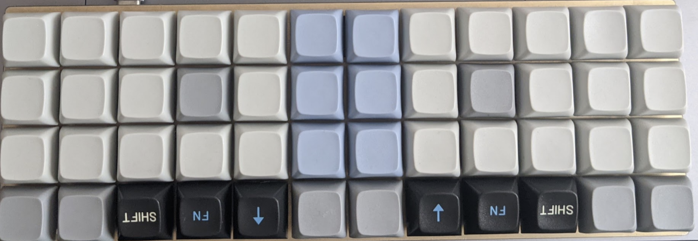

- there are TERM_ON / TERM_OFF mappings on the adjust layer - is this for terminal feature? check it
- PCB extensions
  - (from website) Footprints for add-ons to expand functionality:
    - Footprint for a 4-channel DIP switch ([[https://www.mouser.com/ProductDetail/CTS-Electronic-Components/210-4ES?qs=sGAEpiMZZMv%2F%252b2JhlA6ysOXUT%2FlZGfirY2QChbKK8Qs%3D][210-4ES]])
    - Footprint for a 2-pin JST-PH ([[https://www.sparkfun.com/products/9749][PRT-09749]])
    - Footprint for a 4-pin Qwiic (I2C) JST-SH connector ([[https://www.sparkfun.com/products/14417][PRT-14417]]) making it compatible with [[https://www.sparkfun.com/qwiic][Sparkfun’s Qwiic system]]
    - Footprint for a clickable (worked into the matrix) rotary encoder ([[https://www.sparkfun.com/products/9117][COM-09117]], et al)
    - Footprint for a 6-pin male/female header ([[https://www.sparkfun.com/products/9015][PRT-09015]] or [[https://www.sparkfun.com/products/12590][PRT-12590]], et al)
    - [[https://olkb.com/products/planck-pcb][Planck PCB Rev 6.1 – OLKB]]
    - Planck Rev 6 Feature Set : [[https://www.reddit.com/r/olkb/comments/863zwo/planck_rev_6_feature_set/][olkb]]
  - (from reddit post) Along with lots of footprints and breakouts (every pin/row/col on the chip has been broken-out)!
    - 9x footprints for WS2812B RGB LEDs ([[https://www.sparkfun.com/products/13667][COM-12667]])
    - Footprint for a 4-channel DIP switch that can be used to configure custom flags in QMK ([[https://www.mouser.com/ProductDetail/CTS-Electronic-Components/210-4ES?qs=sGAEpiMZZMv%2F%252b2JhlA6ysOXUT%2FlZGfirY2QChbKK8Qs%3D][210-4ES]] sorry for the only non-Sparkfun link)
    - Footprint for a 2-pin JST-PH (commonly used for batteries) ([[https://www.sparkfun.com/products/9749][PRT-09749]])
    - Footprint for a 4-pin Qwiic (I2C) JST-SH connector ([[https://www.sparkfun.com/products/14417][PRT-14417]])
      - This will allow you to hook up any of Sparkfun's [[https://www.sparkfun.com/categories/399][Qwiic breakouts]] (QMK support will be coming!) but also other keyboards with the same port as split boards (have this working now)
      - Footprint for a clickable (worked into the matrix) rotary encoder in one of four positions along the left side ([[https://www.sparkfun.com/products/9117][COM-09117]], et al)
      - Footprint for a 6-pin male/female header ([[https://www.sparkfun.com/products/9015][PRT-09015]] or [[https://www.sparkfun.com/products/12590][PRT-12590]], et al)
- default layout: [[https://config.qmk.fm/#/planck/rev6/LAYOUT_ortho_4x12][QMK Configurator]]
- [[https://github.com/qmk/qmk_firmware/commit/0e7e52c8202701e6a246fa8a6ac13dd2ecad5743][(advanced planck keymap with sounds) [Keymap] tk planck keymap (#11400) · qmk/qmk_firmware@0e7e52c]]
** Dactyl Minidox.                                                  :folded:
- Printed at 10 micron layer height with black SLA resin. 36 mechanical Redragon red keyswitches.
  - [[https://www.aliexpress.us/item/3256806925808180.html?src=google&gatewayAdapt=glo2usa][Probably this one - REDRAGON SMD RGB MX Switch 3Pin Clicky Linear Tactile Silent Red Switche For Backlit Mechanical Keyboard - AliExpress]]
    - Red Switch:
    - Switch Type: Linear Switch
    - Operating Force: 45 gf/cN
    - End Operating Force: 65 gf/cN MAX
    - Descriptions: The linear switching characteristic combined with the low spring resistance triggers directly. The Red Switch is the first choice for beginners in the world of mechanical keyboards.The smooth-running enables balanced writing and gaming sessions.
    - Hotswappable with kailh-socket-compatible keyswitches, and programmable with QMK.
    - Keymap: [[https://config.qmk.fm/#/handwired/dactyl_minidox/LAYOUT_split_3x5_3][https://config.qmk.fm/#/handwired/dactyl_minidox/LAYOUT_split_3x5_3]]
- [[https://config.qmk.fm/#/handwired/dactyl_minidox/LAYOUT_split_3x5_3][QMK Configurator]]
- How to flash
  - Repo: https://github.com/serebrov/qmk_firmware/tree/custom
    - Local repo: ~/web/keyboard/qmk_firmware (branch "custom")
  - Load the keymap in QMK configurator ([[https://config.qmk.fm/#/handwired/dactyl_minidox/LAYOUT_split_3x5_3][https://config.qmk.fm/#/handwired/dactyl_minidox/LAYOUT_split_3x5_3]])
    - keyboards/handwired/dactyl_minidox/keymaps/dactyl_mini/keymap.json
    - Update the keymap, download the layout add back to the repo
  - Flash with etc/[[http://qmk-flash-dactyl-minidox.sh][qmk-flash-dactyl-minidox.sh]]
    - Connect the keyboard, run this script
    - Reset the left part, wait for flash to complete
      - Note: reset is the big white button
      - ~qmk flash -kb handwired/dactyl_minidox -km dactyl_mini -bl avrdude-split-left~
      - Connect the right side via USB
    - Reset the right side, wait for flash to complete
      - Note: the USB on the right side is upside down comparing to the left side
      - ~qmk flash -kb handwired/dactyl_minidox -km dactyl_mini -bl avrdude-split-right~
  - Keymap commits
    - [[https://github.com/serebrov/qmk_firmware/commit/5fb443183562c236435e50cf9ff013be772de4ff][Add Dactyl Minidox keymap. · serebrov/qmk_firmware@5fb4431]]
    - [[https://github.com/serebrov/qmk_firmware/commit/4b0f817ce5983b62d5083caed81e4a53bad8d9a1][Dactyl keymap - remove tap mods on the Sym layer. · serebrov/qmk_firmware@4b0f817]]
    - [[https://github.com/serebrov/qmk_firmware/commit/c28a00de5e0fd2545c2a2526a4944e37fab0f842][Dactyl keymap - add caps word, swap = and \ on Num, add more Nav keys. · serebrov/qmk_firmware@c28a00d]]
- problem: right half does not work after flashing [solved]
  - Solved by adding #define SPLIT_USB_DETECT
  - if I connect it directly, it works as a left half
  - tried to disconnect TRRS, connect the right side and flash - it works correctly after flashing (as a right side), but when I connect it back via the left side it does not work again
  - there is also a note here - How to Build a Hand Wired Split Ergonomic Keyboard with Per-Key RGB LEDs | [[http://dlford.io][dlford.io]]
      [[https://www.dlford.io/keyboard-build-guide-per-key-rgb-leds/#firmware][https://www.dlford.io/keyboard-build-guide-per-key-rgb-leds/#firmware]]

    #+begin_example
    # MCU name
    MCU = atmega32u4
    # Bootloader selection
    BOOTLOADER = caterina # For Pro Micro
    # BOOTLOADER = qmk-dfu # For Elite-C
    RGB_MATRIX_ENABLE = yes
    LAYOUTS = split_3x5_3
    #+end_example

    - Note: Either of the two halves will be unresponsive if not connected to the other half by the TRRS cable, I haven’t figured out why this happens but it has something to do with using I2C instead of serial.
    - Google more about EE_HANDS - do I need it?
- problem: It does not work after flashing [solved]
  - Changed the info.json in handwired/dactyl_minidox
    -     "diode_direction": "COL2ROW", (from ROW2COL, probably a difference in the build process)
    - [[https://www.reddit.com/r/ErgoMechKeyboards/comments/187cp2m/comment/kbdvkrp/?utm_source=share&utm_medium=web3x&utm_name=web3xcss&utm_term=1&utm_content=share_button][https://www.reddit.com/r/ErgoMechKeyboards/comments/187cp2m/comment/kbdvkrp/?utm_source=share&utm_medium=web3x&utm_name=web3xcss&utm_term=1&utm_content=share_button]]
- VIA | [[https://www.caniusevia.com/][VIA]]
- [[https://docs.qmk.fm/#/keycodes?id=mod-tap-keys][Full List]]
- [[https://www.dlford.io/keyboard-build-guide-per-key-rgb-leds/#firmware][How to Build a Hand Wired Split Ergonomic Keyboard with Per-Key RGB LEDs | [[http://dlford.io][dlford.io]]]]
- [[https://github.com/qmk/qmk_firmware/issues/19906][Serial communication between split keyboard sides doesn't seem to be working · Issue #19906 · qmk/qmk_firmware · GitHub]]
- qmk_firmware/docs/[[http://config_options.md][config_options.md]] at master · qmk/qmk_firmware · GitHub
    [[https://github.com/qmk/qmk_firmware/blob/master/docs/config_options.md][https://github.com/qmk/qmk_firmware/blob/master/docs/config_options.md]]
- Built keyboard, have no idea how to program it. : [[https://www.reddit.com/r/ErgoMechKeyboards/comments/184glhu/built_keyboard_have_no_idea_how_to_program_it/][r/ErgoMechKeyboards]]
** Ajazz shortcuts                                                  :folded:
- FN+B = desktop / home screen
- FN+alt,?,ctr - arrows
- Fn+numbers = Fn keys
- Fn+Z/X/C = Media Prev/Play-Pause/Next
- Fn+V = Lock Screen Win-L
  - Opens calendar on Android
  - Fn+Esc=` (backtick)
  - Fn+Space, hold 4s = reset settings
- Ajazz settings
  - Fn+Q/W/E - bluetooth device
  - Fn+ | - rgb mode cycle
  - Fn+] - rgb speed
  - Fn+[ = rgb brightness
  - Fn+Right Shift - arrows/keys exchange (make arrows work without Fn)
  - Fn+Left Ctr - Number row/Fn row exchange
- Android shortcuts
  - Ctrl+Space - Language
  - Space - scroll down / Shift+Space - up
  - Alt-Tab - switch windows
  - Browser back/forward - Alt+Left/Right arrows
** Mitosis                                                          :folded:
*** Mitosis
- Mitosis Wireless Split Ergonomic Keyboard w/ Acrylic Case | [[https://flashquark.com/product/gb-mitosis-wireless-split-ergonomic-keyboard-w-acrylic-case/][Flashquark]]
- Wireless + Split + QMK = Mitosis : [[https://www.reddit.com/r/MechanicalKeyboards/comments/66588f/wireless_split_qmk_mitosis/][MechanicalKeyboards]]
- [GB] Mitosis Wireless Split Ergonomic Keyboard : [[https://www.reddit.com/r/MechanicalKeyboards/comments/6n4wo9/gb_mitosis_wireless_split_ergonomic_keyboard/][MechanicalKeyboards]]
  - Finally, you can still solder a speaker onto the receiver (pin 5 of the promicro) if you want Planck-like beeps. Pin 5 is not used by the receiver board.
- [[https://i.imgur.com/Ioh0Iix.png][Ioh0Iix.png (PNG Image, 1946 × 1472 pixels) - Scaled (54%)]]
- [[https://github.com/mattdibi/redox-keyboard/tree/master/redox-w#firmware][(redox wireless, uses similar receiver as in mitosis) redox-keyboard/redox-w at master · mattdibi/redox-keyboard]]
  - Basics: The Redox keyboard works similarly to the [[https://github.com/qmk/qmk_firmware/tree/master/keyboards/mitosis][Mitosis keyboard]]: we have two transmitters responsible for scanning the two matrices, which then transmit the matrix status through the [[https://developer.nordicsemi.com/nRF5_SDK/nRF51_SDK_v5.x.x/doc/5.2.0/html/a00140.html][Gazel protocol]] to the receiver. The receiver is another YJ-14015 which receives the two matrix scans and send it through serial to the Arduino Pro Micro. The Pro Micro is responsible for running QMK and converting the bytes received by the YJ-14015 into actual keystrokes.Firmware sources available here: [[https://github.com/mattdibi/redox-w-firmware][https://github.com/mattdibi/redox-w-firmware]].
*** Hardware
- mitosis-hardware/bom at master · reversebias/mitosis-hardware
  [[https://github.com/reversebias/mitosis-hardware/tree/master/bom][https://github.com/reversebias/mitosis-hardware/tree/master/bom]]
  - Hand soldering SMT resistor arrays. Is it possible? : ECE
    [[https://www.reddit.com/r/ECE/comments/17u7kf/hand_soldering_smt_resistor_arrays_is_it_possible/][https://www.reddit.com/r/ECE/comments/17u7kf/hand_soldering_smt_resistor_arrays_is_it_possible/]]
    http://www.digikey.com/product-detail/en/YC164-JR-0710KL/YC164J-10KCT-ND/1005702
- [[https://www.youtube.com/watch?v=hMlQvZNmCc8][Mitosis — Wireless Ergonomic Split Keyboard (nRF51822 based) - YouTube]]
- Mitosis: Anatomy Of A Custom Keyboard | [[https://hackaday.com/2017/06/05/mitosis-anatomy-of-a-custom-keyboard/][Hackaday]]
- [[https://github.com/mattdibi/redox-keyboard/issues/55][Redox Wireless Interference issues · Issue #55 · mattdibi/redox-keyboard]]
- [[https://www.reddit.com/r/ErgoMechKeyboards/comments/n34wep/wireless_split_ergo_endgame/gwnzojp?utm_medium=android_app&utm_source=share&context=3][Wrong keys might be because lower voltage]]
  - [[https://github.com/mattdibi/redox-keyboard/issues/55][Redox Wireless Interference issues · Issue #55 · mattdibi/redox-keyboard · GitHub]]
- Hope it's not NC-559 because I've used a lot of it to make solder bridges on YJ-14015 modules! Battery life should be [[https://github.com/reversebias/mitosis/issues/1][2.5 months]], tops, according to reversebias, my batteries only survived for about 1 month in sleep mode.
  - [[https://github.com/reversebias/mitosis/issues/1][Battery life lower than expected · Issue #1 · reversebias/mitosis]]
- From discord
  - Hi guys, I got my Mitosis a few weeks ago and I'm now finally able to test it with keycaps. I am having a problem with the right half, it keeps repeating the last typed key forever, and some key presses are not detected. First I thought the receiver positioning could fix it, tried many positions but nothing helped. Left half works perfectly. Any ideas what to do?
    - solved it by removing and reinserting the battery on the right half... whew.. posting here in case someone else faces this
    - loving the keyboard btw, best I ve used
    - Is there a way to power cycle one half without removing and reinserting the battery? I've noticed the problem keeps returning every time I don't use it for a few hours
    - Flashquark
  - @dk0 There are two possibilities that might be causing your issue. There may be other wireless devices that are running on the same frequency, which is causing wireless interference. Sometimes if the keyboard is close to the receiver, the keyboard signal can overpower the nearby interfering signals, but after the board is idle for some time, the signal transmission can go into a low power state to save battery, which can cause the interference to have a larger effect. You also want to make sure that the battery is making proper contact with the terminals. If there is a slight gap, you can close the gap by inserting a thin piece of aluminum foil between one side of the battery and the terminal.
    - Btw, if you are experiencing wireless interference, you will have to disable the other wireless devices or place them further away to avoid the issue.
    - as for power cycling, you may be able to program it in QMK, but that shouldn't be necceary if you can fix the root cause of the issue, which is most likely one of the two issues that I mentioned above
*** Firmware
- [[https://github.com/babarrett/mitosis-docs/blob/master/mitosis-README.md][mitosis-docs/[[http://mitosis-README.md][mitosis-README.md]] at master · babarrett/mitosis-docs]]
- [[https://github.com/reversebias/mitosis-hardware/tree/master/bom][mitosis-hardware/bom at master · reversebias/mitosis-hardware]]
- mitosis (radio channel instead of bluetooth, receiver on the computer side)
  - Wireless + Split + QMK = Mitosis : [[https://www.reddit.com/r/MechanicalKeyboards/comments/66588f/wireless_split_qmk_mitosis/][MechanicalKeyboards]]
    - [[https://github.com/reversebias/mitosis-hardware/tree/master/gerbers][PCB manufacturing files]]
    - [[https://github.com/reversebias/mitosis-hardware/tree/master/altium-mitosis][PCB design files]]
    - [[https://github.com/reversebias/mitosis-hardware/tree/master/schematics][PDF Schematics]]
    - [[https://github.com/reversebias/mitosis-hardware/tree/master/cnc][Lasercutting files]]
    - [[https://github.com/reversebias/mitosis][Wireless firmware]]
    - [[https://github.com/qmk/qmk_firmware/tree/master/keyboards/mitosis][QMK source, now merged]]
  - [[https://github.com/reversebias/mitosis-hardware/tree/master/bom][Parts list with suppliers]]
    - Hand soldering SMT resistor arrays. Is it possible? : ECE
      [[https://www.reddit.com/r/ECE/comments/17u7kf/hand_soldering_smt_resistor_arrays_is_it_possible/][https://www.reddit.com/r/ECE/comments/17u7kf/hand_soldering_smt_resistor_arrays_is_it_possible/]]
      http://www.digikey.com/product-detail/en/YC164-JR-0710KL/YC164J-10KCT-ND/1005702
  - As I understand, the design is this (and is quite different from what I thought initially)
    - Both parts are independent and each talks to a radio receiver
    - The radio receiver, together with microprocessor are connected to the computer
    - 1: this is not bluetooth, this is radio channel
    - 2: the keyboard firmware (QMK) is inside the receiver block, not on halves of the keyboard
    - Vs the design I kept in mind: both halves are loaded with QMK and both have bluetooth chip to communicate with each other (master / slave) and with the computer
      - According to the mitosis author, this leads to a much higer energy consumption
      - While his design can hold for 2.5 months on a set of CR2032 batteries (one for each half)
      - It is also much cheaper than bluetooth implementation
      - Also lighter, since big battery is not needed
    - The disadvantage of the design: requires connecting a receiver to the computer
      - Not a big problem, but still, it is more convenient with bluetooth
  - Hmm, interesting. The main issue with a direct transfer over to the TS65 layout is the number of pins required. The nrf51822 has 31 GPIOs, and the mitosis has 23 keys. This left a few GPIOs leftover for configuration and testing LED. It looks like the TS65 keyboard right half has 32 keys in the minimal cofiguration, which means that you'd need to have some matrix and scanning to read all the keys. Which means adding diodes, power consumption, and firmware complexity. The current design doesn't handle any of those things, because it simply didn't need to. So it might be a lot more work than a simple transfer over, sorry.
    - so it connects keys to the pins directly, with no scanning? I thought this is QMK's work, while from what he says, it would be his job (or maybe this is a "custom" part of every QMK-based firmware, what actually differs each board?)
  - Ok, breakdown in US dollars:
    - PCBs/plates: $25 for 10 (used 4)
    - Switches: $33 for 110 (used 46)
    - Keycaps: $28 for a 108key PBT set (used 46)
    - Neoprene: $16 for a meter (used ~1/10th of the roll)
    - Headers/FETs: couple of cents, but had them in stock
    - Wireless modules: $20 for 3
    - ST LINK V2 clone: $2
    - Pro micro: $3
    - Receiver PCB: $5.40 for 3 (used 1)
    - Regulator/RGB LED/buttons: couple of cents, had in stock
    - CR2032: $1 for 5 from china (dubious quality), or $2 for 8 from IKEA
    - That comes up to 134$ just adding those up. But it also sounds like you can pretty much make two keyboards at that price.
    - (so actually, it is < $100)
  - So do the two halves pair to each other? How is the latency between them? Is the pairing address for each half hardcoded into the other half?
    - Both halves only talk to the receiver, there's no low power way for either of the halves to be awake and listening for messages, at least not without unacceptable latency.
      - Worst latency I've seen over the wireless link was 3ms, usually it's below 1.5. Add this to the 5ms debouncing and ~1ms of the USB polling. It's completely imperceptible, I wouldn't use a wireless keyboard if I could notice it.
      - I've been using hardcoded addressing for testing, but I'm currently working on a dynamic pairing system for the future.
      - Oh! That makes more sense. I managed to misunderstand the part about the receiver. I thought you were doing like a master half and a slave half and was worried about the latency between halves, but using a receiver should largely solve that issue. You will obviously still have some amount of latency, but it should be roughly the same between halves so probably not that big of a deal.
  - how are you measuring latency?
    - Using an oscilloscope, I can trigger on a keypress, see the 5 milliseconds of debounce, then the spike in current as the packet is sent, then the output from the receiver module into QMK. I haven't been decoding the USB, but the point is, the wireless system adds 1-3ms of latency above a normal QMK keyboard.
  - Holy crap! Looks like a project that I'd do if I was smart. How do the halves communicate with each other? I mean there should be a second communication channel, are there like three nrf51822s, one for the computer and two for the halves? You can't pair both halves independently, because key combinations would not work, can you?
    - OMG it works even if halves are paired independently or even with different keyboards and different connections (USB/BT/etc.). I've just paired HHKB Pro 2 with Hasu controller and HHKB BT with bt 3.0 to the same machine and key combinations worked just fine. Shift on the first keyboard activates caps mode on the second and Ctrl on the first with A on the second fires "Ctrl+A". Figures you can have two halves paired independently without a need for a dedicated communication channel between the halves. That's kind of cool, I didn't know that until now.
      - reverse_bias: Yeah, what you described works for system modifiers, as the OS keeps track of the state of those keys. Really, all the keyboard is sending is a stream of keyPress and keyRelease events, which means you can use modifiers across keyboards. What you can't do however, is use any function or keymap layers, hence this design using a centralised dongle that handles the keymap and USB communication. The nice things about this method is the super low power keyboard halves, as they never need to be actively listening, and updating keymaps is a single upload to the dongle without having to re-pair or lose connection.
      - Also, the hell is receiver? Don't you use a standard Bluetooth-HID stack and firmware? I've tried a bunch of those for nrf51822 [[https://geekhack.org/index.php?topic=40514.msg2244694#msg2244694][https://geekhack.org/index.php?topic=40514.msg2244694#msg2244694]] it's much more convenient than using a dedicated receiver device. Why even use such a thing (especially on laptops with built-in bluetooth and a lack of usb ports)?
        - reverse_bias Nope, not using Bluetooth here, even though yes, the modules support it.
          - There's no low power way of doing a split Bluetooth keyboard with layers, at least nowhere near the battery life of this design where it lasts 6-12 months on a single coin cell. Non-split Bluetooth keyboards can become lower power by buffering key events to minimise airtime, not possible with a split design as you'd get synchronisation issues between the halves. You may suggest that the halves can communicate the layer state between themselves, but having an RF receiver turned on listening for a packet consumes way too much power, and timesharing the receive only increases latency.
          - I'm using a protocol called Gazell, which supports all the frequency hopping for coexistence, pairing and encryption benefits of Bluetooth while allowing for a no-compromise split design. For me low power, low latency, intelligent layers and macros were much more important.
      - Oh right, how do you press F1-F12 without dedicated keys then? There are independent Fn keys on both halves? That's still kind of a downside though considering I'm using a single Fn key on my HHKB.
        - reverse_bias I meant that the system here uses a centralised dongle, so layers across halves works perfectly fine. All keys and modifiers work as you would expect on a non-split board.
          - I am wondering if firmware could be modified to handle rf and bt communtication in the same time using only two nrf51822 modules so you won't need a receiver at all, is it doable?
            - Well yes, the hardware technically supports it, but it would drop the battery life, and any keymap or macro features would have to be ported over. I have nothing against Bluetooth by the way, I just don't have the software skills to write that firmware. Why I love open source, I was able to leverage the QMK work for this, and maybe someone else will extend my wireless firmware. :)
              - I've successfully compiled and used this keyboard firmware for nrf51822 [[https://github.com/I0x0I/DIY-A-BLE-Keyboard][https://github.com/I0x0I/DIY-A-BLE-Keyboard]] but handling two radio channels at once is of course a whole n'other story.
              - so, as far as I can understand, both halves are independent and talk to the receiver; it is also not a bluetoth, but a radio channel (probably something like it was in the autoalam)
              - build log: [[https://www.reddit.com/r/MechanicalKeyboards/comments/66588f/wireless_split_qmk_mitosis/dky3qxj/?utm_source=reddit&utm_medium=web2x&context=3][https://www.reddit.com/r/MechanicalKeyboards/comments/66588f/wireless_split_qmk_mitosis/dky3qxj/?utm_source=reddit&utm_medium=web2x&context=3]]
- [[https://github.com/joric/bluetosis/blob/d48f097cf91a4ac7e4b1535a771427ad46acf202/README.md][bluetosis/[[http://README.md][README.md]] at d48f097cf91a4ac7e4b1535a771427ad46acf202 · joric/bluetosis]]
  - Mitosis Clones
  - [[https://github.com/Durburz/interphase][Interphase]] by [[https://www.reddit.com/user/Durburz_][/u/Durburz_]] (66 keys, diode matrix, voltage regulator, AAA battery) ([[https://redd.it/7ggeww][Reddit]])
  - [[https://redd.it/7uasay][Meiosis]] by [[https://www.reddit.com/u/SouthPawEngineer][/u/SouthPawEngineer]] (also [[https://redd.it/7ruihw][Telophase]], [[https://redd.it/7zfj19][Helicase]] and [[https://redd.it/8qkib4][Centromere]], no source files available) ([[https://southpawdesign.net/][Site]])
  - [[https://github.com/GlenPickle/Chimera][Chimera]] by [[https://www.reddit.com/user/GlenPickle][/u/GlenPickle]] (also Chimera Ergo, Chimera Ortho, Chimera Ergo Mini and Chimera Ergo 42)
  - [[https://github.com/fhtagnn/kissboard][Kissboard]] by [[https://www.reddit.com/user/fhtagnn][/u/fhtagnn]] ([[http://adnw.de/][AdNW]]-inspired layout, PCB's are not tested) ([[https://redd.it/8bauoz][Reddit]]) ([[https://imgur.com/a/A95FF][Album]])
  - [[https://redd.it/7g54l8][Dichotomy]] by [[https://www.reddit.com/user/Snipeye][/u/Snipeye]] (48-key Mitosis clone with digital encoders, no sources available) ([[https://youtu.be/5jmmYbgtOgI][Youtube]]) ([[https://www.kickstarter.com/projects/1090732691/dichotomy-keyboard-and-mouse][Kickstarter]])
  - [[https://github.com/YCF/Trident][Trident]] by [[https://www.reddit.com/u/imFengz][/u/imFengz]] (Wireless Let's Split, module and battery placed between the switches) ([[https://redd.it/6um7eg][Reddit]]) ([[https://i.imgur.com/mCTgwu5.png][Image]])
  - [[https://github.com/bezmi/orthrus][Orthrus]] by [[https://www.reddit.com/u/bezmi][/u/bezmi]] (great 52-key Atreus/Mitosis crossover, KiCad project) ([[https://redd.it/8txry7][Reddit]])
  - [[https://github.com/satt99/comet46-hardware][Comet]] by [[https://www.reddit.com/user/SaT999][/u/SaT99]] (Comet46 - split 40% wireless keyboard) ([[https://imgur.com/a/vs1W5qB][Gallery]]) ([[https://github.com/satt99/comet46-firmware][Firmware]]) ([[https://redd.it/8ykwjj][Reddit]])
  - [[https://github.com/mattdibi/redox-keyboard/tree/master/redox-w][Redox Wireless]] by [[https://www.reddit.com/user/TiaMaT102][/u/TiaMaT102]] (Redox Wireless a.k.a. codename Ultron) ([[https://www.reddit.com/r/MechanicalKeyboards/comments/9jwg0u/redox_codename_ultron/][Reddit]])
  - [[https://github.com/pseudoku/mitosis][Apoptosis]] by [[https://www.reddit.com/user/Pseudoku_][/u/Pseudoku_]] (Custom Mitosis Clone, Warpman layout, 44 keys) ([[https://www.reddit.com/r/MechanicalKeyboards/comments/9y0xyo/a_small_oddball_family/][Reddit]]) ([[https://i.redd.it/uok64wt73zy11.jpg][Image]])
    - pseudoku/Apoptosis: [[https://github.com/pseudoku/Apoptosis][44 Keys Mitosis Clone with Staggering Stagger!]]
- reversebias/mitosis: [[https://github.com/reversebias/mitosis][Firmware for nordic MCUs used in the Mitosis Keyboard]]
  - [[https://github.com/joric/mitosis/tree/devel][(see also bluetosis) joric/mitosis at devel]]
  - (macos setup fixes) w4ilun/mitosis: [[https://github.com/w4ilun/mitosis][Firmware for nordic MCUs used in the Mitosis Keyboard]]
- (flashquark's version) repne/mitosis: [[https://github.com/repne/mitosis][Firmware for nordic MCUs used in the Mitosis Keyboard]]
- joric/bluetosis: [[https://github.com/joric/bluetosis][Bluetooth firmware for the Mitosis keyboard (no dedicated receiver needed)]]
- [[https://github.com/qmk/qmk_firmware/tree/master/keyboards/mitosis][qmk_firmware/keyboards/mitosis at master · qmk/qmk_firmware]]
*** Layouts
- [[http://www.keyboard-layout-editor.com/#/gists/f89d2ff79b72e920939b][Keyboard Layout Editor]]
  - The layout is 95% from the [[http://www.maltron.com/store/c34/Dual_hand_keyboards.html][Maltron Keyboard]], they have a set of logical [[http://www.maltron.com/3d-89-maltron-introduction.html][tutorials]] that I learnt with. Unless you mean the tri-layer thing?
- [[http://www.keyboard-layout-editor.com/#/gists/e213fec721cb035614cef401cd6750d6][Keyboard Layout Editor]]
- layouts collection [[https://www.reddit.com/r/MechanicalKeyboards/comments/66588f/wireless_split_qmk_mitosis/dl0i527/?utm_source=reddit&utm_medium=web2x&context=3][from this post]]
  - Looks
  - like even on qwerty layout I'm very far from 50 wpm. I want to gather a
  - collection of mitosis layouts here. Links and suggestions are welcome. https://raw.githubusercontent.com/joric/mitosis/devel/precompiled_iar/precompiled-basic-left.hex
   https://raw.githubusercontent.com/joric/mitosis/devel/precompiled_iar/precompiled-basic-right.hex
   https://raw.githubusercontent.com/joric/mitosis/devel/precompiled_iar/precompiled-basic-receiver.hex
  - My precompiled mitosis firmware: [[https://raw.githubusercontent.com/joric/mitosis/devel/precompiled_iar/precompiled-basic-left.hex][left]], [[https://raw.githubusercontent.com/joric/mitosis/devel/precompiled_iar/precompiled-basic-right.hex][right]], [receiver] ([[https://raw.githubusercontent.com/joric/mitosis/devel/precompiled_iar/precompiled-basic-receiver.hex][https://raw.githubusercontent.com/joric/mitosis/devel/precompiled_iar/precompiled-basic-receiver.hex]]) (YJ-14015, led support), [[https://github.com/joric/mitosis/tree/devel][source]].QMK layouts:
  - mitosis-default (original) from [[https://www.reddit.com/u/reverse_bias/][/u/reverse_bias]]: [[http://www.keyboard-layout-editor.com/#/gists/f89d2ff79b72e920939b][kle]], [[https://github.com/qmk/qmk_firmware/blob/master/keyboards/mitosis/keymaps/default/keymap.c][keymap]], [[https://raw.githubusercontent.com/joric/qmk_firmware/mitosis-joric/precompiled/mitosis_default.hex][firmware]], [[http://i.imgur.com/Ioh0Iix.png][pic]]
  - mitosis-qwerty (qwerty layout) from [[https://www.reddit.com/u/runninghack/][/u/runninghack]]: [[http://www.keyboard-layout-editor.com/#/gists/acec41432b5ce0eb341d88245a20d9da][kle]], [[https://github.com/runninghack/qmk_firmware/blob/master/keyboards/mitosis/keymaps/qwerty/keymap.c][keymap]], [[https://raw.githubusercontent.com/joric/qmk_firmware/mitosis-joric/precompiled/mitosis_qwerty.hex][firmware]], [[https://i.imgur.com/Jt0lTWt.png][pic]]
  - mitosis-mjt (qwerty layout) from [[https://www.reddit.com/u/kaybeerry/][/u/kaybeerry]]: [[http://www.keyboard-layout-editor.com/#/gists/e213fec721cb035614cef401cd6750d6][kle]], [[https://github.com/mterhar/qmk_firmware/blob/master/keyboards/mitosis/keymaps/mjt/keymap.c][keymap]], [[https://raw.githubusercontent.com/joric/qmk_firmware/mitosis-joric/precompiled/mitosis_mjt.hex][firmware]], [[https://i.imgur.com/BiKsnIV.png][pic]]
  - mitosis-carvac_dv (qwerty layout) by [[https://www.reddit.com/u/Carvac/][/u/Carvac]]: [[https://github.com/CarVac/qmk_firmware/blob/master/keyboards/mitosis/keymaps/carvac_dv/keymap.c][keymap]]
  - mitosis-workman (workman layout) by [[https://www.reddit.com/u/mloffer/][/u/mloffer]]: [[http://www.keyboard-layout-editor.com/#/gists/db73d647ad8a67c9654a4daeab0e0873][kle]], [[https://github.com/mloffer/mitosis-workman][keymap]]
  - mitosis-atreus (atreus layout) from [[https://www.reddit.com/u/iamjoric/][/u/iamjoric]]: [[http://www.keyboard-layout-editor.com/#/gists/e1b26b86c4e024d2f4f3185e5b769a00][kle]], [[https://github.com/joric/qmk_firmware/blob/mitosis-joric/keyboards/mitosis/keymaps/atreus/keymap.c][keymap]], [[https://raw.githubusercontent.com/joric/qmk_firmware/mitosis-joric/precompiled/mitosis_atreus.hex][firmware]]
  - mitosis-joric (experimental) from [[https://www.reddit.com/u/iamjoric/][/u/iamjoric]]: [[http://www.keyboard-layout-editor.com/#/gists/3f5dd1c848bb9a7a723161ad5e0c8e39][kle]], [[https://github.com/joric/qmk_firmware/blob/mitosis-joric/keyboards/mitosis/keymaps/joric/keymap.c][keymap]], [[https://raw.githubusercontent.com/joric/qmk_firmware/mitosis-joric/precompiled/mitosis_joric.hex][firmware]]
  - Upd made a bluetooth firmware that doesn't need a receiver: [[https://github.com/joric/bluetosis][https://github.com/joric/bluetosis]]
  - [[https://gitlab.com/Nzen/impatient-broth-nenem][Projects · Nicholas Prado / impatient-broth-nenem · GitLab]]
- [[https://config.qmk.fm/#/mitosis/LAYOUT][QMK Configurator]]
- [[https://www.keyboardtester.com/][Keyboard Tester]]
** Microdox                                                         :folded:
*** Microdox
- [[https://github.com/wafflekeebs/waffle_microdox/wiki/Microdox-Build-Guide][Microdox Build Guide · wafflekeebs/waffle_microdox Wiki]]
- 40-percent/microdox-case: [[https://github.com/40-percent/microdox-case][simple tray cases for the Boardsource Microdox]]
- boardsource/microdox-goodies: [[https://github.com/boardsource/microdox-goodies][just a repo of some micro dox goodies feel free to make any prs you want to this repo and mostly I will just pull them in.]]
- Microdox with tented 3D printed case I designed : [[https://www.reddit.com/r/ErgoMechKeyboards/comments/l6hte3/microdox_with_tented_3d_printed_case_i_designed/][ErgoMechKeyboards]]
- It even fits in the pockets of my pants: [[https://www.reddit.com/r/olkb/comments/lzrqu0/it_even_fits_in_the_pockets_of_my_pants/?utm_medium=android_app&utm_source=share][olkb]]
- Microdox with gChoc light blues (20g springs) : ErgoMechKeyboards
  [[https://www.reddit.com/r/ErgoMechKeyboards/comments/k8xuwu/microdox_with_gchoc_light_blues_20g_springs/][https://www.reddit.com/r/ErgoMechKeyboards/comments/k8xuwu/microdox_with_gchoc_light_blues_20g_springs/]]
  https://github.com/t00mietum/keyboard
  - Hmm, 20g springs, is this a common thing in the ergo world? Does it help for some ailments? I feel like you can't rest your hands on the keys at all?
  - [[https://www.reddit.com/user/TeXitoi][TeXitoi]] 20g on choc would be a bit like 30-35g on MX. That's a bit "just touch the switch, and it registers". That's really comfortable, your fingers just lightly walk on the keeb.That's a bit a trend launched by [[https://www.reddit.com/u/HardAsMagnets][/u/HardAsMagnets]] he even propose 12g choc on the "ready" versions at [[https://gboards.ca/][https://gboards.ca]]
- My first build, a Microdox : [[https://www.reddit.com/r/MechanicalKeyboards/comments/iduj56/my_first_build_a_microdox/][MechanicalKeyboards]]
- Check out my new small keyboard and read all about my layers (details in comments) : [[https://www.reddit.com/r/MechanicalKeyboards/comments/igf0xw/check_out_my_new_small_keyboard_and_read_all/][MechanicalKeyboards]]
- [IC] Microdox IC (58-Key Ergodox) : [[https://www.reddit.com/r/MechanicalKeyboards/comments/48okps/ic_microdox_ic_58key_ergodox/][MechanicalKeyboards]]
- Any programmers use a MiniDox? : [[https://www.reddit.com/r/MechanicalKeyboards/comments/99qgb3/any_programmers_use_a_minidox/][MechanicalKeyboards]]
- What typing on a minidox is like, do not fear the ortho, your joints will thank you. : [[https://www.reddit.com/r/MechanicalKeyboards/comments/7g4icy/what_typing_on_a_minidox_is_like_do_not_fear_the/][MechanicalKeyboards]]
  - [[https://gist.github.com/Lhun/ce74b03b1d08992ac0ad3945453de78d#file-keymap-c][config.h]]
  - Maybe [[https://i.imgur.com/bLSbhsb.jpg][I'm just]] in [[https://i.imgur.com/5rgKb24.png][a Google bubble]],
    - but I'll stand my ground. Ortholinear isn't ergonomic, it's really bad
    - with the pinky. But ergonomic keyboards, like the ErgoDox, Atreus are
    - much better because they have staggered columns.
*** Hardware
- [[https://imgur.com/a/vImo6][MiniDox Build log/guide - Imgur]]
- That-Canadian/MiniDox_PCB: [[https://github.com/That-Canadian/MiniDox_PCB][MiniDox Keyboard, PCB files]]
- [[https://github.com/dotdash32/cases/tree/master/Minidox][Cases/Minidox at master · dotdash32/Cases]]
- Microdox pins
  - from keyboards/boardsource/microdox/config.h
  - #define MATRIX_ROW_PINS { B2, B6, B4, B5 }
  - #define MATRIX_COL_PINS { F4, F5, F6, F7, B1 }
  - #define SOFT_SERIAL_PIN D2
  - #define RGB_DI_PIN D3
  - Check: how OLED is controlled - which pins? -> i2c (D1 / D0)
    - [[https://beta.docs.qmk.fm/using-qmk/hardware-features/displays/feature_oled_driver][OLED works via I2C - serial interface via D1 / D0]]
      - [Help] Iris - What extra pins can I use for mods on the Iris from [[http://keeb.io][keeb.io]]? : [[https://www.reddit.com/r/olkb/comments/9wgyvw/help_iris_what_extra_pins_can_i_use_for_mods_on/][olkb]]
      - [[https://thomasbaart.nl/2018/11/14/what-extra-pins-can-i-use-on-the-iris-keyboard-from-keeb-io/][What extra pins can I use on the Iris keyboard from [[http://keeb.io][keeb.io]]? – Thomas Baart]]
        - D1 / D0 also wired to the TRRS jack and connect to the Pro Micro on the other side of the Iris.
  - promicro pinout
- Note: cable positions is inconvenient (both trrs and usb) - they stick to sides, so get in a way when you want to tilt it (usb) and take space between halves (trrs is on the mac track pad)
  - It is more convenient in moonlander where cables are at the top
- battery switch
  - [[https://lcsc.com/product-detail/Toggle-Switches_Korean-Hroparts-Elec-K3-1296S-E1_C128955.html][Korean Hroparts Elec|Korean Hroparts Elec K3-1296S-E1|Toggle Switches|LCSC]]
- rotary encoder?
  - E6, D7, C6, D4 pins seem to be unused
  - could put it instead of the shift on the right
  - with combos, I could also puth control somewhere
  - some example (accidentally found, probably it is easy to find more)
    - [[https://github.com/kdb424/qmk_firmware/blob/084a413ce46ee6b906570fac0a108b4020b363c0/users/kdb424/kdb424.c][qmk_firmware/kdb424.c at 084a413ce46ee6b906570fac0a108b4020b363c0 · kdb424/qmk_firmware]]
      - add MX sockets and try with regular keys?
      - try with nice!nano
- build notes
  - [[https://github.com/wafflekeebs/waffle_microdox/wiki/Microdox-Build-Guide][Microdox Build Guide · wafflekeebs/waffle_microdox Wiki]]
    - pcbs are identical, choose one a left and another as right (controllers outside)
    - good to mark the top side of each side with paper scotch
    - pcb allows both smd and throuhg the hole diodes
    - recommended temperature for regular components - 320C
    - recommended temperature for smd rgb leds - 260C
  - diodes (regular and rgb) are on the bottom side
    - regular diodes - black side goes to a square marked hole (the other is circle)
    - rgb diodes - largest pad goes to the pad marked with rectangle
  - mill-max sockets are not included
    - the kit does not include mill-max sockets for controllers, even not optionally (although boardsource have them in the store) - ordered on digi-key
    - [[https://www.reddit.com/r/ErgoMechKeyboards/comments/k7rno3/finally_finished_building_my_sofle/?utm_medium=android_app&utm_source=share][https://www.reddit.com/r/ErgoMechKeyboards/comments/k7rno3/finally_finished_building_my_sofle/?utm_medium=android_app&utm_source=share]]
  - Microcontrollers are face up (components at the top) on the left side and face down on the right
    - Kyria has both controllers face down
    - When we socket the controller with mill-max pins, it becomes one sided (it is not possible to flip it)
    - I used Elite-C on the right, face down, max-mill pins (so it is compatible with Kyria)
    - And I used pro-micro on the left, face up, with diode legs (so theoretically it could also be placed face down)
      - Practiaclly it looks like it was soldered into the sockets, either diode legs are too thin or the paper scotch I used is not good enough
    - I used these mill-max pins (there are longer in splitkb kit, could use them for two-sided socket): 3320-0-00-15-00-00-03-0 Mill-Max Manufacturing Corp. | Connectors, Interconnects | [[https://www.digikey.com/en/products/detail/3320-0-00-15-00-00-03-0/ED1134-ND/4147392?itemSeq=347104475][DigiKey #copy]]
      - These are quite short, splitkb sent longer (although they recommend to cut them after and shorter pins do not need cutting)
      - Longer might be useful to make a socketed controller that can be used both face up and face down
    - After flashing both sides, I found that left and right are swapped
      - Looks like the default is the opposite: if I connect the left half, the board works as expected
      - But I wanted to connect the right side to use USB-C on Elite-C as a connector
      - The firmware has #define EE_HANDS option set
    - [[https://beta.docs.qmk.fm/developing-qmk/qmk-reference/config_options#setting-handedness][See also Config Options - QMK]]
      - Elite-C on left, Pro-micro on the right. Still ironing out my keymap.
- nice!nano and ZMK
  - can use bigger battery (have 110mh as mentioned in nice!nano guide), but there is plenty of space between plates to fit bigger battery (should be also flat)
  - need some battery connector, it is Inconvenient and, probably, dangerous to solder directly as it immediately powers on the controller (it becomes "live", "online" soldering)
  - ZMK is nice, I was able to get all the QMK features easily
  - It already had Microdox support
    - besides some default keymap that was useful, it also supports LEDs (shows battery status, so good to have)
    - downside: I was not eable to set it up locally (Zephyr seems to be complex)
    - upside: they have a github actions setup to build firmware on github
- [waffle, boardsource discord] SMD LED soldering tips ツ
  - FLUX WILL HELP YOU IMMENSELY
  - Assuming you're using something similar to 60/40 0.032in/0.8mm solder, I recommend soldering at 260°c.
  - Pre tin a pad and reflow the solder while placing the LED down on the pad with some tweezers.
  - Orientation is very important. It won't only mess up your LEDs, but incorrect orientation will also prevent your keys from working.
  - Work on one LED at a time. Solder a pad on one and move onto the next to let the previous one cool.
  - Although it may be a pain to work on these LEDs with your controllers in place, I strongly suggest test the LEDs as you go (completely solder 3 at a time) and plug it in to test that those 3 work. This will save you so much more troubleshooting down the road.
  - Regarding testing, keep in mind LEDs do follow a data chain (1, 2, 3, 4...) so you must follow that for them to work.
- [waffle, boardsource discord] This is for socketing Pro Micros, Elite-C's & OLED displays.
  - [[https://www.digikey.com/product-detail/en/mill-max-manufacturing-corp/315-43-164-41-003000/ED4764-64-ND/1212143][https://www.digikey.com/product-detail/en/mill-max-manufacturing-corp/315-43-164-41-003000/ED4764-64-ND/1212143]]
  - Female to male mill-max sockets ᛏᛏ
  - You need a quantity of 1 for a split keyboard with OLED displays
  - They come in rows of 64 and 48 will be used for your micro controllers and another 8 for you OLED displays.
  - [[https://www.digikey.com/product-detail/en/mill-max-manufacturing-corp/3320-0-00-15-00-00-03-0/ED1134-ND/4147392][https://www.digikey.com/product-detail/en/mill-max-manufacturing-corp/3320-0-00-15-00-00-03-0/ED1134-ND/4147392]][[https://www.digikey.com/product-detail/en/mill-max-manufacturing-corp/3320-0-00-15-00-00-03-0/ED1134-ND/4147392][3320-0-00-15-00-00-03-0 Mill-Max Manufacturing Corp. | Connectors, ...]]Order today, ships today. 3320-0-00-15-00-00-03-0 – Single Post Terminal Connector Through Hole Gold 0.020" (0.51mm) Dia from Mill-Max Manufacturing Corp.. Pricing and Availability on millions of electronic components from Digi-Key Electronics.
  - mill-max socket pins ᛏᛏ These are can be replaced by diode legs but these are all around the best option. These are sold individually, therefore you will need to purchase 48 (24 for each controller)
  - [[https://www.digikey.com/product-detail/en/mill-max-manufacturing-corp/350-10-164-00-006000/ED6864-64-ND/357045][https://www.digikey.com/product-detail/en/mill-max-manufacturing-corp/350-10-164-00-006000/ED6864-64-ND/357045]]
  - Male-Male sockets for OLED displays ᛏᛏ
  - These are used for socketing your OLED displays. These are also sold in rows of 64 so a quantity of 1 will be more than enough (you only need 8)
- [[https://www.thingiverse.com/thing:4350283][Minidox High Profile Case by destinyboy3 - Thingiverse]]
- Rotary Encoder on a Microdox : [[https://www.reddit.com/r/ErgoMechKeyboards/comments/iprfzg/rotary_encoder_on_a_microdox/][ErgoMechKeyboards]]
*** Firmware
- wafflekeebs/waffle_microdox: [[https://github.com/wafflekeebs/waffle_microdox][Microdox Firmware]]
- [[https://github.com/qmk/qmk_firmware/tree/master/keyboards/boardsource/microdox][qmk_firmware/keyboards/boardsource/microdox at master · qmk/qmk_firmware]]
- might be a cool animation (typing cat), try it
  - [[https://github.com/kdb424/qmk_firmware/blob/57dd7b76a5078f20d0ca60fe57fa0a00391d8086/keyboards/crkbd/keymaps/kdb424/keymap.c#L307][qmk_firmware/keymap.c at 57dd7b76a5078f20d0ca60fe57fa0a00391d8086 · kdb424/qmk_firmware]]
    - also it renders WPM, also interesting
- ZMK bluetooth connection problem
  - did before
    - move both to bootloader mode
    - flash left with settings reset, move to bootloader
    - flash right with settings reset, move to bootloader
    - flash left with firmware
    - flash right with firmware
    - try to connect
    - works wired, does not want to connect via bluetooth
    - try to connect - the indicator in bluetooth settings is spinning
    - do bluetooth reset on the keyboard - num layer, BT_CLR (on Q)
    - mac shows Microdox Left at the bottom
    - click Connect once more - now it instantly works
- Flashing
  - double click reset button to flash
- scripts to flash: [[https://github.com/serebrov/qmk_firmware/tree/custom/etc][qmk_firmware/etc at custom · serebrov/qmk_firmware]]
  - right part - ./etc/[[http://qmk-flash-microdox-elite-c.sh][qmk-flash-microdox-elite-c.sh]]
  - left part - ./etc/[[http://qmk-flash-microdox-pro-micro.sh][qmk-flash-microdox-pro-micro.sh]]
- both sides need to be flashed initially, after that only one can be flashed (right, with elite-c in my case as I will be using it as master)
  - [[https://docs.keeb.io/docs/flashing-firmware][https://docs.keeb.io/docs/flashing-firmware]]
  - Initially, you do need to have both sides flashed, as that allows both sides to talk to each other using the same communication protocol
    - Once both sides are flashed, you only need to flash the master side if you are just updating the keymap
- [[https://github.com/qmk/qmk_firmware/tree/master/keyboards/minidox][qmk_firmware/keyboards/minidox at master · qmk/qmk_firmware]]
*** Layout
- [[https://configure.ergodox-ez.com/moonlander/layouts/l7zJe/latest/0][Ergodox EZ Configurator - Minidox AutoShift]]
  - it can actually be reduced even more
  - The , . / can be moved to the Sym layer (same positions) and, probably, alt can be moved to the layer too
  - extra layers (3, 4, 5) are available from the Sym layer
- CMD layer can be removed: regular CMD key is enough and CMD+1,2,... combos can be done on the sym layer (so space+cmd+1,...)
  - but need to move arrow keys somewhere
  - Can remove media layer too, I don't use it much
  - Can I do a sane OSM version for Minidox? Probably, will have to put OSM Shifts to the second thumb key (instead of tab and enter)
- I feel like OSM might be the best speed typing option
  - dual function keys introduce some delays to deal with and can interfer with regular typing
  - AutoShift is nice, but Every Capital Letter require a longer Keypress, so it slows the typing down.
*** Problems (and some solutions)
- How to debug and fix LEDs
  - how to debug this? some might be not soldered properly, some might be burnt
    - solder conroller first, so the board has power
      - LEDs have common VSS (power) and GND (ground)
      - LEDs are connected in a row
        - Controller pin -> LED 1 IN - LED 1 OUT - LED 2 IN - LED 2 OUT - ...
          - Controller pin is TX/D0 - can be checked in QMK, config.h for the keyboard (but all boards that I’ve checked use D0 to control backlight LEDs)
          - Controller sends a data package containing commands for all LEDs, one by one - first LED takes out its data and passes the rest to the output (there is a controller inside the LED too)
          - So if one LED does not work, all LEDs after it won’t work too
        - If nothing works: it is possible to check if there is a signal with LED strip (I used 6 LEDs) by soldering it to controller legs (VSS, GND, TX)
          - Make sure to connect TX to DIN (data IN) on the LED strip - I first connected it to DOUT and was wondering why it does not work
          - Do not connect long strip - it consumes too much current
    - solder first LED, check it it works, then next one and so on
      - cover all pads with solder, then add flux on top, then put the LED on top
      - for SK6812 mini, it is possible to heat two pads at the same time
    - if LED does not work
      - it can be the output of the previous LED that has bad joint
      - try to gently press over the corners of the LED to see if it lights up, often the bad joint can be found this way
      - measure the voltage with multimeter with power on (measure between any GND controller leg and LED pads)
        - VDD (power) leg should have around 4.8V
        - VSS (ground) should have around zero
        - IN will have small value, near 0.10, when measuring in 600mv range, we can see that the value changes when the brightness changes (I tested with breath effect)
        - OUT - same (and same as IN for the next LED)
        - Note that SK6812 does not have legs, so we can only do measurements on PCB pads, but can not check on LED pads (so can not make sure if the solder joint is good)
      - make a visual tester out of LED strip
        - I had 6 LEDs, but one led should be enough
        - it is easy to solder wires to the strip pads
        - I connected power and ground wires to controller legs and used IN wire as a tester, by toching the IN and OUT pad for installed LEDs (so I can find where the signal breaks)
    - Easy way: use LED strip instead of soldering LEDs onto PCB
      - The strip can be cut in smaller pieces that can be connected together with wries
  - katiekat12/20/2020
    - Well I'm all out of leds. still only 2 work
    - Tried replacing the second one that was working too
    - kdb42412/20/2020
    - You have a multimeter?
    - You can validate solder joints with them.
    - Curious if you are on the easy solder LED's or the older ones with no legs.
  - katiekat12/20/2020
    - there has to be something I'm doing wrong here. I've been through 15 leds just to get 2 of them working so far
    - and I'm following all the tips in that pinned message. low temp and everything
    - kdb42412/20/2020
    - It's possible that you are not killing them, but they just aren't making a solid connection. If the previous LED has it's DOUT pin not properly connected, it can make you think that the led after it is wrong, when it's not.
  - Barrington C12/05/2020
    - Hey peeps, do you guys possibly know why my strip doesn't work on startup but I can jump individual LEDs by pressing the Din/Do slot to the opposite strips +5V
    - I assume it's a short, but why would the LEDs stay lit after jumping
  - [[https://github.com/foostan/crkbd/blob/master/corne-classic/doc/buildguide_en.md#some-leds-not-turning-on][crkbd/[[http://buildguide_en.md][buildguide_en.md]] at master · foostan/crkbd]]
    - Some LEDs not turning on
    - If some LEDs aren't turning on, check the first LED not turning on or the one before it.
    - Here are some things to try out:
      - Make sure the LED is soldered correctly. Check the pads to see if it looks like they have a proper connection.
      - Check the LED orientation. Use the pictures above the see the correct orientation. Since the first LED is soldered with its back against the PCB, you might have to determinewhat the orientation should look like from the front using LEDs 7-27 (just double check that they are oriented correctly first).
      - If both of the above looks good, chances are the LED was damaged during soldering. Either replace it directly or use the diod mode of a multimeter to test the connectivity. One way to do this is by simply comparing to some of the other LEDs you have soldered. Choose two of the LED's pads (out of the four available) and compare the reading to that of some of the other LEDs (taking care to measure the same pads with the same needles of your multimeter). Work your way through all combinations of pads and needles. If the differ, you either have a broken LED or bad connectivity. Or simply desolder the LED directly, might be quicker. :)
  - Help with adding RGB strip : [[https://www.reddit.com/r/olkb/comments/8os6xm/help_with_adding_rgb_strip/?sort=new][olkb]]
- No rgb LEDs are on the right side
  - on the right side - also checked with multimeter, resoldered problematic places, but still no leds were working, sometimes the third one lighted red, but that was not stable
    - tried to debug this by removing them one-by-one, no luck, even when only one has left
    - resoldered this one (the first, under the controller) a few times and one of the pads on the PCB went off
    - so left it without the backlight for now. I saw a video with some tips on how to restore the pad, may try that later.
      - the basic idea - wire from the controller's leg to one of the LED pads, but in this case it is better to get LEDs with legs (there are similar LEDs, but with legs that should be easier to solder)
      - See "katiekat12/20/2020" above: Curious if you are on the easy solder LED's or the older ones with no legs.
      - [[https://boardsource.xyz/store/5f6316e0a2c1b43e37ca04c3][Boardsource - LED (SK6812 Mini-e)]]
      - [[https://boardsource.xyz/store/5ecad3d5e7e0515b382b5539][and I have these - Boardsource - LED (WS2812B)]]
        - or maybe just SK6812 (not Mini-e) which seem to be similar to WS2812B
        - note: in the firmware there is a WS2812B comment, some adjustments might be needed
        - It is also possible that the controller leg that works with LEDs is not soldered properly. Need to check which leg it is and try to verify with multimeter. Or just resolder it.
        - tried soldering mini-e with wires, doesn't work (one led)
        - tried to solder 6x led strip directly to elite c - doesn't work
  - next: socket another pro micro, try how it works with pro micro
    - I have an impression this is either a software problem
    - or this pin does not work on elite c (D3/TX0 as I understand)
    - or this is a wrong pin
    - Also: try led strip on the other half
    - Also: try connecting the led strip to arduino
- Only two LEDs are working on the left side, no leds on the right
  - on the left side - using multimeter found all problematic connections, resoldered them and now all leds are working
    - multimeter is in the diode testing mode
    - black multimeter pin to GND (either on the controller or on the GND LED leg), check other legs with red multimeter pin - two of them are showing something like 1.6 and the third is 1.4 (values can wary)
    - [[https://docs.splitkb.com/hc/en-us/articles/360010552299][One or more RGB LEDs do not work properly or at all – [[http://splitkb.com][splitkb.com]]]]
      - the GND and VSS is common for all diodes
      - Some keys were not working on the left side - forgot to solder the switch sockets on one side (easily fixed by soldering them)
- TRRS jacks were not soldered properly - one went off when I unplugged the cable from it and I was able to take off the other one with hands, shaking it back and forth a bit, resoldered, seems to be good now
  - Not really, went off again
  - Resoldered, this time first added flux onto the jack legs and covered with solder, then soldered to the PCB
- OLEDs were showing the upside down images, fixed in firmware:
  - in keymaps/cole/keymap.c
  - #ifdef OLED_DRIVER_ENABLE
  - oled_rotation_t oled_init_user(oled_rotation_t rotation) {
    - if (!is_keyboard_master()) // <------ added ! before is_keyboard_master()
      - return OLED_ROTATION_180;
      - return rotation;
      - }
      - Will need to copy cole`s keymap and make my own with these changes
      - Probably this is also a result of making the right half to be main
      - nice!nano
- the third row on the left half stopped working
  - looks like one of the nice!nano pins does not work anymore (did I burn it?)
    - I think something did burn when I tried to investigate power consumption
  - the row is controlled with B4
    - in QMK for microdox MATRIX_ROW_PINS { B2, B6, B4, B5 }
    - in ZMK for microdox - pro_micro_d 16, 10, 8, 9
    - B4 = 8 (see pinout below)
    - testing with multimeter, voltage on row pins is 2.7 when key in this row is down, but for the broken pin, it is 0.27 (so it kind of still works, but incorrectly)
  - option: reroute B4 to E6 (near B4, unused) -> no B4 is in use
    - Used pins
      - #define MATRIX_ROW_PINS { B2, B6, B4, B5 }
      - #define MATRIX_COL_PINS { F4, F5, F6, F7, B1 }
      - #define SOFT_SERIAL_PIN D2
      - #define RGB_DI_PIN D3
    - Used pins (zmk)
      - = <&pro_micro_d 16 (GPIO_ACTIVE_HIGH | GPIO_PULL_DOWN)>
      - , <&pro_micro_d 10 (GPIO_ACTIVE_HIGH | GPIO_PULL_DOWN)>
      - , <&pro_micro_d 8  (GPIO_ACTIVE_HIGH | GPIO_PULL_DOWN)>
      - , <&pro_micro_d 9  (GPIO_ACTIVE_HIGH | GPIO_PULL_DOWN)>
  - option: use this nice!nano for Kyria -> no, B4 is in use
    - #define MATRIX_ROW_PINS { B4, E6, D7, D4 }
    - #define MATRIX_COL_PINS { B6, B2, B3, B1, F7, F6, F5, F4 }
    - so not an option, Kyria also uses B4
  - option: use this nice!nano for Planck -> no, B4 is in use
    - #define MATRIX_ROW_PINS { A10, A9, A8, B15, C13, C14, C15, A2 }
    - #define MATRIX_COL_PINS { B11, B10, B2, B1, A7, B0 }
  - solved: changed B4 (6 in ZMK) to E6 (7 in ZMK) in firmware code, disconnected pin
    - app/boards/shields/microdox/microdox_left.overlay
    - row-gpios
      - = <&pro_micro_d 16 (GPIO_ACTIVE_HIGH | GPIO_PULL_DOWN)>
      - , <&pro_micro_d 10 (GPIO_ACTIVE_HIGH | GPIO_PULL_DOWN)>
      - // change pin D8 to D7 as output 8 (B4) is broken on the left side.
      - // Note that it is still 8 on the right side
      - , <&pro_micro_d 7 (GPIO_ACTIVE_HIGH | GPIO_PULL_DOWN)>
      - , <&pro_micro_d 9 (GPIO_ACTIVE_HIGH | GPIO_PULL_DOWN)>
      - ;
- And now the first column on the right side does not work too
  - Seems to be similar: the pin (B1, 15, marked 113 on nice!nano) only outputs 0.5V (other pins output 3.3V)
  - Can move it to B3? Why this keeps happening?
  - solved: cut off B1 pin, added a jumpter to B3, changed accordingly in firmware
    - app/boards/shields/microdox/microdox_right.overlay
    - col-gpios
      - // = <&pro_micro_d 15 GPIO_ACTIVE_HIGH>
      - // change pin D15 to D14 as output D15 (B1) is broken on the right side.
      - = <&pro_micro_d 14 GPIO_ACTIVE_HIGH>
      - , <&pro_micro_a 0 GPIO_ACTIVE_HIGH>
      - , <&pro_micro_a 1 GPIO_ACTIVE_HIGH>
      - , <&pro_micro_a 2 GPIO_ACTIVE_HIGH>
      - , <&pro_micro_a 3 GPIO_ACTIVE_HIGH>
      - ;
- And OLED stopped working on the left side, looks like something is wrong with VCC connection, multimeter shows 0.6 (it is 3.3 on the right side) - now it works again, probably was a software problem
  - can this be software issue (after I configured a hotkey that diables/enables power output for OLED), maybe it has saved somewhere (although, I also tried to flash the reset firmware)
  - can try testing OLED separately, with Arduino
  - or just exchange OLEDs with the right side
- Next one: controller on the left side stopped responding (not workIng via USB, not visible via BT, not reacting to reset button or to GND/RST short)
  - Troubleshooting
    [[https://docs.nicekeyboards.com/#/nice!nano/troubleshooting][https://docs.nicekeyboards.com/#/nice!nano/troubleshooting]]
    - Was going to try ST-Link V2 method (I got it with Mitosis)
    - Desoldered battery first and removed controller from the board - tried to connect via USB and it started working - shorting GND and RST put it into bootloader mode
    - Also the power (orange) led started to flash quickly (usually it does not flash), although everything was working, strange, but it went normal later on its own
  - Just for the case, I reflashed bootloader (simpler method without ST-Link, from the troubleshootIng article)
    - Follow the installation section [[https://github.com/adafruit/Adafruit_nRF52_nrfutil#installation][here]]. Most likely you’ll just need to run pip3 install --user adafruit-nrfutil.
    - Download the [[https://docs.nicekeyboards.com/assets/nice_nano_bootloader-_s140_6.1.1.zip][DFU pkg of the nice!nano bootloader]].
    - Connect your nice!nano and put it into the bootloader using a double-tap reset.
    - Run the following command in your terminal:
    - /Users/seb/Library/Python/3.9/bin/adafruit-nrfutil --verbose dfu serial --package ../nice_nano_bootloader-_s140_6.1.1.zip -p /dev/tty.usbmodem144201 -b 115200 --singlebank --touch 1200
      - To fInd the serial device name, I compared `ls /dev/tty*` output before and after connecting the nice!nano via USB
- [[https://docs.splitkb.com/hc/en-us/articles/360010552299][One or more RGB LEDs do not work properly or at all – [[http://splitkb.com][splitkb.com]]]]
  - The steps in this guide apply to split keyboards that use WS2812B RGB LEDs or SK6812MINI RGB LEDs.
  - With the default firmware, the default RGB color will be red. All LEDs should light up red when you plug in your keyboard, provided that RGB is enabled in the keyboard and is switched on.
  - Inspect and reflow the joints on the first LED that doesn't work: Check all connections on the first LED that does not behave correctly. Do all solder joints look okay? If not, try reflowing the joint by applying heat to it with your iron.
  - Inspect and reflow the joints on the LED before it: Check all connections on the LED before the LED that does not behave correctly. So if RGB4 does not work, check the connections on RGB3. Check the solder joints, and rework them as needed.
  - Replace the first offending LED: Does it still not work? Try replacing the first offending LED with a new one. Your kit should include several spares.
  - Replace the LED before it: If that doesn't work either, check the first LED before the offending LED, and replace it.
  - If it then still does not work, check the connections on your microcontroller for bridges and proper connections, and rework as needed.
  - If the first LED in the chain doesn't work, marked with RGB1, the issue might be with a
  - microcontroller pin. You can view the schematics for your keyboard in the [[https://docs.splitkb.com/hc/en-us/sections/360003281779-Technical-Tidbits][Technical Information category]] to see which pin might have a bridge or cold joint. On the Kyria, this is pin D3.
- Check led configuration - they are too bright
  - [[https://beta.docs.qmk.fm/using-qmk/hardware-features/lighting/feature_rgblight#configuration][RGB Lighting - QMK]]
    - RGBLIGHT_LIMIT_VAL 255 The maximum brightness level
  - Probably can aslo set the initial "value" (V in HSV) to set the brightness
    - > Changing the Value sets the overall brightness.
- Also, if i use with nice nano, it would be good to turn them off to save energy
  - [[https://github.com/foostan/crkbd/blob/master/corne-classic/doc/buildguide_en.md][crkbd/[[http://buildguide_en.md][buildguide_en.md]] at master · foostan/crkbd]]
    - To turn the LEDs on, you have to edit the [[http://rules.mk][rules.mk]] file. If you use the default layout, it can be found here keyboards/crkbd/keymaps/default/[[http://rules.mk][rules.mk]]. Add the following line to the top of the file:
    - RGBLIGHT_ENABLE = yes
  - [[https://beta.docs.qmk.fm/using-qmk/hardware-features/lighting/feature_rgblight][RGB Lighting - QMK]]
** Kyria                                                            :folded:
- Kyria Case
  - Can try cardboard
    - [[https://docs.splitkb.com/hc/en-us/articles/360010627159][based on the layout tester (Can I try the Kyria before I buy? – [[http://splitkb.com][splitkb.com]]) make the top plate with holes for switches]]
      - Same shape - bottom plate (solid)
      - Can also add some middle layers (a contour) - so it will be like mitosis
    - Reference
      - [[https://splitkb.com/products/kyria-pcb-kit][Kyria PCB Kit – [[http://splitkb.com][splitkb.com]]]]
      - [[https://splitkb.com/collections/cases-and-plates/products/kyria-acrylic-plate-case?variant=30756427628621][Kyria Acrylic Plate Case – [[http://splitkb.com][splitkb.com]]]]
      - [[https://splitkb.com/collections/cases-and-plates/products/kyria-acrylic-high-profile-case?variant=32863700811853][Kyria Acrylic High Profile Case – [[http://splitkb.com][splitkb.com]]]]
      - splitkb/kyria: [[https://github.com/splitkb/kyria][Files related to the Kyria keyboard.]]
- Build was easy, much simpler than microdox
  - thanks to larger LEDs
    - soldered all on the left side, it worked from the first time
    - soldered all on the right, also worked - found that I put them all on the wrong (top) side - desoldered (!) and resoldered same LEDs to the back side - everything worked
      - desoldering mini LEDs on microdox was super painful
      - #TODO: describe desoldering
  - and thanks to through-the-hole TRRS and reset button
    - btw, reset button is very nice and smooth, easy to press
  - mill-max hot-swap sockets are a quite a lot of work, but bearable
    - use throw-away switches - sometimes solder comes into the socket, usually it is one of the pins, so it is easy to extract the switch by heating the leg
      - but after that, the solder is on the switch leg, so it is better not to use it anymore as it will stick to every next pin
      - in this case - put the switch aside and use the next one
    - sockets itself - seems to be no problem, but quite loose comparing to kailh sockets, it is very easy to get the switch out and it also rocking back and forth while in the socket
      - (I think I saw something about this on reddit)
      - also, kailh MX switches did not fit in - they have one wider pin, used cherry blue, but they do not have plastic support pins on sides, maybe that is why they are not very stable
      - Also looks nice, but it has modifier keys outside too
- The Kyria also supports snapping off the last column, and the two thumb keys support 2U keys. That would give you 5x3 finger keys, 4 thumb keys, and a rotary encoder.
  - So that would be 38 keys like the Microdox and Corne. I personally haven't heard of a 36-key one.
  - 36-key splits w/ rotary encoder? : [[https://www.reddit.com/r/ErgoMechKeyboards/comments/ih42nk/36key_splits_w_rotary_encoder/?sort=qa][ErgoMechKeyboards]]
- [[https://splitkb.com/collections/cases-and-plates][Cases and Plates – [[http://splitkb.com][splitkb.com]]]]
- [[https://www.littlekeyboards.com/products/kyria-pcb-kit][Kyria PCB Kit – Little Keyboards]]
- [[https://splitkb.com/products/kyria-pcb-kit][Kyria PCB Kit – [[http://splitkb.com][splitkb.com]]]]
- splitkb/kyria: [[https://github.com/splitkb/kyria][Files related to the Kyria keyboard.]]
- [[https://docs.splitkb.com/hc/en-us/articles/360010588560-Which-microcontroller-pins-does-the-Kyria-use-][kyria schematics: Which microcontroller pins does the Kyria use? – [[http://splitkb.com][splitkb.com]]]]
- [[https://docs.splitkb.com/hc/en-us/articles/360010627159][Can I try the Kyria before I buy? – [[http://splitkb.com][splitkb.com]]]]
- [[http://www.keyboard-layout-editor.com/#/gists/fafee85929b81ab450e98400e42abd3e][Keyboard Layout Editor]]
- 3/3. Keyboard improvement: [[https://mull.in/2018/03/25/keyboard-improvement-3-layers/][layers – mullin']]
- Kyria layout recommendation anybody? : [[https://www.reddit.com/r/ErgoMechKeyboards/comments/fxqp16/kyria_layout_recommendation_anybody/][ErgoMechKeyboards]]
- My Kyria: first keyboard and cable build! : [[https://www.reddit.com/r/MechanicalKeyboards/comments/h0mjor/my_kyria_first_keyboard_and_cable_build/][MechanicalKeyboards]]
- Kyria rev0.6 : [[https://www.reddit.com/r/ErgoMechKeyboards/comments/cypd4m/kyria_rev06/][ErgoMechKeyboards]]
- Kyria Keyboard (build log - impressions and parts list in first comment) : [[https://www.reddit.com/r/MechanicalKeyboards/comments/eoxo7q/kyria_keyboard_build_log_impressions_and_parts/][MechanicalKeyboards]]
- [[http://xahlee.info/kbd/kyria_keyboard.html][Kyria Keyboard]]
- [[https://thomasbaart.nl/][Thomas Baart]]
- Kyria finally all knobbed out : [[https://www.reddit.com/r/MechanicalKeyboards/comments/dlgq1s/kyria_finally_all_knobbed_out/][MechanicalKeyboards]]
** Atreus - BOX Brown Silent, Model 01 - Matias                     :folded:
[[https://shop.keyboard.io/pages/faqs][Frequently Asked Questions – Keyboardio]]
- Matias Quiet Click
  [[http://matias.ca/switches/quiet/][Matias Quiet Click Mechanical Keyswitches]]
  US: [[https://mechanicalkeyboards.com//shop/index.php?l=product_list&c=52][Matias Mechanical Switches]]
  Cherry MX Brown
  [[https://martin-ueding.de/posts/keyboard-io-model-01-keyboard-switch-failures/][Keyboard.io ]][[https://martin-ueding.de/posts/keyboard-io-model-01-keyboard-switch-failures/][Model]][[https://martin-ueding.de/posts/keyboard-io-model-01-keyboard-switch-failures/][ ]][[https://martin-ueding.de/posts/keyboard-io-model-01-keyboard-switch-failures/][01]][[https://martin-ueding.de/posts/keyboard-io-model-01-keyboard-switch-failures/][ Keyboard Switch Failures | Martin Ueding]]
** Keyboardio                                                       :folded:
- Current configuration
  - [[https://github.com/serebrov/keyboardio-atreus-model01-layouts/blob/master/README.md][https://github.com/serebrov/keyboardio-atreus-model01-layouts/blob/master/README.md]]
- keyboardio configurator - Google Search
  [[https://www.google.com/search?q=keyboardio+configurator&rlz=1C5CHFA_enUA871UA871&oq=keyboardio+&aqs=chrome.1.69i57j35i39j0i512l5j69i61.5194j0j4&sourceid=chrome&ie=UTF-8][https://www.google.com/search?q=keyboardio+configurator&rlz=1C5CHFA_enUA871UA871&oq=keyboardio+&aqs=chrome.1.69i57j35i39j0i512l5j69i61.5194j0j4&sourceid=chrome&ie=UTF-8]]
  [Miryoku] Easiest way to setup on a Keyboardio Model01?https://www.reddit.com › comments › uhtrvd › miryok...
- keyboardio/Chrysalis: [[https://github.com/keyboardio/Chrysalis][Graphical configurator for Kaleidoscope-powered keyboards]]
- Getting started with your new Atreus – Keyboardio
  [[https://shop.keyboard.io/pages/atreus-getting-started][https://shop.keyboard.io/pages/atreus-getting-started]]
- Chrysalis/[[http://README.md][README.md]] at master · keyboardio/Chrysalis
  [[https://github.com/keyboardio/Chrysalis/blob/master/README.md][https://github.com/keyboardio/Chrysalis/blob/master/README.md]]
- [[https://kaleidoscope.readthedocs.io/en/latest/plugins/Kaleidoscope-AutoShift.html][AutoShift — Kaleidoscope documentation]]
- model01 oneshot
  - [[https://community.keyboard.io/t/problems-with-oneshot-sticky-keys-plugin-options/3833][Problems with OneShot sticky keys / plugin options? - Programming - Keyboardio community]]
  - [[https://community.keyboard.io/t/disable-oneshot-stickability-for-modifiers/6037][Disable oneshot stickability for modifiers - Programming - Keyboardio community]]
* Keyboards with keywell: Glove 80, Dactyl etc                       :folded:
** [[https://kinesis-ergo.com/keyboards/advantage360/][Kinesis Advantage]]
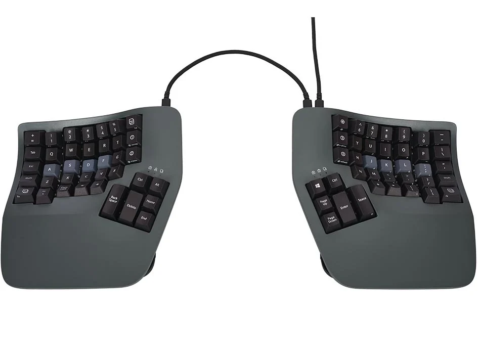

- [[https://www.google.com/search?q=kinesis+advantage+360+smartset+home+row+mods&sca_esv=573962864&rlz=1C5CHFA_enUA871UA871&ei=EvItZaCGDKmp5NoPs_SHgAk&ved=0ahUKEwig19iXhfyBAxWpFFkFHTP6AZAQ4dUDCBA&uact=5&oq=kinesis+advantage+360+smartset+home+row+mods&gs_lp=Egxnd3Mtd2l6LXNlcnAiLGtpbmVzaXMgYWR2YW50YWdlIDM2MCBzbWFydHNldCBob21lIHJvdyBtb2RzMgUQIRigATIFECEYoAEyBRAhGKABMgUQIRigAUi0SVDIIFi0SHAEeAGQAQCYAWygAfEJqgEEMTUuMbgBA8gBAPgBAcICChAAGEcY1gQYsAPCAgUQIRirAuIDBBgAIEGIBgGQBgg&sclient=gws-wiz-serp][kinesis advantage 360 smartset home row mods - Google Search]]
- Advantage 360 vs 360 pro concerns. : [[https://www.reddit.com/r/kinesisadvantage/comments/1125ohy/advantage_360_vs_360_pro_concerns/][r/kinesisadvantage]]
- SmartSet: tap and hold for A-Z keys on the 360? : [[https://www.reddit.com/r/kinesisadvantage/comments/yc9ohi/smartset_tap_and_hold_for_az_keys_on_the_360/][r/kinesisadvantage]]
- [[https://kinesis-ergo.com/wp-content/uploads/Adv360-SmartSet-Direct-Programming-Guide-v8-26-22.pdf][Adv360 SmartSet Direct Programming Guide- Version (draft) (8-26-22).pub]]
** [[https://www.moergo.com/collections/glove80-keyboards][Glove 80]]
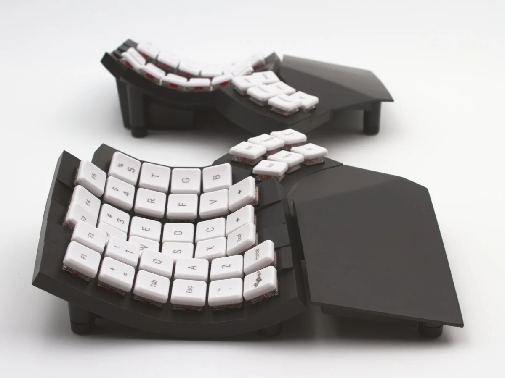
** Dactyl and family                                                :folded:
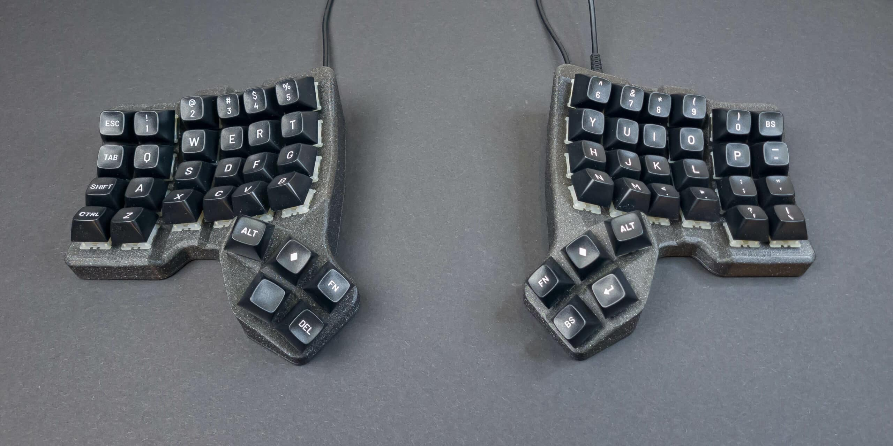

- Low-pro Bluetooth Dactyl with Borders : ErgoMechKeyboards
  - [[https://www.reddit.com/r/ErgoMechKeyboards/comments/sm7s5s/lowpro_bluetooth_dactyl_with_borders/?utm_source=pocket_mylist][reddit]], [[https://www.reddit.com/r/ErgoMechKeyboards/comments/omxepc/yet_another_dactyl_spinoff_now_with_a_border/][reddit]]
    - Yet another Dactyl spinoff. Now with a border! : [[https://www.reddit.com/r/ErgoMechKeyboards/comments/omxepc/yet_another_dactyl_spinoff_now_with_a_border/][ErgoMechKeyboards]]
    - [[https://github.com/omurovec/dactyl-high-profile][omurovec/dactyl-high-profile]]
    - [[https://github.com/omurovec/zmk/tree/main/app/boards/shields/dactyl][zmk/app/boards/shields/dactyl at main · omurovec/zmk]]
- [[https://www.reddit.com/r/ErgoMechKeyboards/s/k5WydrDPvn][Based on the cosmos generator]]
  Looks like the default config of Cosmos: [[https://ryanis.cool/cosmos/beta][https://ryanis.cool/cosmos/beta]]
  which by the way, it's the best thumb-cluster setting. i literally went through all of them and other esoteric stuff
  OP: I did use the Cosmos Generator. I only played around with the placement and spacing of the keys and hoped the curvature of the keywell would be a sane default.
- Dactyl Stabilized - wireless with reworked thumb cluster : [[https://www.reddit.com/r/ErgoMechKeyboards/comments/oedaqg/dactyl_stabilized_wireless_with_reworked_thumb/?%24deep_link=true&correlation_id=68b1a219-7111-4493-9b1c-e7389a29a94e&post_fullname=t3_oedaqg&post_index=1&ref=email_digest&ref_campaign=email_digest&ref_source=email&utm_content=post_title&%243p=e_as&_branch_match_id=714182536837643027][ErgoMechKeyboards]]
    - [[https://github.com/brucedjones/dactyl-stabilized][brucedjones/dactyl-stabilized]]
- New version of the Lil Chonky Bois, MX version added. : [[https://www.reddit.com/r/ErgoMechKeyboards/comments/ns6igi/new_version_of_the_lil_chonky_bois_mx_version/?utm_source=pocket_mylist][r/ErgoMechKeyboards]]
    - [[https://github.com/sanderboer/chonkybois][sanderboer/chonkybois]]
- [[https://github.com/Smeeba/Dactyl-Family-Album][Smeeba/Dactyl-Family-Album]]
    - Dactyl Family Album - A repository to catalog dactyl/dactyl inspired designs and innovations : [[https://www.reddit.com/r/ErgoMechKeyboards/comments/nns3if/dactyl_family_album_a_repository_to_catalog/?utm_source=pocket_mylist][r/ErgoMechKeyboards]]
      - I love this idea, would the Lagrange qualify? [[https://github.com/dpapavas/lagrange-keyboard][https://github.com/dpapavas/lagrange-keyboard]]
      - Some other additions:
      - [[https://github.com/carbonfet/dactyl-manuform][https://github.com/carbonfet/dactyl-manuform]] - this has a different thumb cluster.
      - The tbk mini [[https://github.com/Bastardkb/TBK-Mini/][https://github.com/Bastardkb/TBK-Mini/]]
      - The tightly comes to mind as well
      - [[https://github.com/okke-formsma/dactyl-manuform-tight][https://github.com/okke-formsma/dactyl-manuform-tight]]

      - Dactyl deskmount: khail spacing and deskmounted: [[https://github.com/nickcoutsos/dactyl-deskmount][https://github.com/nickcoutsos/dactyl-deskmount]]
      - DMOTE: Dactyl Manu Opposable Thumbs Edition [[https://viktor.eikman.se/article/the-dmote/][https://viktor.eikman.se/article/the-dmote/]]
      - DMOTE Concertina: DMOTE vertical edition [[https://viktor.eikman.se/article/the-concertina/][https://viktor.eikman.se/article/the-concertina/]]
      - I think are the most radical variations i have seen in the dactyl family.
      - idk if it counts because I don't think anybody other than me has built one, but feel free to add [[https://github.com/jchendy/dactyl-manuform/][https://github.com/jchendy/dactyl-manuform/]]

      - crystalhand's which has a palm rest mount for a standard gel rest and commercially available prints & pre-builts [[https://github.com/crystalhand/dactyl-keyboard][https://github.com/crystalhand/dactyl-keyboard]]
      - kenny kaye's which has a printed palm rest [[https://github.com/kennykaye/dactyl-keyboard][https://github.com/kennykaye/dactyl-keyboard]] and an iconic photo of an alumide print [[https://mobile.twitter.com/_kennykaye/status/858807986680090624?lang=en][https://mobile.twitter.com/_kennykaye/status/858807986680090624?lang=en]]

      - kenny kaye's which has a printed palm rest [[https://github.com/kennykaye/dactyl-keyboard][https://github.com/kennykaye/dactyl-keyboard]] and an iconic photo of an alumide print [[https://mobile.twitter.com/_kennykaye/status/858807986680090624?lang=en][https://mobile.twitter.com/_kennykaye/status/858807986680090624?lang=en]]
- Extra small trackball keyboard (5x3, miryoku, 34mm trackball, PMW3360 PCB) : [[https://www.reddit.com/r/ErgoMechKeyboards/comments/oxuo6p/extra_small_trackball_keyboard_5x3_miryoku_34mm/?utm_medium=android_app&utm_source=share][ErgoMechKeyboards]]
- Charybdis - Dactyl trackball keyboard : [[https://www.reddit.com/r/ErgoMechKeyboards/comments/osqd86/charybdis_dactyl_trackball_keyboard/?utm_medium=android_app&utm_source=share][ErgoMechKeyboards]]
- Presenting the Scylla - a modern Dactyl Manuform : [[https://www.reddit.com/r/MechanicalKeyboards/comments/n117y6/presenting_the_scylla_a_modern_dactyl_manuform/?utm_medium=android_app&utm_source=share][MechanicalKeyboards]]
- Hand Wired Skeletyl : [[https://www.reddit.com/r/ErgoMechKeyboards/comments/q1j73b/hand_wired_skeletyl/hffln4r/?utm_medium=android_app&utm_source=share&context=3][ErgoMechKeyboards]]
- Designing Dactyl Manuforms (fusion 360 tutorial) : [[https://www.reddit.com/r/MechanicalKeyboards/comments/mytk54/designing_dactyl_manuforms_fusion_360_tutorial/?utm_medium=android_app&utm_source=share][MechanicalKeyboards]]
- Six Column Skeletyl with Amoebas Powered by a Pi Pico and custom firmware : [[https://www.reddit.com/r/ErgoMechKeyboards/comments/q228v8/six_column_skeletyl_with_amoebas_powered_by_a_pi/?utm_medium=android_app&utm_source=share][ErgoMechKeyboards]]
- Introducing Dactyl Chimera, a 3D keyboard test bench. : [[https://www.reddit.com/r/ErgoMechKeyboards/comments/q7jqlh/introducing_dactyl_chimera_a_3d_keyboard_test/?utm_medium=android_app&utm_source=share][ErgoMechKeyboards]]
- Modular mini 3D Keyboard (No support needed) : [[https://www.reddit.com/r/ErgoMechKeyboards/comments/qcqgb4/modular_mini_3d_keyboard_no_support_needed/?%24deep_link=true&correlation_id=46ee8e44-1972-4d3a-92ca-83457d87e82b&post_fullname=t3_qcqgb4&post_index=1&ref=email_digest&ref_campaign=email_digest&ref_source=email&utm_content=post_title&%243p=e_as&_branch_match_id=714182536837643027&utm_medium=Email%20Amazon%20SES][ErgoMechKeyboards]]
- Wakanda forever. : [[https://www.reddit.com/r/ErgoMechKeyboards/comments/qe4nyr/wakanda_forever/?utm_medium=android_app&utm_source=share][ErgoMechKeyboards]]
- [[https://github.com/bastardkb/charybdis?utm_source=pocket_mylist][Bastardkb/Charybdis - An ergonomic keyboard with integrated trackball.]]
- ScyllaBallz - a tractyl Manuform with OLEDs, roller encoders, audio, and per key RGB : [[https://www.reddit.com/r/ErgoMechKeyboards/comments/qkd9xe/scyllaballz_a_tractyl_manuform_with_oleds_roller/?utm_medium=android_app&utm_source=share][ErgoMechKeyboards]]
- Dactyl-Manuform with spring-swapped ALPS Blacks (Kailh Choc 12gf springs by Sprit), wood-filled PLA case : [[https://www.reddit.com/r/ErgoMechKeyboards/comments/qimk2h/dactylmanuform_with_springswapped_alps_blacks/?utm_source=pocket_mylist][r/ErgoMechKeyboards]]
- [[https://www.reddit.com/r/ErgoMechKeyboards/comments/p2fxhr/people_who_have_built_a_dactyl_manuform_how_long/?utm_source=pocket-app&utm_medium=share][People who have built a Dactyl Manuform, how long did it take you to build your first one, and was it successful?]]
- [[https://www.reddit.com/r/MechanicalKeyboards/comments/o85dm8/70_dactyl_manuform_and_my_mechanical_keyboard/?utm_medium=android_app&utm_source=share][$70 Dactyl Manuform and my mechanical keyboard journey]]
- [[https://github.com/dpapavas/lagrange-keyboard/discussions/10][My lagrange build · Discussion #10 · dpapavas/lagrange-keyboard]]
- One-two split mini (dactyl manuform variant: Skeletyl) : [[https://www.reddit.com/r/ErgoMechKeyboards/comments/n8jzc1/onetwo_split_mini_dactyl_manuform_variant_skeletyl/?utm_medium=android_app&utm_source=share][ErgoMechKeyboards]]
- New keyboard - new layout. Skeletyl with tents printed in resin. : [[https://www.reddit.com/r/ErgoMechKeyboards/comments/sg80yp/new_keyboard_new_layout_skeletyl_with_tents/?utm_source=pocket_mylist][ErgoMechKeyboards]]
- [[https://www.reddit.com/r/ErgoMechKeyboards/comments/n6b41w/my_first_handwired_ergo_build_lagrange/?utm_medium=android_app&utm_source=share][My first hand-wired ergo build (lagrange)]]
- [[https://www.reddit.com/r/ErgoMechKeyboards/comments/m5jz1r/redesigned_4x6_typesafe/?utm_medium=android_app&utm_source=share][Redesigned 4x6 typesafe]]
- I made a Dactyl Manuform and I don't like it. : [[https://www.reddit.com/r/ErgoMechKeyboards/comments/ltcf0g/i_made_a_dactyl_manuform_and_i_dont_like_it/][ErgoMechKeyboards]]
  - [[https://github.com/dereknheiley/dactyl-manuform-tight][dereknheiley/dactyl-manuform-tight]]
  - [[https://github.com/abstracthat/dactyl-manuform][abstracthat/dactyl-manuform]]
  - [[https://dactyl.siskam.link/][Dactyl Generator]]
- [[https://www.diykeyboards.com/cases/product/dmf-hardware-kit][Manuform Hardware Kit - DIY Keyboards]]
- [[https://bastardkb.com/][Shop Home - Bastard Keyboards]]
- Ascension! [Dactyl Manuform weekend build] : [[https://www.reddit.com/r/ErgoMechKeyboards/comments/kzh3id/ascension_dactyl_manuform_weekend_build/?utm_medium=android_app&utm_source=share][ErgoMechKeyboards]]
- Which CAD tool do you use? (for Dactyl alike keebs) : [[https://www.reddit.com/r/ErgoMechKeyboards/comments/kyhml6/which_cad_tool_do_you_use_for_dactyl_alike_keebs/?utm_medium=android_app&utm_source=share][ErgoMechKeyboards]]
- Wireless Dactyl Manuform Build : [[https://www.reddit.com/r/ErgoMechKeyboards/comments/ktw1b7/wireless_dactyl_manuform_build/][ErgoMechKeyboards]]
- Finished my Bastyl : [[https://www.reddit.com/r/ErgoMechKeyboards/comments/krdnux/finished_my_bastyl/][ErgoMechKeyboards]]
- Why isn't dactyl manuform the norm ergonomics wise : [[https://www.reddit.com/r/ErgoMechKeyboards/comments/kh5i5s/why_isnt_dactyl_manuform_the_norm_ergonomics_wise/][ErgoMechKeyboards]]
- [[https://www.hidtech.ca/?product=flexyl-univ#page-content][Flexyl-Univ – HID Technologies]]
- tshort/dactyl-keyboard: [[https://github.com/tshort/dactyl-keyboard][Dactyl-ManuForm, a parameterized ergonomic keyboard]]
- Dacyl Manuform 5x7 (Wiring/Firmware) At my limit : [[https://www.reddit.com/r/ErgoMechKeyboards/comments/kntsxg/dacyl_manuform_5x7_wiringfirmware_at_my_limit/][ErgoMechKeyboards]]
- I built my brother and myself Dactyl Manuform 4x6s for christmas: [[https://www.reddit.com/r/ErgoMechKeyboards/comments/kka63c/i_built_my_brother_and_myself_dactyl_manuform/][ErgoMechKeyboards]]
- [[https://github.com/jchendy/dactyl-manuform/blob/master/README.md][dactyl-manuform/[[http://README.md][README.md]] at master · jchendy/dactyl-manuform]]
  - Da Huuuuuudge - a Dactyl ManuForm fork with a nasty blob thing for a thumb cluster : [[https://www.reddit.com/r/ErgoMechKeyboards/comments/kkq8i1/da_huuuuuudge_a_dactyl_manuform_fork_with_a_nasty/][ErgoMechKeyboards]]
- [[https://github.com/qmk/qmk_firmware/commit/5619b1d3db335750bed394b0d27980d67f4f50c5][[Keyboard] Add drashna's dactyl manuform 5x6 with trackball (#11062) · qmk/qmk_firmware@5619b1d]]
- Bastyl
  - Bastyl, now with RGB midplate : [[https://www.reddit.com/r/ErgoMechKeyboards/comments/jvqzez/bastyl_now_with_rgb_midplate/][ErgoMechKeyboards]]
  - [[https://www.hidtech.ca/?product=dactyl-manuform-kit#tab-description][Bastyl – HID Technologies]]
  - [[https://hid-technologies.github.io/][Resources | [[http://HID-Technologies.github.io][HID-Technologies.github.io]]]]
  - I always try new thing, now the Bastyl! : [[https://www.reddit.com/r/ErgoMechKeyboards/comments/jtiasl/i_always_try_new_thing_now_the_bastyl/?$deep_link=true&correlation_id=9c72f26a-bab7-479d-a3c5-4a2613ad3929&ref=email_digest&ref_campaign=email_digest&ref_source=email&utm_content=post_title&utm_medium=digest&utm_name=top_posts&utm_source=email&utm_term=day&$3p=e_as&$original_url=https%3A%2F%2Fwww.reddit.com%2Fr%2FErgoMechKeyboards%2Fcomments%2Fjtiasl%2Fi_always_try_new_thing_now_the_bastyl%2F%3F%24deep_link%3Dtrue%26correlation_id%3D9c72f26a-bab7-479d-a3c5-4a2613ad3929%26ref%3Demail_digest%26ref_campaign%3Demail_digest%26ref_source%3Demail%26utm_content%3Dpost_title%26utm_medium%3Ddigest%26utm_name%3Dtop_posts%26utm_source%3Demail%26utm_term%3Dday&_branch_match_id=776150985127357810][ErgoMechKeyboards]]
  - Bastyl Dactyl with per-key addressable RGB PCB : [[https://www.reddit.com/r/ErgoMechKeyboards/comments/k64niz/bastyl_dactyl_with_perkey_addressable_rgb_pcb/][ErgoMechKeyboards]]
- Dactyl 36-key ("minidox") : [[https://www.reddit.com/r/ErgoMechKeyboards/comments/jvw3u1/dactyl_36key_minidox/][ErgoMechKeyboards]]
- Rebuild finally complete : [[https://www.reddit.com/r/ErgoMechKeyboards/comments/jvofrz/rebuild_finally_complete/][ErgoMechKeyboards]]
- Dactyl number 5 - never ending path towards the endgame : [[https://www.reddit.com/r/ErgoMechKeyboards/comments/j8mu6n/dactyl_number_5_never_ending_path_towards_the/][ErgoMechKeyboards]]
- [[https://geekhack.org/index.php?topic=88576.0][Dactyl-ManuForm keyboard build]]
- Dactyl Manuform 5x6 : [[https://www.reddit.com/r/ErgoMechKeyboards/comments/jp47nc/dactyl_manuform_5x6/?$deep_link=true&correlation_id=49750e8d-3c05-4622-9627-de792afb3dc0&ref=email_digest&ref_campaign=email_digest&ref_source=email&utm_content=post_title&utm_medium=digest&utm_name=top_posts&utm_source=email&utm_term=day&$3p=e_as&$original_url=https%3A%2F%2Fwww.reddit.com%2Fr%2FErgoMechKeyboards%2Fcomments%2Fjp47nc%2Fdactyl_manuform_5x6%2F%3F%24deep_link%3Dtrue%26correlation_id%3D49750e8d-3c05-4622-9627-de792afb3dc0%26ref%3Demail_digest%26ref_campaign%3Demail_digest%26ref_source%3Demail%26utm_content%3Dpost_title%26utm_medium%3Ddigest%26utm_name%3Dtop_posts%26utm_source%3Demail%26utm_term%3Dday&_branch_match_id=776150985127357810][ErgoMechKeyboards]]
- [[http://xahlee.info/kbd/dactyl_keyboard.html][Dactyl keyboard]]
- [[http://xahlee.info/kbd/dactyl_manuform_keyboard.html][Dactyl Manuform Keyboard]]
- Dactyl Manuform 5X6 Mechanical Keyboard Case Split Ergonomic | [[https://www.etsy.com/listing/798929419/dactyl-manuform-5x6-mechanical-keyboard?gpla=1&gao=1&&utm_source=google&utm_medium=cpc&utm_campaign=shopping_us_low-low_a-electronics_and_accessories-computers_and_peripherals-keyboards_and_mice-other&utm_custom1=_k_CjwKCAjww5r8BRB6EiwArcckCw0W3A1tmcgzxaJYoiWQVEb_Q78jGiHOXC7v36Leil61-Qt_kyTkphoCfGEQAvD_BwE_k_&utm_content=go_6721326189_78823280625_388283447266_pla-317092178143_m__798929419_12768591&utm_custom2=6721326189&gclid=CjwKCAjww5r8BRB6EiwArcckCw0W3A1tmcgzxaJYoiWQVEb_Q78jGiHOXC7v36Leil61-Qt_kyTkphoCfGEQAvD_BwE][Etsy]]
- adereth/dactyl-keyboard: [[https://github.com/adereth/dactyl-keyboard][Parameterized ergonomic keyboard]]
  - [[https://github.com/qmk/qmk_firmware/tree/a3db72df7299140e52f57d082a3742a8b480a226/keyboards/handwired/dactyl_promicro][qmk_firmware/keyboards/handwired/dactyl_promicro at a3db72df7299140e52f57d082a3742a8b480a226 · qmk/qmk_firmware]]
- [[https://github.com/qmk/qmk_firmware/tree/a3db72df7299140e52f57d082a3742a8b480a226/keyboards/handwired/dactyl_manuform][qmk_firmware/keyboards/handwired/dactyl_manuform at a3db72df7299140e52f57d082a3742a8b480a226 · qmk/qmk_firmware]]
  - crystalhand's which has a palm rest mount for a standard gel rest and commercially available prints & pre-builts [[https://github.com/crystalhand/dactyl-keyboard][https://github.com/crystalhand/dactyl-keyboard]]
** More                                                             :folded:
- [[https://github.com/jdart/chortyl][https://github.com/jdart/chortyl]]
- Latest build : [[https://www.reddit.com/r/ErgoMechKeyboards/comments/10j2lee/latest_build/?utm_source=share&utm_medium=android_app&utm_name=androidcss&utm_term=1&utm_content=share_button][r/ErgoMechKeyboards]]
  - [[https://www.reddit.com/r/ErgoMechKeyboards/comments/110hmuv/trackswitch_manuform_hyperergo_dactyl_w_clickable/?utm_source=share&utm_medium=android_app&utm_name=androidcss&utm_term=2&utm_content=share_button][https://www.reddit.com/r/ErgoMechKeyboards/comments/110hmuv/trackswitch_manuform_hyperergo_dactyl_w_clickable/]]
- [[https://kbd.news/Cygnus-1.0-2307.html?utm_source=kbdnews&utm_medium=email&utm_campaign=issue-157-keyboard-builders-digest][Cygnus 1.0]]
- [[https://github.com/juhakaup/keyboards/tree/main/Cygnus%20v1.0?utm_source=kbdnews&utm_medium=email&utm_campaign=issue-160-keyboard-builders-digest][Dactyl Cygnus is a minimalist 36-key ortholinear split keyboard.]]
- [[https://github.com/wizarddata/Ergo-S-1][GitHub - wizarddata/Ergo-S-1]]
  - [[https://orbitouch.com/][orbiTouch | orbiTouch Keyless Keyboard | Blue Orb, Inc. - orbitouch.com]]
- [[https://www.reddit.com/r/ErgoMechKeyboards/comments/1lbxhs3/sildactyl_40_dactyl_split_mechanical_hotswap/][Sildactyl - 40$ dactyl split mechanical hotswap keyboard without PCB or 3D print : r/ErgoMechKeyboards - www.reddit.com]]
  - [[https://github.com/lordxax/sildactyl54][lordxax/sildactyl54: 54-key column staggered split handwired dactyl keyboard - github.com]]
  - [[https://kbd.news/rkbrd3-2658.html?utm_source=kbdnews&utm_medium=email&utm_campaign=issue-192-keyboard-builders-digest][rkbrd3 - kbd.news]]
- [[https://kbd.news/Red-Cedar-split-2583.html?utm_source=kbdnews&utm_medium=email&utm_campaign=issue-185-keyboard-builders-digest][Dactyl-like]]
- [[https://kbd.news/3D-Corne-2409.html?utm_source=kbdnews&utm_medium=email&utm_campaign=issue-169-keyboard-builders-digest][3D Corne]]
- [[https://kbd.news/Mechabasilisk-2448.html][Mechabasilisk]]
  - [[https://kbd.news/SOWGull-2392.html?utm_source=kbdnews&utm_medium=email&utm_campaign=issue-167-keyboard-builders-digest][SOWGull]]

* Keyboards (unusual)                                                :folded:
- Clap with one hand: Fully Functional One-Hand Keyboard : [[https://www.reddit.com/r/ErgoMechKeyboards/comments/1u4tt61/clap_with_one_hand_fully_functional_onehand/?share_id=yues65a14eM_D1SSrLMTy&utm_medium=android_app&utm_name=androidcss&utm_source=share&utm_term=2][r/ErgoMechKeyboards]]
  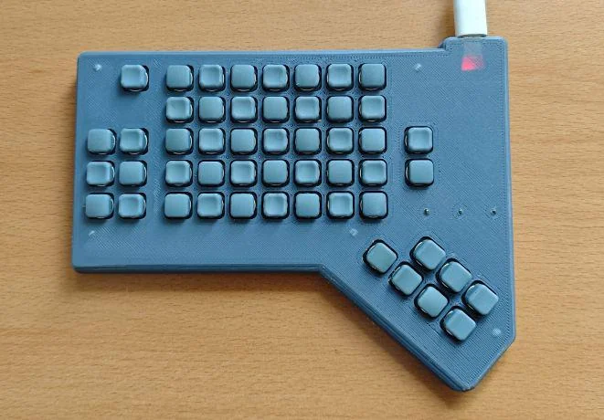
- [[https://kbd.news/Black-Pearl-2823.html?utm_source=kbdnews&utm_medium=email&utm_campaign=issue-208-keyboard-builders-digest][Black Pearl]]
  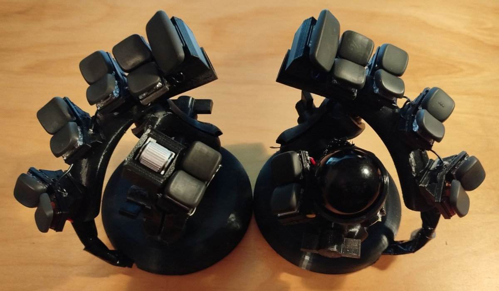
- GitHub - JesusFreke/lalboard: [[https://github.com/JesusFreke/lalboard][A 3D-printed keyboard inspired by the DataHand (Also like Svalboard)]]
  - Grabshell - [[https://www.reddit.com/r/ErgoMechKeyboards/comments/1qvg363/a_little_present_for_myself/?%24deep_link=true&correlation_id=3a349c47-82f6-4038-be7b-a0a25340b45b&post_fullname=t3_1qvg363&post_index=4&ref=email_digest&ref_campaign=email_digest&ref_source=email&target_user=serebrov&utm_content=post_title&%243p=e_as&_branch_match_id=1419495333484602716&utm_medium=Email%20Amazon%20SES&_branch_referrer=H4sIAAAAAAAAA22Qy07DMBBFvybdpS2x2wJShRCPDeIbLMeeOBZ%2BMZ40dMO3M6HACsm2ru7xnRl7JCr1drNBsNbTWpeyDj69bUS5azopyhGUriuWGb3zSQc1YTiOS6oR9033zGue5%2FVP3uTIBvJ%2BQpdfwYwvcO6zRlvZYxoh0SKv3k9O7AUrrYInCqAKQmWqhowqniuEYSkvuMOukxagqGWyRjwSTtB0e5MRIWjyOSlv2RdayBsjD%2B11N%2BxbuRXXbQ%2BHvtVb3e2E3PZy13Ou5MpNphCSjrCUE%2Bpvmgv0ycIHE8kGwsAKovZBWe%2Bg0sVURseivUv%2F05onNPDL2CSNDkhNFZBdPqHHfGIwUVQmJ%2BKnM%2FjuT57%2FY%2FXJdQDRJ6f46syR48OIOcIXFHRXA7QBAAA%3D][A little present for myself : r/ErgoMechKeyboards - www.reddit.com]]
  - [[https://orbitouch.com/][orbiTouch | orbiTouch Keyless Keyboard | Blue Orb, Inc. - orbitouch.com]]
  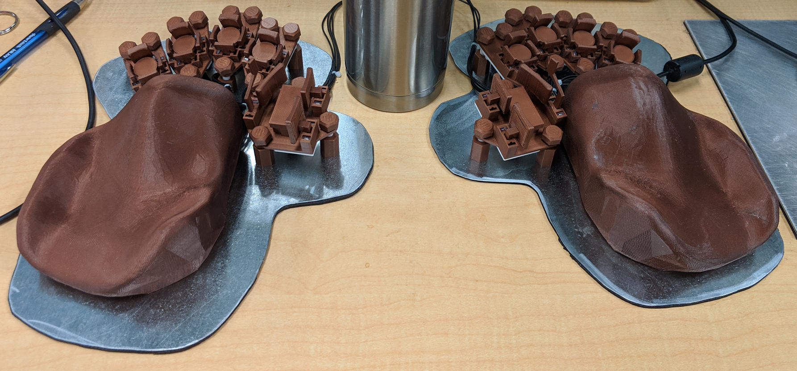
- Rotary Keyboard | [[https://squidgeefish.com/projects/rotary-keyboard/][Squidgeefish]]
  - [[https://github.com/lemosbor/lapa][lemosbor/lapa: Эргономичная раздельная клавиатура-мышь «Лапа» - github.com]]
  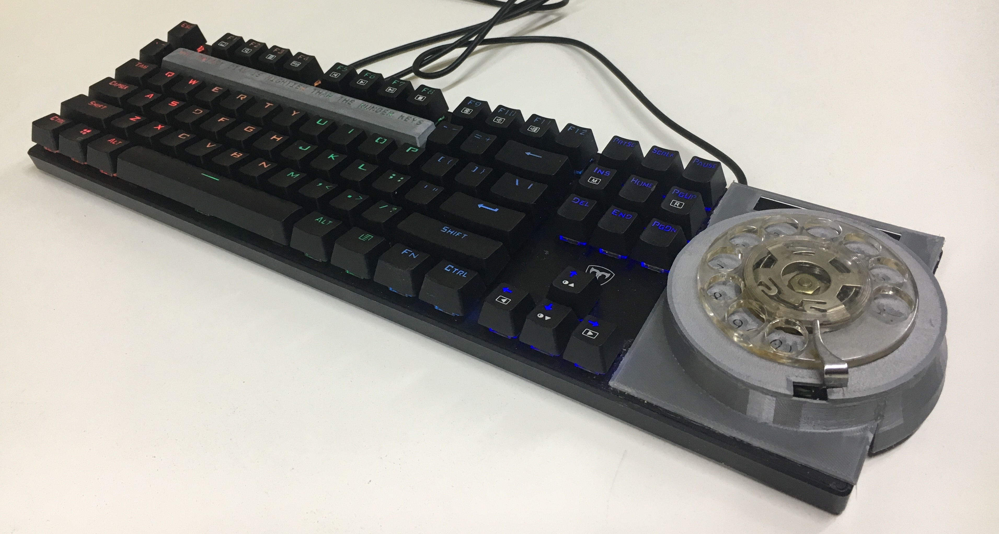
- protieusz/Starship-Bubu-01-Prototype-Trackball-Unit: [[https://github.com/protieusz/Starship-Bubu-01-Prototype-Trackball-Unit][Solo trackball unit powered by my Omega Supreme all in one PMW3660 sensor trackball, PER56, RP2040 integrated module.]]
  - protieusz/OmegaSupreme: [[https://github.com/protieusz/OmegaSupreme/][RP2040 integrated components with integrated PMW3360 trackball sensor & PER56 encoder. The rest of the RP2040 pins are fully broken out]]
    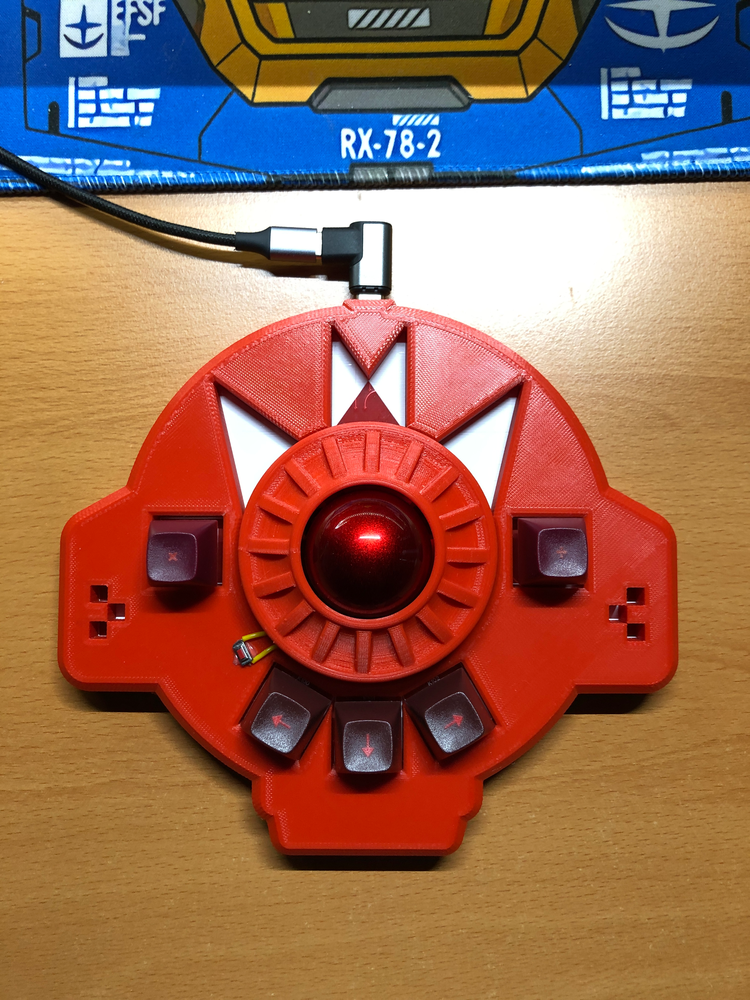
- [[https://svalboard.com/][Svalboard - Datahand forever!]]
  - Svalboard in action : [[https://www.reddit.com/r/ErgoMechKeyboards/comments/1vm16f3/svalboard_in_action/?solution=aa8da9bb45f4d5a9aa8da9bb45f4d5a9&js_challenge=1&token=7afd7253fec22262ff1c52b1703fe9eca761aec41fb76bff09d4277a22e4df27&jsc_orig_r=&share_id=9-walBJWCY94VM6wxG7OA&utm_medium=android_app&utm_name=androidcss&utm_source=share&utm_term=2][r/ErgoMechKeyboards]]
    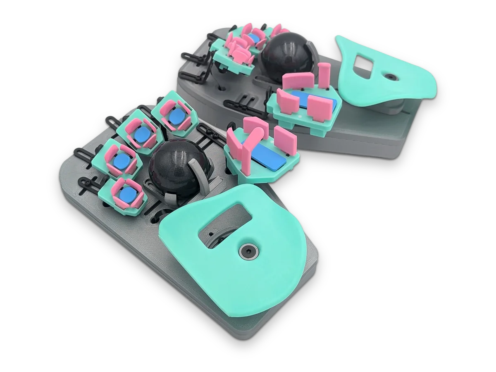
- [[https://github.com/mikeysklar/ble-morsecode-neokey][Morse code keyboard]]
  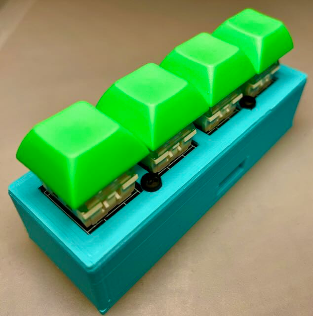
- [[https://kbd.news/TapXR-review-2352.html?utm_source=kbdnews&utm_medium=email&utm_campaign=issue-162-keyboard-builders-digest][TapXR review]]
  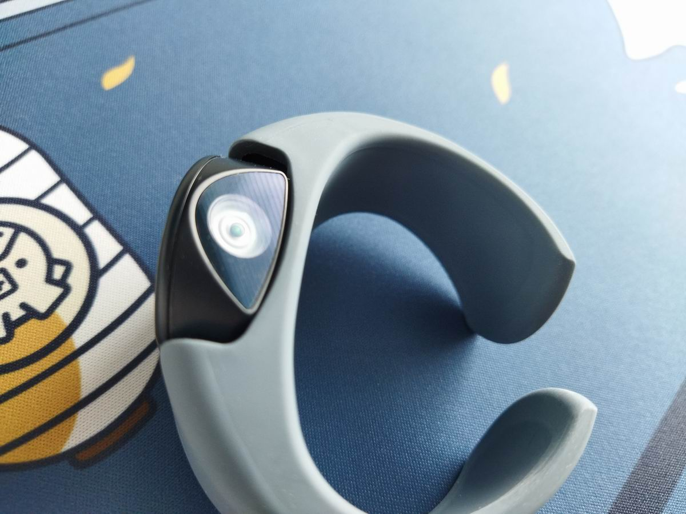
** Handhels                                                         :folded:
- [[https://www.mytwiddler.com/getstarted.html][Twiddler 4 - Get Started - www.mytwiddler.com]]
  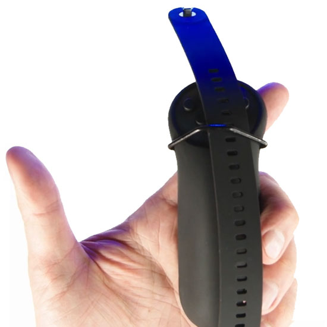
  - [[https://www.mytwiddler.com/doc/doku.php?id=t4_firsttype][t4_firsttype [Twiddler] - www.mytwiddler.com]]
  - [[https://www.reddit.com/r/ErgoMechKeyboards/search/?q=twiddler&cId=794c1c82-a574-4bad-b30f-798aa52ed67b&iId=8c429e58-a887-42c5-9b08-6e72de025241][twiddler - Reddit Search! - www.reddit.com]]
- [[https://www.reddit.com/r/ErgoMechKeyboards/comments/xysk09/handhelds/][Handhelds : r/ErgoMechKeyboards - www.reddit.com]]
- [[https://www.usinenouvelle.com/article/alphaui-revisite-le-clavier.N203576][AlphaUI revisite le clavier - www.usinenouvelle.com]]
  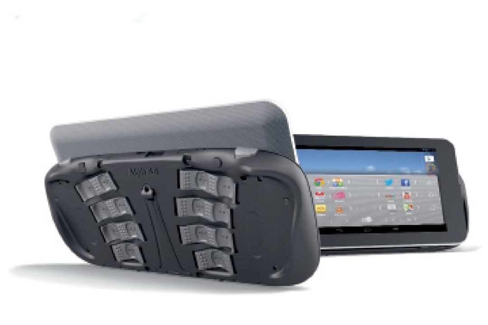
- [[https://alphagrip.com/][AlphaGrip - alphagrip.com]]
  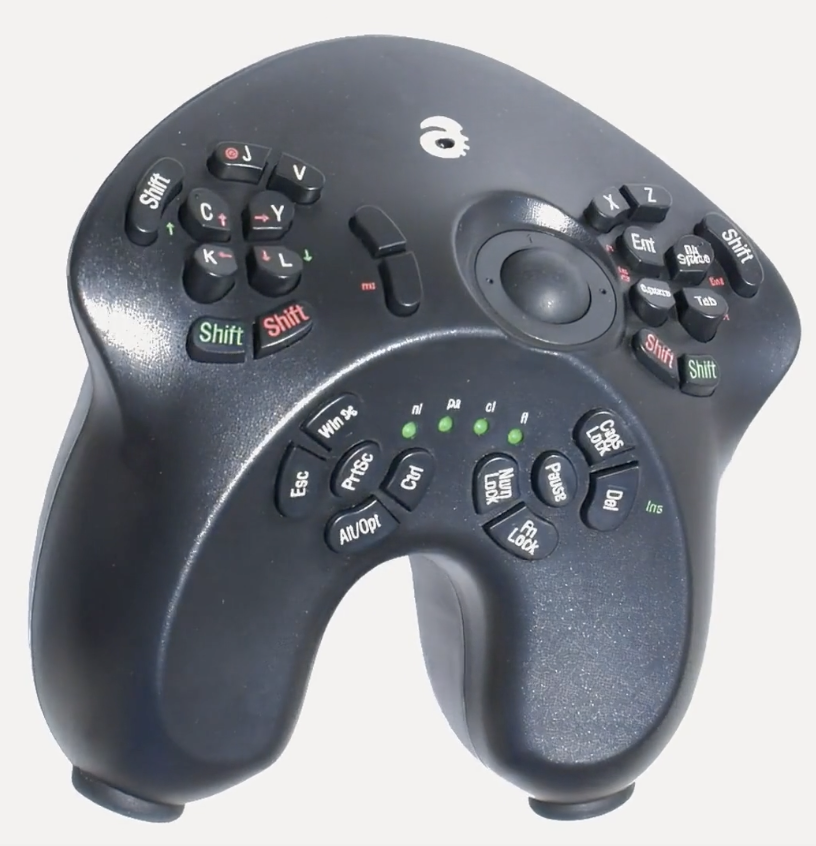
* Keyboards                                                          :folded:
** Reviews and Galleries
- [[https://mechdb.net/keyboards?split=true&opensource=true][Mechanical Keyboards Database - custom keyboards photos]]
- [[https://aposymbiont.github.io/split-keyboards/][Split Keyboards Gallery]]
- [[https://www.reddit.com/r/MechanicalKeyboards/wiki/index][index - MechanicalKeyboards]]
- [[https://github.com/BenRoe/awesome-mechanical-keyboard/blob/master/docs/README.md][awesome-mechanical-keyboard/[[http://README.md][README.md]] at master · BenRoe/awesome-mechanical-keyboard]]
- diimdeep/awesome-split-keyboards: [[https://github.com/diimdeep/awesome-split-keyboards][A collection of ergonomic split keyboards ⌨]]
- help-14/mechanical-keyboard: [[https://github.com/help-14/mechanical-keyboard][DIY mechanical keyboard and where to find them]]
- [[https://www.reddit.com/r/MechanicalKeyboards/wiki/buying_guide#wiki_reddit_mechanical_keyboard_buying_guide][buying_guide - MechanicalKeyboards]]
- [[https://switchandclick.com/][Switch And Click – Dedicated to people who passionate about their mechanical keyboard and want to learn more.]]
  - How to Build a Custom Mechanical Keyboard: [[https://switchandclick.com/2020/08/20/how-to-build-a-keyboard/][A Step-by-Step Guide – Switch And Click]]
  - [[https://switchandclick.com/recommended-tools/][Recommended Tools and Parts – Switch And Click]]
  - Ultimate Guide: [[https://switchandclick.com/2020/06/06/the-ultimate-guide-lube-your-mechanical-keyboard-switches/][How to Lube your Keyboard Switches – Switch And Click]]
- Split keyboard layout comparison site : [[https://www.reddit.com/r/ErgoMechKeyboards/comments/f5h3d6/split_keyboard_layout_comparison_site/][ErgoMechKeyboards]]
- [[http://xahlee.info/kbd/diy_keyboards_index.html][Do-It-Yourself Keyboards]]
- [[https://awesomeopensource.com/project/diimdeep/awesome-split-keyboards][Awesome Split Keyboards]]
- [[https://jhelvy.shinyapps.io/splitkbcompare/][Split keyboard compare]]
- Low Profile KBs - [[https://docs.google.com/spreadsheets/d/1Y62AuStZCQQXOMM5keUN2KYDh1IoifZkrnJV-tLFKH4/edit#gid=0][Google Sheets]]
** ergodox
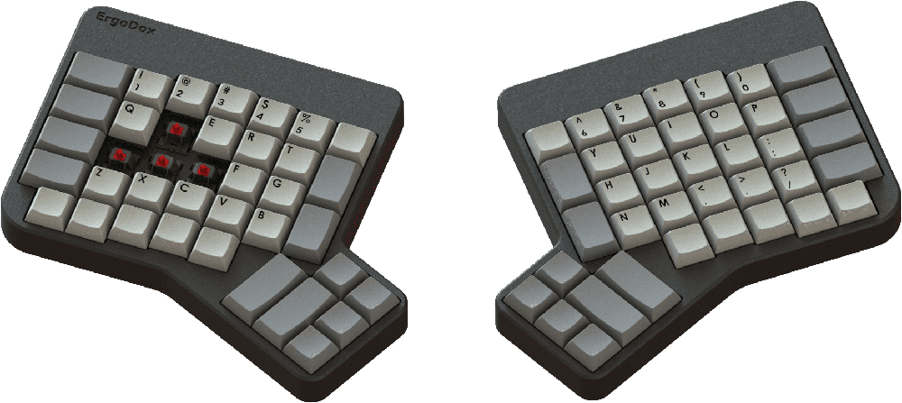

- [[https://www.ergodox.io/][ErgoDox Mechanical Keyboard (io site, open source DYI version)]]
- redox
  - [[https://github.com/mattdibi/redox-keyboard/tree/master/redox-w][redox-keyboard/redox-w at master · mattdibi/redox-keyboard]]
- hotdox
  - Alpaca Keyboards: ErgoDox 76 "Hot Dox": [[https://www.alpacakeyboards.com/][Hot Swappable Ergonomic Keyboard]]
- ergoblue (ergodox, bluetooth, solar batteries)
  - ErgoBlue 2: Wireless and Solar Powered ErgoDox Mechanical Keyboard - Xudong Zheng
    - [[https://www.xudongz.com/blog/2020/ergoblue/][https://www.xudongz.com/blog/2020/ergoblue/]]
  - ErgoBlue 2: Wireless and Solar Powered ErgoDox (with Interest Check) : ergodox
    - [[https://www.reddit.com/r/ergodox/comments/jxabst/ergoblue_2_wireless_and_solar_powered_ergodox/?%24deep_link=true&correlation_id=ec6d62e2-1090-42c8-8c76-0dcff6fa55fe&%243p=e_as&%24original_url=https%3A%2F%2Fwww.reddit.com%2Fr%2Fergodox%2Fcomments%2Fjxabst%2Fergoblue_2_wireless_and_solar_powered_ergodox%2F%3F%24deep_link%3Dtrue%26correlation_id%3Dec6d62e2-1090-42c8-8c76-0dcff6fa55fe%26ref%3Demail_digest%26ref_campaign%3Demail_digest%26ref_source%3Demail&_branch_match_id=776150985127357810][https://www.reddit.com/r/ergodox/comments/jxabst/ergoblue_2_wireless_and_solar_powered_ergodox/?%24deep_link=true&correlation_id=ec6d62e2-1090-42c8-8c76-0dcff6fa55fe&%243p=e_as&%24original_url=https%3A%2F%2Fwww.reddit.com%2Fr%2Fergodox%2Fcomments%2Fjxabst%2Fergoblue_2_wireless_and_solar_powered_ergodox%2F%3F%24deep_link%3Dtrue%26correlation_id%3Dec6d62e2-1090-42c8-8c76-0dcff6fa55fe%26ref%3Demail_digest%26ref_campaign%3Demail_digest%26ref_source%3Demail&_branch_match_id=776150985127357810]]
** Plank and Preonic

- https://olkb.com/collections/planck
- Blanck : [[https://www.reddit.com/r/mechanicalheadpens/comments/jnmhpl/blanck/][mechanicalheadpens]]
  - With 36 key layout: [[https://www.reddit.com/r/mechanicalheadpens/comments/jnmhpl/blanck/?i=1][reddit]]
  - Ultraviolet Catastrophe : [[https://www.reddit.com/r/MechanicalKeyboards/comments/jdzmk1/ultraviolet_catastrophe/][MechanicalKeyboards]]
- My First Decent Build. Drop Preonic with SA Vilebloom and blueberries : [[https://www.reddit.com/r/MechanicalKeyboards/comments/jpnhfi/my_first_decent_build_drop_preonic_with_sa/?%2524deep_link=true&correlation_id=dc2ea89e-eef5-4913-b011-8b86c48e5745&%25243p=e_as&%2524original_url=https%3A%2F%2Fwww.reddit.com%2Fr%2FMechanicalKeyboards%2Fcomments%2Fjpnhfi%2Fmy_first_decent_build_drop_preonic_with_sa%2F%3F%24deep_link%3Dtrue%26correlation_id%3Ddc2ea89e-eef5-4913-b011-8b86c48e5745%26ref%3Demail_digest%26ref_campaign%3Demail_digest%26ref_source%3Demail%26utm_content%3Dpost_title%26utm_medium%3Ddigest%26utm_name%3Dtop_posts%26utm_source%3Demail%26utm_term%3Dday&_branch_match_id=714182536837643027][MechanicalKeyboards]]
- Thumb keys for Plank
  - Continuing my quest to find the most comfortable Planck grid layout space keys: flipped G20 profile. : [[https://www.reddit.com/r/olkb/comments/694jlt/continuing_my_quest_to_find_the_most_comfortable/][olkb]]
  - First Planck! : [[https://www.reddit.com/r/olkb/comments/h0o1f7/first_planck/][olkb]]
    - Nice! I notice different profiles on some keys. What are they and why did you pick them?
    - flip the “thumb keys” upside-down. It’s very comfortable on the thumbs.The profile is OEM, the keycap set is “Acute”
    - I also did this with my space keys. It's pretty common. Makes it way more comfortable on my thumbs too
  - [[http://thedarnedestthing.com/plancked][plancked]]
- 48 keys are plenty | Callum Oakley
  - [[https://callumoakley.net/posts/48-keys-are-plenty.html][https://callumoakley.net/posts/48-keys-are-plenty.html]]
  - [[https://olkb.com/password][OLKB – Opening Soon]]
- The Ez configurator and Planck rev6? : [[https://www.reddit.com/r/olkb/comments/dm47by/the_ez_configurator_and_planck_rev6/][olkb]]
- [[https://iamsteve.in/2020/01/07/new-keeb-planck-rev-6/][New Keeb – Planck Rev 6 – Stephen McLeod Blythe – Clicky Steve]]
- [[http://thedarnedestthing.com/wide%20planck%20form][wide planck form [the plank layout with letters outside]]]
  - [[http://thedarnedestthing.com/ergo%20planck][ergo planck]]
- What is your Planck layout? : [[https://www.reddit.com/r/olkb/comments/3q7fog/what_is_your_planck_layout/?sort=qa][olkb]]
- Double planck
  - [photos] "OrthoDox" (2xPlanck) build log : [[https://www.reddit.com/r/MechanicalKeyboards/comments/3pmul1/photos_orthodox_2xplanck_build_log/][MechanicalKeyboards]]
  - [photos] Split Planck! : [[https://www.reddit.com/r/MechanicalKeyboards/comments/3gcxr1/photos_split_planck/?sort=qa][MechanicalKeyboards]]
- [[http://www.keyboard-layout-editor.com/#/gists/d06425aaccaef71cf3d0ffbc0e2042ba][The art of making 40% layouts - Keyboard Layout Editor]]
- [[http://xahlee.info/kbd/planck_keyboard.html][Planck Keyboard]]
- The Planck - Key Theory | [[https://www.smittey.co.uk/the-planck-key-theory][Andy.Writing]]
- The Planck Keyboard | [[https://noahfrederick.com/log/the-planck-keyboard][Noah Frederick]]
- Gorgeous low-profile miniature mechanical Planck keyboard | [[https://boingboing.net/2017/12/15/gorgeous-low-profile-miniature.html][Boing Boing]]
- This Planck replaces my Preonic as primary keeb : [[https://www.reddit.com/r/olkb/comments/er1z8e/this_planck_replaces_my_preonic_as_primary_keeb/][olkb]]
** Corne
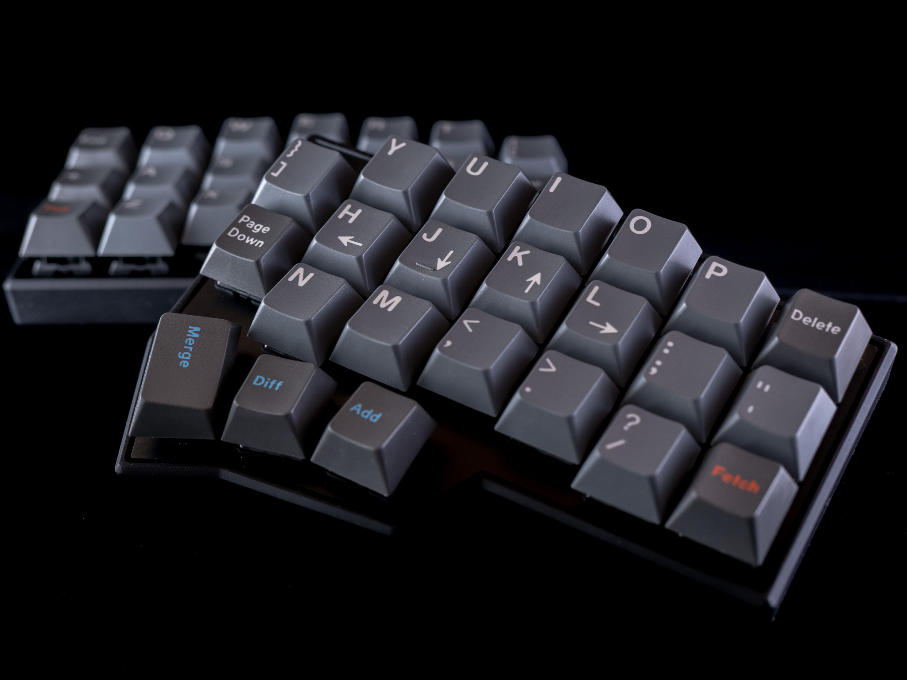

- [[https://github.com/foostan/crkbd/blob/master/corne-classic/doc/buildguide_en.md][crkbd/buildguide_en.md]] at master · foostan/crkbd
- [[https://github.com/foostan/crkbd/blob/master/README.md][Corne crkbd/README.md]] at master · foostan/crkbd
- [[https://www.reddit.com/r/ErgoMechKeyboards/comments/n94ii9/custom_corne_case_covering_controller/?utm_medium=android_app&utm_source=share][Custom corne case covering controller]]
- [[https://imgur.com/a/P5g8rKu][Corne V3 Build Log - Imgur #copy]]
- second crkbd, with vlukash trackpad : [[https://www.reddit.com/r/ErgoMechKeyboards/comments/jp24is/second_crkbd_with_vlukash_trackpad/?utm_medium=android_app&utm_source=share][ErgoMechKeyboards]]
- [[https://josef-adamcik.cz/electronics/corne-keyboard-build-log.html][Corne keyboard – Josef Adamčík]]
  - IMK Corne Case — KeyHive
    - [[https://keyhive.xyz/shop/aluminum-corne-helidox-case][https://keyhive.xyz/shop/aluminum-corne-helidox-case]]
    - htps://keyhive.xyz/shop/corne-v3
  - My Corne keyboard (crkbd-classic) - Split, column staggered with 3-thumb keys. : [[https://www.reddit.com/r/MechanicalKeyboards/comments/9i5uo3/my_corne_keyboard_crkbdclassic_split_column/][MechanicalKeyboards]]
    - Looks intereseting - in terms of the amount of keys it is like my current moonlander planck layout
    - Just looks awesome
    - But additional keys are outside, not inside (so will load pinkies)
- note: it can be built without outer column
  - from here
    - My first build, a Microdox : [[https://www.reddit.com/r/MechanicalKeyboards/comments/iduj56/my_first_build_a_microdox/?sort=qa][MechanicalKeyboards]]
      - I can recommend the crkbd with outer columns removed. The thumb keys on this look a bit cramped. Even on the crkbd they would be better another 1/2u further out.
- [[https://thomasbaart.nl/2018/11/26/corne-keyboard-helidox-build-log/][Corne Keyboard (Helidox) build log – Thomas Baart]]
  - You may snap off the outer column if you decide you won’t use those
  - keys, which makes for an even tinier keyboard. Keep in mind you’ll then 
  - also need an other case. You might be able to edit [[https://github.com/foostan/crkbd/tree/master/corne-classic/case][the case files]] if you do.
- [[https://splitkb.com/products/corne-cherry-pcb-kit][Corne Cherry PCB kit – [[http://splitkb.com][splitkb.com]]]]
  -Outer column breaks away if you want a smaller form factor
- [[https://boardsource.xyz/store/5f2efc462902de7151495057][Boardsource - Corne LP]]
- [[https://splitkb.com/collections/keyboard-kits/products/corne-lp-group-buy?variant=32581056593997][Corne LP Group Buy – [[http://splitkb.com][splitkb.com]]]]
- [[https://josef-adamcik.cz/electronics/corne-keyboard-build-log.html][Corne keyboard – Josef Adamčík]]
- foostan/crkbd: [[https://github.com/foostan/crkbd][Corne keyboard, a split keyboard with 3x6 column staggered keys and 3 thumb keys.]]
- Jorne
  - joric/jorne: My fork of Corne keyboard with an extra key for brackets and international layouts
    - [[https://github.com/joric/jorne][https://github.com/joric/jorne]]
  - [[http://xahlee.info/kbd/corne_jorne_keyboard.html][Corne/Jorne Keyboard]]
** gBoards - gergo, georgi, ginny
- gergo
  - [[http://xahlee.info/kbd/xah_gergo_layout.html][Xah Gergo Layout]]
  - [[http://xahlee.info/kbd/gergo_keyboard.html][Gergo Keyboard]]
  - [[http://xahlee.info/kbd/gergoplex.html][gergoplex]]
  - GergoPlex | [[https://www.gboards.ca/product/gergoplex][g Heavy Industries]]
  - Gergo | [[https://www.gboards.ca/product/gergo][g Heavy Industries]]
  - germ/qmk_firmware: [[https://github.com/germ/qmk_firmware/][keyboard controller firmware for Atmel AVR and ARM USB families]]
- Georgi
  - Georgi: Steno For All | [[https://www.gboards.ca/product/georgi][g Heavy Industries]]
- Ginny | [[https://www.gboards.ca/product/ginni][g Heavy Industries]]
- [[https://blog.gboards.ca/][Bernhardt]]
** Ferris
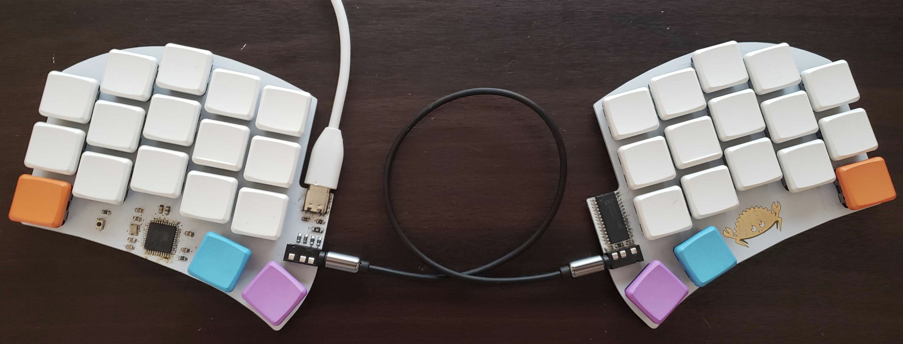

- pierrechevalier83/ferris: [[https://github.com/pierrechevalier83/ferris][A low profile split keyboard designed to satisfy one single use case elegantly]]
- pierrechevalier83/ferris: [[https://github.com/pierrechevalier83/ferris][A low profile split keyboard designed to satisfy one single use case elegantly]]
- [[https://config.qmk.fm/#/ferris/0_1/LAYOUT][QMK Configurator]]
- GitHub - pierrechevalier83/ferris: [[https://github.com/pierrechevalier83/ferris][A low profile split keyboard designed to satisfy one single use case elegantly]]
- davidphilipbarr/Sweep: [[https://github.com/davidphilipbarr/Sweep?utm_source=pocket_mylist][Sweep - a small promicro based keyboard inspired by the Ferris.]]
- Wireless Ferris Sweep Compact : [[https://www.reddit.com/r/ErgoMechKeyboards/comments/mpp2g9/wireless_ferris_sweep_compact/?utm_medium=android_app&utm_source=share][ErgoMechKeyboards]]
** KeySeeBee
- Keyseebee with Gazzew Boba U4 Silent : [[https://www.reddit.com/r/ErgoMechKeyboards/comments/k5h2dt/keyseebee_with_gazzew_boba_u4_silent/][ErgoMechKeyboards]]
- TeXitoi/keyseebee: [[https://github.com/TeXitoi/keyseebee][KeySeeBee is a split ergo keyboard. It is only 2 PCB (so the name) with (almost) only SMD components on it. It's only a keyboard, no LED, no display, nothing more than keys and USB.]]
- KeySeeBee with a splash of colour : [[https://www.reddit.com/r/ErgoMechKeyboards/comments/jazgju/keyseebee_with_a_splash_of_colour/][ErgoMechKeyboards]]
- KeySeeBee, TeXitoi/keyberon: [[https://github.com/TeXitoi/keyberon][A rust crate to create a pure rust keyboard firmware.]]
** Lily58
- Custom acrylic case for the Lily58 Pro. Files in comments. : [[https://www.reddit.com/r/ErgoMechKeyboards/comments/kq9qc0/custom_acrylic_case_for_the_lily58_pro_files_in/?%2524deep_link=true&correlation_id=1abc83f8-d687-4f76-885a-59645be71c5f&%25243p=e_as&%2524original_url=https%3A%2F%2Fwww.reddit.com%2Fr%2FErgoMechKeyboards%2Fcomments%2Fkq9qc0%2Fcustom_acrylic_case_for_the_lily58_pro_files_in%2F%3F%24deep_link%3Dtrue%26correlation_id%3D1abc83f8-d687-4f76-885a-59645be71c5f%26ref%3Demail_digest%26ref_campaign%3Demail_digest%26ref_source%3Demail&_branch_match_id=714182536837643027][ErgoMechKeyboards]]
- [[https://www.rearvuemirror.com/guides/lily58buildguide][Building a Lily58 — Rear Vue Mirror]]
- [[https://github.com/kata0510/Lily58/blob/master/Pro/Doc/buildguide_en.md][Lily58/[[http://buildguide_en.md][buildguide_en.md]] at master · kata0510/Lily58 #copy]]
- [[https://github.com/BenRoe/Lily58L-Build-Guide/blob/master/buildguide_en.md][Lily58L-Build-Guide/[[http://buildguide_en.md][buildguide_en.md]] at master · BenRoe/Lily58L-Build-Guide]]
- Lily58 Pro Wireless - DSA Keycaps : [[https://www.reddit.com/r/ErgoMechKeyboards/comments/k989kg/lily58_pro_wireless_dsa_keycaps/][ErgoMechKeyboards]]
- [[https://boardsource.xyz/store/5ec9df84c6b834480de6c3d0][Boardsource - Lily 58 Pro]]
- kata0510/Lily58: [[https://github.com/kata0510/Lily58][6×4+4keys column-staggered split keyboard.]]
- [[https://mysticmechs.com/products/lily58-pro-kit][Lily58 Pro Encoder Kit – MysticMechs]]

** Sofle
- Sofle v2 officialized : [[https://www.reddit.com/r/ErgoMechKeyboards/comments/kzrah7/sofle_v2_officialized/?utm_medium=android_app&utm_source=share][ErgoMechKeyboards]]
- Sofle v2 : [[https://www.reddit.com/r/ErgoMechKeyboards/comments/jotdkj/sofle_v2/?$deep_link=true&correlation_id=3fec69ce-3561-4c42-8714-9d8762283b1c&ref=email_digest&ref_campaign=email_digest&ref_source=email&utm_content=post_title&utm_medium=digest&utm_name=top_posts&utm_source=email&utm_term=day&$3p=e_as&$original_url=https%3A%2F%2Fwww.reddit.com%2Fr%2FErgoMechKeyboards%2Fcomments%2Fjotdkj%2Fsofle_v2%2F%3F%24deep_link%3Dtrue%26correlation_id%3D3fec69ce-3561-4c42-8714-9d8762283b1c%26ref%3Demail_digest%26ref_campaign%3Demail_digest%26ref_source%3Demail%26utm_content%3Dpost_title%26utm_medium%3Ddigest%26utm_name%3Dtop_posts%26utm_source%3Demail%26utm_term%3Dday&_branch_match_id=776150985127357810][ErgoMechKeyboards]]
- Sofle Keyboard evolution: [[https://josef-adamcik.cz/electronics/soflekeyboard-evolving.html][slow and not really steady – Josef Adamčík]]
- [[https://josef-adamcik.cz/electronics/let-me-introduce-you-sofle-keyboard-split-keyboard-based-on-lily58.html][Let me introduce you SofleKeyboard - a split keyboard based on Lily58 and Crkbd – Josef Adamčík]]
- My first Sofle : [[https://www.reddit.com/r/ErgoMechKeyboards/comments/jnzndj/my_first_sofle/?utm_medium=android_app&utm_source=share][ErgoMechKeyboards]]
- Finally finished building my Sofle : [[https://www.reddit.com/r/ErgoMechKeyboards/comments/k7rno3/finally_finished_building_my_sofle/][ErgoMechKeyboards]]
** ATREUS
- My thinnest, most portable keyboard! : [[https://www.reddit.com/r/MechanicalKeyboards/comments/q87mhs/my_thinnest_most_portable_keyboard/?utm_medium=android_app&utm_source=share][MechanicalKeyboards]]
- [[https://atreus.technomancy.us/][Atreus Keyboard Kit]]
- [[https://shop.keyboard.io/products/keyboardio-atreus][Keyboardio Atreus]]
** Gherkin
- 40% Keyboards: [[http://www.40percent.club/2016/11/gherkin.html][Gherkin]]
- [[https://raymii.org/s/articles/Gherkin_30_key_keyboard_build_log_and_review.html][Gherkin 30% keyboard build log and review - [[http://Raymii.org][Raymii.org]]]]
- math0ne/keyboard-gherkin: [[https://github.com/math0ne/keyboard-gherkin][The layout for my Gherkin Keyboard]]
- 30% keyboard. "Gherkin" | [[https://drop.com/talk/1325/30-keyboard-gherkin][Drop]]
** Iris
- [[https://keeb.io/collections/keyboard-pcbs/products/iris-keyboard-split-ergonomic-keyboard][Iris Keyboard - PCBs for Split Ergonomic Keyboard – Keebio]]
- [[http://xahlee.info/kbd/iris_keyboard.html][Iris Keyboard]]
- An Iris rev4 for my aunt! First split ergo! : [[https://www.reddit.com/r/ErgoMechKeyboards/comments/k8vkh3/an_iris_rev4_for_my_aunt_first_split_ergo/?%24deep_link=true&correlation_id=38eeaf7b-e5e3-41f2-96f1-b819b89f5337&%243p=e_as&%24original_url=https%3A%2F%2Fwww.reddit.com%2Fr%2FErgoMechKeyboards%2Fcomments%2Fk8vkh3%2Fan_iris_rev4_for_my_aunt_first_split_ergo%2F%3F%24deep_link%3Dtrue%26correlation_id%3D38eeaf7b-e5e3-41f2-96f1-b819b89f5337%26ref%3Demail_digest%26ref_campaign%3Demail_digest%26ref_source%3Demail&_branch_match_id=776150985127357810][ErgoMechKeyboards]]
** Totem
- [[https://youtu.be/riqmW3UHqPY?si=DiBPEkDYT3DiKLHN][https://youtu.be/riqmW3UHqPY?si=DiBPEkDYT3DiKLHN]]
- [[https://kbd.news/Allium58CAD-2391.html?utm_source=kbdnews&utm_medium=email&utm_campaign=issue-167-keyboard-builders-digest][Allium58CAD]]
- [[https://github.com/GEIGEIGEIST/totem][GEIGEIGEIST/]][[https://github.com/GEIGEIGEIST/totem][TOTEM]][[https://github.com/GEIGEIGEIST/totem][: ]][[https://github.com/GEIGEIGEIST/totem][TOTEM]][[https://github.com/GEIGEIGEIST/totem][ is a 38 keys column-staggered split keyboard. It meant to be used with a SEEED XIAO BLE or RP2040]]
- [[https://www.hackster.io/geist/totem-a-tiny-splitkeyboard-with-splay-cb2e43][TOTEM | a tiny splitkeyboard with splay - Hackster.io]]
- [[https://github.com/bgl314/qmk_firmware/tree/bgldev/keyboards/totem][qmk_firmware/keyboards/totem at bgldev · bgl314/qmk_firmware · GitHub]]
- [[https://kbd.news/Totem-with-trackpad-mod-1976.html][Totem]][[https://kbd.news/Totem-with-trackpad-mod-1976.html][ with trackpad mod]]
- [[https://shop.beekeeb.com/product/pre-soldered-wired-totem/][Buy Pre-soldered TOTEM 38 keys Low Profile Choc Wired Split Keyboard - beekeeb]]
- [[https://github.com/tompi/cheapino][tompi/cheapino]]
** [[https://en.wikipedia.org/wiki/DataHand][DataHand - Wikipedia]]
- [[https://geekhack.org/index.php?topic=41422.100][Re-Create the DataHand - Thumb cluster under development. Project 75% done.]]
** Steno keyboard: About | [[https://www.charachorder.com/about][CharaChorder]]
- CharaChorder | [[https://www.charachorder.com/product-page/charachorder][CharaChorder]]
- [[https://www.kickstarter.com/projects/adan-arriaga/charachorder-lite-type-at-the-speed-of-thought][CharaChorder Lite - Type at the Speed of Thought® by CharaChorder — Kickstarter]]
** μTRON Keyboard
- [[http://xahlee.info/kbd/uTRON_keyboard.html][http://xahlee.info/kbd/uTRON_keyboard.html]]
** [[https://hhkeyboard.us/][Happy Hacking]]
** Stagger
- Chocofi with White PBT Choc Keycaps and Nice!Nano MCU controller : [[https://www.reddit.com/r/ErgoMechKeyboards/comments/1167ba1/chocofi_with_white_pbt_choc_keycaps_and_nicenano/][ErgoMechKeyboards]]
  - pashutk/chocofi: [[https://github.com/pashutk/chocofi?utm_source=pocket_mylist][Split 36-key keyboard]]
- My First Choc Board : [[https://www.reddit.com/r/ErgoMechKeyboards/comments/114tk6j/my_first_choc_board/][ErgoMechKeyboards]]
- TeXitoi/keyseebee: [[https://github.com/TeXitoi/keyseebee/][KeySeeBee is a split ergo keyboard. It is only 2 PCB (so the name) with (almost) only SMD components on it. It's only a keyboard, no LED, no display, nothing more than keys and USB.]]
- First build: The Slant : [[https://www.reddit.com/r/ErgoMechKeyboards/comments/znq9j8/first_build_the_slant/?utm_name=androidcss&utm_source=pocket_saves][ErgoMechKeyboards]]
- Yucu 2000: 38-40 key super staggered keyboard with single key pcb's : [[https://www.reddit.com/r/ErgoMechKeyboards/comments/zhum3w/yucu_2000_3840_key_super_staggered_keyboard_with/?utm_name=androidcss&utm_source=pocket_saves][ErgoMechKeyboards]]
- Introducing the Piantor keyboard - 42/36 keys, RP2040 MCU with Low Profile Hotswap Sockets : [[https://www.reddit.com/r/ErgoMechKeyboards/comments/yl114s/introducing_the_piantor_keyboard_4236_keys_rp2040/][ErgoMechKeyboards]]
  - [[https://shop.beekeeb.com/product/pre-soldered-piantor-split-keyboard/][Buy [Limited Introductory Price] Pre-soldered Piantor Pro 42 Keys / 36 Keys RP2040 Low Profile Choc Split Keyboard - beekeeb]]
- splitkbcompare - [[https://jhelvy.shinyapps.io/splitkbcompare/][https://jhelvy.shinyapps.io/splitkbcompare/]] - column stagger = aggressive
  - [[https://jhelvy.shinyapps.io/splitkbcompare/][https://jhelvy.shinyapps.io/splitkbcompare/]]
  - [[https://shop.beekeeb.com/product/pre-soldered-cantor-keyboard/][Buy Pre-soldered Cantor Keyboard - beekeeb]]
  - [[https://shop.beekeeb.com/product/elephant42-v1-0-pcb-kit/][Buy Elephant42 v1.0 Hotswap PCB Kit - beekeeb]]
** Splayed
- sebastian-stumpf/swepp: [[https://github.com/sebastian-stumpf/swepp][Minimal splayed split keyboard]]
- [[https://kbd.news/Fisk-keyboard-1235.html?utm_source=pocket_reader][Fisk keyboard]]
  - vvhg1/clp-keycaps: [[https://github.com/vvhg1/clp-keycaps?utm_source=pocket_reader][MX compatible low profile ergonomic keycaps]]
  - vvhg1/fisk: [[https://github.com/vvhg1/fisk?utm_source=pocket_reader][QMK keymap files for the fisk split keyboard]]
- [[https://github.com/mmccoyd/hillside/tree/main/hillside46][hillside/hillside46 at main · mmccoyd/hillside]]
- Yet another 5x3 + 3 split keyboard: the Owl : [[https://www.reddit.com/r/ErgoMechKeyboards/comments/10bwgv6/yet_another_5x3_3_split_keyboard_the_owl/?%243p=e_as&%24deep_link=true&_branch_match_id=1019890131909609090&_branch_referrer=H4sIAAAAAAAAA22Qy2rDMBBFv8bd2U4s260DoRTabkq%2FYVCksS2iF9K4Tv6%2B4ybtqiDB5RyuZtBMFPOhrhNqbaiSMVbW%2BHMt4nPRtCIeEWR%2B4BiSmYyXFpZkj%2FPWKsRL0bzzWde1uvdVcAwS37c0hU9U8wdeT0EmnZmxdehpi%2FvdaZ2%2Bek5XJJA%2B0IwJuosAATlaQ3C%2BF4ENhNVuswSPazVihG3JQrxSWrBoehVSQivJBA9GM9dq9yQ67ErZSixbVF05DHtdKj10euy7oXncejFkgnGx1kuH23MC%2Fha7SeM1Xtg0DBKOnNBJY0GbCTPdICjpojST%2F9%2FmsCSFv47hQg5U8MRfwfRnDBmy%2BA2dQmxmjAEAAA%3D%3D&correlation_id=dc0835e5-a4ae-4ec5-991d-cd95df65927e&post_fullname=t3_10bwgv6&post_index=2&ref=email_digest&ref_campaign=email_digest&ref_source=email&utm_source=pocket_reader][ErgoMechKeyboards]]
  - sapristi/owl: [[https://github.com/sapristi/owl?utm_source=pocket_reader][Split Generated keyboard]]
- andrewjrae/rae-dux: [[https://github.com/andrewjrae/rae-dux?utm_source=pocket_reader][Generated keyboard]]
- [[https://kbd.news/GHOST-message-from-GEIST-1799.html?utm_source=pocket_reader][GHOST - message from GEIST]]
- My first custom keyboard design Klein, with bluetooth, encoder, touchpad, oled, buzzer and haptics : [[https://www.reddit.com/r/ErgoMechKeyboards/comments/ybdi89/my_first_custom_keyboard_design_klein_with/][ErgoMechKeyboards]]
- GEIGEIGEIST/KLOR: [[https://github.com/GEIGEIGEIST/KLOR][KLOR is 36-42 keys column-staggered split keyboard. It supports a per key RGB matrix, encoders, OLED displays, haptic feedback, audio, a Pixart Paw3204 trackball and four different layouts, through brake off parts.]]
  - [[https://shop.beekeeb.com/product/klor-split-keyboard-diy-kit/][Buy KLOR by GEIST 36-42 Keys Ergonomic Split Keyboard - beekeeb]]
- lapidot/2BKeyboard: [[https://github.com/lapidot/2BKeyboard][44-Key Split keyboard with stagger and splay(can also be used with one hand)]]
- Chocofly v2.0 : [[https://www.reddit.com/r/ErgoMechKeyboards/comments/110b68k/chocofly_v20/][ErgoMechKeyboards]]
- Tenax, a 36 key diodeless split keyboard with pinky splay : [[https://www.reddit.com/r/ErgoMechKeyboards/comments/xn24c1/tenax_a_36_key_diodeless_split_keyboard_with/][ErgoMechKeyboards]]
- Stagger + Splay = Skyline Keyboard : First Custom Build : [[https://www.reddit.com/r/ErgoMechKeyboards/comments/xx4vl1/stagger_splay_skyline_keyboard_first_custom_build/][ErgoMechKeyboards]]
- New travel keyboard, this time it's splayed : [[https://www.reddit.com/r/ErgoMechKeyboards/comments/y1a0iy/new_travel_keyboard_this_time_its_splayed/][ErgoMechKeyboards]]
- Buzzard - a 40 keys split keyboard with splay and TrackPoint : [[https://www.reddit.com/r/ErgoMechKeyboards/comments/svrdu1/buzzard_a_40_keys_split_keyboard_with_splay_and/][ErgoMechKeyboards]]
- 6 column splay split handwired cardboard : [[https://www.reddit.com/r/ErgoMechKeyboards/comments/shy8hz/6_column_splay_split_handwired_cardboard/][ErgoMechKeyboards]]
- A dactyl-like choc build with splay : [[https://www.reddit.com/r/ErgoMechKeyboards/comments/qoudvd/a_dactyllike_choc_build_with_splay/][ErgoMechKeyboards]]
- Any 3x5+4 ergo, split, columnar-staggered, open-source, splayed keyboards? : ErgoMechKeyboards
  - [[https://www.reddit.com/r/ErgoMechKeyboards/comments/xeefir/any_3x54_ergo_split_columnarstaggered_opensource/][https://www.reddit.com/r/ErgoMechKeyboards/comments/xeefir/any_3x54_ergo_split_columnarstaggered_opensource/]]
** More keyboards
- Fifi
  - Meet Fifi 🐶 ⌨️, the split 3x5 with 3 thumb cluster, OLED support, kailh (mx) hotswap socket, and aggressive column staggers keyboard. It is perfect for manna-harbour miryoku layout. : [[https://www.reddit.com/r/ErgoMechKeyboards/comments/kuvyyb/meet_fifi_the_split_3x5_with_3_thumb_cluster_oled/][ErgoMechKeyboards]]
  - [[https://www.reddit.com/r/ErgoMechKeyboards/comments/mfcsiz/living_that_minimal_ergomech_life/?utm_medium=android_app&utm_source=share][Living that minimal ErgoMech life]]
  - [[https://www.reddit.com/r/MechanicalKeyboards/comments/mf9918/fifi_in_brass_and_acrylic/?utm_medium=android_app&utm_source=share][FiFi in Brass and Acrylic]]
- chimera
  - GitHub - GlenPickle/Chimera: [[https://github.com/GlenPickle/Chimera][Chimera Keyboard software and hardware]]
- keyboard with magnetic keys from Aliexpress
  - [[https://www.reddit.com/r/Trackballs/comments/ktdvnp/thanks_for_the_recommendation_one_week_so_far_and/][Reddit]]:
    - Good - Moving keys around is perfect for experimentation. I can get a layout that no one else can offer - Super easy to swap keys & key caps - Software is relatively quick to get up and running - Magnets are just right. Strong enough that they don't move, but weak enough that I can move everything when I want to
    - Bad - Some key bases are a bit dodgy. e.g. They don't activate, they don't recognise when being held down to activate a different method, or there is key chatter (enter being pressed twice). This really breaks my flow/quite frustrating. Tried different switches but it's always the underlying base. Happens probably 1 in 20 key presses... - Key base is a little bit high, hence the wrist rest. I'd get lower profile switches & keycaps next time. If they could manage to halve the height of keybase, that'd be great - Software is missing advanced functionality that keyboards offer such as QMK, which I would like
- [[https://mechboards.co.uk/shop/kits/pockettype/][PocketType — Mechboards]]
- That-Canadian/MiniDox_PCB: [[https://github.com/That-Canadian/MiniDox_PCB][MiniDox Keyboard, PCB files]]
- Butter Stick | [[https://www.gboards.ca/product/butter-stick-limited-edition][g Heavy Industries]]
- [[https://www.reddit.com/r/ErgoMechKeyboards/comments/mup736/squeezebox_keyboard/?utm_medium=android_app&utm_source=share][Squeezebox Keyboard]]
  - Squeezebox Keyboard| [[https://peterlyons.com/problog/2021/04/squeezebox-keyboard/][Peter Lyons]]
- [[https://spandexwizard.github.io/Archimedes/][Archimedes - Archimedes, a Wizard's Helper]]
  - Archimedes, my dumb keyboard yet to be. : ErgoMechKeyboards
    - [[https://www.reddit.com/r/ErgoMechKeyboards/comments/mb7cwh/archimedes_my_dumb_keyboard_yet_to_be/][https://www.reddit.com/r/ErgoMechKeyboards/comments/mb7cwh/archimedes_my_dumb_keyboard_yet_to_be/]]
    - htps://spandexwizard.github.io/Archimedes/
- [[https://www.reddit.com/r/ErgoMechKeyboards/comments/mro632/bluetooth_centromere_mini/?utm_medium=android_app&utm_source=share][Bluetooth Centromere Mini]]
- Wireless low-profile Centromere Mini that lasts for months with a coin battery. This variant has a few extra tricks. : [[https://www.reddit.com/r/ErgoMechKeyboards/comments/oghec4/wireless_lowprofile_centromere_mini_that_lasts/?utm_medium=android_app&utm_source=share][ErgoMechKeyboards]]
- new keyboard: [[https://www.reddit.com/r/ErgoMechKeyboards/comments/mrrrxe/new_keyboard_the_btrfly/?utm_medium=android_app&utm_source=share][the btrfly]]
  - GitHub - SolidHal/btrfly-keyboard: [[https://github.com/SolidHal/btrfly-keyboard][small dactyl with the halves squished together]]
- [[https://store.azeron.eu/][("glove" keyboard) Azeron Store]]
- [[https://www.reddit.com/r/ErgoMechKeyboards/comments/moe6zi/ahokore_groupbuy_live_now/?utm_medium=android_app&utm_source=share][Ahokore Groupbuy Live Now!]]
- [[https://www.reddit.com/r/ErgoMechKeyboards/comments/mqz3u3/fish_ladder_mk3/?utm_medium=android_app&utm_source=share][Fish Ladder Mk.3]]
- [[https://www.reddit.com/r/ErgoMechKeyboards/comments/mr90et/brand_new_keyboard_with_willow_layout/?utm_medium=android_app&utm_source=share][Brand new keyboard with Willow layout]]
- system76/launch: System76 Launch Configurable Keyboard
  - [[https://github.com/system76/launch][https://github.com/system76/launch]]
  - pop-os/keyboard-configurator: [[https://github.com/pop-os/keyboard-configurator][Keyboard configuration UI]]
- Breeze | [[https://afternoonlabs.com/breeze/][Afternoon Labs]]
- [[https://www.reddit.com/r/ErgoMechKeyboards/comments/mkmfur/splay46_is_now_open_sourced_link_is_in_comment/?utm_medium=android_app&utm_source=share][Splay46 is now open sourced! (link is in comment section)]]
  - https://github.com/kobababa/Splay46
- [[https://www.reddit.com/r/ErgoMechKeyboards/comments/m9x4x6/aaaaand_done/?utm_medium=android_app&utm_source=share][Aaaaand done! 😎😎😎]]
- My recently finished design: the Lagrange keyboard : [[https://www.reddit.com/r/ErgoMechKeyboards/comments/l2vxlx/my_recently_finished_design_the_lagrange_keyboard/][ErgoMechKeyboards]]
  - dpapavas/lagrange-keyboard: [[https://github.com/dpapavas/lagrange-keyboard][A configurable, handwired, ergonomic keyboard]]
- Djinn
  - tzarc/djinn: [[https://github.com/tzarc/djinn][Djinn Split Keyboard]]
- DracuLad
  - My own creation, the DracuLad: Split, aggressive pinky stagger, OLED, backlit, 34-36 keys, 2+ rotary encoders, high (mx) or low (choc v1) profile. My sweet spot of a keyboard. : [[https://www.reddit.com/r/ErgoMechKeyboards/comments/k7yu5g/my_own_creation_the_draculad_split_aggressive/][ErgoMechKeyboards]]
  - MangoIV/dracuLad: [[https://github.com/MangoIV/dracuLad][QMK-powered 34-36 key split keyboard]]
- tranquility
  - Tranquility v2 - now with tenting! : [[https://www.reddit.com/r/ErgoMechKeyboards/comments/kn7fy6/tranquility_v2_now_with_tenting/][ErgoMechKeyboards]]
  - cyanophage/tranquility: Design for a ergo split keyboard case
    - [[https://github.com/cyanophage/tranquility][https://github.com/cyanophage/tranquility]]
- Adante
  - Andante: row-staggered, wireless, split : [[https://www.reddit.com/r/ErgoMechKeyboards/comments/k8vv8r/andante_rowstaggered_wireless_split/][ErgoMechKeyboards]]
- Absolem | [[https://zealot.hu/absolem/][absolem (custom keyboard)]]
  - mrzealot/absolem-firmware: [[https://github.com/mrzealot/absolem-firmware][Generic keyboard firmware framework]]
    - it is bluetooth and the layout is nice (minidox-like in terms of number of keys and thumb cluster and Kyria - like in terms of shape)
  - Ladies and Gentleman, the Absolem! : [[https://www.reddit.com/r/MechanicalKeyboards/comments/d0wls7/ladies_and_gentleman_the_absolem/][MechanicalKeyboards]]
  - mrzealot/absolem: [[https://github.com/mrzealot/absolem][My version of the "endgame" ergonomic keyboard]]
- [[https://boardsource.xyz/store/5ecb6aee86879c9a0c22da89][Boardsource - Rhymestone]]
- Bloomer
  - [[https://cozykeys.xyz/keyboards/bloomer/][Bloomer keyboard]]
- [[http://xahlee.info/kbd/eucalyptus_keyboard.html][Eucalyptus Keyboard]]
  - [photos] 1st Prototype of my keyboard [WIP] : [[https://www.reddit.com/r/MechanicalKeyboards/comments/6psa7j/photos_1st_prototype_of_my_keyboard_wip/][MechanicalKeyboards]]
  - [photos] Eucalyptus Keyboard Prototype ver2 [WIP] : [[https://www.reddit.com/r/MechanicalKeyboards/comments/6w7bja/photos_eucalyptus_keyboard_prototype_ver2_wip/][MechanicalKeyboards]]
- [[http://xahlee.info/kbd/orthodox_keyboard.html][Orthodox Keyboard]]
  - Orthodox Parts Coming Together (Continued): 3D Printed Keycaps - Doubleshot per the /u/TheBlueberryIncident method... : [[https://www.reddit.com/r/MechanicalKeyboards/comments/6xx2zl/orthodox_parts_coming_together_continued_3d/][MechanicalKeyboards]]
  - [[http://xahlee.info/kbd/nyquist_keyboard.html][Nyquist Keyboard]]
- Let's Split v2
  - nicinabox/lets-split-guide: [[https://github.com/nicinabox/lets-split-guide][This guide covers building a Let's Split v2]]
- [[https://hackaday.io/project/160704-dichotomy-keyboard-and-mouse][Dichotomy - Keyboard and Mouse | [[http://Hackaday.io][Hackaday.io]]]]
  - Dichotomy - wireless combined keyboard/mouse inspired by Mitosis! : [[https://www.reddit.com/r/MechanicalKeyboards/comments/7g54l8/dichotomy_wireless_combined_keyboardmouse/][MechanicalKeyboards]]
- [[https://github.com/ibnuda/Squiggle][ibnuda/Squiggle]]
- mohitg11/TS65AVR: [[https://github.com/mohitg11/TS65AVR][The Split 65% Keyboard - AVR Based]]
- Pteron36, an open source 36 key split keyboard. Ready for use. Details in comment: [[https://www.reddit.com/r/ErgoMechKeyboards/comments/o539dk/pteron36_an_open_source_36_key_split_keyboard/?utm_source=pocket-app&utm_medium=share][ErgoMechKeyboards]]
- harshitgoel96/pankh-keyboard: [[https://github.com/harshitgoel96/pankh-keyboard][separate split keyboard, modified from pteron36]]
- YAEMK | [[https://karlk90.github.io/yaemk-split-kb/?utm_source=pocket_mylist][YAEMK is yet another ergonomic mechanical (split-)keyboard]]
- Introducing the Grabbity Gloves : [[https://www.reddit.com/r/ErgoMechKeyboards/comments/oywuqd/introducing_the_grabbity_gloves/?utm_medium=android_app&utm_source=share][ErgoMechKeyboards]]
- Ultra Low Profile 34 Key Build with RP2040 and Rust Firmware! : [[https://www.reddit.com/r/ErgoMechKeyboards/comments/pwxfir/ultra_low_profile_34_key_build_with_rp2040_and/?utm_source=share&utm_medium=mweb3x][ErgoMechKeyboards]]
  - [[https://github.com/camrbuss/pinci][camrbuss/pinci]]
- Nyquist
  - [[https://keeb.io/products/nyquist-keyboard][Nyquist/Levinson Keyboard PCBs - 60%/40% Split Ortholinear – Keebio]]
- Arch-36
  - obosob/arch-36-case: [[https://github.com/obosob/arch-36-case][Case files for Arch-36 keyboard]]
- Zinc
  - Zinc Build Guide | [[http://www.sho-k.co.uk/tech/1330.html][25KEYS]]
  - Zinc buying guide | [[http://www.sho-k.co.uk/tech/1314.html][25KEYS]]
  - Anyone tried this? Pseudo-Sculpting with Keycap Profiles! : [[https://www.reddit.com/r/ErgoMechKeyboards/comments/jv45wg/anyone_tried_this_pseudosculpting_with_keycap/][ErgoMechKeyboards]]
- Torn
  - [[https://github.com/rtitmuss/torn/blob/master/doc/build.md][torn/[[http://build.md][build.md]] at master · rtitmuss/torn]]
  - Torn v2.1 with white PCBs : [[https://www.reddit.com/r/ErgoMechKeyboards/comments/jydug3/torn_v21_with_white_pcbs/?%24deep_link=true&correlation_id=cfa8c5f8-ad47-425a-8823-9e2e8ef492a9&%243p=e_as&%24original_url=https%3A%2F%2Fwww.reddit.com%2Fr%2FErgoMechKeyboards%2Fcomments%2Fjydug3%2Ftorn_v21_with_white_pcbs%2F%3F%24deep_link%3Dtrue%26correlation_id%3Dcfa8c5f8-ad47-425a-8823-9e2e8ef492a9%26ref%3Demail_digest%26ref_campaign%3Demail_digest%26ref_source%3Demail&_branch_match_id=776150985127357810][ErgoMechKeyboards]]
- ThinKeys 13: split ortho with TrackPoint for ThinkPad : [[https://www.reddit.com/r/ErgoMechKeyboards/comments/n8ouqi/ic_thinkeys_13_split_ortho_with_trackpoint_for/?utm_medium=android_app&utm_source=share][ErgoMechKeyboards]]
- [[https://www.reddit.com/r/ErgoMechKeyboards/comments/mo4ic9/introducing_the_yaemk_keyboard_running_on_qmk_and/?utm_medium=android_app&utm_source=share][Introducing the YAEMK keyboard running on QMK and a ARM or RISC-V MCU]]
  - YAEMK | [[https://karlk90.github.io/yaemk-split-kb/][YAEMK is yet another ergonomic mechanical (split-)keyboard]]
- Birds of a Feather… : [[https://www.reddit.com/r/ErgoMechKeyboards/comments/q3xqhs/birds_of_a_feather/?$deep_link=true&correlation_id=c94cd512-261c-4c1c-9347-07aec6a1ca4a&post_fullname=t3_q3xqhs&post_index=1&ref=email_digest&ref_campaign=email_digest&ref_source=email&utm_content=post_title&utm_medium=Email%20Amazon%20SES&$3p=e_as&_branch_match_id=776150985127357810][ErgoMechKeyboards]]
  - walterhanley/wren-keyboard: [[https://github.com/walterhanley/wren-keyboard?utm_source=pocket_mylist][A split ergonomic "system keyboard" with options for numpad, nav cluster, and more.]]
- AZM5Ortho. Wireless ortho, touchpad in the middle. : [[https://www.reddit.com/r/ErgoMechKeyboards/comments/qkbzg8/azm5ortho_wireless_ortho_touchpad_in_the_middle/?utm_medium=android_app&utm_source=share][ErgoMechKeyboards]]
- [[https://kagizaraya.jp/en/products/miniaxe?variant=35404757270677][MiniAxe – kagizaraya]]
- kbjunky/IIICC: [[https://github.com/kbjunky/IIICC][Three split ergo keyboard with macropad running QMK]]
- My first (good) mech! Naked60BMP : [[https://www.reddit.com/r/MechanicalKeyboards/comments/hjttyh/my_first_good_mech_naked60bmp/][MechanicalKeyboards]]
- [[https://www.reddit.com/r/ErgoMechKeyboards/comments/mc2pw1/introducing_ya36_a_36_keys_split_keyboard_with/?utm_medium=android_app&utm_source=share][Introducing YA36, a 36 keys split keyboard with tight key spacing and angled columns]]
- Oh baby! babyV Groupbuy starts 16 November : [[https://www.reddit.com/r/olkb/comments/jou55h/oh_baby_babyv_groupbuy_starts_16_november/?$deep_link=true&correlation_id=3fec69ce-3561-4c42-8714-9d8762283b1c&ref=email_digest&ref_campaign=email_digest&ref_source=email&utm_content=post_title&utm_medium=digest&utm_name=top_posts&utm_source=email&utm_term=day&$3p=e_as&$original_url=https%3A%2F%2Fwww.reddit.com%2Fr%2Folkb%2Fcomments%2Fjou55h%2Foh_baby_babyv_groupbuy_starts_16_november%2F%3F%24deep_link%3Dtrue%26correlation_id%3D3fec69ce-3561-4c42-8714-9d8762283b1c%26ref%3Demail_digest%26ref_campaign%3Demail_digest%26ref_source%3Demail%26utm_content%3Dpost_title%26utm_medium%3Ddigest%26utm_name%3Dtop_posts%26utm_source%3Demail%26utm_term%3Dday&_branch_match_id=776150985127357810][olkb]]
- Helidox | Corne | [[http://the-frey.github.io/2019/02/15/helidox-build-log][CRKBD build log]]
- [[https://shop.keyboard.io/blogs/news/better-and-better-keyboards][Better and Better keyboards – Keyboardio]]
- Shinobi | [[https://tex.com.tw/products/shinobi?variant=16969883648090][TEX Electronics [Thinkpad-like keyboard]]]
- [[http://typematrix.com/][TypeMatrix - The Keyboard is the Key]]
- [[http://catboard.klava.org/][CatBoard ][]]
- GlenPickle/Chimera: Chimera Keyboard software and hardware: [[https://github.com/GlenPickle/Chimera][Split wireless QMK powered keyboards]]
- [[https://www.thingiverse.com/thing:4605764][Macro Knob and Keyboard by TrashBoat - Thingiverse]]
- [[https://www.velotype.com/en/homepage-eng/?utm_source=pocket_mylist][Homepage English - Velotype]]
- macroxue/keyboard-diy: [[https://github.com/macroxue/keyboard-diy][DIY 60% split keyboard, 3D-printed and hand-wired]]
- [[https://github.com/sadekbaroudi/enigma36/tree/main/v1?utm_source=pocket_mylist][enigma36/v1 at main · sadekbaroudi/enigma36]]
- [[https://github.com/sadekbaroudi/barobord?utm_source=pocket_mylist][sadekbaroudi/barobord]]
- soundmonster/samoklava: [[https://github.com/soundmonster/samoklava?utm_source=pocket_mylist][Generated keyboard]]
  - The interesting thing about this keyboard is that it's a declarative design ("samoklava" can be loosely translated as "keyboard that assembles itself" from Russian).
  - Layout is declared using [[https://github.com/mrzealot/ergogen/][Ergogen]]
  - The build system uses Ergogen to translate YAML to a KiCad PCB and plate files for FR-4 fab or laser cutting
  - uses [[https://github.com/productize/kicad-automation-scripts][kicad-automation-scripts]] and [[https://github.com/freerouting/freerouting][FreeRouting]] to automatically route the traces on the PCB
  - uses [[https://github.com/yaqwsx/KiKit][KiKit]] to render PCB previews (see top of this file) and production-ready Gerber files
- 6 column splay split handwired cardboard : [[https://www.reddit.com/r/ErgoMechKeyboards/comments/shy8hz/6_column_splay_split_handwired_cardboard/?utm_source=pocket_mylist][ErgoMechKeyboards]]
  - columns are spread \ | /
- fisk - an ergonomic 54-key hand wired split keyboard running QMK on Elite-C microcontrollers, living inside its 3D-printed case : [[https://www.reddit.com/r/ErgoMechKeyboards/comments/sgzqmm/fisk_an_ergonomic_54key_hand_wired_split_keyboard/?utm_source=pocket_mylist][ErgoMechKeyboards]]
  - vvhg1/fisk: [[https://github.com/vvhg1/fisk][QMK keymap files for the fisk]]
  - [[https://github.com/vvhg1/fisk_build_guide][vvhg1/fisk_build_guide]]
- [[https://www.reddit.com/r/ErgoMechKeyboards/comments/1x8d8sb/introducing_the_wolf_keyboard/][Introducing The Wolf Keyboard]]
  Sources:
  Gallery Site: https://willacosta.github.io/wlfkbd/
  GitHub: https://github.com/WillACosta/wlfkbd/
  Firmware: https://github.com/WillACosta/zmk-config-wlf
  - [[https://www.keychron.com/products/keychron-nape-pro-wireless-trackball-mouse][Keychron Nape Pro Wireless Trackball Mouse]]
- Crosses/Bridges | [[https://ergokeyboards.com/products/crosses-bridges-keyboard-wireless-edition?srsltid=AfmBOooLAGHJ1eg7BDK8y5Cz5nU9NuNN_WLO0c8itWeQuGBJEo4ZzAhN][Wireless Split Keyboard with Dual Trackballs – Good Great Grand Wonderful LLC.]]
  - Good-Great-Grand-Wonderful/crosses: [[https://github.com/Good-Great-Grand-Wonderful/crosses][A modular ergonomic columar staggered keyboard]]
  - [[https://github.com/Good-Great-Grand-Wonderful/crosses-v2][Good-Great-Grand-Wonderful/crosses-v2]]
- Space Mission 30 is now fully open-source : [[https://www.reddit.com/r/ErgoMechKeyboards/comments/1tvneuc/space_mission_30_is_now_fully_opensource/][r/ErgoMechKeyboards]]
  - [[https://www.kickstarter.com/projects/moergo/moergo-go60-keyboard-ergonomics-evolved-built-to-go][MoErgo Go60 Keyboard: Ergonomics Evolved. Built to Go. by MoErgo — Kickstarter]]
  - [[https://shop.beekeeb.com/][beekeeb - experimental ergonomic mechanical keyboards and cases]]
- GeaconPolaris: The Final Form. Now with Aluminum Plate and Reinforced Battery Compartment. : [[https://www.reddit.com/r/ErgoMechKeyboards/comments/1rw2237/geaconpolaris_the_final_form_now_with_aluminum/][r/ErgoMechKeyboards]]
- schuay/cirrus40: [[https://github.com/schuay/cirrus40][A 40% split mechanical keyboard with a focus on usable rotary encoders]]
- [[https://kbd.news/Paw-34-2819.html?utm_source=kbdnews&utm_medium=email&utm_campaign=issue-208-keyboard-builders-digest][Paw 34]]
- PIM: Move from markdown to org : [[https://www.reddit.com/r/emacs/comments/1rrk9en/pim_move_from_markdown_to_org/][r/emacs]]
- GitHub - disarmyouwitha/GlassToKey: [[https://github.com/disarmyouwitha/glasstokey][An attempt to use the apple magic trackpad as a keyboard (like the touch stream LP)]]
  - GitHub - disarmyouwitha/AppleMagicTouchstreamLP: [[https://github.com/disarmyouwitha/AppleMagicTouchstreamLP][An attempt to create an open source version of the Fingerworks TouchstreamLP using the Apple Magic Trackpad.]]
- GitHub - MajinEvelyn/aphelo30: [[https://github.com/MajinEvelyn/aphelo30][30 key 3x5 + 0 (no thumb key) wireless ergonomic split keyboard]]
- [[https://kbd.news/ArcBoard-mk20-2767.html][ArcBoard mk20]]
  - Clarent is a split, tented, columnar keyboard with a bistable compliant mechanism that physically shifts between typing and gaming layouts. [[https://andrew-tai.com/projects/clarent][Andrew Tai - andrew-tai.com]]
- GitHub - zzkt/charybdis: [[https://github.com/zzkt/charybdis][🔀 An emacs centric keymap for the Charybdis keyboard]]
- Ergonomic keyboarding with the Svalboard: a half-year retrospective | [[https://news.ycombinator.com/item?id=44759171][Hacker News]]
  - [[https://twey.io/hci/svalboard/][Ergonomic keyboarding with the Svalboard]]
- ArcBoard mk20 is finally done : [[https://www.reddit.com/r/ErgoMechKeyboards/comments/1p4ogme/arcboard_mk20_is_finally_done/][r/ErgoMechKeyboards]]
  - [[https://imgur.com/gallery/arcboard-mk20-development-g7PXRzy][ArcBoard mk20 development - 3d printing post - Imgur]]
  - [[https://github.com/christrotter/qmk_firmware/tree/arcboard-series/keyboards/handwired/arcboard_mk20][qmk_firmware/keyboards/handwired/arcboard_mk20 at arcboard-series · christrotter/qmk_firmware]]
    - Build journal [[https://docs.google.com/document/d/1H42WKKSJjMTwKAtwSacicEkNXHAzItHnSK0OiVTYifs/edit?usp=drivesdk][https://docs.google.com/document/d/1H42WKKSJjMTwKAtwSacicEkNXHAzItHnSK0OiVTYifs/edit?usp=drivesdk]]
    - Build journal copy [[https://docs.google.com/document/d/1Q4H33kUK4VX6ZWsQgzuTMuh28zCzRODj7Pb7sdVXT80/edit?usp=drivesdk][https://docs.google.com/document/d/1Q4H33kUK4VX6ZWsQgzuTMuh28zCzRODj7Pb7sdVXT80/edit?usp=drivesdk]]
- True wireless split keyboard with ink display: [[https://www.reddit.com/r/olkb/comments/o7skep/true_wireless_split_keyboard_with_ink_display/?utm_source=pocket-app&utm_medium=share][olkb]]
- The Fulcrum, a 20-key keyboard with horizontal 5-way switch joysticks for maximum ergonomic utility : [[https://www.reddit.com/r/ErgoMechKeyboards/comments/10dpl3w/the_fulcrum_a_20key_keyboard_with_horizontal_5way/?utm_source=pocket_mylist][r/ErgoMechKeyboards]]
  - dschil138/Fulcrum: [[https://github.com/dschil138/Fulcrum?utm_source=pocket_mylist][The Fulcrum Keyboard is an ergo-mechanical split keyboard with extra thumb functionality. It has 20 keys, two rotary encoders, and two 5-way switches.]]
    - [[https://kbd.news/Heron-v1-2086.html][Heron v1]]
- [[https://kbd.news/Pinsl-s-2119.html?utm_source=pocket_mylist][Pinsl]]
  - [[https://www.reddit.com/r/ErgoMechKeyboards/comments/10yds33/40s_day_santoku_with_3dprinted_chicago_steno_and/?utm_source=share&utm_medium=android_app&utm_name=androidcss&utm_term=2&utm_content=share_button][https://www.reddit.com/r/ErgoMechKeyboards/comments/10yds33/40s_day_santoku_with_3dprinted_chicago_steno_and/]]
- I've created an abomination : [[https://www.reddit.com/r/ErgoMechKeyboards/comments/1719yix/ive_created_an_abomination/][r/ErgoMechKeyboards]]
- RaphCoder13/Birdy44: [[https://github.com/RaphCoder13/Birdy44][A low-profil split keyboard]]
- [[https://ctrlshiftba.com/ogre-ergo][Ogre]]
- sevmeyer/chrumm-keyboard: [[https://github.com/sevmeyer/chrumm-keyboard/][Ergonomic monoblock keyboard]]
- Keychron Q1 HE QMK Wireless Custom Keyboard – Keychron | [[https://www.keychron.com/products/keychron-q1-he-qmk-wireless-custom-keyboard?utm_source=pocket_saves][Wireless Mechanical Keyboards for Mac, Windows and Android]]
  -Magnetic switches with configurable actuation point and up to 4 actions on a key press (down, further down, half-up, up)
- [[https://kbd.news/Articulation70-2240.html?utm_source=kbdnews&utm_medium=email&utm_campaign=issue-149-keyboard-builders-digest][Articulation70]]
- I've been prototyping a hyper compact : [[https://www.reddit.com/r/olkb/comments/1at3z7s/ive_been_prototyping_a_hyper_compact/?utm_source=kbdnews&utm_medium=email&utm_campaign=issue-156-keyboard-builders-digest][r/olkb]]
- Wysteria
  - [[https://kbd.news/Wysteria-2351.html?utm_source=kbdnews&utm_medium=email&utm_campaign=issue-162-keyboard-builders-digest][https://kbd.news/Wysteria-2351.html?utm_source=kbdnews&utm_medium=email&utm_campaign=issue-162-keyboard-builders-digest]]
  - j-w-e/wysteria: [[https://github.com/j-w-e/wysteria][custom split keyboard]]
- [[https://github.com/dlip/tamatama?tab=readme-ov-file][Tamatama 28 key split with trackballs]]
- VIAL for PNCATEHO (RISATENO) : [[https://www.reddit.com/r/ErgoMechKeyboards/comments/1oljujl/vial_for_pncateho_risateno/?share_id=2Pt-z9mOPqaKylAvdDAEC&utm_content=2&utm_medium=android_app&utm_name=androidcss&utm_source=share&utm_term=2][r/ErgoMechKeyboards]]
- [[https://en.wikipedia.org/wiki/Ergonomic_keyboard][Ergonomic keyboard - Wikipedia]]
- [[https://there.oughta.be/a/macro-keyboard][There oughta be a macro keyboard.]]
- Clavier: An FPGA-based mechanical keyboard with USB hub and comms interfaces | [[https://news.ycombinator.com/item?id=45440180][Hacker News]]
  - GitHub - lsartory/Clavier: [[https://github.com/lsartory/Clavier][An FPGA-based mechanical keyboard with an integrated USB hub and communication interfaces]]
- [[https://kbd.news/Tengoku-Cosmos-keyboard-2726.html?utm_source=kbdnews&utm_medium=email&utm_campaign=issue-199-keyboard-builders-digest][Tengoku Cosmos keyboard]]
  - [[https://decatxt.com/][DecaTxt Keyboard – One Handed mobile touch-typing - decatxt.com]]
  - [[https://github.com/DynamicWhiteHat/Corneucopia/][DynamicWhiteHat/Corneucopia: A Corne based custom low-profile keyboard - github.com]]
  - [[https://www.reddit.com/r/ErgoMechKeyboards/comments/1n5qahs/charybdis_mini_wireless_w_zmk_prospector_dongle/][Charybdis Mini Wireless w/ ZMK Prospector Dongle : r/ErgoMechKeyboards - www.reddit.com]]
- [[https://www.reddit.com/r/ErgoMechKeyboards/comments/1m218cz/toepad_a_keyboard_for_your_feet/][Toepad - a keyboard for your feet? : r/ErgoMechKeyboards - www.reddit.com]]
  - "https://kumekay.com/toepad-a-keyboard-for-feet/"
  - [[https://kbd.news/One-Handed-Keyboard-2664.html?utm_source=kbdnews&utm_medium=email&utm_campaign=issue-193-keyboard-builders-digest][One-Handed Keyboard - kbd.news]]
- [[https://github.com/htx-studio/One-Handed-Keyboard][htx-studio/One-Handed-Keyboard]]
  - [[https://oppi.li/posts/programming_on_34_keys/][Programming On 34 Keys · oppi.li]]
- [[https://github.com/dlip/harite-v2?tab=readme-ov-file][GitHub - dlip/harite-v2]]
  - https://www.reddit.com/r/ErgoMechKeyboards/s/OIA2J6tbxU
- [[https://kbd.news/Crosses-2580.html?utm_source=kbdnews&utm_medium=email&utm_campaign=issue-185-keyboard-builders-digest][Crosses keyboard]]
  - [[https://github.com/Good-Great-Grand-Wonderful/crosses][GitHub]]
- [[https://kbd.news/Harite-v2-2569.html?utm_source=kbdnews&utm_medium=email&utm_campaign=issue-184-keyboard-builders-digest][Harite v2]]
  - [[https://github.com/dlip/harite-v2][dlip/harite-v2]]
- GroooveBob/DASBOB: [[https://github.com/GroooveBob/DASBOB][36 Key Diodeless Split Choc Keyboard]]
- menura: a versatile 30-36 key keyboard, capable of mimicking many physical layouts : [[https://www.reddit.com/r/ErgoMechKeyboards/comments/1hy4d2g/menura_a_versatile_3036_key_keyboard_capable_of/][r/ErgoMechKeyboards]]
  - rmuraglia/menura-kb: [[https://github.com/rmuraglia/menura-kb][A 30-36 key wireless split keyboard, supporting a wide range of physical layouts]]
- [[https://kbd.news/The-Phasmic-keyboard-2507.html?utm_source=kbdnews&utm_medium=email&utm_campaign=issue-178-keyboard-builders-digest][The Phasmic keyboard - magnetic split keyboard]]
- [[https://www.reddit.com/r/ErgoMechKeyboards/s/VX3R1mPnxU][Rae Dux]]
- [[https://kbd.news/Pipar-2473.html?utm_source=kbdnews&utm_medium=email&utm_campaign=issue-175-keyboard-builders-digest][Pipar]]
  - RasmusKoit/pipar: [[https://github.com/RasmusKoit/pipar][Pipar is 36 key ergo keyboard with choc switches]]
- [[https://kbd.news/Keiler-2407.html?utm_source=kbdnews&utm_medium=email&utm_campaign=issue-169-keyboard-builders-digest][Keiler]]
** Various, not only mechanical
- [[https://www.tapwithus.com/][Tap Strap 2 - Wearable Keyboard, Mouse & Air Gesture Controller]]
- Ergonomic mouse | Pen-grip design | [[https://www.swiftpoint.com/products/swiftpoint-gt-ergonomic-mouse/][Swiftpoint GT]]
- Keytron - An ultra-slim wireless mechanical keyboard | [[https://www.producthunt.com/posts/keytron][Product Hunt]]
- NuType F1 Wireless Mechanical Keyboard - Designed for your MacBook and other mobile devices ⌨️ | [[https://www.producthunt.com/posts/nutype-f1-wireless-mechanical-keyboard][Product Hunt]]
- KEMOVE - A convertible wireless mechanical keyboard | [[https://www.producthunt.com/posts/kemove][Product Hunt]]
- Qwerkywriter - A mechanical-inspired typewriter for your iPad (really) | [[https://www.producthunt.com/posts/qwerkywriter][Product Hunt]]
- Ultimate Hacking Keyboard - A hardcore mechanical keyboard that splits in half | [[https://www.producthunt.com/posts/ultimate-hacking-keyboard-2][Product Hunt]]
- Das Keyboard 5Q - The cloud connected keyboard | [[https://www.producthunt.com/posts/das-keyboard-5q][Product Hunt]]
- Rymek - A retro-style versatile mechanical bluetooth keyboard | [[https://www.producthunt.com/posts/rymek][Product Hunt]]
- Sonder Keyboard - World’s first E Ink™ keyboard | [[https://www.producthunt.com/posts/sonder-keyboard][Product Hunt]]
- Keyboardio Model 01 - An heirloom-grade keyboard for serious typists (Kickstarter) | Product Hunt
  - https://www.producthunt.com/posts/keyboardio-model-01
- Orée Board 2 - Real wooden bluetooth keyboard | [[https://www.producthunt.com/posts/oree-board-2][Product Hunt]]
- [[https://mechanicalkeyboards.com/shop/index.php?l=product_detail&p=2247][Ducky Pocket RGB LED Double Shot PBT Mechanical Keyboard (Blue Cherry MX)]]
  - there are more keyboards on this site
- 11 Alternatives to KUMO Keyboard | [[https://www.producthunt.com/alternatives/kumo-keyboard][Product Hunt]]
- [[https://mysticmechs.com/][MysticMechs]]
- Amazon.com: [[https://www.amazon.com/Apple-Keyboard-12-9-inch-Generation-English/dp/B07JZYSWPY][Apple Smart Keyboard Folio (for iPad Pro 12.9-inch, 3rd Generation, US English) - MU8H2LL/A]]
- Brydge Keyboard for iPad Pro 2018 | [[https://www.brydge.com/products/brydge-for-ipad-pro-2018][Brydge Technologies]]
* Keyboards with trackpad / trackball / touchpad                     :folded:
- Totem + Endgame Trackball have pretty much become my endgame setup : [[https://www.reddit.com/r/ErgoMechKeyboards/comments/1w56qyf/totem_endgame_trackball_have_pretty_much_become/?share_id=87jMgZv3RBVi1PW8zDGHF&utm_medium=android_app&utm_name=androidcss&utm_source=share&utm_term=2][r/ErgoMechKeyboards]]
- Finally got my Dactyl-Manuform-Joystick working today, 5 months after starting the design : [[https://www.reddit.com/r/ErgoMechKeyboards/comments/sewx0j/finally_got_my_dactylmanuformjoystick_working/?utm_source=pocket_mylist][ErgoMechKeyboards]]
- Any Corne-like keyboard with integrated trackball/trackpoint/joystick that is good enough to replace mouse? : [[https://www.reddit.com/r/ErgoMechKeyboards/comments/smro34/any_cornelike_keyboard_with_integrated/?%243p=e_as&%24deep_link=true&_branch_match_id=1019890131909609090&_branch_referrer=H4sIAAAAAAAAA22P3WrDMAyFnya7S7vEJpRBGYNtN2PPYBRbSUT9h62Q9e2nrO3dwIbDd3T0szDn%2BnI8FnSO%2BAA5HzzFy1Hl16bXKp%2FRQH0SmQrNFMGbtfjzsqca9db0n%2FK2bTvc8zYFAUX%2BR5nTN9rlC69jguKqMHEDRt5lDSUpLQLi1dhUInq6oLncq81GvBiKjHMBRrcPUjJLO8Rs9g0b9c5lxaYfJF3QA1OKhpzwbtCTVdPQSvXUauu6FpQeW9Cnbuz657EbTpLLqbKZVu8jBNzbKfPY6uZRdPiz9xNQcBKFAcgbRzNWvkFjIWSgOf7v1rQWiw9P4MpBzpW7Igv9G8PEHn8BTolPoIgBAAA%3D&correlation_id=164fc3f6-4def-4cd1-a34b-a481b120b168&post_fullname=t3_smro34&post_index=1&ref=email_digest&ref_campaign=email_digest&ref_source=email&utm_source=pocket_mylist][ErgoMechKeyboards]]
- [[https://www.reddit.com/r/ErgoMechKeyboards/comments/n7zsxb/my_ergonomic_keyboard_setup_im_not_left_handed/?utm_medium=android_app&utm_source=share][My Ergonomic Keyboard setup. I'm not left handed, just using the trackball to move the cursor and my right hand clicks with the keyboard]]
- [[https://youtu.be/TMf-uJA-d9I][Watch "Corne with Pimoroni Trackball" on YouTube]]
  - [[https://www.reddit.com/r/ErgoMechKeyboards/comments/mvx4hy/corne_with_pimoroni_trackball_video_showing/?utm_medium=android_app&utm_source=share][Corne with Pimoroni Trackball - video showing movement]]
- Kyria with bottom mounted TrackPoint: [[https://www.reddit.com/r/ErgoMechKeyboards/comments/mo06h8/kyria_with_bottom_mounted_trackpoint/][ErgoMechKeyboards]]
- Next Dactyl / trackball iteration is complete: [[https://www.reddit.com/r/ErgoMechKeyboards/comments/lyloog/next_dactyl_trackball_iteration_is_complete/?utm_medium=android_app&utm_source=share][ErgoMechKeyboards]]
- [[https://github.com/ploopyco/nano-trackball/wiki/Ploopy-Nano-Trackball-Kit-Assembly][Ploopy Nano Trackball Kit Assembly · ploopyco/nano-trackball Wiki]]
  - My project for a ball-only trackball companion for split keyboards is done! Everything is working! Will release source code very soon. Here's a sneak peak! : [[https://www.reddit.com/r/ErgoMechKeyboards/comments/lnhxs8/my_project_for_a_ballonly_trackball_companion_for/][ErgoMechKeyboards]]
  - [[https://www.reddit.com/r/Trackballs/comments/mfngct/ploopy_nano_is_here/?utm_medium=android_app&utm_source=share][Ploopy Nano is here!]]
- Sofle Keyboard Pimoroni Trackball integration : olkb
   [[https://www.reddit.com/r/olkb/comments/lu1nit/sofle_keyboard_pimoroni_trackball_integration/][https://www.reddit.com/r/olkb/comments/lu1nit/sofle_keyboard_pimoroni_trackball_integration/]]
  - [[https://github.com/foureight84/sofle-keyboard-pimoroni/blob/master/README.md][sofle-keyboard-pimoroni/[[http://README.md][README.md]] at master · foureight84/sofle-keyboard-pimoroni]]
- [[https://www.sprintek.com/en/products/pointing_stick/SK8702.aspx][SK8702 FlexPoint™ PS/2 Pointing Stick Mouse Module |Sprintek]]
- It's not large, but it's mine : [[https://www.reddit.com/r/Trackballs/comments/gtm36a/its_not_large_but_its_mine/?utm_medium=android_app&utm_source=share][Trackballs]]
- My trackball is a bit unconventional : [[https://www.reddit.com/r/Trackballs/comments/k9et29/my_trackball_is_a_bit_unconventional/?utm_medium=android_app&utm_source=share][Trackballs]]
- My Dactyl Manuform + built in trackball! : [[https://www.reddit.com/r/ErgoMechKeyboards/comments/jqluvm/my_dactyl_manuform_built_in_trackball/?utm_medium=android_app&utm_source=share][ErgoMechKeyboards]]
- [[https://atulloh.github.io/oddball/][Overview - Oddball]]
  - Oddball v2 (and a few nice pics of v1) : [[https://www.reddit.com/r/ErgoMechKeyboards/comments/kxsniq/oddball_v2_and_a_few_nice_pics_of_v1/?utm_medium=android_app&utm_source=share][ErgoMechKeyboards]]
- brickbots/aball: [[https://github.com/brickbots/aball][A Ball - Buttonless trackball for all]]
- Do any small wireless standalone trackballs like this exist? I am looking for a smaller (preferably wireless) arcade trackball to put next to the thumb cluster of my Corne. : [[https://www.reddit.com/r/Trackballs/comments/l0j2c6/do_any_small_wireless_standalone_trackballs_like/][Trackballs]]
- [[https://github.com/noahprince22/tractyl-manuform-keyboard][noahprince22/tractyl-manuform-keyboard]]
- Print failed :( : [[https://www.reddit.com/r/ErgoMechKeyboards/comments/kvn3l7/print_failed/][ErgoMechKeyboards]]
- What are some good Trackpads/D-Pads/Mini Joysticks for handwired builds? : [[https://www.reddit.com/r/ErgoMechKeyboards/comments/deso3t/what_are_some_good_trackpadsdpadsmini_joysticks/?sort=new][ErgoMechKeyboards]]
- New trackball project progress. Working electronics. The ADNS-5050 is working quite well. More in comments. : [[https://www.reddit.com/r/Trackballs/comments/l2pyg0/new_trackball_project_progress_working/][Trackballs]]
  - Working on a new trackball project. STL available in comments. I'd love some feedback! : [[https://www.reddit.com/r/Trackballs/comments/kfn0ng/working_on_a_new_trackball_project_stl_available/][Trackballs]]
- with trackpad
  - second crkbd, with vlukash trackpad : [[https://www.reddit.com/r/ErgoMechKeyboards/comments/jp24is/second_crkbd_with_vlukash_trackpad/?sort=new][ErgoMechKeyboards]]
  - Trackpad in a Keycap for Corne/CrKbd Keyboard | [[https://vlukash.com/2019/01/15/trackpad-in-keycap-corne-crkbd-keyboard/][Volodymyr Lukashevych]]
- trackpoint
  - [[https://github.com/manna-harbour/crkbd/blob/master/trackpoint/readme.org][crkbd/[[http://readme.org][readme.org]] at master · manna-harbour/crkbd]]
  - Stay on Track and get to the Point! : [[https://www.reddit.com/r/MechanicalKeyboards/comments/ifolwm/stay_on_track_and_get_to_the_point/][MechanicalKeyboards]]
  - Erogonomic split keyboard with trackpoint, build #2 : [[https://www.reddit.com/r/thinkpad/comments/ifksei/erogonomic_split_keyboard_with_trackpoint_build_2/][thinkpad]]
- [[https://ergonomictouchpad.com/mini_touchpad.php][The Mini Touchpad]]
- Trackballs, eh? : [[https://www.reddit.com/r/ErgoMechKeyboards/comments/imavgi/trackballs_eh/][ErgoMechKeyboardsl]]
    - [[https://shop.pimoroni.com/products/trackball-breakout][Trackball Breakout – Pimoroni]]
      - Yeah it's a hunk of shit to use as a pointer, the resolution just isn't there. I made a keyboard module for Gergo based off those.
      - Think less pointer more directional trackpad!
* Keyboard mounting / tilt solutIons, stands, tenting solutions      :folded:
- My Ikea armchair setup : [[https://www.reddit.com/r/ErgoMechKeyboards/comments/1oudzeb/my_ikea_armchair_setup/?share_id=peGLWkr5EqNhqLEZvXXNu&utm_content=2&utm_medium=android_app&utm_name=androidcss&utm_source=share&utm_term=2][r/ErgoMechKeyboards]]
- Cheap kick stands to tent keyboards : [[https://www.reddit.com/r/ErgoMechKeyboards/comments/10jtaf3/cheap_kick_stands_to_tent_keyboards/?%24deep_link=true&correlation_id=055b27c3-03ae-4e79-8932-734c58b7a252&post_fullname=t3_10jtaf3&post_index=1&ref=email_digest&ref_campaign=email_digest&ref_source=email&utm_content=post_title&%243p=e_as&_branch_match_id=1019890131909609090&utm_medium=Email%20Amazon%20SES&_branch_referrer=H4sIAAAAAAAAA22P3U7DMAyFn6bcdT9JSzekCSEBN4hnsNzEa0PTJEpcDd4elwHiAsmRjr7jYzsjcyp3220max1vMKWNd2Ha6nRfqUanEwGWG5Exu8EF9LBkfxrXVKUfKvUsdblcNt95E2cBWd5THuIrmfGFPvqI2RZh4s4UeJX73RvjWa9wJEwwOTNBYQy2AEdgaYPpT7TSsqmxRAnW%2Byr9yHmhSt2amDN5ZBcDOCt817a96oyudxqpbqg71oejVnWnG9Me%2Bg5VqySXYmE4L94HnGkdp%2BH3pqvpgqV3cfYCMp1F0YzOg3UDFb5CMDgndEP43y1xyYZ%2BPIELz2BiWL8n9GsNO%2Fb0CSLD8BKHAQAA][ErgoMechKeyboards]]
- [[https://cceckman.com/writing/keyboard-holders-gen1/][Keyboard Holders, Generation 1 | [[http://cceckman.com][cceckman.com]]]]
- Does anyone know what this magic arm product is? : r/ErgoMechKeyboards
  - [[https://www.reddit.com/r/ErgoMechKeyboards/comments/1i4tmit/does_anyone_know_what_this_magic_arm_product_is/?post_fullname=t3_1i4tmit&post_index=2][https://www.reddit.com/r/ErgoMechKeyboards/comments/1i4tmit/does_anyone_know_what_this_magic_arm_product_is/?post_fullname=t3_1i4tmit&post_index=2]]
- Rate my new Retro Battlestation. : [[https://www.reddit.com/r/retrobattlestations/comments/1gdgvsa/rate_my_new_retro_battlestation/][r/retrobattlestations (lego keyboard and computer)]]
- [[http://araxia.net][araxia.net]] - Magnetic Keyboard Mounting/Tenting
  - [[https://araxia.net/keyboards/magnetic-mount/][https://araxia.net/keyboards/magnetic-mount/]]
- My first build. Chocofi, nice!nano, removable tenting legs, ChicagoSteno keycaps, gChocs, Miryoku, and Colemak-DH : [[https://www.reddit.com/r/ErgoMechKeyboards/comments/spc8u2/my_first_build_chocofi_nicenano_removable_tenting/hwfmx14/?context=3&utm_source=pocket_mylist][ErgoMechKeyboards]]
  - I used these rubber bumpers and the magnets I linked earlier: Conical Rubber Bumpers [[https://www.amazon.com/dp/B075KZBR2Y/ref=cm_sw_r_apan_glt_i_R7CFN8J5XJJMNJQ0DKBV?_encoding=UTF8&psc=1][https://www.amazon.com/dp/B075KZBR2Y/ref=cm_sw_r_apan_glt_i_R7CFN8J5XJJMNJQ0DKBV?_encoding=UTF8&psc=1]]
- [[https://www.reddit.com/r/ErgoMechKeyboards/comments/oq96xo/came_up_with_a_new_detachable_tenting_solution/?utm_medium=android_app&utm_source=share][Came up with a new detachable tenting solution, using magnets!]]
- Tenting | [[https://rmwphd.github.io/tenting?utm_source=pocket-app&utm_medium=share][Hello, World]]
- Four corks, four handmade washers, some duct tape, and a Victorinox Swiss knife: [[https://www.reddit.com/r/ErgoMechKeyboards/comments/n7x6w4/four_corks_four_handmade_washers_some_duct_tape/?utm_medium=android_app&utm_source=share][here's my tenting solution for my Lily58L. Ugly but efficient.]]
- [[http://Amazon.com][Amazon.com]] : Manfrotto MP3-BK Large Pocket Support, Black : [[https://www.amazon.com/Manfrotto-MP3-BK-Large-Pocket-Support/dp/B00HCAB8MU][Camera & Photo]]
- [[https://www.reddit.com/r/ErgoMechKeyboards/comments/mso761/i_think_i_reached_peak_ergo/?utm_medium=android_app&utm_source=share][I think I reached peak ergo]]
- [[https://www.reddit.com/r/ErgoMechKeyboards/comments/mpnu48/simple_tenting_solution_for_keyboards/?utm_medium=android_app&utm_source=share][Simple tenting solution for keyboards]]
- [[https://www.reddit.com/r/ErgoMechKeyboards/comments/mkpxmu/torn_keyboard_case/?utm_medium=android_app&utm_source=share][Torn keyboard case]]
- [[https://www.reddit.com/r/ErgoMechKeyboards/comments/mgbjsg/removable_tenting_for_torn/?utm_medium=android_app&utm_source=share][Removable tenting for Torn.]]
- [[https://blog.splitkb.com/blog/march-2021][March 2021 — [[http://splitkb.com][splitkb.com]] Blog - Everything split keyboard.]]
- [[https://www.rgbkb.net/products/sol-3-magnetic-tenting-kit][(magnetic) Sol 3 Magnetic Tenting Kit (WIP)]]
  - Magnetic, adjustable tenting feet with pogo-pin RGB underglow!: [[https://www.reddit.com/r/ErgoMechKeyboards/comments/m4xp75/magnetic_adjustable_tenting_feet_with_pogopin_rgb/?$deep_link=true&correlation_id=ffe467d7-1a47-49c6-9b0e-a5403879e7db&post_fullname=t3_m4xp75&post_index=1&ref=email_digest&ref_campaign=email_digest&ref_source=email&utm_content=post_title&$3p=e_as&_branch_match_id=776150985127357810][ErgoMechKeyboards]]
  - [[https://rgbkb.gitbook.io/rgbkb-build-guides/sol-3/accessories][Accessories - RGBKB Build Guides]]
- (magnetic tenting) Lily58 | tablet and tenting mode | thumbstick | haptic feedback | custom OLED (more infos in comment): [[https://www.reddit.com/r/olkb/comments/iwzunw/lily58_tablet_and_tenting_mode_thumbstick_haptic/?utm_medium=android_app&utm_source=share][olkb]]
- [[http://Amazon.com][Amazon.com]] : Manfrotto MP3-BK Large Pocket Support, Black : [[https://www.amazon.com/Manfrotto-MP3-BK-Large-Pocket-Support/dp/B00HCAB8MU][Camera & Photo]]
  - Pocket Support Large Black - MP3-BK | [[https://www.manfrotto.com/global/pocket-support-large-black-mp3-bk/][Manfrotto Global]]
- The real reason I got a split keyboard : [[https://www.reddit.com/r/ErgoMechKeyboards/comments/l69qhq/the_real_reason_i_got_a_split_keyboard/][ErgoMechKeyboards]]
- Tripod Socket : [[https://www.reddit.com/r/ErgoMechKeyboards/comments/ibvxgu/tripod_socket/][ErgoMechKeyboards]]
  - Arm Mount : [[https://www.reddit.com/r/ErgoMechKeyboards/comments/ibvzr8/arm_mount/][ErgoMechKeyboards]]
  - Desk Stand : [[https://www.reddit.com/r/ErgoMechKeyboards/comments/ibvyl9/desk_stand/][ErgoMechKeyboards]]
  - [[https://community.keyboard.io/t/custom-mounts-what-are-your-ideas/495][Custom Mounts - What are your ideas? - Typing & Ergonomics - Keyboardio community]]
- Mounter STL file for mini trackballs to be released by Bit Trade One
  - Found on low profile keys discord, a key-sized trackball (to be released), supports both cherry and choc mounts
  - koktoh/Bit-Trade-One-Trackball-Mounter: [[https://github.com/koktoh/Bit-Trade-One-Trackball-Mounter][Trackball by Bit Trade One Mounter]]
  - Bit Trade One, LTD | [[https://bit-trade-one.co.jp/][Bit Trade One, LTD]]
- Yes, first I cut it with a cutter in a rectangle. I heated the acrylic with the solder iron locked between two bricks and I bended it in 90 degrees. The final shape was with a little saw and a metal file
  - A silicon case (like for mobile phone), the tenting kit can be mounted to the case then
  - A magnet to attach the tenting kit (again, similar to mobile phone solutions)
- [[https://community.keyboard.io/t/custom-mounts-what-are-your-ideas/495][Custom Mounts - What are your ideas? - Typing & Ergonomics - Keyboardio community]]
- tfw no 3d printer go brrr : [[https://www.reddit.com/r/ErgoMechKeyboards/comments/i1k9jm/tfw_no_3d_printer_go_brrr/][ErgoMechKeyboards]]
- Using cardboard cutouts and your legs as a minimalist tenting prototype/solution for home office (with a crkbd pcb sandwich) : [[https://www.reddit.com/r/ErgoMechKeyboards/comments/kex1d0/using_cardboard_cutouts_and_your_legs_as_a/][ErgoMechKeyboards]]
- ErgoThink T420 Laptop Tray : [[https://www.reddit.com/r/ErgoMechKeyboards/comments/iqf58v/ergothink_t420_laptop_tray/][ErgoMechKeyboards]]
- Ultra cheap, off-the-shelf split keyboard tenting solution ($10) [w/pics] : ergodox
  - [[https://www.reddit.com/r/ergodox/comments/er2f7v/ultra_cheap_offtheshelf_split_keyboard_tenting/][https://www.reddit.com/r/ergodox/comments/er2f7v/ultra_cheap_offtheshelf_split_keyboard_tenting/]]
  - [[https://imgur.com/gallery/Ra6OYN2][KB off-the-shelf tenting options [[https://www.reddit.com/r/MechanicalKeyboards/submit?draft=07041a50-3582-11ea-8f85-620eff1b326c][https://www.reddit.com/r/MechanicalKeyboards/submit?draft=07041a50-3582-11ea-8f85-620eff1b326c]] - Imgur]]
- With long screws at corners - Imgur: [[https://imgur.com/nDP1aTo][The magic of the Internet]]
  - [[https://imgur.com/a/aWdXw][Iris tenting - Imgur]]
- adereth/ergodox-tent: [[https://github.com/adereth/ergodox-tent][A tent for the Ergodox acrylic case designed by Litster]]
* Trackball, touchpad, mouse                                         :folded:
- My (Efog) Endgame journey - Final review and update (custom endgame with 15 buttons) : [[https://www.reddit.com/r/Trackballs/comments/1wkjp3o/my_efog_endgame_journey_final_review_and_update/?%24deep_link=true&correlation_id=80b04bf0-75fc-4c25-801b-3f2f41baaf24&post_fullname=t3_1wkjp3o&post_index=1&ref=email_digest&ref_campaign=email_digest&ref_source=email&target_user=serebrov&utm_content=post_karma&%243p=e_as&_branch_match_id=1629950867801289399&utm_medium=Email%20Amazon%20SES&_branch_referrer=H4sIAAAAAAAAA22Oy07EMAxFv8bs5uV0CkIaIaSqX8A%2BchOnhMlLTkphw7ej8lqxs3x077nPrZV6fzgIW%2BvbnkrZB5%2BuB1UeADtVLqyp3gB2WfzsEwW9SLg8bylQj4Aj4Liu6%2F4nb3IEHAVwfBIy14lCqICjyTFyatt5Wq8vRWXAMb5rdnnWnOxMkfVLXiTxu3ZfGuFXz6umZPVSLDXeXGoEPGNnmYveZoIamiwM2JsswoGaz0l7C2q4O07HbnLH3e3ZmV1n8Ly7O56mnXLoutNE5LAD7EuuTbslhESRtzql%2FxZ%2BQ58sv4EaToC9sAM1cCQftPUz1%2Fb91IZiIT%2Bn%2F2nNixj%2BZYB9I5m56aWygBoqC0%2BSXwH7pUVtcmqcGqjhy38liXTzIexYxKdZT5LXynIZvbDLb5%2BH6Ws%2BwgEAAA%3D%3D][r/Trackballs]]
- Endgame Trackball — DIY kit | [[https://efog.tech/products/endgame-trackball-complete-diy-kit][EFOG.TECH]]
- Current Finger & Ambidextrous Trackballs : [[https://www.reddit.com/r/Trackballs/comments/1vtifiy/current_finger_ambidextrous_trackballs/?%24deep_link=true&correlation_id=2b752040-0999-4262-88c1-91db01f8e35d&post_fullname=t3_1vtifiy&post_index=4&ref=email_digest&ref_campaign=email_digest&ref_source=email&target_user=serebrov&utm_content=post_karma&%243p=e_as&_branch_match_id=1620206412680383462&utm_medium=Email%20Amazon%20SES&_branch_referrer=H4sIAAAAAAAAA22Q3U7DMAyFn6a769Ym3ViRJoSE9gTcR2njFmv5k5Os44Znx2WAuEBKIuc7Prblt5xjetztCIzBvNUxbi36y07Gp0p0Mp5A6bThMBDO6LVVhezpbXVV8rkSZz7Lsmy%2F%2FWNwDIjvK%2BnxMmhrE38YO%2FB5DdtrxgnfV1iIGKoJ%2FQyktBvQwC1TKEnlv%2B5Kcpe96AxAVOt0lXzJVKAShzFwDaszBq%2FQMBfDw140XVM3fd%2FXnTiI%2Bngc27pvzdC00xHk3rAvhsSNi7VeO1jLSfU72F1Ez8Ow0jEgmDgCp9EqgzOkfIdq1C5qnP3%2FagqFRvjRGGZNM2RVEhBTfmGgcGWhZKfG4DOvg4Wv%2FhdNTm8%2BuA4Q8YYUpy5sOZ2RWbh9ArIVlh%2B5AQAA][r/Trackballs]]
- Touchy-pad: a new open-source $15 graphical macropad/trackpad : [[https://www.reddit.com/r/ErgoMechKeyboards/comments/1tvidh5/touchypad_a_new_opensource_15_graphical/][r/ErgoMechKeyboards]]
- Ploopy’s smallest open-source trackball now includes a button | [[https://www.theverge.com/news/816341/ploopy-nano-2-open-source-trackball-button-qmk][The Verge]]
- Mouse alternatives
  - [[https://www.semicomplete.com/projects/keynav/][keynav - retire your mouse. - semicomplete]]
  - [[http://Amazon.com][Amazon.com]]: TapWithUs: [[https://www.amazon.com/stores/TapWithUs/Homepage/page/D7EDA383-DB63-4169-8E06-AC74EA65F120][Home page]]
  - Goldilocks and the three trackballs - Elecom Bitra (for travel), Deft Pro (daily driver and my gateway drug 6 months ago), Huge (birthday gift for a friend and what I hope will be his gateway drug) : [[https://www.reddit.com/r/Trackballs/comments/juit2r/goldilocks_and_the_three_trackballs_elecom_bitra/][Trackballs]]
  - [[http://xahlee.info/kbd/trackball_index.html][Trackball Reviews]]
  - [[https://novedge.com/products/spacemouse-enterprise?variant=31020053266490&currency=USD&utm_medium=product_sync&utm_source=google&utm_content=sag_organic&utm_campaign=sag_organic][Buy SpaceMouse Enterprise $399.00 - Best Price - 3Dconnexion Store @ NOVEDGE - Authorized Reseller]]
  - [[https://novedge.com/products/spacemouse-compact-usb?variant=31020053430330&currency=USD&utm_medium=product_sync&utm_source=google&utm_content=sag_organic&utm_campaign=sag_organic][Buy SpaceMouse Compact USB $121.00 - Best Price - 3Dconnexion Store @ NOVEDGE - Authorized Reseller]]
  - Contour ShuttleXpress - Shuttle wheel - right and left-handed - 5 buttons - wired - USB - black | [[https://www.dell.com/en-us/shop/contour-shuttlexpress-shuttle-wheel-right-and-left-handed-5-buttons-wired-usb-black/apd/aa777801/pc-accessories?gacd=9694607-1010-5761040-266790354-0&dgc=st&gclid=CO7MtZ32zewCFVNCwgodhXQNRQ&gclsrc=ds][Dell USA]]
- I Tried All Trackballs - Here’s My Favorite : [[https://www.reddit.com/r/Trackballs/comments/qfz3nk/i_tried_all_trackballs_heres_my_favorite/?utm_source=pocket_mylist][Trackballs]]
  - 1. Ploopy Classic Incredibly comfortable and precise!
  - 2. Gameball Smooth ball but lacks comfort.
  - 3. Elecom Deft Pro A lot of customization, lacks comfort and precision.
- [[https://github.com/monroewilliams/trackball][Dyi trackball]]
- [[https://www.reddit.com/r/Trackballs/comments/m530sc/longtime_trackball_user_just_got_a_trackman/?utm_medium=android_app&utm_source=share][Longtime trackball user, just got a Trackman Marble FX.... My God....! What a trackball!!!]]
- Orbit® Fusion™ Wireless Trackball | Trackballs | Trackball Mouse | [[https://www.kensington.com/p/products/electronic-control-solutions/trackball-products/orbit-fusion-wireless-trackball/][Kensington]]
- [[http://Amazon.com][Amazon.com]]: ELECOM 2.4GHz Wireless Finger-operated Trackball Mouse EX-G series 8-Button Function with Smooth Tracking, Precision Optical Gaming Sensor (M-DT2DRBK): [[https://www.amazon.com/ELECOM-M-DT2DRBK-Wireless-Trackball-buttons/dp/B0171QQ7FM/ref=sr_1_15?_encoding=UTF8&c=ts&dchild=1&keywords=Computer+Trackballs&qid=1614649659&s=pc&sr=1-15&ts_id=172499][Computers & Accessories]]
  - Elecom Huge
- [[http://Amazon.com][Amazon.com]]: Kensington Expert Trackball Mouse (K64325), Black Silver: [[https://www.amazon.com/Kensington-Expert-Trackball-Mouse-K64325/dp/B00009KH63/ref=sr_1_2?dchild=1&keywords=Computer+Trackballs+kensington+expert&qid=1614650027&s=pc&sr=1-2][Computers & Accessories]]
- [[http://Amazon.com][Amazon.com]]: Kensington SlimBlade Trackball Mouse (K72327U): [[https://www.amazon.com/Kensington-SlimBlade-Trackball-Mouse-K72327U/dp/B001MTE32Y/ref=sr_1_17?dchild=1&keywords=Elecom+HUGE+trackball&qid=1614649820&s=electronics&sr=1-17][Electronics]]
- The Ploopy Nano Trackball is officially released. All design files are available. Kits are available for preorder. Check comments for details! : [[https://www.reddit.com/r/ErgoMechKeyboards/comments/lqixa5/the_ploopy_nano_trackball_is_officially_released/][ErgoMechKeyboards]]
- Kensington Expert user tries Elecom Huge : [[https://www.reddit.com/r/Trackballs/comments/8zrvtv/kensington_expert_user_tries_elecom_huge/][Trackballs]]
- [[https://www.reddit.com/r/MouseReview/comments/lmcyj5/the_first_step_to_recovery_is_admitting_you_have/gnupvgd/?context=3][Buzz_Buzz_Buzz_ comments on The first step to recovery is admitting you have a problem... or something like that (reviews incoming!)]]
  - [[https://www.reddit.com/r/Trackballs/comments/lmepfy/i_ordered_a_bunch_of_trackballs_to_find_the_right/gnutvs4/?context=3][Buzz_Buzz_Buzz_ comments on I ordered a bunch of trackballs to find the right fit, but I love them all!]]
    - Not actually true. I didn't like the gray DEFT DT1DR or Orbit Fusion, and the Orbit Wireless I bought open-box was busted. But:
    - The EX-G is the most comfortable pointing device I've ever used, the DEFT Pro has a great balance of comfort and precision, and the HUGE just feels great (after angle adjustment).
- Looking for a replacement trackball : [[https://www.reddit.com/r/Trackballs/comments/l18z1p/looking_for_a_replacement_trackball/][Trackballs]]
- SlimBlade™ Trackball | Ergonomic Input Devices | [[https://www.kensington.com/p/products/ergonomics/ergonomic-input-devices/slimblade-trackball/][Kensington]]
- [[http://xahlee.info/kbd/trackball.html][Best Trackballs, Xah Pick]]
- ErgoDox: [[https://asylum.madhouse-project.org/blog/2016/06/15/ergodox-day-54/][Day 54 - It's never done - Asylum (trackballs review is at the end)]]
- [[http://xahlee.info/kbd/trackball_index.html][Trackball Reviews]]
- In general: is it better than a touchpad?
  - [[https://www.amazon.com/s?k=touchpad&i=electronics&ref=nb_sb_noss_1][https://www.amazon.com/s?k=touchpad&i=electronics&ref=nb_sb_noss_1]]
- [[http://xahlee.info/kbd/Kensington_Orbit_with_Scroll_Ring_trackball.html][Kensington Orbit Trackball with Scroll Ring]]
  - scroll wheel, index operated
  - not expensive
- L-Trac Trackball
  - [[http://xahlee.info/kbd/L-Trac_trackball.html][http://xahlee.info/kbd/L-Trac_trackball.html]]
  - [[http://Amazon.com][Amazon.com]]: X-keys L-Trac Blue Trackball: [[https://www.amazon.com/dp/B00YI07MC2/?tag=xahh-20][Computers & Accessories]]
- [[http://Amazon.com][Amazon.com]]: Imouse Q50 Wireless Ambidextrous Trackball Mouse: [[https://www.amazon.com/Adesso-IMOUSE-Q50-Wireless-Trackable/dp/B07S1V4JWG/ref=pd_di_sccai_16?_encoding=UTF8&pd_rd_i=B07S1V4JWG&pd_rd_r=370d573d-ef82-4d12-aa53-cb345f818c6e&pd_rd_w=aSDhb&pd_rd_wg=3QIrK&pf_rd_p=5415687b-2c9d-46da-88a4-bbcfe8e07f3c&pf_rd_r=4F6EX9NYJ5X8D5SXYVAQ&psc=1&refRID=4F6EX9NYJ5X8D5SXYVAQ][Computers & Accessories]]
  - found this on amazon, not on xahlee site, looks interesting too
- [[http://Amazon.com][Amazon.com]]: Ergonomic Handheld Trackball Mouse Wired Mini USB Portable Finger Travel Computer Right Left Handed Mice for PC Laptop Mac Window OS Linux Unix: [[https://www.amazon.com/Ergonomic-Handheld-Trackball-Portable-Computer/dp/B071NT761Z/ref=pd_di_sccai_9?_encoding=UTF8&pd_rd_i=B071NT761Z&pd_rd_r=370d573d-ef82-4d12-aa53-cb345f818c6e&pd_rd_w=aSDhb&pd_rd_wg=3QIrK&pf_rd_p=5415687b-2c9d-46da-88a4-bbcfe8e07f3c&pf_rd_r=4F6EX9NYJ5X8D5SXYVAQ&psc=1&refRID=4F6EX9NYJ5X8D5SXYVAQ][Computers & Accessories]]
  - also found on amazon, small, although, not sure if that would be convenient enough
- [[http://xahlee.info/kbd/logitech_mx_ergo_trackball.html][Logitech MX Ergo Trackball]]
  - looks good, but thumb, I think index finger trackball is better
- [[http://xahlee.info/kbd/elecom_huge_trackball.html][Elecom HUGE Trackball]]
  - linux supports it
  - so thus far, and to my surprise (I really thought I would like the HUGE more), the [[http://xahlee.info/kbd/logitech_mx_ergo_trackball.html][Logitech MX Ergo]] comes out on top for me, easily.actually I have a sore thumb too but my thumb ball exacerbates it much less than than a mouse or the HUGE's thumb buttons.
- [[http://xahlee.info/kbd/elecom_pro_trackball.html][Elecom DEFT Pro Trackball]]
  - this looks good, but it has a thumb scroll wheel, I'd better have a scroll wheel on top
* Keyboard Firmware                                                  :folded:
** QMK                                                              :folded:
- [[file:keyboard-layouts.org::*QMK Features: Layers, Home Row Mods, Combos, etc][QMK Features: Layers, Home Row Mods, Combos, etc]]
- source code
  - (tmk core + keyboards) tmk/tmk_keyboard: [[https://github.com/tmk/tmk_keyboard][Keyboard firmwares for Atmel AVR and Cortex-M]]
  - tmk/tmk_core: [[https://github.com/tmk/tmk_core][TMK keyboard library]]
    - [[https://github.com/tmk/tmk_core/commit/ac3134ffeb3a2fb998e628e97a06b413fba8ee48][(first commit) add initial files from teensy's usb_keyboard_debug. · tmk/tmk_core@ac3134f]]
      - [[https://github.com/tmk/tmk_core/commits/master?after=f47682b6f99eb6304c1e35b43cad7644d8980a51+1294&branch=master][(page with first commits) Commits · tmk/tmk_core]]
    - lufa - The Lightweight USB Framework for AVRs
      - initial attempt for LUFA. · [[https://github.com/tmk/tmk_core/commit/dd93d2915f79d0b825fc6bbc4edb556a69eac406][tmk/tmk_core@dd93d29]]
      - [[https://github.com/tmk/tmk_core/commit/a9a3610dd4a168e473d2d6a2eb3fbc37aabb46c9][Add LUFA mouse feature and fix mouse report. · tmk/tmk_core@a9a3610]]
      - [[https://github.com/tmk/tmk_core/commit/3d81d5221eac9ca9620ba9043a250dcb8371b22e][Add consumer/system control feature to LUFA. · tmk/tmk_core@3d81d52]]
      - [[https://github.com/tmk/tmk_core/commit/cc68adeb5744cba9e8650bab04ff0f0a4033db9f][Add protocol/lufa. LUFA supported now. · tmk/tmk_core@cc68ade]]
      - [[https://github.com/tmk/tmk_core/commit/fca518f90dfc7f72132ff7950b000cfbd5709807][Merge branch 'lufa' · tmk/tmk_core@fca518f]]
      - [[https://github.com/tmk/tmk_core/commits/master?after=f47682b6f99eb6304c1e35b43cad7644d8980a51+1154&branch=master][Commits · tmk/tmk_core]]
      - [[https://github.com/tmk/tmk_core/commit/daa4a4235fd4a88b3b6f64e4a2cf590f28f4b65b][Add NKRO support for LUFA · tmk/tmk_core@daa4a42]]
      - [[https://github.com/search?q=repo%3Atmk%2Ftmk_core+lufa&type=commits][Search · lufa]]
    - [[https://github.com/tmk/tmk_core/commit/2a562a4191a5b9e88731efb5eabd921821f25f7e][(first ps2 commit) Add PS/2 mouse support to connect TrackPoint Unit. · tmk/tmk_core@2a562a4]]
      - [[https://github.com/tmk/tmk_core/commits/master?before=f47682b6f99eb6304c1e35b43cad7644d8980a51+1295&branch=master][(page with ps2 commits) Commits · tmk/tmk_core]]
      - [[https://github.com/search?q=repo%3Atmk%2Ftmk_core+ps%2F2&type=commits][Search · ps/2]]
    - [[https://github.com/tmk/tmk_core/commit/895cd4dfa29f0f3c623544f4868ac63e619c69d9][(first usb hid commit) Add USB HID(host) protocol.(not finished) · tmk/tmk_core@895cd4d]]
      - [[https://github.com/tmk/tmk_core/commits/master?before=f47682b6f99eb6304c1e35b43cad7644d8980a51+1190&branch=master][Commits · tmk/tmk_core]]
    - chibios
      - [[https://github.com/tmk/tmk_core/commit/aa054f0eb6b85f3303c792a86bf75af44a6f3947][Add ChibiOS support (USB stack + support files). · tmk/tmk_core@aa054f0]]
      - [[https://github.com/tmk/tmk_core/commits/master?before=f47682b6f99eb6304c1e35b43cad7644d8980a51+455&branch=master][Commits · tmk/tmk_core]]
      - [[https://github.com/search?q=repo%3Atmk%2Ftmk_core+ChibiOS&type=commits][Search · ChibiOS]]
      - [[https://github.com/tmk/tmk_core/commits?author=flabbergast][(the chibios implementation contributor commits) Commits · tmk/tmk_core]]
  - mmalecki/qmk_rc: Remote control for your QMK-powered keyboard
      - [[https://github.com/mmalecki/qmk_rc][https://github.com/mmalecki/qmk_rc]]
      - On the keyboard side: include the c/h files, hook it to the `raw_hid_receive`
      - On the computer side: run cmd tool to send commands to the keyboard - enable or disable RGB, write something to OLED screen, toggle layer, etc
      - Interesting as an interaction example between the host and keyboard
  - [[https://github.com/qmk/qmk_web_stack][qmk/qmk_web_stack]]
  - QMK - python code
      - I thought it was for tool scripts, but it looks like actually part of the keyboard code can be in python
  - [[https://github.com/qmk/qmk_firmware/tree/0.19.0/users/dennytom/chording_engine][qmk_firmware/users/dennytom/chording_engine at 0.19.0 · qmk/qmk_firmware]]
    - This chording engine has some python logic
  - [[https://github.com/search?q=repo%3Aqmk%2Fqmk_firmware+def+language%3APython&type=code][see also Search · def]]
  - LED heatmap lighting : [[https://www.reddit.com/r/ergodox/comments/klxkcs/led_heatmap_lighting/][ergodox]]
  - webusb / connect mitosis to ORYX
    - Probably the simple way would be to flash zsa's QMK and add my keymap to it
    - [[https://github.com/qmk/qmk_firmware/pull/7778][Add support for WebUSB by drashna · Pull Request #7778 · qmk/qmk_firmware]]
    - [[https://github.com/qmk/qmk_firmware/pull/9214][Keyboards/zsa updates by drashna · Pull Request #9214 · qmk/qmk_firmware]]
    - [[https://github.com/qmk/qmk_firmware/blob/c87b2efef8c7ff02c997c64c6bf112af4f30622e/keyboards/moonlander/moonlander.h][qmk_firmware/moonlander.h at c87b2efef8c7ff02c997c64c6bf112af4f30622e · qmk/qmk_firmware]]
  - Joystick support
    - Joystick: [[https://docs.qmk.fm/features/joystick][https://docs.qmk.fm/features/joystick]]
    - [[https://github.com/qmk/qmk_firmware/tree/a3db72df7299140e52f57d082a3742a8b480a226/keyboards/handwired/onekey/keymaps/joystick][qmk_firmware/keyboards/handwired/onekey/keymaps/joystick at a3db72df7299140e52f57d082a3742a8b480a226 · qmk/qmk_firmware]]
    - [[https://github.com/qmk/qmk_firmware/pull/10439][Joystick 16-bit support by seb-pau · Pull Request #10439 · qmk/qmk_firmware]]
** ZMK (bluetooth firmware)                                         :folded:
- zephyrproject-rtos/zephyr
  [[https://github.com/zephyrproject-rtos/zephyr][Primary Git Repository for the Zephyr Project. Zephyr is a new generation, scalable, optimized, secure RTOS for multiple hardware architectures.]]
- [[https://web.archive.org/web/20201004082841/https://github.com/joric/nrfmicro/wiki/ZMK][ZMK · joric/nrfmicro Wiki]]
  - [[https://github.com/zmkfirmware/zmk/pull/547][Invoke behaviors with different "locality" by petejohanson · Pull Request #547 · zmkfirmware/zmk]]
- Troubleshooting | [[https://zmk.dev/docs/troubleshooting][ZMK Firmware]]
- [[https://github.com/serebrov/zmk-config/commit/f1bd3d9][Add autoshift for slash · serebrov/zmk-config@f1bd3d9]]
- [[https://github.com/zmkfirmware/zmk/blob/main/app/include/dt-bindings/zmk/keys.h][zmk/keys.h at main · zmkfirmware/zmk]]
- autoshift via Hold-Tap works
  Hold-Tap Behavior | [[https://zmk.dev/docs/keymaps/behaviors/hold-tap][ZMK Firmware]]
- Flashing: double "tap" the reset button.
- Connect halves:
  Tap reset once on each half (blue diode starts flashing on the nice!nano)

  Tap once more to exit the pair mode.
- Basic Setup | [[https://zmk.dev/docs/development/local-toolchain/setup][ZMK Firmware]]
  [[https://docs.zephyrproject.org/2.3.0/getting_started/toolchain_3rd_party_x_compilers.html#gnu-arm-embedded][3rd Party Toolchains — Zephyr Project Documentation]]
- auto-shift can be done as hold-tap where the hold version is the upper-case version of the same key
  - &ht A LS(A)
  - (it is not possible to combine it with mod though - but this is not possible in QMK either)
- Hello from ZMK Firmware | [[https://zmk.dev/][ZMK Firmware]]
** KMK (python-based firmware)                                      :folded:
- KMKfw/kmk_firmware: [[https://github.com/KMKfw/kmk_firmware][Clackety Keyboards Powered by Python]]
- 40% Keyboards: [[https://www.40percent.club/2021/02/kmk-explorer.html][KMK-Explorer]]
- 40% Keyboards: [[https://www.40percent.club/2021/02/pipi-gherkin.html][PiPi Gherkin]]
- 40% Keyboards: [[https://www.40percent.club/2021/01/pca10059-running-kmk-firmware.html][PCA10059 running KMK firmware]]
- [[https://github.com/KMKfw/kmk_firmware/tree/main/kmk][kmk_firmware/kmk at main · KMKfw/kmk_firmware]]
- makerdiary/python-keyboard: [[https://github.com/makerdiary/python-keyboard][A hand-wired USB & Bluetooth keyboard powered by Python and more]]
** Lists of Keyboard Firmware
- [[https://github.com/Keycapsss/awesome-mechanical-keyboard/blob/master/src/pages/en/firmware.md][awesome-mechanical-keyboard/firmware.md]] at master · Keycapsss/awesome-mechanical-keyboard
  - Firmware
  - [[https://github.com/jpconstantineau/BlueMicro_BLE][BlueMicro_BLE]] - A Bluetooth Firmware for the NRF52832.
  - [[https://web.archive.org/web/20190420233918/https://github.com/geoah/bluetosis][Bluetosis]] - Bluetooth firmware for the Mitosis keyboard.
  - [[https://github.com/dhowland/EasyAVR][EasyAVR]] - is a keyboard firmware and keymapper GUI for custom keyboards based on USB AVRs.
  - [[https://github.com/keyboardio/Kaleidoscope][Kaleidoscope]] - Flexible firmware for Arduino-powered keyboards.
  - [[https://github.com/ahtn/keyplus][Keyplus]] - An easy to use keyboard firmware with support for wireless and wired split keyboards.
  - [[https://github.com/KMKfw/kmk_firmware][KMK]] - is a feature-rich and beginner-friendly firmware for computer keyboards written and configured in CircuitPython.
  - [[https://github.com/colinta/Mechy][Mechy]] - Arduino compatible, plugin based.
  - [[https://github.com/Galzai/MK32][MK32]] - Simple BLE keyboard for ESP32
  - [[https://github.com/Lotlab/nrf52-keyboard][nrf52-keyboard]] - A ble keyboard firmware using nrf52810/52832
  - [[https://github.com/makerdiary/python-keyboard][Python-Keyboard]] - A highly extensible firmware written in Python, based on CircuitPython, with RGB, USB and Bluetooth.
  - [[https://github.com/qmk/qmk_firmware][QMK]] - A keyboard firmware based on the tmk_keyboard firmware for Atmel AVR and ARM controllers.
  - [[https://github.com/tmk/tmk_keyboard][TMK]] - Keyboard firmwares for Atmel AVR and Cortex-M.
  - [[https://zmk.dev/][ZMK]] - MIT-licensed firmware built on top of the Zephyr RTOS that is "wireless first".
  - [[https://github.com/blakedietz/kbd-prettier][kbd-prettier]] - Automatically format your keyboard layout
  - [[https://kbfirmware.com/][Keyboard Firmware Builder]] - Online QMK Firmware Builder (2+ years behind QMK firmware master)
  - [[https://github.com/2hwk/Q2K][Q2K]] - A python based utility for parsing QMK Firmware keymaps to various outputs
  - [[https://config.qmk.fm/][QMK Configurator]] - An open source configurator for QMK Firmware
  - [[https://github.com/klardotsh/qmk_emote_macro_generator][qmk_emote_macro_generator]] - Easily generate QMK macro/leader sequences for arbitrary unicode sequences.
  - [[https://web.archive.org/web/20160522125358/http://kb.sized.io/][TMK Firmware Builder]] - Online TMK Firmware Builder
- help-14/mechanical-keyboard: [[https://github.com/help-14/mechanical-keyboard#firmware][DIY mechanical keyboard and where to find them]]
  - [[https://github.com/dhowland/EasyAVR][EasyAVR]] - EasyAVR is a keyboard firmware and keymapper GUI for custom keyboards based on USB AVRs. It is powerful but also really easy to use.
  - [[https://github.com/the-via/firmware][The VIA]] - QMK based firmware for the view app.
  - [[https://github.com/ah-/anne-key][Anne Key]] - Firmware for Anne Pro Keyboard written in Rust.
  - [[https://github.com/Lotlab/nrf52-keyboard][Lotlab/nrf52-keyboard]] - TMK based keyboard firmware for nRF52 series, now support both nRF52810 and nRF52832.
  - [[https://github.com/Lotlab/nrf51822-keyboard][Lotlab/nrf51822-keyboard]] - This is a firmware based on nrf51822 Bluetooth keyboard, which uses nRF SDK 10.0 as the underlying hardware driver, and uses TMK keyboard library as the upper part of the keyboard function.
  - [[https://gitlab.com/polymer-kb/firmware/polymer][Polymer firmware]] - Polymer keyboard firmware.
  - [[https://github.com/e-matteson/pipit-keyboard][Pipit keyboard]] - Firmware and config tools for chording keyboards.
  - [[https://github.com/makerdiary/python-keyboard][python-keyboard]] - A highly extensible firmware written in Python, based on CircuitPython, with RGB, USB and Bluetooth. similar to TMK/QMK.
- [[https://web.archive.org/web/20211028082301/https://keebfolio.netlify.app/firmware/][Firmware - Keebfol.io]] (firmware list)
- [[https://www.reddit.com/r/MechanicalKeyboards/wiki/firmware][firmware - MechanicalKeyboards]] (firmware list)
** Rust Firmware
- How to make your C codebase rusty: [[https://about.houqp.me/posts/rusty-c/][rewriting keyboard firmware keymap in Rust · houqp]]
- Univa/rumcake: A rust-based mechanical keyboard firmware
  [[https://github.com/Univa/rumcake][https://github.com/Univa/rumcake]]
- KeySeeBee, TeXitoi/keyberon: [[https://github.com/TeXitoi/keyberon][A rust crate to create a pure rust keyboard firmware.]]
- [[https://github.com/TeXitoi/keyberon][Keyberon]] - A pure rust keyboard firmware.
- [[https://github.com/TyberiusPrime/KeyToKey][Key To Key]] - Rust libary for building keyboard firmwares.
- [[https://about.houqp.me/posts/rusty-c/][rusty-c]] - QMK in rust.
** Other
- Real-Time OS Basics: Picking The Right RTOS When You Need One | [[https://hackaday.com/2021/02/24/real-time-os-basics-picking-the-right-rtos-when-you-need-one/][Hackaday]]
  - RTOS: [[https://blog.nordicsemi.com/getconnected/what-is-rtos-real-time-operating-systems-for-embedded-developers][Real-Time Operating Systems for Embedded Developers]]
  - Introduction to RTOS Part 1 - What is a Real-Time Operating System (RTOS)? | [[https://www.youtube.com/watch?v=F321087yYy4][Digi-Key Electronics - YouTube]]
- pop-os/keyboard-configurator: [[https://github.com/pop-os/keyboard-configurator][Keyboard configuration UI]]
- grota/tmk_keyboard: [[https://github.com/grota/tmk_keyboard][keyboard controller firmware for Atmel AVR USB family]]
- [[https://kaleidoscope.readthedocs.io/en/latest/][Kaleidoscope — Kaleidoscope documentation]]
  - keyboardio/Kaleidoscope: [[https://github.com/keyboardio/Kaleidoscope][Firmware for the Keyboardio Model 01 and other keyboards with AVR or ARM MCUs.]]
  - [[https://kaleidoscope.readthedocs.io/en/latest/customization/core-plugins.html][Core plugin overview — Kaleidoscope documentation]]
  - keyboardio/Chrysalis: [[https://github.com/keyboardio/Chrysalis][Graphical configurator for Kaleidoscope-powered keyboards]]
- [[https://github.com/safijari/keyboard_firmware_gen][safijari/keyboard_firmware_gen]]
  - looks like basic firmware is actually pretty simple (based on arduino keyboard.h)
  - My dumb little firmware generator is functionally complete now : [[https://www.reddit.com/r/ErgoMechKeyboards/comments/l1c3vx/my_dumb_little_firmware_generator_is_functionally/][ErgoMechKeyboards]]
  - Question about how serial or i2c comms are handled : [[https://www.reddit.com/r/ErgoMechKeyboards/comments/ksxak3/question_about_how_serial_or_i2c_comms_are_handled/][ErgoMechKeyboards]]
- VIA : [[https://caniusevia.com/][https://caniusevia.com/]]
  - [[https://github.com/the-via/keyboards/issues/491][Is VIA dead? · Issue #491 · the-via/keyboards]]
  - GitHub - ci-bus/Miguelio-VIA-Keyboards: [[https://github.com/ci-bus/Miguelio-VIA-Keyboards][VIA Software Open Source to keyboards with QMK]]
    - looks like this is a dynamic configurator (no flashing needed)
    - it is closed-source (some code is open, but not the configurator nor firmware, so it is not possible to build VIA firmware on your own)
  - QMK is amazing and the VIA tool is just something else. : [[https://www.reddit.com/r/olkb/comments/im5qv7/qmk_is_amazing_and_the_via_tool_is_just_something/?sort=qa][olkb]]
    - drashna (about non-opensource Via)
      - They did have the source for a while.
      - But no license attached to it. But then some Chinese company cloned it, and they changed the repo to private.
    - drashna (how it works)
      - It's a few things, actually.The real magic is the "dynamic keymaps" which store the keymap in eeprom, rather than program memory. This allows for it to be changed and retained without flashing the board.
      - The second part is Raw HID, which allows for bidirectional communication (to read and write data to the board). This is what allows you to get and change said keymap.
      - And there is the via feature, which leverages both of the above, and creates a communication protocol that allows for all of this to work, and interface with other features in QMK (rgb stuff).
      - ..
      - I'd also love to see VIA use the QMK API (what the configurator uses for the backend) to grab all the board info. That would mean that once the board is added to QMK, it would be immediately recognized by VIA. No doubling up PRs.
      - However, I suspect that it would take some changes to the API. but ... that would be something to be discussed between the via devs and the devs for the QMK configurator.
  - microdox is not listed on the site, but it looks like there is support already
    - [[https://github.com/qmk/qmk_firmware/blob/0.22.0/keyboards/boardsource/microdox/keymaps/via/rules.mk][qmk_firmware/rules.mk at 0.22.0 · qmk/qmk_firmware]]
    - although the PR to via repository is open
      - [[https://github.com/the-via/keyboards/pull/406][Add VIA support for boardsource/microdox by wafflekeebs · Pull Request #406 · the-via/keyboards]]
      - so may need to build via manually to make it work, not sure though if the configurator itself is opensource, I only see the binary releases repository
        - [[https://github.com/the-via/releases/releases/tag/v1.3.1][Release 1.3.1 · the-via/releases]]
        - [[https://github.com/the-via/releases/issues/13][No Source Code (=Closed source?) · Issue #13 · the-via/releases]]
        - [[https://github.com/the-via/releases/issues/26][Is Via actually open source? I want to compile my own version with the devtools enabled. · Issue #26 · the-via/releases]]
      - Is the source in the reader repo?
        - [[https://github.com/the-via/reader][the-via/reader]]
  - there is a PR for mitosis
    - [[https://github.com/the-via/keyboards/pull/468][Add support for the Mitosis keyboard. by awpr · Pull Request #468 · the-via/keyboards]]
  - also for Ergodox EZ
    - [[https://github.com/the-via/keyboards/pull/467][Add support for the ErgoDox EZ. by awpr · Pull Request #467 · the-via/keyboards]]
  - vial-kb/vial-gui: [[https://github.com/vial-kb/vial-gui][Vial is an open-source cross-platform (Windows, Linux and Mac) GUI and a QMK fork for configuring your keyboard in real time, similar to VIA.]]
* Keyboard Stores                                                    :folded:
- [[https://shop.beekeeb.com/product-category/pcb-kits/][PCB Kits Archives - beekeeb]]
- [[https://www.3dkeeb.com/][3DKeeb (build your keeb, configuratior)]]
- [[https://shopmech.com/][Shopmech]]
- EU stores
  - [[https://keygem.store/][https://keygem.store/]] (Germany)
  - https://oblotzky.industries/ (Germany)
  - https://salvun.com/ (Belgium)
  - https://candykeys.com/ (Germany)
  - https://tastatur.no/ (local Mekanisk) (Norway)
  - https://caps-unlocked.com/ (UK)
  - https://heavymetalkeyboards.com/ (Germany)
  - https://kibou.store/ (UK)
  - https://sidderskb.co.uk/ (UK)
  - https://www.theteleport.de/ (Germany)
  - https://42keebs.eu/ (Czech Republic)
  - https://mykeyboard.eu/ (Belgium)
  - https://mechboards.co.uk/ (UK)
  - https://keycapsss.com/ (Germany)
  - http://mechbox.co.uk (UK)
  - https://keebcats.co.uk/ (UK)
  - http://www.ukkeycaps.co.uk (UK)
  - https://splitkb.com/ (Netherlands?)
  - https://www.eloquentclicks.com/ (Spain)
  - https://www.keebstuff.com/ (Germany)
  - https://www.opticboards.com/ (UK?)
  - https://loob.no/ (Norway)
  - https://geekboards.ru/ (Russia)
  - https://funkeys.com.ua/ (Ukraine)
  - https://falba.tech/ (Poland)
  - https://keebit.studio/ (Switzerland)
  - https://prototypist.net/ (UK)
  - [[https://qwertykey.ro/][https://qwertykey.ro/]] (Romania)
- [[https://lowprokb.ca/collections/all][Corne-ish Zen - Products – [[http://Lowprokb.ca][Lowprokb.ca]]]]
- [[https://keycapsss.com/][Keycapsss]]
- [[https://geekhack.org/index.php?board=54.0][The Keyboard Company]]
- Home | [[https://shop.profetkeyboards.com/][Profet Keyboards]]
  - Drop
  - [[http://zsa.io][zsa.io]]
- [[https://mkultra.click/][MKUltra Corporation]]
- [[https://olkb.com/][OLKB]]
- [[https://boardsource.xyz/store][Boardsource - Store [Corne, Corne LowProfile, Lily58]]]
- [[https://keeb.io/][Keebio]]
- Home | [[https://www.gboards.ca/][g Heavy Industries]]
  - Butter Stick | [[https://www.gboards.ca/product/butter-stick-limited-edition][g Heavy Industries]]
- splitkb.com - All about split keyboards.
  - [[https://splitkb.com/collections/keyboard-kits/products/kyria-pcb-kit][Kyria PCB Kit]]
    - [[https://blog.splitkb.com/blog/introducing-the-kyria][Introducing: The Kyria — [[http://splitkb.com][splitkb.com]] Blog - Everything split keyboard.]]
    - [[https://docs.splitkb.com/hc/en-us/articles/360010513760-How-can-I-use-a-rotary-encoder-][How can I use a rotary encoder? – [[http://splitkb.com][splitkb.com]]]]
  - Keyboardio: [[https://shop.keyboard.io/][keyboards for serious typists]]
    - [[https://atreus.technomancy.us/][Atreus Keyboard Kit]]
  - [[https://kbdfans.com/][KBDfans – KBDfans® Mechanical Keyboards Store]]
  - [[https://mechboards.co.uk/product-category/kits/][Kits — Mechboards]]
  - FalbaTech | Custom Mechanical Keyboards: [[https://falba.tech/?v=3943d8795e03][ErgoDox, ReDox, Atreus, Redox]]
  - Bespoke Ergonomic Keyboards | [[https://www.cyboard.digital/?utm_source=pocket_mylist][Cyboard (custom keyboards)]]
  - [[https://kebo.store/][KeBo Store - Mechanical Keyboard, Mechanical Switch, and More]]
    - [[https://kebo.store/products/cherry-pcb-stabilizer?ref=switchandclick&variant=6557339582506][Cherry PCB Stabilizer - KEBO]]
  - [[https://southpawdesign.net/][SouthPaw Design – Southpaw Design]]
  - [[https://keyhive.xyz/shop][Shop — KeyHive]]
  - [[https://kono.store/][Mechanical Keyboards and Awesome Stuff Worth Buying — Kono Store]]
  - [[https://mechgroupbuys.com/][MechGroupBuys]]
  - [[https://novelkeys.xyz/collections/group-buys][Group Buys – NovelKeys LLC]]
  - [[https://keycaplendar.firebaseapp.com/][KeycapLendar]]
  - [[https://keyboardtreehouse.com/][Keyboard Treehouse]]
  - Home | [[https://www.cbkbd.com/][Coffee Break Keyboards]]
  - [[https://spacecat.design/collections/pcbs-cases-kits][PCBs, Cases, Kits – SpaceCat Design]]
  - [[https://mechboards.co.uk/shop/][Shop — Mechboards]]
  - UniKeyboard | [[https://unikeyboard.io/][Unique Keyboards for Unique People]]
  - [[https://funkeys.com.ua/][Интернет-магазин FunKeys]]
  - [[https://www.rgbkb.net/collections/all][rgbkb - All]]
  - [[https://kprepublic.com/collections/xd75?page=2][/collections/xd75?page=2]]
  - [[https://zealpc.net/collections/switches?aff=28][Switches & Stabilizers - Zeal Generation Inc.]]
  - [[https://kono.store/products/kono-switch-tester?rfsn=3140256.33986&_pos=1&_sid=49204db1f&_ss=r][Kono Switch Tester — Kono Store]]
* Related:
- [[file:keyboard-my-layout.org][My Keyboard Layouts]]
- [[file:keyboard-layouts.org][Keyboard Layouts (Links, Articles)]]
- [[file:keyboard-layouts-examples.org][Keyboard Layouts (Examples)]]
- [[file:keyboard-links.org][Keyboards Links]]
- [[file:2020-01-21-touch-typing.org][Touch Typing Tutors and Games]]
- [[file:diy-links.org][DIY Links]]
