#+TITLE: My Keyboard Layouts
#+DATE: <2006-11-06>
#+TYPE: post
#+FILETAGS: :kbd:
#+DESCRIPTION: My Keyboard Layouts

* My Layout
I use [[https://www.zsa.io/voyager][Voyager]] as my main keyboard with [[https://www.kailhswitch.com/mechanical-keyboard-switches/choc-pro-pink-keyboard-switch.html][20g Choc Pro Pink switches]].

And [[https://configure.zsa.io/voyager/layouts/aldqO/latest/0][my layout]] is minimal, I don't even use all the Voyager keys.

This is a cleaned up version with only keys I actually use (and I am experimenting with the rest to try different things).

#+begin_export html
<!-- The ZSA embed shows empty frame if the width is below ~760px wide, so render it at 1000px and scale it to fit. -->

  <iframe src="https://configure.zsa.io/embed/voyager/layouts/q6boz/latest/0"
          style="border: 0; width: 1000px; height: 620px; position: absolute; top: 0; left: 0; transform-origin: 0 0;"></iframe>

#+end_export

Main features:
+ The layout is shifted up and outward (compared to the [[https://configure.zsa.io/voyager/layouts/default/latest/0][default layout]])
  + This creates more space for thumb keys and less work for pinky (no modifiers on the far left and right sides).
  + Numbers are on the separate layer with Numpad-like layout.
+ Home-row mods
  + (Cmd, Ctrl, Alt, Num Layer) on the left side
  + (Fn Layer, Alt, Ctrl, Cmd) on the right side
  + Mods are symmetric except the Num (left) and Fn (right) layer keys
+ Shift is the thumb key, OSM
  + Shift is symmetric on both sides
  + OSM is "one shot", I don't have to hold Shift, just press and release, it will affect the next key
+ Space bar is the main thumb key (the thumb rest position)
  + Space is symmetric on both sides
  + Backspace is on the layer (hold left space, press right space for backspace)
  + When held, space activates layers:
    + Left space, when held, makes HJKL on the right half act as arrow keys
    + The left space layer also has window management shortcuts (switch between virtual desktops)
    + Right space activates mouse layer (although I don't use it much)
+ The "Sym" key (next to the space)
  + Switches to the symbols layer
  + It is "OSL" (similar to Shift), I can press and release, it affects the next key

In terms of the ergonomics:
+ The pinky load is reduced by moving modifiers to home row and thumbs
+ All thumb keys extend outward to avoid thumb pain
+ The layout is mostly symmetric (with mods, Space, Shift on both sides)
+ The keymap is QWERTY

It is important to have all thumb keys extending outward because, through some pain,
I found out that if the thumb key is directly below the index finger or further inward
(you have to curl your thumb to press the key), it is causing the thumb pain.

So, for example, [[https://github.com/foostan/crkbd][corne]]'s inner thumb key is dangerous if used often:

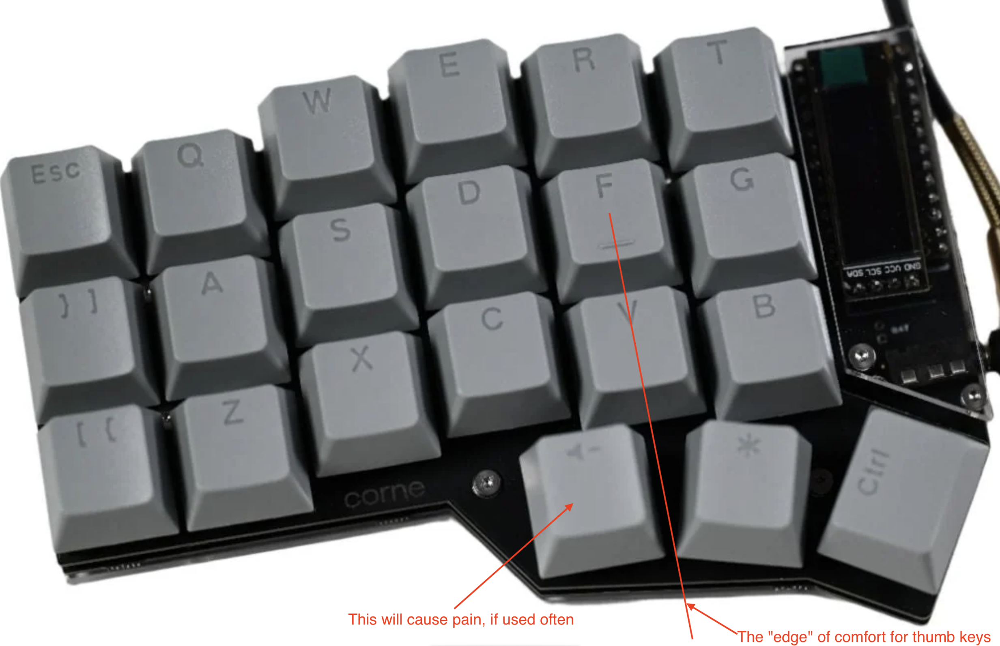

In the layout above it is fine, since volume control is a relatively rare key.

But in my layout, all three thumb keys play a critical role and are used often,
so I need something like Voyager or [[https://blog.splitkb.com/introducing-the-kyria/][Kyria]].

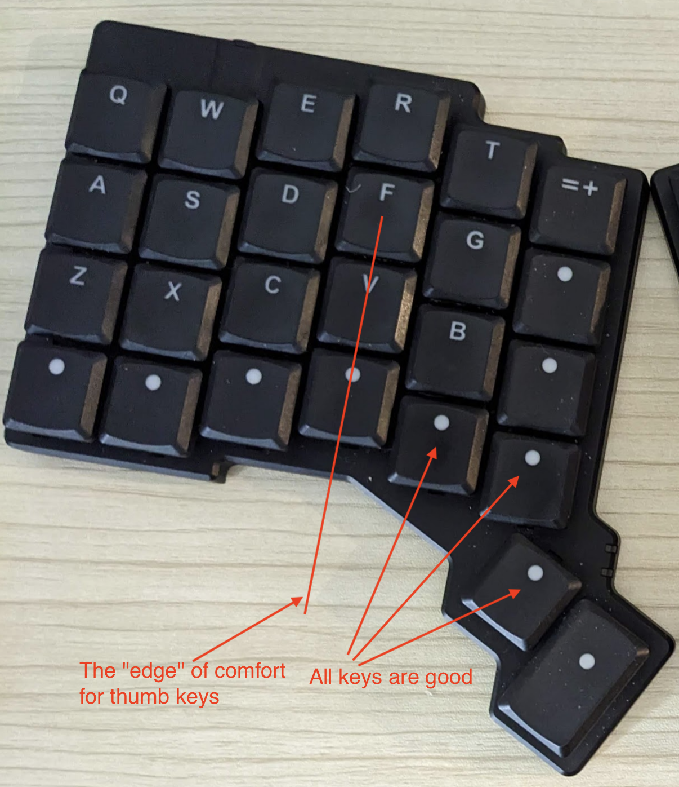

* My Other Layouts
:PROPERTIES:
:CUSTOM_ID: my-layouts
:END:

** Moonlander Mini OSM UP

https://configure.zsa.io/moonlander/layouts/alljO/Zb5wo/0

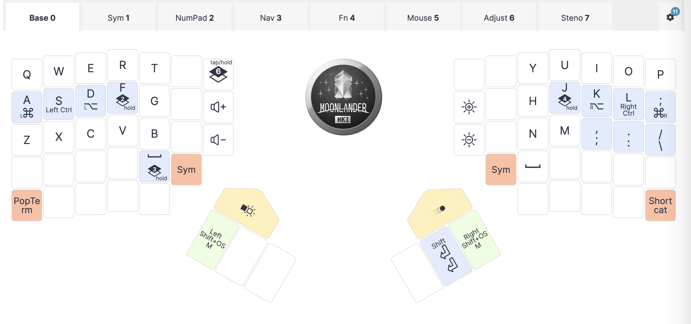

Moving closer to my current layout, keys are shifted to the top and outside.

** Ergodox Mini OSM
https://configure.zsa.io/ergodox-ez/layouts/AnO4e/latest/0

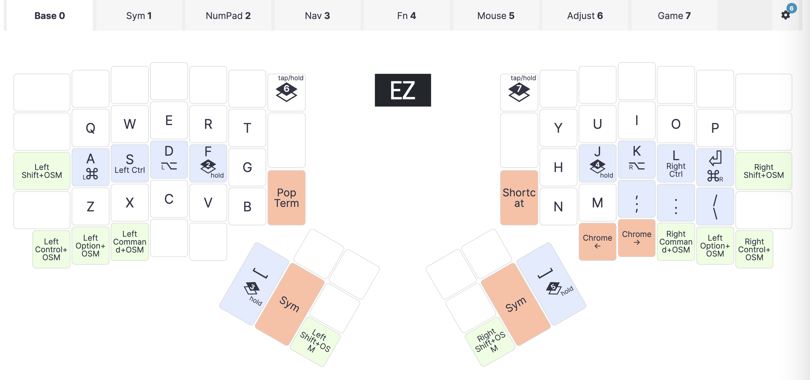

Minimal layout for Ergodox.

** Moonlander Mini 1.0 (OSM / AutoShift)
https://configure.zsa.io/moonlander/layouts/bdJbA/qBgOy/0

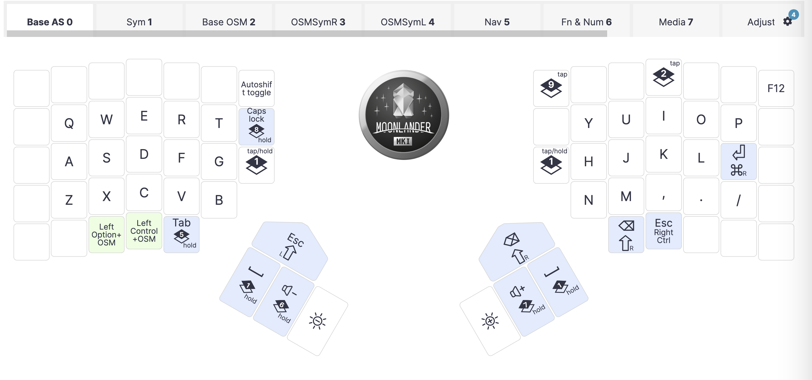

- Can work with or without AutoShift (has OSM shift)
- Layer toggles are OSM, so it is not necessary to hold anything to get to symbols and numbers
- Has OSM Ctrl too
- Esc, Tab, etc are easily reachable via holding the space, on the Nav layer
- Layers are more focused: sym, num, nav, fn, numpad (vs more condensed in AutoShift layout)
- easy on fingers, it is good to use no shift for Sym layer
- osm switch to sym also feels good, so might change that on the autoshift layer
  - initially the decision to have toggles on space was this: thumbs are naturally on spaces while typing, so it is easier to use them to switch to the Sym layer, even if I have to hold down the key
  - I've also had osm switches for some time and then removed them
  - additional mods on the left side of Nav also feel good
  - have doubts about the asymmetric Sym and Num: for example, the " on Sym layer is on V and I have to press two keys nearby (Sym and then V) to get it, although OSM toggle makes this possible without much of a problem
  - home row numbers are nice too

** Moonlander Mini AutoShift
:PROPERTIES:
:CUSTOM_ID: moonlander-mini-autoshift
:END:
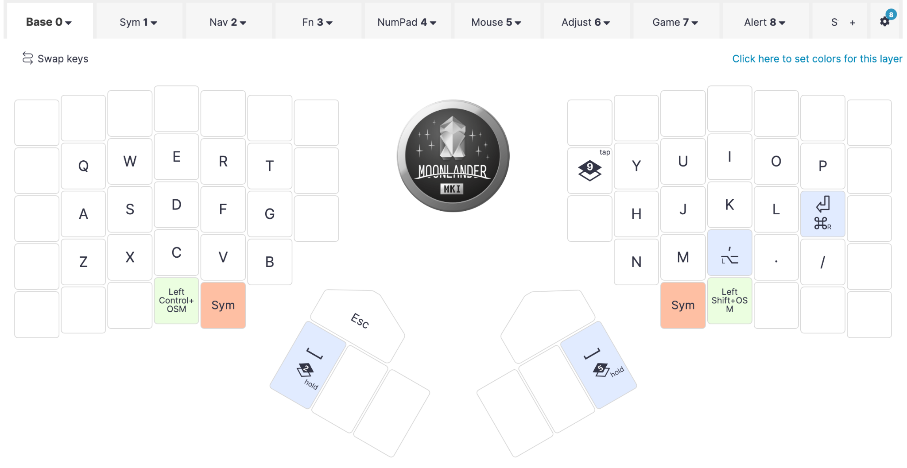

https://configure.zsa.io/moonlander/layouts/MJvlL/6lAZR/0

This is interesting as it does not require a shift modifier.

Notes:
- Very minimal layout
- No home-row mods, auto-shift and OSMs instead
- Symmetric Space and Sym
- Enter in place of ;
  - Both ; and : are on the Sym layer
  - Note: Win+Enter is not reachable
- Alt on `,` (as we do not need auto-shifted version here)
  - Similarly we could have mod-tap on `.`
- The `/` is used with auto-shift (there is no ? on the sym layer)

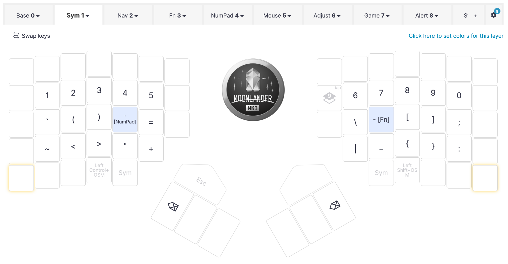

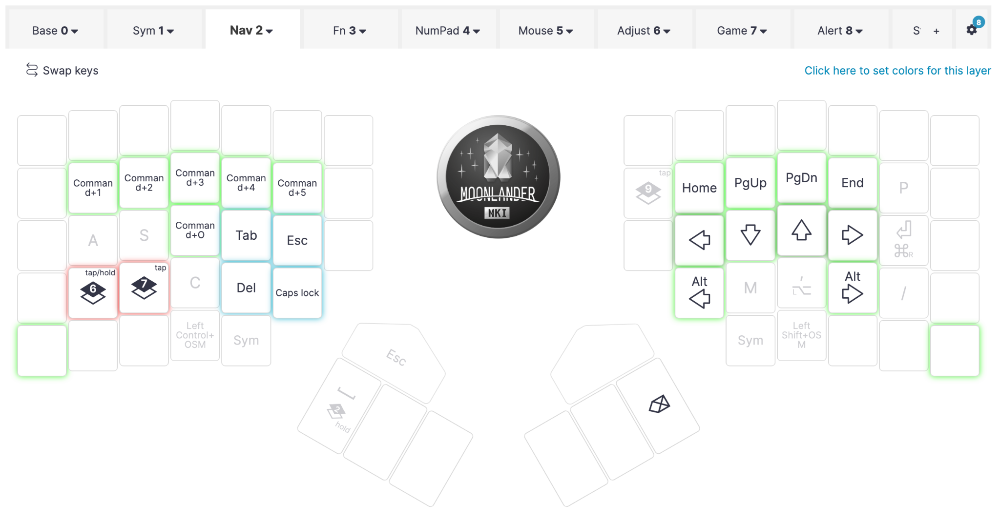

- Other:
  - Default delay for autoshift is 175, for fast typing it can be lowered significantly
  - This layout (florian, qmk dev at ergodox) uses 110:
    - [[https://configure.zsa.io/moonlander/layouts/aWyOG/latest/config/tapping][https://configure.zsa.io/moonlander/layouts/aWyOG/latest/config/tapping]]
    - There is also reduced tapping / holding delay and retrotap
      - retro tap is probably needed to compensate for the small tap delay
      - if you are on a dual-function key and hold it for a bit too long, it will still produce the original key
      - for example, the dual function space
      - this doesn't work after another key though: if I press and hold space on its own, it always produces the space, but if I hold it for a bit after another key, the space is not printed out

- Cons:
  - It requires a small pause each time
  - It requires more aggressive typing (although I can set bigger delay)
  - It doesn't allow dual function keys in the main area

- AutoShift vs OSM
  - AutoShift pros
    - minimalistic layout, intuitive, easy to remember
    - Shift is not needed most of the time
    - Makes you type faster, use shorter taps for regular keypresses
    - Discourages the use of repeated keys, like jjjjjj in vim
    - Shifted version is always convenient to produce, even with one hand (no need to hold or press anything else)
      - This also means it is equally easy to produce shifted versions of keys on another layer (when you also hold the layer modifier)
  - AutoShift cons
    - false positives, requires training (although, increasing the delay also could help)
    - conflicts with dual-function keys, so no modifiers on the home row (unless we don't use autoshift for some keys, which is inconsistent)
    - faster typing doesn't always feel good
    - probably can cause slowdowns when typing fast, as sometimes a key needs to go down for a longer time (on the other hand, what is faster: holding one key for a longer time or typing two keys (OSM shift) or holding one key and tapping another (regular shift))
    - Key repeat doesn't work
  - OSM pros
    - Very easy to use, comparing to the hold shift situation
    - Easy to get used to, comes naturally
    - No conflict with dual function keys
  - OSM cons
    - Requires a dedicated key (and better two, for symmetry)

- I switched to OSM-based layouts, but not sure, maybe go for a bit more with autoshift
  - Possible fixes
    - Add shifted symbols to the sym layer to reduce autoshift usage
    - Split Fn and Num into two layers (or maybe just remove the top numbers row, to have fn on the left and num on the right)
    - Try OSM for sym/nav layer once more
    - Remove cmd from nav layer, add mods there instead

** AutoShift
:PROPERTIES:
:CUSTOM_ID: autoshift
:END:
https://configure.zsa.io/moonlander/layouts/0qL5N/latest/0

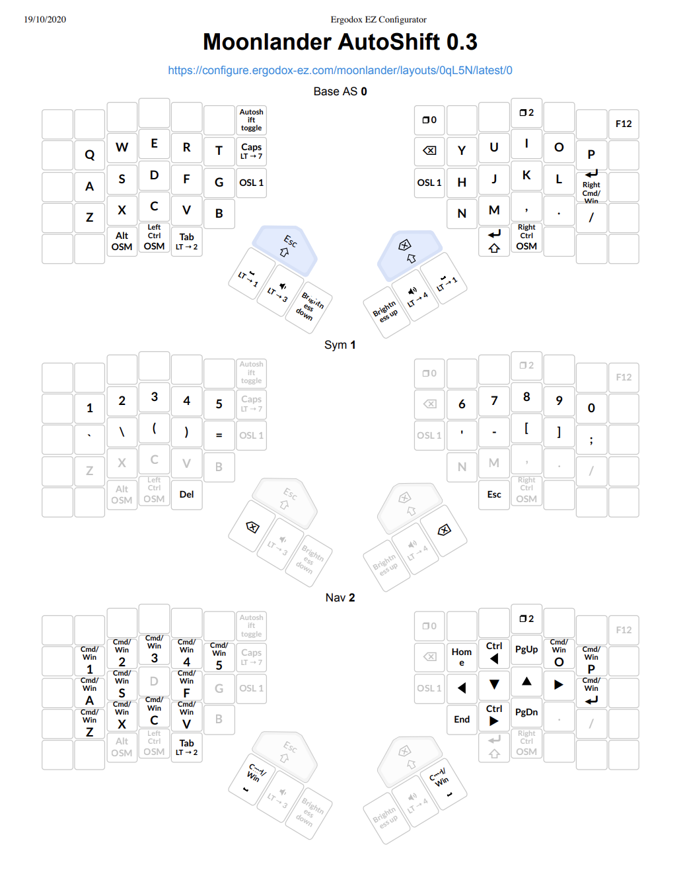

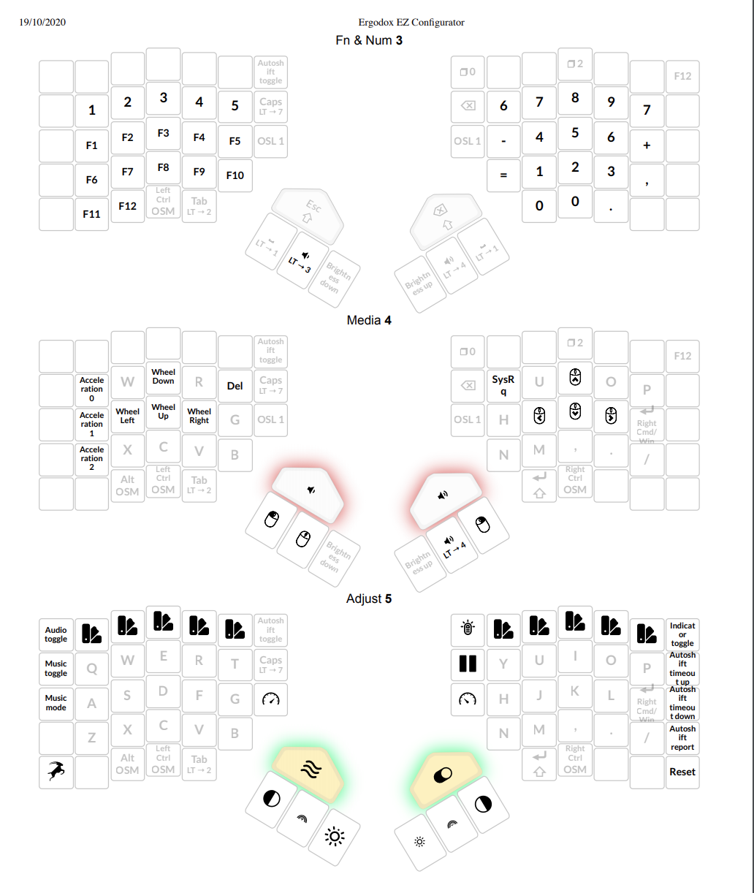

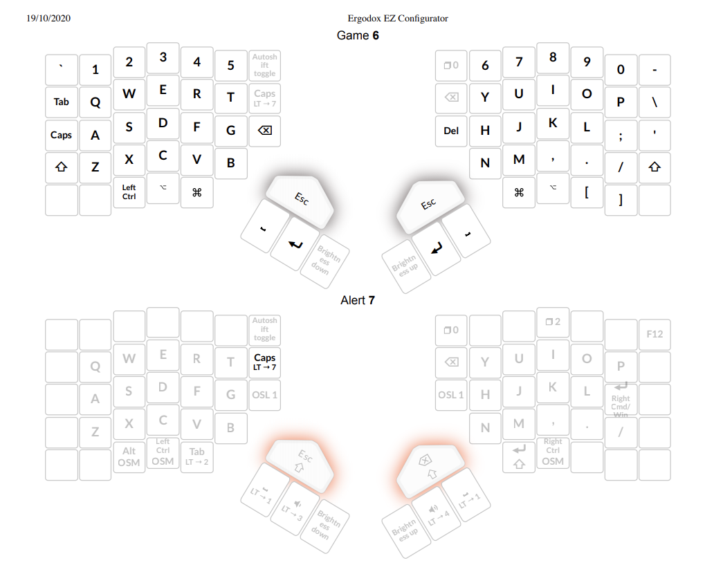

AutoShift lets you keep the layout very simple, with minimal Sym layer.

Typing is somewhat similar to morse code: regular keys are dots and
shifted versions are dashes.

It is easy to remember - base layer is regular qwerty, Sym layer has
numbers at the top, with shift they produce appropriate symbols, like on
any keyboard. There is a small set of additional symbols on the home
row - these again are used with auto shift to produce the rest of
symbols.

Since there is no need to hold shift, there is no situation when you
need to hold a layer toggle plus hold or tap shift. Without autoshift,
such situation creates additional cognitive load, it is also harder to
use it physically.

On the other hand, AutoShift conflicts with dual-function keys. For
example, it is convenient to have ctrl as a dual function key in the
home row (I am using D and K in other layouts for that), but it won't
work with AutoShift, so in this layout there are no dual function keys
on letters.

And another thing about AutoShift is that there is an adjustment period.
In the beginning, your text looks like this: YOuR TExt LOOKS Like This.
Some letters come out as upper case more often than others, it depends
on the typing habits I guess. Probably this is a good thing that
AutoShift teaches you to type more uniformly, with shorter strokes,
rather than having delays on certain keys. In the beginning, I felt
like I had to type much more aggressively and faster to get it working
properly.

The autoshift configuration buttons are also helpful: on the adjustment
layer I have keys to increase and decrease the autoshift timeout and to
print the current timeout value.

I also had some doubts about the efficiency: will it slow the typing
down when making longer key presses for uppercase letters and symbols?
But then I remembered the morse code, I learned how to use it when
studying at university: it is very similar, you have one key there where
the short press is dot and the long press is dash (... --- ...). When
learning it, you start slow and then you can gain good speed at it
without even thinking about the length of the press. This should work
similarly for autoshift, where you can start slower with bigger timeout
and then gradually speed up and decrease the timeout. Again, dedicated
timeout adjustment keys are very helpful when experimenting with this,
as you don't have to flash the firmware each time after changing the
timeout.

I don't use top row, side rows and outer keys in bottom rows as it is
not convenient to reach them. I have never mastered the numbers row on a
regular keyboard. And I don't feel good about smallest fingers being
assigned to all the modifiers in the outer row. So I use thumbs or index
fingers for modifiers and layer toggles.

So the goals I am trying to achieve: move fingers less, load stronger
fingers more.

Another goal is symmetry: when holding a modifier with one hand, the
work is done on the other half of keyboard by the other hand. Cases when
one hand holds a modifier and does something else at the same time
should be rare.

It is OK though to use these positions in top, inner or outer rows for
something that is out of the regular typing flow. For example, I use
Caps to switch languages, so I am OK about moving the hand to tap it. On
the same key I have the adjust layer switch where it is also OK to move
the hand and hold it while pressing something else (usually, this is the
Reset button).

Spacebars are symmetric. It is better to use both hands for spaces: when
you finish typing the word with the left hand, press space with right
thumb, and vice versa.

I haven't finalized the decision about enter - thumb or pinky.

Ctrl and Alt modifiers are OSM (one shot modifiers, can be tapped to
only modify the next key, and can be held as a regular modifier). In
general, OSMs are very convenient to type, but require a dedicated key
(you can not use them as dual function key). OSM shift is not needed
when autoshift is on.

Esc is on the Sym layer, under the right thumb. There is a backup
escape on the red key.

Backspace is on the space: hold one space and press another to produce
the backspace. There is also a backup backspace on the red key.

OSL1 keys are unused (too far and I have sym toggles on spaces).

There are backup shifts on red keys, for example for Shift-tab, where
autoshift doesn't work, or for the case when autoshift is disabled.

There is AutoShift Toggle key. Sometimes it is useful to turn autoshift
off, for example, when entering the password with the input hidden, so
it is hard to control the autoshift related errors.

Nav layer (and the rest of layers) is similar in all layouts. Nav layer
acts as CMD, but with top row on the left acting as CMD plus numbers, I
use these to switch between virtual desktops.

The rest of keys have CMD modifier, so we can do copy/paste and other cmd
operations from here.

Nav layer also has arrows on the right.

PgUp/PgDown are useful for scrolling. Ctrl plus arrows to move by word.

Overview of modifiers / special keys

- Mods
  - *Ctrl*, *Alt*, *Cmd*, - ctrl and cmd are thumb keys (I mostly use
    the Nav layer as Cmd, Ctrls are OSM, so it is easy to use it for
    single combinations, such as ctrl-r in zsh to search history), Alt
    is in the bottom row, in the unreachable for a thumb position, but I
    use it extremely rarely, usually for some specific shortcuts, so it is
    OK to move the hand to press it.
  - *Shift* - this layout uses autoshift, there is a backup shift on
    right thumb and red keys

- Non-mods
  - *Tab* - left thumb key
  - *Enter* - right thumb key
  - *Space* - two thumb keys
  - *Backspace* - hold one space, press another
  - *Esc* - hold left space, press right thumb key
  - *Caps* - inner row on the left
  - *Del* - hold right space, press left thumb key (although this is
    rarely needed, I almost never use it)
  - *Arrow keys*

- 2 keys for switching to other layers: Sym and Nav (these are also
  Mods), less important: other layer toggles

This looks like a lot, but in fact, not all of the special keys are
important (this depends on the software setup and the operating system)
and mods / non-mods can be combined with dual function keys.

For me, important mods are Shift, Ctrl and Cmd, I rarely use Alt.

Important non-mods: Space, Enter, Backspace, Arrow keys.

Less important: Esc (I have jk mapped to esc in vim, although Esc is
still useful sometimes, for example, when editing a file on a remote
server where I don't have my vim config), Caps (I use it for language
switch, so it is not needed during the typing sessions), Del (I almost
never use it, unless it is in some keyboard shortcut).

So I can get away with:

- Space + Sym toggle
  - Backspace on the Sym layer, on Space keys, easily reachable and
    intuitive
- Tab + Nav toggle
  - Arrow keys on the Nav layer.
- Enter + Cmd
- AutoShift (no key needed) or OSM shift
- OSM Ctrl or Ctrl + Backspace or Esc

So, besides Space, I need 4 more places for these special keys. Or even
less when using dual function keys - here I can put Sym layer switch to
F and J and ctrl to D and K (these are the modifiers I use most).

This way, everything fits nicely into a 36-key keyboard, like
[[https://web.archive.org/web/20210126220212/https://boardsource.xyz/store/5f2e7e4a2902de7151494f92][_Microdox_]] (or is it called [[https://github.com/That-Canadian/MiniDox_PCB][_Minidox_]]?).

The rest of layers:

- Fn&Num - I mostly use it for a numpad to enter longer sequences of
  numbers.
  - It also has a full number row at the top, so could be always used
    for numbers, and on the Sym layer we could have shifted version
    (! @ # etc)
  - This trick is useful for other layouts (no autoshift) to create a
    sym layer that can be used without shift, but this also creates
    additional cognitive load: you need to remember to use additional
    layer for numbers
- Media - Mouse controls
- Adjust - keyboard settings, backlight controls, audio and music
  toggles, autoshift settings, reset and oryx buttons
- Game - full standard layout, no modifiers, so it can be used for games
  or other cases when standard layout is needed.
- Alert - unused at the moment, utility layer that is useful when
  experimenting with the layout. When some key is moved to another
  place, the alert layer toggle can be placed to the previous position.
  So when you type there, the whole keyboard will glow in red, hinting
  the error.

** Moonlander OSM Shift
:PROPERTIES:
:CUSTOM_ID: moonlander-osm-shift
:END:
https://configure.zsa.io/moonlander/layouts/ZrKpV/latest/0

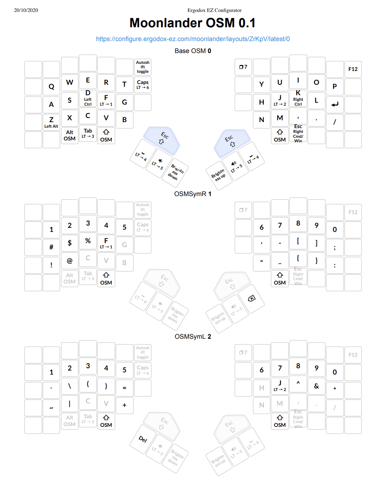

This is an alternative layout that uses OSM Shift instead of the
AutoShift.

It also implements an idea of having a split Sym layer, separate for
left and right hand.

The rest of layers (Nav, Fn&Num, Media, Game, Alert) are exactly the
same as in the AutoShift layout.

The goals here are the same: reduce finger movement and load stronger
fingers more.

A few key points about this layout:

- J and F are toggles to the Sym layer (left and right parts, but
  conceptually this is the single Sym layer, more about it below)
- D and K are dual-function controls
- Spaces are toggles to the Fn&Num layer
- Shifts are OSM, so there is no need to hold them - just tap and tap
  the next key to get the shifted variant
- Enter is on the right pinky, the thumb key is busy with OSM shift, the
  second thumb key is not convenient enough. In general, Enter instead
  of ; works quite well, it is not complex to remember to access ; via
  Sym layer on the same place.

The Sym layer is split into two halves: OSMSymR is active when F on the
left is pressed on the left side. At the same time, on the left side
there are shifted versions of the numbers (! @ #, etc).

And OSMSymL is active when J is pressed and we have extra symbols on the
left and shifted versions of numbers on the right.

What this does is:
- numbers are always available at the top
- shifted versions of numbers can be produced by:
  - holding F or J to get to the Sym layer, tapping OSM shift, tapping the
    number
  - OR holding F or J to get to the Sym layer and tapping the appropriate
    shifted symbol with the same hand

This is because I find it not very convenient to use the layer toggle
AND shift at the same time (although, maybe I didn't use this layout
long enough to get used to it).

For the same reason, Sym layer also has shifted versions of extra
symbols on the bottom row. So it is both easy to remember (same pairs as
with shift on the regular keyboard) and easy to access - no need to use
shift to get any of the symbols.

** Microdox OSM Shift
:PROPERTIES:
:CUSTOM_ID: microdox-osm-shift
:END:
https://configure.zsa.io/moonlander/layouts/0qoY6/latest/0

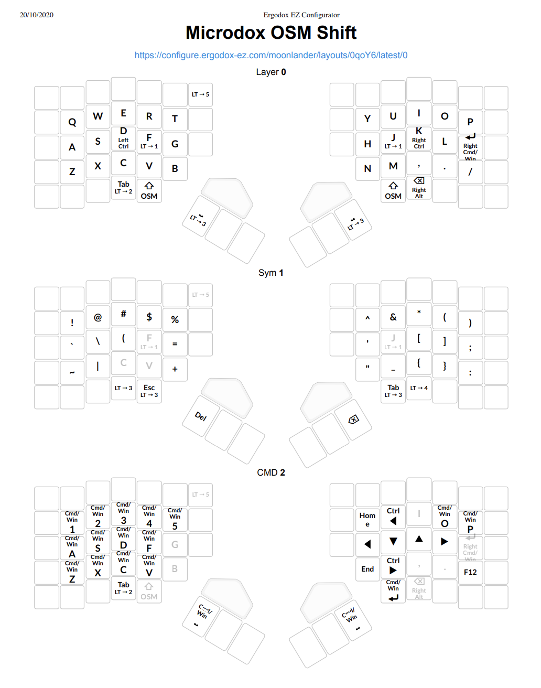

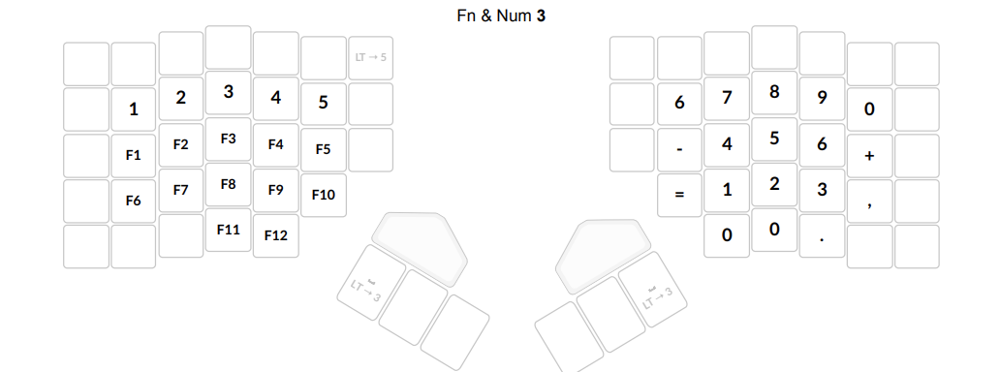

This is very similar to the OSM Shift layout above, but it doesn't use
additional keys, so it could fit to microdox, but also, what is more
important, it implements a different version of the Sym layer - it is a
single layer on this layout.

So both F and J switch to this layout when held.

This Sym layer also doesn't have numbers - the top row has shifted
versions, so it is for symbols only.

Numbers are available on the Fn&Num layer, both at the top row and as a
numpad on the right.

We can get to this layer by holding either of the spacebars.

So in this case, it is necessary to actively use three layers: base, sym
and fn&num. While in AutoShift and the other OSM layout it is mainly two: Base
and Sym to get letters, numbers and all symbols (strictly speaking,
the other OSM layout also has three main layers as there are two Syms, but it
feels like one layer when working with it, so we can count it as two).

This way:
- AutoShift
  - Base layer - letters, Sym - numbers and symbols
- Moonlander OSM Shift
  - Base layer - letters, Split sym layer - numbers and symbols
- Microdox OSM Shift
  - Base layer - letters, Sym - symbols, fn&num - numbers
** Moonlander Planck
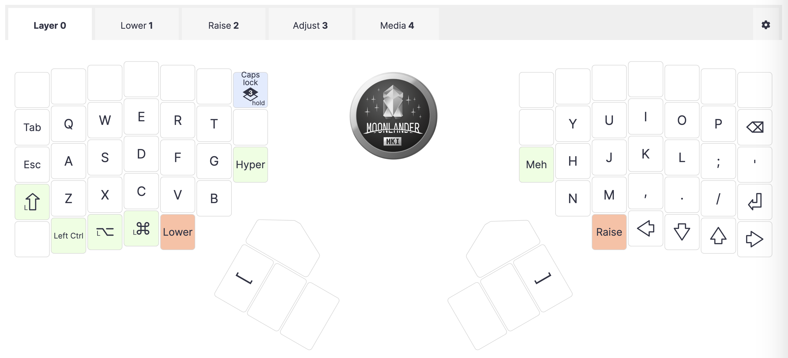

- [[https://configure.zsa.io/moonlander/layouts/L4MMq/latest/0][Moonlander Planck 2.0 = Ergodox EZ Configurator]]
- [[https://configure.zsa.io/planck-ez/layouts/default/latest/0][Planck default - Ergodox EZ Configurator]]
- [[https://configure.zsa.io/planck-ez/layouts/x9JPR/latest/8][MadHat2r Planck = Ergodox EZ Configurator]]
- [[https://configure.zsa.io/moonlander/layouts/7JaNr/latest/0][Classic ML 2.9 - Ergodox EZ Configurator]]
- Tab
  - The left cmd + TAB should work well, but do I need tab there? It is not something I need to access very often. So might get back backspace in there. Try using the tab / shift-tab on the media layer.
    - From a quick test - it works nicely, especially in workflowy where both tab and shift tab are useful. The only issue is that I don't use the media layer too much, so I have to learn to hold a special modifier just for tab.
    - Another solution - put it to the right side to the num layer, although again, I don't use the right num/fn side much and I am more used to having navigation on the right side (hjkl, arrows)
- Symbols - !#% are not very convenient to type, while I have some free space on the right side, maybe move them?
  - Reordered the symbols, I quite like the current layout, where left and right rows are not used.
- Add Copy / Cut / Paste keys?
  - Added copy and paste, let's see how it works and if I also need a Cut shortcut
  - Another useful thing could be Ctrl+A to select all
  - Also Ctrl+z
  - Add "+p macro? or better rebind it in vim?
  - try macro record/play
- one more idea is to have open and close brackets on left and right sides, this would require relearning symbols though
  - [[https://www.keyboard-layout-editor.com/##@@_x:3.5&t=%23000000%0A%0A%0A%0A%0A%0A%23ff0000&fa@:0&:0&:0&:0&:0&:0&:2%3B%3B&=%C2%A7%0A3%0A%0A%C2%B3%0A%0A%0AF3&_x:10.5%3B&=(%0A8%0A%0A%5B%0A%0A%0AF8&_x:4.5&t=%23000000&w:6.5&h:6.75&d:true%3B&=H%20-%20Hold%3Cp%3E%3C%2F%2Fp%3Edt%20-%20doubletap%3Cp%3E%3C%2F%2Fp%3E%3B&@_y:-0.875&x:2.5&t=%23000000%0A%0A%0A%0A%0A%0A%23ff0000%3B&=%22%0A2%0A%0A%C2%B2%0A%0A%0AF2&_x:1%3B&=$%0A4%0A%0A%0A%0A%0AF4&_x:8.5%3B&=%2F%2F%0A7%0A%0A%7B%0A%0A%0AF7&_x:1%3B&=)%0A9%0A%0A%5D%0A%0A%0AF9%3B&@_y:-0.875&x:5.5%3B&=%25%0A5%0A%0A%0A%0A%0AF5&=Esc%0A%0A%0A%0A%0A%0AF11&_x:4.5&t=%23ff0000&a:6&fa@:2%3B%3B&=F12&_t=%23000000%0A%0A%0A%0A%0A%0A%23ff0000&a:4&fa@:0&:0&:0&:0&:0&:0&:2%3B%3B&=%2F&%0A6%0A%0A%0A%0A%0AF6%3B&@_y:-0.875&t=%23000000&w:1.5%3B&=%C2%B0%0A%5E&_t=%23000000%0A%0A%0A%0A%0A%0A%23ff0000%3B&=!%0A1%0A%0A%0A%0A%0AF1&_x:14.5%3B&=%2F=%0A0%0A%0A%7D%0A%0A%0AF10&_f:3&w:1.5%3B&=%3F%0A%C3%9F%0A%0A%5C%0A%0A%0APrint%3B&@_y:-0.625&x:8.25&t=%23000000&a:7&w:3&d:true%3B&=Layer%200%3B&@_y:-0.75&x:3.5&t=%23000000%0A%0A%0A%0A%0A%0A%23ff0000&a:4&f:3%3B&=E%0A%0A%0A%E2%82%AC%0A%0A%0A%7D&_x:10.5&t=%23000000%0A%0A%0A%0A%0A%0A%23ff0000%0A%2327ad23&f:3%3B&=I%0A%0A%0A%0A%0A%0A%7B%0A9%3B&@_y:-0.875&x:2.5&t=%23000000%0A%0A%0A%0A%0A%0A%23ff0000&f:3%3B&=W%0A%0A%0A%0A%0A%0A%5D&_x:1&f:3%3B&=R%0A%0A%0A%0A%0A%0A)&_x:8.5&t=%23000000%0A%0A%0A%0A%0A%0A%23ff0000%0A%2327ad23&f:3%3B&=U%0A%0A%0A%0A%0A%0A(%0A8&_x:1&t=%23000000%0A%0A%0A%0A%0A%0A%23ff0000&f:3%3B&=O%0A%0A%0A%0A%0A%0A%5B%3B&@_y:-0.875&x:5.5&f:3%3B&=T%0A%0A%0A%0A%0A%0A%3E&_t=%2327ad23&a:7&h:1.5%3B&=L2&_x:4.5&h:1.5%3B&=L2&_t=%23000000%0A%0A%0A%0A%0A%0A%23ff0000%0A%2327ad23&a:4&f:3%3B&=Z%0A%0A%0A%0A%0A%0A%3C%0A7%3B&@_y:-0.875&t=%23000000&a:7&w:1.5%3B&=&_t=%23000000%0A%0A%0A%0A%0A%0A%23ff0000&a:4&f:3%3B&=Q%0A%0A%0A%2F@%0A%0A%0A%5C&_x:14.5&f:3%3B&=P%0A%0A%0A%0A%0A%0A%2F%2F&_t=%23000000&w:1.5%3B&=%60%0A%C2%B4%3B&@_y:-0.375&x:3.5&t=%23000000%0A%0A%0A%0A%0A%0A%23ff0000&f:3%3B&=D%0A%0A%0A%0A%0A%0A%7B&_x:10.5&t=%23000000%0A%0A%0A%0A%0A%0A%23ff0000%0A%2327ad23%0A%0A%232baab3&f:3%3B&=K%0A%0A%0A%0A%0A%0A%7D%0A6%0A%0A%3Ci%20class%2F=%27fa%20fa-arrow-up%27%3E%3C%2F%2Fi%3E%3B&@_y:-0.875&x:2.5&t=%23000000%0A%0A%0A%0A%0A%0A%23ff0000&f:3%3B&=S%0A%0A%0A%0A%0A%0A%5B&_x:1&t=%23000000%0A%0A%0A%0A%0A%0A%23ff0000%0A%0A%0A%232baab3&f:3&n:true%3B&=F%0A%0A%0A%0AL3%20(H)%0A%0A(%0A%0A%0AL3&_x:8.5&t=%23000000%0A%0A%0A%0A%0A%0A%23ff0000%0A%2327ad23%0A%0A%232baab3&f:3&n:true%3B&=J%0A%0A%0A%0A%0A%0A)%0A5%0A%0A%3Ci%20class%2F=%27fa%20fa-arrow-down%27%3E%3C%2F%2Fi%3E&_x:1&t=%23000000%0A%0A%0A%0A%0A%0A%23ff0000%0A%0A%0A%232baab3&f:3%3B&=L%0A%0A%0A%0A%0A%0A%5D%0A%0A%0A%3Ci%20class%2F=%27fa%20fa-arrow-right%27%3E%3C%2F%2Fi%3E%3B&@_y:-0.875&x:5.5&t=%23000000%0A%0A%0A%0A%0A%0A%23ff0000&f:3%3B&=G%0A%0A%0A%0A%0A%0A%3C&_x:6.5&t=%23000000%0A%0A%0A%0A%0A%0A%23ff0000%0A%2327ad23%0A%0A%232baab3&f:3%3B&=H%0A%0A%0A%0A%0A%0A%3E%0A4%0A%0A%3Ci%20class%2F=%27fa%20fa-arrow-left%27%3E%3C%2F%2Fi%3E%3B&@_y:-0.875&t=%23000000&a:5&fa@:0&:2&:0&:0&:0&:0&:2%3B&w:1.5%3B&=%0AAlt(H)%0A%0A%0A%0A%0ATab&_t=%23000000%0A%0A%0A%0A%0A%0A%23ff0000&a:4&f:3%3B&=A%0A%0A%0A%0A%0A%0A%2F%2F&_x:14.5&f:3%3B&=%27%0A%23%0A%0A%0A%0A%0A%5C&_t=%23000000&fa@:0&:0&:0&:0&:0&:0&:2&:0&:0&:0&:2%3B&w:1.5%3B&=*%0A+%0A%0A~%0A%0A%0A%0A%0A%0A%0AAltGr(H)%3B&@_y:-0.625&x:6.5&t=%23ff0000&a:7&h:1.5%3B&=L1&_x:4.5&h:1.5%3B&=L1%3B&@_y:-0.75&x:3.5&t=%23000000&a:4%3B&=C&_x:10.5&t=%23000000%0A%0A%0A%0A%0A%0A%0A%2327ad23%3B&=%2F%3B%0A,%0A%0A%0A%0A%0A%0A3%3B&@_y:-0.875&x:2.5&t=%23000000%3B&=X&_x:1%3B&=V&_x:8.5&t=%23000000%0A%0A%0A%0A%0A%0A%0A%2327ad23%3B&=M%0A%0A%0A%0A%0A%0A%0A2&_x:1&t=%23000000%3B&=%2F:%0A.%3B&@_y:-0.875&x:5.5%3B&=B&_x:6.5&t=%23000000%0A%0A%0A%0A%0A%0A%0A%2327ad23%3B&=N%0A%0A%0A%0A%0A%0A%0A1%3B&@_y:-0.875&t=%23000000&a:7&w2:1.5&l:true%3B&=Shift&_x:0.5&a:4%3B&=Y%0A%0A%0A%0AWin(H)&_x:14.5%3B&=%2F_%0A-%0A%0A%0AWin(H)&_a:7&w2:1.5&l:true%3B&=Shift%3B&@_y:-0.375&x:3.5&a:4%3B&=%C3%96&_x:10.5&a:7%3B&=%3Ci%20class%2F=%27fa%20fa-arrow-down%27%3E%3C%2F%2Fi%3E%3B&@_y:-0.875&x:2.5&a:4%3B&=%C3%84&_x:1%3B&=%C3%9C&_x:8.5&a:7%3B&=%3Ci%20class%2F=%27fa%20fa-arrow-left%27%3E%3C%2F%2Fi%3E&_x:1%3B&=%3Ci%20class%2F=%27fa%20fa-arrow-up%27%3E%3C%2F%2Fi%3E%3B&@_y:-0.75&x:0.5%3B&=Ctrl&_a:4%3B&=%3E%0A%0A%0A%0A%0A%0A%0A%0A%0A%3C&_x:14.5&a:7%3B&=%3Ci%20class%2F=%27fa%20fa-arrow-right%27%3E%3C%2F%2Fi%3E&=Ctrl%3B&@_r:30&rx:6.5&ry:4.25&y:-1&x:1%3B&=%2F_%2F_&=%2F_%2F_%3B&@_t=%23000000%0A%23ff0000&a:5&f:3&h:2%3B&=%0AL1%20(H)%0A%0A%0A%0A%0ASpace&_t=%23000000%0A%2327ad23&f:3&h:2%3B&=%0AL2%20(H)%0A%0A%0A%0A%0ARet&_t=%23000000&a:7%3B&=Pos1%3B&@_x:2%3B&=End%3B&@_r:-30&rx:13&y:-1&x:-3%3B&=%2F_%2F_&=%2F_%2F_%3B&@_x:-3%3B&=PgUp&_t=%23000000%0A%2327ad23&a:5&fa@:1%3B&h:2%3B&=Einf%20(dt)%0AL2%20(H)%0A%0A%0A%0A%0AEntf&_t=%23000000%0A%23ff0000&h:2%3B&=%0AL1%20(H)%0A%0A%0A%0A%0ADel%3B&@_x:-3&t=%23000000&a:7&f:3%3B&=PgDn][Keyboard Layout Editor]]
    - here the brackets are on different sides and also duplicated two times - in the home row and above it
- Enter - I haven't decided on Enter position - the thumb cluster or inner keys in the bottom row
  - if I was on Planck, then there is no thumb cluster, so I'd have to go with lower/raised keys as enter (and I am not sure where I'd put backspace)
- also, with current layout, the left part is shifted to the right, where inner column is in use for special keys (tab and backspace), while right side has letters first and special keys on the right
  - this looks strange, but actually good - I feel like the right pinky is better at work than the left one
  - there is also an option (algernon) to have : and - on the inner bottom keys where I now have CMD / enter
- he's also using one shot modifiers, but that is not possible with dual function keys, modifiers should be dedicated keys
  - [[https://asylum.madhouse-project.org/blog/2016/10/15/multi-purpose-keys/][more on this topic Multi-purpose keys, and a case for small keyboards - Asylum]]
    - Most layouts I have seen, most research I have read did not even consider this possibility. Even on a traditional keyboard, with the stock QWERTY layout, one-shot modifiers would still be an improvement. On ergonomic keyboards, even more so.
  - ErgoDox: [[https://asylum.madhouse-project.org/blog/2016/05/26/ergodox-day-34/][Day 34 - Asylum]]
    - Tab in the inner row is quite hard to reach, maybe move it back to the left row for pinky?
    - Media layer - instead of arrows that are on Low&Rai, I can have Home PgDown PgUp End there (although, I rarely use these)
- Just got an ErgoDox and looking for a layout that suites me. What layouts do you guys use? Drop some hex files if possible so I can try some and see how I like them. This is the one I am currently running that I whipped together in configurator : [[https://www.reddit.com/r/ergodox/comments/e5wdpr/just_got_an_ergodox_and_looking_for_a_layout_that/?sort=qa][ergodox]]
  - Some stuff I couldn't communicate in the EZ configurator:
  - The empty key to the right of left Hyper is my custom KC_TASK macro. Pressing it presses Alt and Tab; releasing it releases Tab, and after 500 ms, releases Alt. So you can tap it multiple times in succession to switch to any open app (assuming your OS supports Alt-Tab).
    - this is interesting, although, I don't have much need for alt+tab
    - The empty key to the right of KC_TASK is my leader key, which is used to switch to game-specific layers such as the GS_SCB example I included (for Super Crate Box). I don't actually use this function, because I don't play any games at the moment that need it.
  - The empty keys adjacent to OSL 1 put me in a "Tmux macro" layer, where all keys are the same as on the home layer, but they get prefixed with Ctrl-B. This is used for the terminal app Tmux, where all commands are Ctrl-B <something>.
    - and this is interesting too, tmux'es Ctrl-B is awful
    - In case it's unclear, the function layer has (, [, { all next to each other on the left, and }, ], ) on the right. Very nice for programming.
- lower/raised level
  - I now use the numpad on the right for numbers, alternative is something like in this layout
  - [[https://configure.zsa.io/planck-ez/layouts/x9JPR/latest/2][https://configure.zsa.io/planck-ez/layouts/x9JPR/latest/2]]
  - where numbers are at qwertyuiop and symbols are below
  - numpad is still possible to have on a separate layer
    - trying it out with Moonlander Planck 3.0
      - temporary - lower is changed to classic Planck numbers, raised is "my" style
      - lower is bound to both spaces and my style, as a backup, to thumb enters
- "Moonlander Planck" Motivation: have a unified Moonlander / Ergodox / Planck layout, minimize finger movements, shift more work from pinky to bigger and stronger fingers; try Planck-like experience
  - Modifiers are on the home row (shift, ctrl, media)
  - Caps - I use it as a language switch, [ and ] in the bottom row are for Cyrillic layout (х and ъ), I use brackets from the lower / raised layer on the right
    - TODO: maybe move caps to the bottom right key? (and keep the layer 3 switch where it is, so I can still have reset on the same place). Will it work well? If I also start using enter on the right, won't it be a problem (accidental layout switches)?
  - Space is also a Lower and Raised Planck layers modifier
    - For Planck, the raised and lower layers would be exactly the same
    - Left side is for symbols and right side is numpad
  - Non-Planck features
    - Cmd+win 1,2,3,4,5 keys at the top - I switch between desktops with these, on Planck I would have to use the numpad, maybe later I'll remove these and try using numpad layer on moonlander too
    - additional features on thumb keys (enter, brightness, esc) - just for convenience, I mostly use space, can disable others later
    - caps + lt 3 toggle at the top inner button - I rarely use this, can move elsewhere
    - inner row of keys (not present on Planck) - caps, mentioned above, hyper / meh and backspace
      - I only use backspace quite a lot, would have to train to use the backspace after P on Planck
      - The Adjust layer has some color buttons at the top, but these are rarely used and can be placed elsewhere
      - In the future - remove top keys and use them for media functions (volume, brightness, etc)
      - Experimental - enter on the left and on the right, see if I can use them (there was Esc on the left, but I don't need it since I use jk in vim and there is a backup esc in the thumb cluster [but I would have to use esc on the left or somewhere else on Planck])
** Planck Symmetric
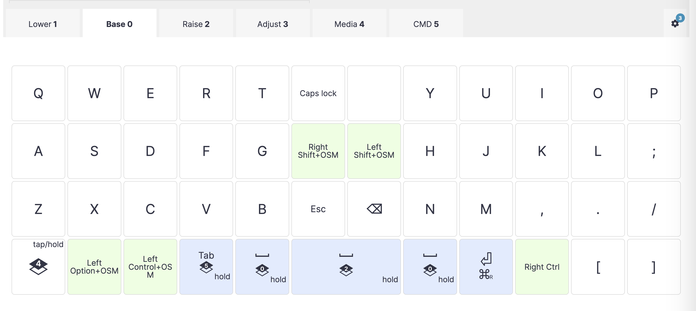

- https://configure.zsa.io/planck-ez/layouts/bdgLp/yGg3r/0
** Ergodox
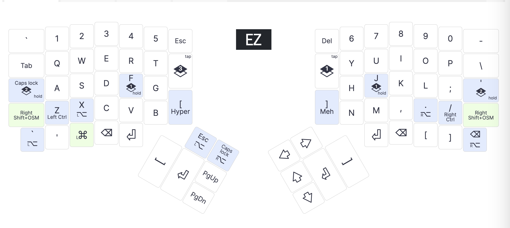

- https://configure.zsa.io/ergodox-ez/layouts/0WVA3/l9gKb/0
- Classic 4.15
  - Shift didn't work well - if other key is pressed first, it didn't catch up (for example, Shift + ; didn't produce : reliably)
  - Played for a bit with advanced settings (Ignore mod tap, Permissive hold) - didn't help
  - Disabled dual function shift (space cadet shift) - now it works well
  - https://configure.zsa.io/ergodox-ez/layouts/0WVA3/BOaPD/0
- Classic 4.12
  - Added dual function Alt (X and .)
- previous editions
  - Classic 4.11
    - Disabled auto shift (conflicts with dual function Ctrl)
  - Classic 4.10
    - Lay1: Hyper/Meh as [ and ], space cadet shift (as parens when tapped). Lay2: macro keys. Auto shift on.
      - Hyper / Meh - tap to enter [ and ], hold for Hyper / Meh (I don't actually use them though)
      - Auto shift - hold the key to enter shift
      - Space Shift Cadet
        - When held, acts as Shift; when tapped, sends "(" (opening parentheses). Great for your left shift key.
        - Dual function Caps Lock (hold to enable Layer 2, before it was just enabling layer two, caps was on the small block of keys on the left side)
        - Note: auto shift doesn't work for A and Z which are dual function keys, tried to enable "retro tapping" mode (see https://configure.zsa.io/ergodox-ez/layouts/0WVA3/latest/config/tapping), but it doesn't help - holding a / z produces lower-case letters
        - https://configure.zsa.io/ergodox-ez/layouts/0WVA3/latest/0
  - [[https://configure.zsa.io/keyboard_layouts/qjdnmw/edit][Classic 4.7]]
  - [[https://configure.zsa.io/keyboard_layouts/kpvjlo/edit][Classic 4.5]]
  - [[https://configure.zsa.io/keyboard_layouts/kzjnmr/edit][Classic 4.4]]
    - added layer 3 - keyboard without special features on A / ; - for gaming
  - [[https://configure.zsa.io/keyboard_layouts/koejly/edit][Classic 4.2]]
    - removed J-Alt
  - [[https://configure.zsa.io/keyboard_layouts/qraavv/edit][Classic 4.1]]
  - [[https://configure.zsa.io/keyboard_layouts/qdalrk/edit][Classic 4.0]]
    - https://configure.zsa.io/keyboard_layouts/kooopk/edit
    - https://configure.zsa.io/keyboard_layouts/qndvbq/edit
  - https://configure.zsa.io/keyboard_layouts/kbxjrk/edit
    - lt->1 and lt->3 enable the layer permanently (don't switch off when released), lt->2 works, lt->1 works on the bottom left key and bottom right key, but doesn't work on A / ;
    - https://configure.zsa.io/keyboard_layouts/kwwvlk/edit
  - [[https://configure.zsa.io/keyboard_layouts/qnddpq/edit][Classic 3.11]]
* Related:
- [[file:keyboard-my-layout.org][My Keyboard Layouts]]
- [[file:keyboard-layouts.org][Keyboard Layouts (Links, Articles)]]
- [[file:keyboard-layouts-examples.org][Keyboard Layouts (Examples)]]
- [[file:keyboard-links.org][Keyboards Links]]
- [[file:2020-01-21-touch-typing.org][Touch Typing Tutors and Games]]
- [[file:diy-links.org][DIY Links]]
